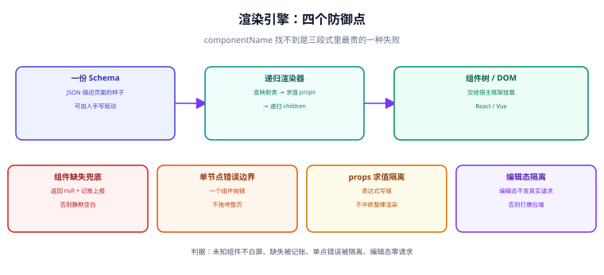

# 渲染引擎：从 Schema 到视图

**渲染引擎是低代码平台里唯一「每次打开页面都在跑」的部分。** 它把一份 JSON 递归地变成一棵组件树，再交给 Vue / React 去挂载。这一层写得好，平台才有资格谈性能与稳定性；写得糙，后面每一层都要替它还债。



## 一句话定位

**渲染引擎的核心只有一件事：把 `componentName` 翻译成组件，把 `children` 递归下去，其余全是这件事的防御性补充。** 一个最简渲染器不到 50 行，但一个**能在生产用**的渲染器要处理四类问题：组件找不到、渲染抛错、编辑态与运行态不一致、大 Schema 的性能。

## 解释渲染 vs 编译渲染

这是渲染层第一个要做的架构决定，两者后续的代价完全不同：

| 维度 | 解释渲染（运行时解释 Schema） | 编译渲染（Schema → 代码） |
| --- | --- | --- |
| 页面来源 | 运行时拉 Schema，当场渲染 | 构建期把 Schema 编译成组件代码 |
| 改配置生效 | **立即生效**（刷新即见） | 需要重新构建 / 发布 |
| 运行时开销 | 每页多一次遍历与映射 | 无（就是普通代码） |
| 包体积 | 需带渲染器与全部物料运行时 | 只带用到的部分（可摇树） |
| 可调试性 | 断点在渲染器里，看不到「页面的代码」 | 产物是普通组件，可读可改 |
| 可回滚 | 改 Schema 即回滚 | 需要回滚构建产物 |

**务实的做法是两者都留**：日常编辑与内部页面走解释渲染（快），面向客户的、性能敏感的页面走编译渲染（稳）。这也是「[交付与运行时](../Runtime/index.md)」里出码方案存在的原因——**出码不是低代码的背叛，而是低代码的交付形态之一**。

## 递归渲染器：核心与四个防御点

```jsx [renderer/NodeRenderer.jsx]
import React, { createElement } from "react";
import { componentRegistry } from "./registry";
import { resolveProps } from "./props";
import { ErrorBoundary } from "./ErrorBoundary";

function NodeRenderer({ node, ctx }) {
  if (!node) return null;

  const Comp = componentRegistry.get(node.componentName);

  // 防御一：组件不存在。渲染占位而不是抛错，否则一个错组件会让整页白屏
  if (!Comp) {
    return ctx.mode === "edit"
      ? <UnknownNode name={node.componentName} nodeId={node.id} />
      : null;                       // 运行态静默跳过，但必须记账（见下）
  }

  const props = {
    ...resolveProps(node.props, ctx),        // 表达式求值、数据绑定
    style: toCss(node.style),                // 受控 style 转内联样式
    key: node.id,
    "data-node-id": node.id,                 // 编辑态选中靠它，运行态可保留（无害）
  };

  const children = (node.children || []).map((c) => (
    <NodeRenderer key={c.id} node={c} ctx={ctx} />
  ));

  // 防御二：组件抛错不能拖垮整页 —— 错误边界只包住这个节点
  return (
    <ErrorBoundary nodeId={node.id} fallback={ctx.editFallback}>
      {createElement(Comp, props, children)}
    </ErrorBoundary>
  );
}

export const Renderer = ({ schema, ctx }) => (
  <NodeRenderer node={schema.root} ctx={ctx} />
);
```

四个防御点，缺哪个都会在生产上出事：

| 防御点 | 防的是什么 | 不做会怎样 |
| --- | --- | --- |
| **组件缺失兜底** | 物料被删 / 名字拼错 / 版本不匹配 | 整块空白且**控制台干净**，最难查 |
| **单节点错误边界** | 某个组件内部抛错 | 整页白屏，一个坏组件拖垮所有人 |
| **`props` 求值隔离** | 表达式写错 | 未捕获异常导致渲染中断 |
| **`ctx.mode` 区分** | 编辑态与运行态需求不同 | 编辑器里看到的与生产不一致 |

::: danger 「组件找不到」是三段式里最贵的一种失败
它的症状是**页面局部空白、构建绿、控制台无报错**（React 会直接跳过返回 `null` 的分支；Vue 会渲染成注释节点）。所以**必须显式记账**：渲染器维护一个 `missingComponents` 集合，渲染结束后上报（编辑态红框提示、运行态打点告警）。

```js
// 不要这样：静默返回 null，问题被吞掉
if (!Comp) return null;

// 要这样：返回 null 的同时记账
if (!Comp) { ctx.report?.({ type: "MISSING_COMPONENT", name: node.componentName, nodeId: node.id }); return null; }
```
:::

## 组件映射表：注册而非硬编码

渲染器**不应该认识任何具体组件**——`if (name === "Button")` 这类分支一旦出现，就说明分层塌了。正确做法是一张注册表：

```js
// renderer/registry.js
const registry = new Map();

export const componentRegistry = {
  register(materials) {
    for (const m of materials) {
      if (!m.componentName) throw new Error("物料缺少 componentName");
      if (registry.has(m.componentName)) {
        throw new Error(`物料重复注册：${m.componentName}`);   // 重复必须报错，不能覆盖
      }
      registry.set(m.componentName, m.impl);
    }
  },
  get(name) { return registry.get(name); },
  has(name) { return registry.has(name); },
  names() { return [...registry.keys()]; },
};
```

三条纪律：

1. **重复注册必须抛错，不能静默覆盖。** 覆盖会让「到底用的是哪一份物料」变得不可知，多团队并行开发物料时必踩。
2. **注册表要能枚举。** 编辑器左侧组件面板、协议校验（`componentName` 是否已知）、出码时的 import 收集，三处都要枚举它——这是「单一事实来源」。
3. **注册发生在启动时、一次性完成，不在渲染过程中。** 渲染过程中改注册表会导致同一次渲染的结果不确定。

## 容器组件与插槽

`children` 递归对「容器」成立，对「有具名插槽的组件」不成立。这块要提前设计，否则后期会出现「表格的行渲染不出来」这类问题。

| 形态 | Schema 表达 | 渲染方式 |
| --- | --- | --- |
| **普通容器** | `children: []` | 顺序递归，作为 `children` 传入 |
| **具名插槽** | `slots: { header: {…}, footer: {…} }` | 按名取值，渲染成 `props.header` 之类的具名节点 |
| **数据驱动内容** | `props.columns` / `props.options` | **不进节点树**，作为普通属性透传（它们不是节点） |

::: tip 判断「该不该进节点树」的一句话标准
**能被单独选中、单独拖动的，才进节点树。** 表格的列、下拉的选项、图表的系列，都不能被用户在画布上选中，它们就是**属性**而不是节点。把它们做成节点会让 Schema 体积暴涨、编辑器逻辑变得极复杂。
:::

具名插槽的最小写法：

```json
{
  "id": "node_table",
  "componentName": "Table",
  "props": { "dataSource": "userList.data" },
  "slots": {
    "empty": {
      "id": "node_empty",
      "componentName": "Empty",
      "props": { "text": "暂无数据" },
      "children": []
    }
  },
  "children": []
}
```

## 编辑态与运行态的渲染差异

同一个渲染器要服务两种模式，差异必须**收敛到少数几个开关**，而不是两套代码：

| 关注点 | 运行态 | 编辑态 | 建议做法 |
| --- | --- | --- | --- |
| 数据获取 | 真实发起请求 | **不应发请求**（否则编辑器每秒打爆后端） | `ctx.mode === "edit"` 时用 mock 或空数据 |
| 交互事件 | 真实执行动作 | 不执行（点击是选中） | 事件层拦截，不把 `onClick` 挂上去 |
| 组件缺失 | 跳过 + 告警 | **红框 + 提示名** | 渲染占位组件 |
| 错误边界 | 降级展示 | 显示错误详情 | `fallback` 由 `ctx` 决定 |
| 选中框 / hover | 无 | 有 | 由外层包裹层实现，**不写进 Schema** |

::: danger 编辑器里发真实请求是高频事故
一个「数据源自动加载」的表单页，在编辑器里被拖 20 个组件、每次改动都重渲染，就会向后端发几十次请求——**轻则接口被打挂，重则产生脏数据**（如果数据源里配了写操作）。**编辑态必须默认关闭数据源自动加载**，改为「手动点一下预览」。
:::

## 性能：大 Schema 怎么不卡

Schema 一大会出现三类性能问题，成因与解法都不同：

| 现象 | 成因 | 解法 |
| --- | --- | --- |
| 首次渲染慢 | 节点多（几百上千个），一次挂载 | 虚拟滚动 + 视口外懒渲染；或用编译渲染 |
| 改一个属性全页重渲 | 整棵树共用一个 state，任何改动都触发根节点重渲 | 把节点状态**按 id 规范化**存储，配合 `memo` / `shallowRef` 只让受影响子树更新 |
| 编辑器越来越卡 | 每次操作都深拷贝整棵 Schema | 用不可变结构 + 结构共享，或只 diff 变化节点 |

「改一个属性全页重渲」是最常见的坑，根因通常出在状态组织方式：

```js
// ❌ 反例：整棵树的引用随任一改动而变 → 所有子树重渲
const [schema, setSchema] = useState(pageSchema);
setSchema({ ...schema, root: newRoot });

// ✅ 正例：把「节点内容」与「节点树的顺序」分开存，改动只影响引用它的节点
const store = {
  nodesById: { node_1: {...}, node_2: {...} },   // 内容，按 id 索引
  rootId: "node_root",
  childrenById: { node_1: ["node_2", "node_3"] },// 结构，按 id 索引
};
// 改 node_2 的 props：只有 nodesById[node_2] 变，其他节点引用不变 → memo 生效
```

## 验证方式：渲染器的四条判据

```shell
# ① 未知组件不白屏：构造一份含未知组件的 Schema，渲染后应仍有其他内容
node -e "const {render}=require('./renderer');const s={root:{id:'r',componentName:'Page',props:{},children:[{id:'a',componentName:'_NOPE_',props:{},children:[]},{id:'b',componentName:'Text',props:{text:'ok'},children:[]}]}};const h=render(s);console.log(h.includes('ok')?'PASS 未知组件不影响其余':'FAIL 白屏')"

# ② 组件缺失被记账
node -e "const {render,store}=require('./renderer');render({root:{id:'r',componentName:'_NOPE_',props:{},children:[]}});console.log(store.missing.size?'PASS 已记账 '+[...store.missing]:'FAIL 未记账')"

# ③ 单节点抛错不拖垮整页（用一个会抛错的测试物料）
node -e "const {render}=require('./renderer');const h=render(require('./fixtures/throw-node.json'));console.log(h.includes('正常内容')?'PASS 错误被隔离':'FAIL 整页崩')"

# ④ 编辑态不发请求
node -e "const {render}=require('./renderer');let hits=0;global.fetch=()=>{hits++;return Promise.resolve({json:()=>({})})};render(require('./fixtures/with-datasource.json'),{mode:'edit'});console.log(hits===0?'PASS 编辑态无请求':'FAIL 编辑态发了 '+hits+' 次请求')"
```

预期：四条全 PASS。**第 ④ 条是最容易被忽略的一条**——它保护的不是渲染器，而是你的后端。

## 参考资料

- [React：Error Boundaries](https://react.dev/reference/react/Component#catching-rendering-errors-with-an-error-boundary)
- [Vue：渲染函数与 `h()`](https://cn.vuejs.org/guide/extras/render-function.html)
- [Alibaba LowCodeEngine：渲染模块（react-renderer）](https://github.com/alibaba/lowcode-engine/tree/main/packages/react-renderer)
- [Amis：渲染器原理](https://aisuda.bce.baidu.com/amis/zh-CN/docs/start/getting-started)
- [GrapesJS：编辑器与渲染的分离设计](https://grapesjs.com/docs/)
