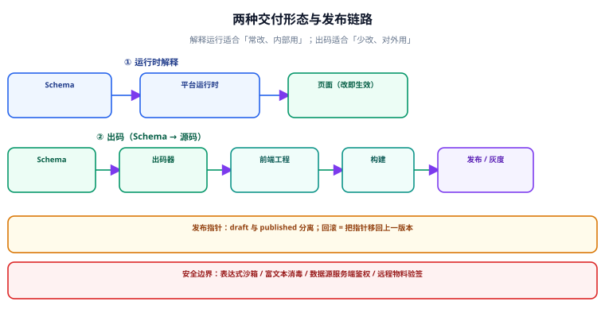

# 交付与运行时：出码、版本与安全

**低代码平台的价值在「谁能改」，交付方式决定「改完之后怎么上线」。** 一个只能「改完立即对公网生效」的平台，在真实业务里几乎不可用——没有版本、没有灰度、没有回滚，一次误操作就是一次事故。本页讲三件事：出码 vs 运行时解释、Schema 的版本与发布、以及安全边界。



## 一句话定位

**交付形态决定了平台的天花板：解释运行适合「常改、内部用」，出码适合「少改、对外用」。** 两者不是先进与落后的关系，而是**两个不同的成本结构**——选错的代价是长在运维和发布流程上。

## 解释运行 vs 出码

| 维度 | 运行时解释 | 出码（Schema → 源码） |
| --- | --- | --- |
| 产物 | 一份 Schema + 平台运行时 | 一个独立的前端工程 |
| 改配置生效 | 保存即生效（刷新可见） | 需要重新构建与发布 |
| 包体积 | 含渲染器 + 全部物料 | 只含用到的组件，可摇树 |
| 可读性 | 看不到「页面的代码」 | 产物是普通代码，可读可改 |
| 可回滚 | 回滚 Schema 记录 | 回滚构建产物 + 发布系统 |
| 脱离平台 | **不能**（强绑定运行时） | **能**（产物可独立维护） |
| 适合 | 内部后台、字段常改 | 对外页面、性能敏感、有合规要求 |

::: tip 一个务实的组合策略
**同一套协议，两条交付链路**：内部管理页走解释运行（改即生效，效率优先），对外页面走「出码 + 常规发布流程」（稳定优先）。前提是**协议足够干净**——如果协议里塞满了只有平台运行时才认识的东西，出码链路根本写不出来。

这也是判断协议质量的试金石：**「能不能从这份 Schema 出一份不依赖平台的代码」**。能，说明协议是描述性的；不能，说明协议里混了运行时语义。
:::

出码的最小实现思路（不要手写字符串拼接，要基于 AST）：

```ts [codegen/index.ts]
import { parse } from "@babel/parser";
import generate from "@babel/generator";
import * as t from "@babel/types";

export function schemaToComponent(schema) {
  // 1) 递归把节点转成 JSX 元素
  const buildNode = (n) => {
    const props = Object.entries(n.props || {}).map(([k, v]) =>
      t.jsxAttribute(t.jsxIdentifier(k), t.stringLiteral(String(v)))
    );
    if (n.style) props.push(t.jsxAttribute(t.jsxIdentifier("style"), t.jsxExpressionContainer(toObjectExpr(n.style))));
    const children = (n.children || []).map(buildNode);
    return t.jsxElement(
      t.jsxOpeningElement(t.jsxIdentifier(n.componentName), props, children.length === 0),
      children.length ? t.jsxClosingElement(t.jsxIdentifier(n.componentName)) : null,
      children
    );
  };

  // 2) 生成函数组件
  const ast = t.program([
    t.functionDeclaration(t.identifier("Page"), [], t.blockStatement([t.returnStatement(buildNode(schema.root))])),
  ]);
  return generate(ast).code;
}
```

::: danger 出码最容易出的两类错
1. **字符串拼接出码**（`"<" + name + " />"`）：一旦 props 里有引号、换行、中文，产物就语法错误。**必须走 AST**（Babel / `@vue/compiler-core`），让工具负责转义。
2. **出码产物与原渲染结果不一致**：解释器有一套 props 处理（表达式求值、默认值合并、样式转换），出码却只搬了字面量。**判据是「同源对照」**：同一份 Schema，分别用解释器渲染与出码构建，DOM 结构、可见文本、关键样式必须一致（见下方验证）。
:::

## Schema 的存储与版本

Schema 是**核心数据**，它的存储设计要能回答四个问题：

| 问题 | 做法 | 不做的后果 |
| --- | --- | --- |
| 历史版本要不要留？ | 每次保存**追加**一条版本记录，不覆盖 | 误操作无法回滚 |
| 线上用的是哪一版？ | 用「发布记录」指向某个版本 | 「谁把线上改了」说不清 |
| 草稿与线上是否分离？ | 分离：`draft` 与 `published` 两张指针 | 编辑到一半就影响线上 |
| 灰度怎么做？ | 按页面 + 用户维度挂「版本映射」 | 只能全量切换 |

```sql [page_schema.sql]
CREATE TABLE page_schema (
  id           BIGINT       NOT NULL AUTO_INCREMENT,
  page_key     VARCHAR(128) NOT NULL,
  version      INT          NOT NULL,
  schema_json  JSON         NOT NULL,
  engine_ver   VARCHAR(32)  NOT NULL,
  created_by   VARCHAR(64)  NOT NULL,
  created_at   DATETIME     NOT NULL DEFAULT CURRENT_TIMESTAMP,
  PRIMARY KEY (id),
  UNIQUE KEY uk_page_version (page_key, version)
);

CREATE TABLE page_release (
  page_key     VARCHAR(128) NOT NULL,
  env          VARCHAR(16)  NOT NULL,   -- dev / staging / prod
  version      INT          NOT NULL,   -- 指向 page_schema.version
  released_by  VARCHAR(64)  NOT NULL,
  released_at  DATETIME     NOT NULL DEFAULT CURRENT_TIMESTAMP,
  PRIMARY KEY (page_key, env)
);
```

::: warning 别用「覆盖式保存」
「保存即 `UPDATE page_schema SET schema_json = ?`」是很多平台的起点，它在第一次误操作后会变成事故：**用户删掉一个区块并保存，线上立刻没了，谁也说不清原来长什么样**。

正确做法是**追加版本 + 发布指针**：保存产生新版本（草稿指针移动），发布移动 `page_release` 指针。回滚 = 把指针移回旧版本，一次 SQL 完成。
:::

## 灰度与回滚

灰度不是「低代码平台的高级功能」，而是**任何面向生产的配置系统的必需品**。最小可用的灰度方案：

| 维度 | 做法 | 判据 |
| --- | --- | --- |
| **按环境** | dev / staging / prod 三套发布指针 | 改完先在 staging 打开，与 prod 对比 |
| **按用户比例** | 用稳定的 hash（用户 id / 设备 id）对 100 取模 | 同一用户多次访问命中同一版本（不能刷新就变） |
| **按白名单** | 内测用户列表直接指定版本 | 上线前内部先跑一遍 |
| **一键回滚** | 把发布指针移回上一版本 | 回滚后刷新页面即恢复，**无需重新构建** |

::: tip 灰度必须用「稳定哈希」而不是随机数
用随机数做灰度，同一个用户刷新一下就可能从新版本变回旧版本，会看到「页面突然变了」。**用用户维度的稳定哈希**（如 `hash(userId) % 100 < 10`），才能保证体验一致。
:::

## 性能：大 Schema 的两处瓶颈

| 瓶颈 | 现象 | 解法 |
| --- | --- | --- |
| **传输体积** | 一份复杂大屏 Schema 有几百 KB | 去重（复用节点定义）、压缩、按需分片加载 |
| **解释开销** | 首屏要等 Schema 拉完 + 递归渲染 | 关键路径预置骨架屏；大页面拆分为多个子页面 |

::: danger 不要用「把 Schema 存到 localStorage 加速」来绕
这会导致**版本不一致**：用户本地缓存的是旧 Schema，服务端已经发布新版本，用户看到的是旧页面且刷新也不变（因为本地缓存优先）。**缓存可以有，但必须带版本号并与服务端版本校验。**
:::

## 安全边界

低代码平台天然是一个「**让非研发人员往里写内容**」的系统，它的攻击面比普通前端大得多：

| 风险 | 场景 | 防护 |
| --- | --- | --- |
| **表达式注入** | 用户写 <span v-pre>`"{{ __proto__ }}"`</span> 之类的表达式逃逸沙箱 | 受限 AST 解释器 + 方法白名单（见 [数据源与联动](../DataBinding/index.md)） |
| **XSS（富文本）** | 富文本物料直接 `innerHTML` | 一律走白名单消毒（DOMPurify 形态） |
| **数据越权** | 数据源 URL 由用户配置，可指向任意接口 | 服务端**白名单接口 + 权限校验**，绝不信任前端配置 |
| **供应链** | 远程物料包被替换 | 验签 + 来源白名单 + 版本锁定 |
| **审计缺失** | 「谁把线上的告警开关关了」查不到 | 每次发布与关键配置变更写审计日志 |

::: danger 数据源的安全必须在服务端做
前端确实可以做「URL 白名单」，但那只防君子。**真正的边界是：数据源只能调用后端授权的接口，而授权判断在服务端完成。** 一个常见的高危设计是「低代码配置里直接写 SQL / 数据库连接」——那等于把数据库交给页面配置者。

**判据：把前端配置里的 URL 换成任意恶意地址，服务端应当拒绝而不是执行。**
:::

## 验证方式：交付链路的五条判据

```shell
# ① 出码产物不依赖平台运行时
pnpm --dir out build && grep -rn "@lowcode\|platform-runtime" out/dist/*.js && echo "FAIL 产物依赖平台运行时" || echo "PASS 产物独立"

# ② 产物可单独运行
(cd out && npx serve -p 4173 dist >/dev/null 2>&1 &) && sleep 2 && curl -sI http://localhost:4173/ | head -1

# ③ 同源对照：解释渲染与出码产物的可见文本一致
node -e "
const {render}=require('./renderer'); const a=render(require('./fixtures/page.json')).replace(/<[^>]+>/g,'');
const b=require('fs').readFileSync('out/expected-text.txt','utf8');
console.log(a.trim()===b.trim() ? 'PASS 同源一致' : 'FAIL 产物与解释渲染不一致');
"

# ④ 回滚：把发布指针移回上一版，读取到的 Schema 版本随之变化
node -e "
const {release,getPublishedVersion}=require('./release');
const v=getPublishedVersion('page_home','prod'); release('page_home','prod',v-1);
console.log(getPublishedVersion('page_home','prod')===v-1 ? 'PASS 回滚生效' : 'FAIL 回滚无效');
"

# ⑤ 灰度稳定：同一用户多次求值命中同一版本
node -e "
const {pickVersion}=require('./release');
const r=Array.from({length:20},()=>pickVersion('page_home','user_42'));
console.log(new Set(r).size===1 ? 'PASS 灰度稳定' : 'FAIL 灰度抖动');
"
```

预期：五条全 `PASS`。**第 ① 条是判断「能不能脱离平台」的硬判据**——只要产物引用了平台运行时，就说明出码只是「换了个壳的解释运行」。

## 与「富文本编辑器工程」专题的分工（第 154 天补充）

本页讲**画布运行时**：协议怎么描述页面、物料怎么注册、组件树怎么渲染。而"一段连续文本的行内编辑"（加粗、粘贴、输入法、撤销）归[富文本编辑器工程](../../RichTextEditor/index.md)。

| 维度 | 本页（低代码运行时） | 富文本专题 |
| --- | --- | --- |
| 编辑对象 | 组件树（块级、可拖拽） | 行内文本与标记 |
| 位置模型 | 拖拽落点、栅格坐标 | 文档位置（`from`/`to`） |
| 输入通道 | 属性面板、画布手势 | `beforeinput`、粘贴、输入法 |
| 复用边界 | 物料可以嵌一个富文本字段 | 富文本不知道画布存在 |

一句话结论：**画布管"块放哪里"，富文本管"块里写什么"**；两者共用 schema 思路，但不要共用一套事件处理。

::: danger 本页读者最容易踩的一个坑
在画布里放一个 `contenteditable` 的"文本物料"时，**画布的选中/拖拽手势会与编辑器的光标事件打架**：点一下想选中物料，结果光标进了文本；拖一下想移动物料，结果选中了一段文字。正确做法是给编辑器容器加 `stopPropagation` 的边界，并把"进入编辑态"做成显式双击。
:::

## 参考资料

- [JSON Schema：`$schema` 与方言确定](https://json-schema.org/draft/2020-12/json-schema-core)
- [Babel：`@babel/generator`（AST → 代码）](https://babeljs.io/docs/babel-generator)
- [Vue：`@vue/compiler-core`（编译为渲染函数）](https://github.com/vuejs/core/tree/main/packages/compiler-core)
- [DOMPurify：HTML 消毒库](https://github.com/cure53/DOMPurify)
- [OWASP：Cross Site Scripting Prevention Cheat Sheet](https://cheatsheetseries.owasp.org/cheatsheets/Cross_Site_Scripting_Prevention_Cheat_Sheet.html)
- [Alibaba LowCodeEngine：出码能力](https://github.com/alibaba/lowcode-engine/tree/main/modules/code-generator)
