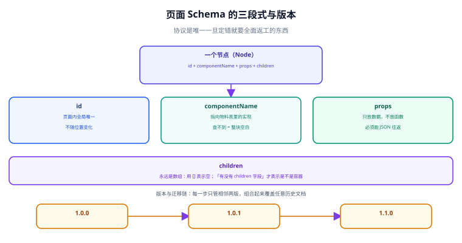

# 协议设计：页面 Schema 的契约

**Schema 是低代码平台里唯一一旦定错就要全面返工的东西。** 渲染器可以重写、编辑器可以换框架、物料可以补，但一份已经存进数据库、被几十个页面引用的 Schema 结构，只能靠迁移来改——而迁移是最贵的一种工作。本页给出一个经过验证的 Schema 结构、五条设计约束，以及版本与迁移的做法。



## 一句话定位

**Schema 不是「页面的 JSON 版本」，而是「渲染器与编辑器共同遵守的契约」。** 它要被两类完全不同的人用：渲染器只关心「怎么渲染」，编辑器还要关心「怎么改」——好的 Schema 让第二类需求**不污染第一类**。

## 三段式节点树

一份页面 Schema 的最小可用结构是「根节点 + 节点树 + 元信息」：

```json [page.schema.json]
{
  "$schema": "https://example.com/lowcode/schema/v1.json",
  "version": "1.0.0",
  "meta": {
    "title": "用户信息表单",
    "createdAt": "2026-10-11T09:00:00+08:00",
    "updatedAt": "2026-10-11T10:20:00+08:00"
  },
  "dataSources": [],
  "state": {},
  "root": {
    "id": "node_root",
    "componentName": "Page",
    "props": { "title": "用户信息" },
    "children": [
      {
        "id": "node_1",
        "componentName": "Form",
        "props": { "labelWidth": 100, "layout": "vertical" },
        "children": [
          {
            "id": "node_2",
            "componentName": "Input",
            "props": { "label": "姓名", "name": "username", "required": true },
            "children": []
          }
        ]
      }
    ]
  }
}
```

节点只有四个必要字段，其中三个构成「三段式」：

| 字段 | 作用 | 谁在读它 | 定错后果 |
| --- | --- | --- | --- |
| `id` | 节点在 Schema 内的**稳定身份** | 编辑器（选中、引用、撤销重做） | id 不唯一 / 会变 → 撤销重做错位、联动找不到目标 |
| `componentName` | 指向物料表里的哪个组件 | 渲染器（查映射表） | 名字与物料不一致 → 整块空白且**不报错** |
| `props` | 这个组件收到什么属性 | 渲染器 + 编辑器（属性面板） | 结构不统一 → 属性面板无法通用 |
| `children` | 子节点数组 | 渲染器（递归） | 用 `null` 与用 `[]` 混用 → 容器判断到处写兼容 |

::: danger 四个必须一开始就定死的约定
1. **`children` 一律是数组，绝不用 `null` 或 `undefined` 表示「没有子节点」。** 混用会让「这是不是容器」这件事有两种判断方式，最终每个消费方各写一套兼容代码。用 `[]` 表示空，用「有没有 `children` 字段」表示是不是容器。
2. **`id` 在页面内全局唯一，且不随位置变化。** 不要用「路径」当 id（`0-1-2`），因为一旦拖动节点，所有祖先路径都变，引用（联动、规则、埋点）全部失效。用随机 / 雪花 id。
3. **`props` 里只放数据，不放函数、不放循环引用。** Schema 要能 `JSON.stringify` 后原样还原；任何 `Date`、`Map`、`undefined` 都会在序列化时静默丢失。
4. **不要为「编辑期的需要」污染运行期结构。** 比如 `selected: true`、`dragging: false` 这类纯编辑器状态，属于**编辑器内部状态**，不应该写进 Schema——写进去就会造成「同样的 Schema 渲染出来带个蓝框」。
:::

## `props` 的三种写法与取舍

`props` 是争议最大的地方。三种常见写法：

| 写法 | 例子 | 优点 | 缺点 |
| --- | --- | --- | --- |
| **扁平展开** | `{ "label": "姓名", "required": true }` | 简单、可读、物料直接透传 | 组件属性与会话属性混在一起，难以区分 |
| **分组** | `{ "props": {...}, "style": {...}, "events": {...} }` | 边界清晰、便于渲染器分别处理 | 多一层嵌套，物料要按约定取数 |
| **扁平 + 保留前缀** | `{ "label": "姓名", "style.width": "200px" }` | 兼容扁平的可读性 | 点号键名容易被当成嵌套路径处理 |

**推荐第二种（分组）**，并把分组固定为四类：

```json
{
  "id": "node_2",
  "componentName": "Input",
  "props": { "label": "姓名", "placeholder": "请输入" },
  "style": { "width": "200px", "marginBottom": 12 },
  "events": { "onChange": [{ "action": "setState", "args": { "key": "name" } }] },
  "lifecycle": { "onMount": [] },
  "children": []
}
```

理由：**渲染器需要区分「透传给组件的属性」和「平台自己消费的配置」**。`style` 要由平台统一转换（见下），`events` 要由平台的编排器执行，它们都不该混进 `props` 让物料自己处理。

::: tip `style` 要不要进 Schema
要，但要**受控**。如果允许任意 CSS 字符串，Style 就会成为绕过一切协议约束的后门（想调布局就用 `style`），最后 Schema 的语义完全不可分析。务实做法是**白名单 + 单位化**：只允许布局类属性（`width`/`height`/`margin`/`padding`/`display`/`gap` 等），数值统一转成 `px`，不允许 `position: fixed` 这类破坏页面流的值出现在业务组件上（需要的话用平台的布局容器表达）。
:::

## `id` 与引用：跨节点怎么找到对方

低代码里有两类引用，做法必须不同：

| 引用类型 | 典型需求 | 推荐做法 | 为什么 |
| --- | --- | --- | --- |
| **对组件的引用** | 「点按钮时，把焦点给某个输入框」 | 用 `id` 字符串引用 | 目标节点可能被移动，但它的 `id` 不变 |
| **对数据的引用** | 「这个表格读哪个数据源的哪条路径」 | 用**声明式路径**（`dataSources.userList.data`） | 数据不是节点，没有 id；路径是稳定命名空间 |
| **对表达式的引用** | 「这个按钮显示的文字由变量算出来」 | <span v-pre>写成 `"{{ state.count }}"` 这样的表达式字符串</span> | 表达式是数据（字符串），在渲染时才求值 |

::: danger 不要用「组件路径」做引用
把引用写成 `root/children[0]/children[2]`，在拖动一次之后就全错了。这类 bug 的特点是**搭建时完全正常、保存后重开页面就错**——因为只有「重新解析」时才会发现路径失效。**引用一律基于 `id` 或命名空间。**
:::

## 版本与 `$schema`

Schema 是有生命周期的数据，必须自带版本。分层写版本，不要只写一个号：

```json
{
  "$schema": "https://example.com/lowcode/schema/v1.json",
  "version": "1.0.3",
  "engineVersion": ">=1.2.0 <2.0.0"
}
```

| 字段 | 含义 | 谁用它 |
| --- | --- | --- |
| `$schema` | 指向**元 Schema**（描述「Schema 该长什么样」） | 编辑器与 CI 的校验器 |
| `version` | 这份文档自身的版本（语义化） | 迁移程序、审计 |
| `engineVersion` | 渲染这份文档所需引擎版本范围 | 运行时前置校验 |

**`$schema` 的价值在于「可以把协议写成机器可校验的」**：用 [JSON Schema draft 2020-12](https://json-schema.org/draft/2020-12/schema) 描述你的节点结构，就能在保存与 CI 两道关卡拦住绝大多数手写错误：

```json [lowcode.schema.v1.json]
{
  "$schema": "https://json-schema.org/draft/2020-12/schema",
  "title": "LowCodePage",
  "type": "object",
  "required": ["version", "root"],
  "properties": {
    "version": { "type": "string", "pattern": "^\\d+\\.\\d+\\.\\d+$" },
    "root": { "$ref": "#/$defs/node" },
    "dataSources": { "type": "array" }
  },
  "$defs": {
    "node": {
      "type": "object",
      "required": ["id", "componentName", "props"],
      "properties": {
        "id": { "type": "string", "minLength": 1 },
        "componentName": { "type": "string", "minLength": 1 },
        "props": { "type": "object" },
        "style": { "type": "object" },
        "events": { "type": "object" },
        "children": { "type": "array", "items": { "$ref": "#/$defs/node" } }
      },
      "additionalProperties": false
    }
  }
}
```

配套的四条校验（缺一条就有盲区）：

```shell
# ① 结构合规：Schema 能被元 Schema 校验通过
npx ajv-cli validate -s lowcode.schema.v1.json -d page.schema.json

# ② id 唯一性（元 Schema 表达不了「全局唯一」，必须单独校验）
python -c "import json,sys;d=json.load(open(sys.argv[1]));ids=[];f=lambda n:(ids.append(n['id']), [f(c) for c in n.get('children',[])]);f(d['root']);print('DUP:',[i for i in set(ids) if ids.count(i)>1])" page.schema.json

# ③ 组件名都在物料表里（协议与物料的交叉校验）
python -c "import json,sys;d=json.load(open(sys.argv[1]));mat=set(json.load(open('materials.json')));used=set();f=lambda n:(used.add(n['componentName']),[f(c) for c in n.get('children',[])]);f(d['root']);print('UNKNOWN:',used-mat)" page.schema.json

# ④ 无残留的编辑器状态字段（防止 selected 之类的字段被存进库）
grep -n '"\(selected\|dragging\|hovered\|focused\)"' page.schema.json && echo "FAIL: 存进了编辑器状态" || echo "PASS"
```

预期：① 无输出即通过；② 输出 `DUP: []`；③ 输出 `UNKNOWN: set()`；④ 输出 `PASS`。

## 迁移：Schema 升级怎么做才不掉页面

**迁移的判据只有一条：升级之后，所有历史页面打开后渲染结果与升级前一致。** 达成它需要三个机制：

| 机制 | 做法 | 为什么必须 |
| --- | --- | --- |
| **版本标记** | 每份 Schema 存 `version`，入库时记录 | 迁移程序要能判断「这份文档是第几版」 |
| **迁移链** | 写「逐版本升级函数」，`1.0.0 → 1.0.1 → 1.1.0` | 支持任意历史版本的文档跳到最新 |
| **双向或只读降级** | 要么能双向转换，要么**旧版本只读** | 无法双向时，必须明确「旧文档能看不能改」 |

```js [migrations/index.js]
// 迁移链：每一步只管相邻两版，组合起来能覆盖任意起点
const migrations = {
  "1.0.0->1.0.1": (doc) => {
    // 1.0.1 起 children 必须存在，缺失即补空数组
    walk(doc.root, (n) => { if (!Array.isArray(n.children)) n.children = []; });
    doc.version = "1.0.1";
    return doc;
  },
  "1.0.1->1.1.0": (doc) => {
    // 1.1.0 起 events 从 props.events 迁到顶层 events
    walk(doc.root, (n) => {
      if (n.props && n.props.events) { n.events = n.props.events; delete n.props.events; }
    });
    doc.version = "1.1.0";
    return doc;
  },
};

export function migrate(doc, to = "1.1.0") {
  const order = Object.keys(migrations);          // 按注册顺序即「版本递增顺序」
  while (doc.version !== to) {
    const step = order.find((k) => k.startsWith(doc.version + "->"));
    if (!step) throw new Error(`无迁移路径：${doc.version} -> ${to}`);
    doc = migrations[step](doc);
  }
  return doc;
}
```

::: danger 迁移的两条硬纪律
1. **迁移函数必须是纯函数、必须可重复执行。** 迁移过程中任何失败都要能整体回滚，绝不能出现「被迁移了一半」的文档——那是最难排查的状态。
2. **不要「迁移时顺手修数据」。** 有人在迁移里顺手把空的 `style` 删掉、把 `null` 换成 `[]`，导致「同一份文档迁移两次结果不同」。**迁移只做「结构升级」这一件事**，数据清洗是另一条独立流程。
:::

## 验证方式：三个自检

任何一份 Schema 在入库前都该过这三关，且**第三关是最容易被漏掉的**：

```json
// 幂等性：migrate(migrate(x)) === migrate(x)
// 有损性：老结构里能表达的，新结构里都还能表达（尤其是「未设置」与「设置了空值」的区分）
// 兼容性：用新渲染器渲染旧 Schema，视觉与交互与旧渲染器一致
```

最小验证命令（把下面三条各跑一次即可）：

```shell
# ① 幂等性：二次迁移无变化
node -e "const {migrate}=require('./migrations');const fs=require('fs');const a=JSON.stringify(migrate(structuredClone(JSON.parse(fs.readFileSync(process.argv[1])))));const b=JSON.stringify(migrate(JSON.parse(a)));console.log(a===b?'PASS 幂等':'FAIL 幂等')" page.schema.json

# ② 无编辑器状态泄漏
grep -c '"selected"\|"dragging"\|"hovered"' page.schema.json | grep -q '^0$' && echo "PASS 无状态泄漏" || echo "FAIL 存在编辑器状态"

# ③ 组件名全部已知
node -e "const d=require('./page.schema.json');const m=new Set(require('./materials.json'));const u=new Set();const w=n=>{u.add(n.componentName);(n.children||[]).forEach(w)};w(d.root);const bad=[...u].filter(x=>!m.has(x));console.log(bad.length?'FAIL '+bad:'PASS 组件名全部已知')"
```

## 参考资料

- [JSON Schema：The Basics](https://json-schema.org/learn/getting-started-step-by-step)
- [JSON Schema draft 2020-12 核心规范](https://json-schema.org/draft/2020-12/json-schema-core)
- [Alibaba LowCodeEngine：协议规范](https://lowcode-engine.cn/site/docs/specs/lowcode-spec)
- [Amis：Schema 总览](https://aisuda.bce.baidu.com/amis/zh-CN/docs/types/api)
- [Ajv：JSON Schema 校验器](https://ajv.js.org/)
- [Semantic Versioning 2.0.0](https://semver.org/lang/zh-CN/)
