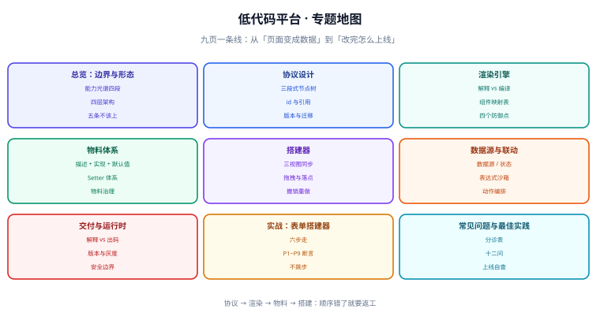

# 低代码平台

**低代码平台（Low-Code Platform）** 是一类「把页面与逻辑从「写代码」搬到「配置描述」」的系统。它的核心不是拖拽动画好不好看，而是一份**机器可读的描述（Schema）**：谁渲染它、它能表达什么、改了它以后旧页面还认不认。

一句话定位：**这个专题讲的是「当页面不再由人手写、而是由一份 JSON 描述生成时，这份描述该怎么定契约、谁来渲染、组件从哪来、人怎么改它、改完怎么上线」**——凡是「低代码搭出来的页面改不动」「Schema 一升级历史页面全崩」「运营说拖不动」这类问题，根因几乎都落在这五件事上。

::: info 版本与形态说明（2026-10 核对）
低代码是**通用技术名**，不是一个产品，因此本专题不绑定任何具体平台的版本号；文中出现的形态以当前主流实现为准——协议层的参照是 [JSON Schema draft 2020-12](https://json-schema.org/draft/2020-12/schema)（最新稳定草稿；IETF 已启动 v1 规范工作），渲染与物料层的参照形态是阿里 [LowCodeEngine](https://github.com/alibaba/lowcode-engine)（最小内核 + 最强生态，含 `engine` / `designer` / `editor-skeleton` / `react-renderer` 等模块）与百度 Amis（JSON 配置驱动页面）。**具体版本以官方仓库为准**，本专题只讲与版本无关的判据。
:::

## 为什么需要这个专题

「低代码」这三个字在国内被用得很杂：代码生成器、快速开发脚手架、表单引擎、大屏搭建器、BPM 表单设计器……它们**都自称低代码，但技术内核完全不同**，选错了会付出很高代价——最典型的是把「代码生成器」当成「可视化引擎」采购，结果发现业务人员连一个字段都改不了。

| 常见叫法 | 真实内核 | 业务人员能改吗 |
| --- | --- | --- |
| 代码生成器（RuoYi 形态） | 按表结构**生成源码**，之后就是普通工程 | 不能，改代码要走研发流程 |
| JSON 渲染引擎（Amis 形态） | 一份 JSON 描述页面，**运行时解释渲染** | 能改配置，但要懂 JSON 语义 |
| 可视化搭建器（LowCodeEngine 形态） | 拖拽产出结构化 Schema，**同时可出码** | 能拖拽，复杂逻辑仍需研发 |
| 表单 / 流程设计器 | 只覆盖表单与流程两类场景 | 能改表单，边界外做不了 |

本专题的落点是**第三种**：一个能拖、能配、能产出可维护描述的**平台**。其余三种会在 [总览](Overview/index.md) 里作为「形态光谱」被对照进来，因为它们在很多团队里是并存而非互斥的。

## 专题地图

## 页面导航

1. [总览：低代码的边界与四种形态](Overview/index.md) —— 能力光谱、四层架构（协议 / 渲染 / 物料 / 搭建）、三种落地形态的取舍、五条「什么时候不该上低代码」
2. [协议设计：页面 Schema 的契约](Schema/index.md) —— 节点树的三段式（`componentName` / `props` / `children`）、id 与引用、版本与 `$schema`、迁移策略、Schema 的「面向谁」验证
3. [渲染引擎：从 Schema 到视图](RenderEngine/index.md) —— 解释渲染 vs 编译渲染、递归渲染器与组件映射表、插槽与容器组件、错误边界与兜底、编辑态与运行态的渲染差异
4. [物料体系：组件即积木](Materials/index.md) —— 物料协议（描述 + 实现 + 默认值）、注册与版本、设置器（Setter）体系、物料库治理、物料开发规范与验收
5. [搭建器：画布、属性与撤销重做](Designer/index.md) —— 画布 / 大纲树 / 属性面板三视图同步、拖拽模型、选中与多选、撤销重做的实现取舍、快捷键与协作边界
6. [数据源与联动：表达式、变量与动作](DataBinding/index.md) —— 数据源定义、作用域与变量解析、表达式沙箱、事件与动作编排、加载与错误的可视化
7. [交付与运行时：出码、版本与安全](Runtime/index.md) —— 运行时解释 vs 出码、Schema 的存储与版本、灰度与回滚、大 Schema 的性能、表达式沙箱与 XSS
8. [实战：从零搭一个表单页搭建器](Practice/index.md) —— 六步走（协议 → 渲染器 → 物料 → 搭建器 → 联动 → 出码），每步判据与验收断言清单
9. [常见问题与最佳实践](FAQ/index.md) —— 按现象分诊的排查树、十二个高频问题、平台上线自查清单

## 建议的阅读顺序

- **只想知道「值不值得做」**：先读 [总览](Overview/index.md) 的能力光谱与「五条不该上」两节，再决定要不要往下看。
- **要设计协议**：[协议设计](Schema/index.md) 是地基，重点看「三段式节点树」与「版本与迁移」两节——**协议定错，后面每一层都要返工**。
- **要做渲染**：[渲染引擎](RenderEngine/index.md) 的「组件映射表」与「编辑态 / 运行态差异」是主战场。
- **要做物料库**：[物料体系](Materials/index.md) 的 Setter 体系与物料验收标准，决定平台能不能被别人扩展。
- **要做编辑器**：[搭建器](Designer/index.md) 的撤销重做与三视图同步两节最容易踩坑。
- **要动手**：[实战](Practice/index.md) 的六步顺序照做，不要跳步——**先有协议再有编辑器**，反过来一定返工。

## 本专题与相邻专题的分工

这几处边界**写死在页面上**，互不替代：

| 相邻专题 | 它讲什么 | 本专题讲什么 |
| --- | --- | --- |
| [Vue](../Frame/Vue/index.md) / [React](../Frame/React/index.md) | 组件怎么写、响应式怎么工作、`v-model` 与 Hooks 的用法 | 低代码的渲染器**宿主**是这些框架：本专题讲「怎么把一份 JSON 映射成组件树」，框架 API 归框架页 |
| [微前端](../MicroFrontend/index.md) | 多个应用如何并存、隔离与路由分发 | 微前端解决「**多个应用怎么拼在一个壳里**」，低代码解决「**一个页面怎么被描述出来**」；两者可叠加（低代码产物作为一个子应用） |
| [数据可视化](../DataVisualization/index.md) | 图表选型、坐标系、大数据量渲染 | 大屏搭建器是低代码的一个**垂类**：本专题讲协议与搭建机制，图表本身怎么选归可视化页 |
| [前端工程化](../Others/FrontendEngineering/index.md) | 规范、构建、测试、CI 门禁 | 本专题只讲低代码产物特有的部分：**Schema 的版本校验与出码产物如何进流水线** |
| [前端测试](../Testing/index.md) | 单测、组件测试、E2E 与覆盖率 | 低代码页面的测试是「**同一份 Schema 在不同解释器下结果一致**」这类契约测试，策略在主专题、平台特有的断言在本专题 |
| [工作流与规则引擎](../../Backend/WorkflowEngine/index.md) | 流程定义、节点流转、规则表达式与审批 | 流程设计器与低代码**共用表达式与表单**，但前者讲的是「状态怎么流转」，本专题讲「页面怎么被描述」 |
| [完整项目实战 · 后台模板](/project/Base/AdminTemplate/index.md) | 某个真实后台的骨架、登录与菜单怎么搭 | 项目页负责「照着做一个后台」，本专题负责「为什么这么设计、判据是什么」 |

## 参考资料

- [JSON Schema 官网（draft 2020-12 规范）](https://json-schema.org/)
- [JSON Schema Core：Versioning and Compatibility](https://json-schema.org/draft/2020-12/json-schema-core)
- [Alibaba LowCodeEngine（低代码引擎）](https://github.com/alibaba/lowcode-engine)
- [LowCodeEngine 官网与文档](https://lowcode-engine.cn/)
- [Amis：JSON 配置驱动的前端框架](https://github.com/baidu/amis)
- [Amis 官方文档](https://aisuda.bce.baidu.com/amis/)
- [GrapesJS：开源 Web 搭建器](https://github.com/GrapesJS/grapesjs)
- [JSONata：JSON 查询与转换表达式语言](https://jsonata.org/)
- [CEL（Common Expression Language）](https://github.com/google/cel-spec)
