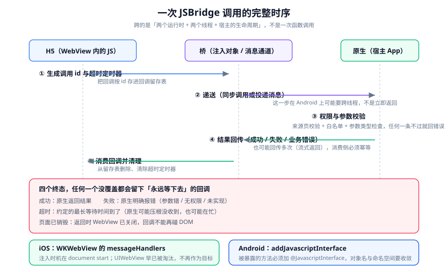

# 桥接通信

WebView 里的页面想用原生能力（相机、扫码、支付、定位、文件、分享），中间必须有一条通道。这条通道就是桥接（bridge）。它的难点不在「怎么把消息发出去」，而在**消息发出去之后的那段时间里可能发生的一切**。

::: tip 一句话理解
把桥接当成「一次跨进程的网络请求」来设计，而不是「一次函数调用」——因为它确实不是函数调用：它跨运行时、跨线程，并且随时可能被宿主的生命周期中止。
:::

## 一、桥接的两端是什么形状

| 端 | 位置 | 它是什么 | 谁写它 |
| --- | --- | --- | --- |
| H5 侧 | WebView 内 | 一个 JS 对象或消息通道 | 前端 |
| 桥接层 | 内核内 / 宿主内 | 消息序列化与转发 | 前端 + 客户端约定 |
| 原生侧 | 宿主 App | 真正执行动作的代码 | 客户端 |

**关键事实**：桥接不是「前端调用原生函数」，而是**三件独立的事**——前端发出请求、原生执行并回传、前端消费回传。任何一件没做全，用户看到的就是「没反应」。

```text
H5 发请求 ──→ 原生执行 ──→ 回传结果 ──→ H5 消费
   ↑                ↑             ↑
 要有 id         可能抛错       可能不回
 要有超时       可能无权限     可能回多次
 要有回调表     可能未实现     可能在页面销毁后回
```

## 二、两端的原生实现（只列形状，具体 API 以官方文档为准）

### 1. iOS：`WKWebView` 的消息处理器

```javascript
// H5 侧：调用 webkit.messageHandlers
const messageHandlers = window.webkit?.messageHandlers;

function postToNative(method, params, callId) {
  if (!messageHandlers?.appBridge) {
    return Promise.reject(new Error("BRIDGE_UNAVAILABLE"));
  }
  // postMessage 只接收可序列化的值；函数、undefined、Date、Map 都会丢语义
  messageHandlers.appBridge.postMessage({ method, params, callId });
  return new Promise((resolve, reject) => register(callId, resolve, reject));
}
```

::: info 关于注入时机
`WKWebView` 的消息处理器需要在**页面开始加载之前**注册（在导航动作的 `userContentController` 上），否则页面早期执行的脚本取不到 `window.webkit.messageHandlers`。**这就是「桥接有时能用有时不能用」的第一大来源**——取决于页面脚本执行得早还是晚。
:::

### 2. Android：`addJavascriptInterface`

```javascript
// H5 侧：调用被注入的全局对象
function postToNative(method, params, callId) {
  if (!window.appBridge?.invoke) {
    return Promise.reject(new Error("BRIDGE_UNAVAILABLE"));
  }
  // Android 侧通常用「接收一个 JSON 字符串」的形式，避免跨语言类型映射问题
  const payload = JSON.stringify({ method, params, callId });
  window.appBridge.invoke(payload);
  return new Promise((resolve, reject) => register(callId, resolve, reject));
}
```

**纪律**：被暴露的对象名要收敛（一个入口而不是十几个方法），并且**只有在确实需要时才注入**。暴露面的问题在[安全面](../Security/index.md)一节展开。

### 3. 回传：`evaluateJavascript` 或消息回调

原生的回传有两种形态：

| 形态 | 机制 | 注意 |
| --- | --- | --- |
| 单次回调 | 原生执行一次 `evaluateJavascript("window.__bridgeResolve(id, payload)")` | 最常见；要注意页面可能已销毁 |
| 多次回传 | 进度类操作（上传、下载、长任务）会多次回调 | **H5 侧必须幂等**：收满之后忽略后续 |
| 主动推送 | 原生主动通知 H5（登录态变化、位置更新、返回键） | 需要 H5 侧注册与注销成对出现 |

## 三、一次调用的六个阶段



| 阶段 | 做什么 | 失败时用户看到 |
| --- | --- | --- |
| ① 生成 id 与超时 | 分配唯一 `callId`，把回调存进留存表，起一个超时定时器 | 若不生成 id，回调无处可去，界面永久 loading |
| ② 递送 | 通过桥接对象发出（Android 上可能跨线程，不是同步返回） | 桥接对象不存在 → 必须明确失败，而不是静默返回 |
| ③ 权限与参数校验（原生侧） | 来源页校验、方法白名单、参数类型与长度 | 缺这一步是安全问题，不是功能问题 |
| ④ 结果回传 | 成功 / 失败 / 业务错误码 | 不回传 → 只能靠超时兜底 |
| ⑤ 消费回调 | 从留存表取出、执行、删除 | 页面已销毁 → 不能再碰 DOM |
| ⑥ 清理 | 清超时定时器、删留存条目 | 泄漏 → 长会话下留存表越来越大 |

### 四个终态，缺一不可

```javascript
const DEFAULT_TIMEOUT = 10000;
const pending = new Map();   // callId -> { resolve, reject, timer }
let pageAlive = true;

function call(method, params, { timeout = DEFAULT_TIMEOUT } = {}) {
  if (!pageAlive) return Promise.reject(new Error("PAGE_DESTROYED"));
  const callId = `${Date.now()}-${Math.random().toString(36).slice(2, 8)}`;

  return new Promise((resolve, reject) => {
    const timer = setTimeout(() => {
      pending.delete(callId);
      reject(new Error("BRIDGE_TIMEOUT"));          // 终态三：超时
    }, timeout);

    pending.set(callId, { resolve, reject, timer });

    try {
      postToNative(method, params, callId);
    } catch (err) {
      clearTimeout(timer);
      pending.delete(callId);
      reject(new Error("BRIDGE_UNAVAILABLE"));      // 终态二：明确失败
    }
  });
}

// 原生回传的唯一入口：成功与失败都从这里进
window.__bridgeCallback = function (payload) {
  const entry = pending.get(payload.callId);
  if (!entry) return;                                // 多次回传 / 过期回传：直接忽略（幂等）
  clearTimeout(entry.timer);
  pending.delete(payload.callId);
  if (!pageAlive) return;                            // 终态四：页面已销毁
  payload.ok ? entry.resolve(payload.data) : entry.reject(new Error(payload.error));
};

// 页面销毁时的统一收尾
window.addEventListener("pagehide", () => {
  pageAlive = false;
  for (const { timer, reject } of pending.values()) {
    clearTimeout(timer);
    reject(new Error("PAGE_DESTROYED"));
  }
  pending.clear();
});
```

::: danger 四个终态里最容易漏的两个
1. **漏超时**：这是「原生没实现这个方法」时的唯一兜底。没有超时，用户会一直看着转圈，直到自己关掉页面。
2. **漏页面销毁**：从相机 / 支付返回后，原页面往往已被系统重载。此时旧的回调如果还在跑，会去操作已经不存在的 DOM——通常表现为一个莫名的 `TypeError`。
:::

## 四、协议设计：把「约定」写下来

桥接最容易失控的地方是**方法名与参数的约定漂移**：前端以为传的是 `{ url }`，原生读的是 `{ link }`，双方都不报错，功能就是不通。

### 1. 一次调用的三个必填字段

```javascript
// 统一载荷：方法名、参数、调用 id
{
  method: "camera.open",              // 命名空间.动作，便于原生侧做白名单
  params: { quality: "high" },        // 只放可序列化的值
  callId: "1729-abc123"
}
```

| 字段 | 约定 | 定错的后果 |
| --- | --- | --- |
| `method` | 采用 `命名空间.动作` 形式，全部方法列在一张表里 | 无法做白名单；改名后旧版本 App 失效 |
| `params` | **只用可序列化值**：字符串、数字、布尔、数组、纯对象 | `Date` / `Map` / 函数会静默丢失或变形 |
| `callId` | 每次调用唯一；H5 生成、原生原样回传 | 无法区分回传属于哪次调用，流式返回时更明显 |

### 2. 错误码：区分「谁的问题」

| 错误码 | 含义 | 前端该做什么 |
| --- | --- | --- |
| `BRIDGE_UNAVAILABLE` | 桥接对象不存在（不在宿主内、注入失败） | 走页内降级路径 |
| `BRIDGE_TIMEOUT` | 超时（原生没回、原生在忙） | 提示重试，不要静默失败 |
| `METHOD_NOT_FOUND` | 原生未实现该方法 | 说明宿主版本过低，走降级路径 |
| `PERMISSION_DENIED` | 用户拒绝授权或来源页不在白名单 | 提示去设置中开启，不要反复弹窗 |
| `PAGE_DESTROYED` | 页面已销毁 | 静默丢弃，不要提示用户 |
| `INVALID_PARAMS` | 参数校验不过 | 属于开发期错误，应当上报而不是提示用户 |

### 3. 版本协商：宿主能力是变量

```javascript
// 启动时问一次宿主能力，而不是按 UA 猜
const capabilities = await call("app.getCapabilities", {});
// 期望：{ version: "3.7.0", methods: ["camera.open", "scan.qr", "pay.invoke"], os: "ios" }

function isSupported(method) {
  return capabilities.methods.includes(method);
}

// 用能力决定路径，而不是用版本号比较大小
if (isSupported("scan.qr")) {
  scanViaBridge();
} else {
  scanViaWebFallback();   // 走页内降级路径
}
```

::: warning 为什么不要按版本号比大小
版本号比较看起来更简单（`if (version >= "3.5.0")`），但它把「能力」与「版本」绑死了。真实情况是：同一版本在不同平台上可能只实现了一部分方法，灰度期间也可能只有一部分用户能用。**让宿主自己报出它有什么方法**，比让前端推断它该有什么更可靠。
:::

## 五、注入时机与「就绪」判定

| 宿主的注入方式 | 时机 | H5 侧的判定 |
| --- | --- | --- |
| 页面加载前注入（推荐） | 任何页面脚本执行前就存在 | 直接检测对象是否存在 |
| 页面加载完成后注入 | 可能晚于首屏脚本 | 必须等待并重试 |
| 首次交互后注入（延迟初始化优化） | 可能非常晚 | 需要显式的「就绪」事件 |

```javascript
// 等待桥接就绪：最多等 3 秒，每 50ms 探测一次
function waitForBridge({ timeout = 3000, interval = 50 } = {}) {
  return new Promise((resolve) => {
    const started = Date.now();
    const tick = () => {
      if (window.appBridge?.invoke || window.webkit?.messageHandlers?.appBridge) {
        return resolve(true);
      }
      if (Date.now() - started > timeout) return resolve(false);
      setTimeout(tick, interval);
    };
    tick();
  });
}

// 用法：把「是否可用」变成一个明确的分支，而不是散落的 if
const ready = await waitForBridge();
if (!ready) enterWebFallback();
```

::: danger 「桥接有时能用有时不能用」的四种成因
1. **注入晚于首屏脚本**：页面顶部就调用了桥接，此时对象还不存在。**要在入口处统一等一次就绪，而不是在业务里到处 `if`。**
2. **页面重载后没有重新等待**：从相机返回时页面被系统重载，桥接对象重新出现，但代码里的「已就绪」标记还是旧页面的。
3. **宿主版本差异**：同一个方法在低版本宿主上不存在，前端没有做能力判断。
4. **跨域 iframe**：桥接对象只在宿主直接加载的顶层页面里存在，iframe 里的页面拿不到（除非宿主显式向该 iframe 注入）。
:::

## 六、降级：桥接不存在时页面还能用吗

这是桥接设计的最后一道，也是最常被跳过的一道。

| 能力 | 桥接可用时 | 降级路径 |
| --- | --- | --- |
| 扫码 | 调原生扫码 | 用 `getUserMedia` + 页内解码（支持的机型）或引导用户手动输入 |
| 拍照 / 选图 | 调原生相册 | `<input type="file" accept="image/*" capture="environment">` |
| 支付 | 调原生支付 SDK | 跳转 H5 支付页 / 唤起 `https` 支付链接 |
| 定位 | 调原生定位（更准更快） | `navigator.geolocation` |
| 分享 | 调原生分享面板 | `navigator.share`（支持的平台） |
| 返回键 | 宿主拦截并通知 H5 | 页内提供显式的返回按钮 |

```javascript
// 统一的降级分发：把「用哪条路」集中在一处
async function openCamera() {
  if (isSupported("camera.open")) {
    return call("camera.open", { quality: "high" });
  }
  if (window.isSecureContext && navigator.mediaDevices?.getUserMedia) {
    return openCameraViaWeb();
  }
  return openInputCaptureFallback();   // 最后一层：input[type=file]
}
```

::: warning `navigator.share` 与 `getUserMedia` 的两个硬约束
1. **`getUserMedia` 只在安全上下文（`https` 或 `localhost`）可用**：`http` 页面上它直接不存在。判断要用 `window.isSecureContext`。
2. **`navigator.share` 必须由用户手势触发**：在异步回调里调用会被拒绝。**不要在 `await` 之后才调用它。**
:::

## 七、调试：两端都要能看见

| 位置 | 怎么看 | 能看到什么 |
| --- | --- | --- |
| H5 侧 | 桌面浏览器远程调试（iOS 用 Safari 开发菜单、Android 用 Chrome `chrome://inspect`） | console、网络、DOM |
| 原生侧 | 客户端日志（Xcode 控制台 / Logcat） | 是否收到调用、参数是什么、执行结果 |
| 桥接层 | 两端各自打印同一份 `callId` | **用 `callId` 把两侧日志对上**，这是定位「前半段通了后半段没通」的唯一可靠手段 |

```javascript
// 调试开关：只在调试构建里打开，生产构建关闭
const BRIDGE_DEBUG = /[?&]bridgeDebug=1/.test(location.search);

function trace(stage, payload) {
  if (!BRIDGE_DEBUG) return;
  console.log(`[bridge:${stage}]`, payload);
}
```

```shell
# Android 远程调试入口（USB 连接后）
# 期望：Chrome 打开 chrome://inspect 能看到 WebView 条目并点 "inspect"
chrome://inspect
```

```shell
# iOS 远程调试入口
# Safari → 开发 → <设备名> → 选择对应的页面
# 期望：能看到 console 与 DOM；看不到时先确认设备已在此电脑上「信任」
```

::: danger 生产环境必须关掉调试入口
Android 的 `setWebContentsDebuggingEnabled(true)` 与 iOS 的 `isInspectable` 一旦在生产打开，**任何能物理接触设备的人都可以注入并执行任意 JS**，而页面里有桥接对象——那等于把宿主的部分权限交出去。**调试开关只允许在调试构建里打开。**
:::

## 八、判据清单

| 编号 | 判据 | 怎么验证 |
| --- | --- | --- |
| `HB-A` | 每次调用生成唯一 `callId`，且原生原样回传 | 两端日志里能找到同一个 id |
| `HB-B` | 每次调用都有超时，且超时是**显式错误**而不是静默挂起 | 让原生不回传，观察是否在约定时间内报错 |
| `HB-C` | `up` 类终态之外，`PAGE_DESTROYED` 也被覆盖（页面销毁时统一拒绝未完成调用） | 从相机返回后检查是否出现残留回调 |
| `HB-D` | 多次回传（进度类）在 H5 侧是幂等的，收满后忽略后续 | 让原生重复回传同一 `callId`，观察是否重复执行副作用 |
| `HB-E` | 请求载荷只使用可序列化的值，且方法名限定在约定表内 | 审查 `params`；出现 `Date` / 函数 / `undefined` 即缺陷 |
| `HB-F` | 宿主能力由宿主上报（`getCapabilities` 类接口），前端**不按版本号比较**推断能力 | 搜索版本号比较；命中即缺陷 |
| `HB-G` | 桥接不可用时存在页内降级路径，且该路径被真实测过 | 在浏览器里打开页面（无桥接），功能仍可用 |
| `HB-H` | 来源页校验在**原生侧**执行（不是只在前端判断） | 用非白名单页面调用，观察原生是否拒绝 |

## 九、验证方式

```javascript
// 1) 覆盖四个终态（贴进 H5 控制台，逐条执行）
// a. 明确失败：调用一个不存在的方法
call("__not_exist__", {}).catch((e) => console.log("失败终态:", e.message));

// b. 超时：调用一个原生不会回传的方法（或临时让原生不回传）
call("debug.noCallback", {}, { timeout: 2000 }).catch((e) => console.log("超时终态:", e.message));

// c. 页面已销毁：在页面 unload 之后调用
//    把上面任一句放进 setTimeout(…, 很短)，然后立刻刷新页面
// 期望：三种情况各自落到不同错误码，且都不出现「永久 pending」
```

```javascript
// 2) 幂等检查：让原生对同一 callId 回传两次，观察副作用是否只执行一次
let sideEffectCount = 0;
call("debug.echoTwice", { value: 1 }).then(() => { sideEffectCount += 1; });
setTimeout(() => console.log("副作用执行次数:", sideEffectCount), 3000);
// 期望：打印 1（不是 2）
```

```javascript
// 3) 降级路径检查：在桌面浏览器里打开同一页面（必然没有桥接对象）
console.log({
  hasAppBridge: Boolean(window.appBridge?.invoke),
  hasWebkit: Boolean(window.webkit?.messageHandlers?.appBridge),
  secure: window.isSecureContext,
});
// 期望：两个 has* 都是 false，且页面上的功能按钮仍然可用（走了降级路径）
// 判读：按钮点了没反应 → 缺乏降级路径（HB-G 不合格）
```

::: danger 三个让桥接测试失效的做法
1. **只在「桥接可用」的环境里测**：这样永远测不到降级路径。**至少要在纯浏览器里跑一遍完整流程。**
2. **用固定的 `callId` 做测试**：会让「幂等」的缺陷被掩盖（因为留存表里永远只有一条）。**幂等测试必须用同一个 id 连续回传两次。**
3. **只看前端 console**：桥接的问题一半在原生侧。**必须在两端同时打开日志，并用 `callId` 对齐。**
:::

## 十、相关页面与下一篇

- 下一篇：[兼容与真机排障](../Compatibility/index.md)——桥接通了之后，还剩「哪台机器上不通」这一类问题。
- 上游必读：[总览：四条边界](../Overview/index.md)（`MH-D`：四个终态）。
- 相邻必读：[WebView 与桥接的安全面](../Security/index.md)（来源校验与最小暴露面）、[桌面应用 · IPC 与命令](../../DesktopApp/IPC/index.md)（同一类跨运行时通信问题的另一种形态）。

## 十一、参考资料

- [Apple Developer · `WKScriptMessageHandler`](https://developer.apple.com/documentation/webkit/wkscriptmessagehandler)
- [Apple Developer · `WKUserContentController`（注入时机）](https://developer.apple.com/documentation/webkit/wkusercontentcontroller)
- [Android Developers · `WebView.addJavascriptInterface`](https://developer.android.com/reference/android/webkit/WebView#addJavascriptInterface(java.lang.Object,%20java.lang.String))
- [Android Developers · WebView 安全建议](https://developer.android.com/privacy-and-security/security-tips)
- [MDN · `navigator.share`（必须由用户手势触发）](https://developer.mozilla.org/en-US/docs/Web/API/Navigator/share)
- [MDN · `MediaDevices.getUserMedia`（安全上下文要求）](https://developer.mozilla.org/en-US/docs/Web/API/MediaDevices/getUserMedia)
