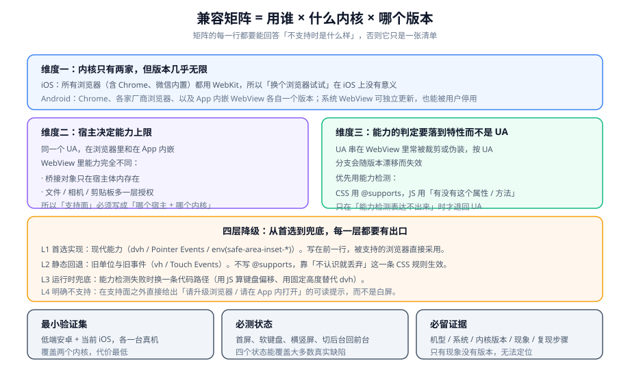

# 兼容与真机排障

「在我手机上没问题」是移动端最常见的一句话，也是信息量最低的一句话。本页要解决的是：**把「哪台机器不行」变成一张能跑的矩阵**，再给排障一套能复用的流程。

::: tip 一句话理解
兼容工作的产出不是「修了多少 bug」，而是**一张支持面**：哪些宿主 × 哪些内核 × 哪些版本要保证可用，其余的情况给出什么结果。没有这张表，每来一台新机型都是一次新的惊喜。
:::

## 一、内核地图（2026-10 口径）



| 平台 | 内核 | 版本由谁决定 | 关键推论 |
| --- | --- | --- | --- |
| iOS | **全部 WebKit**（Safari、Chrome、微信内置、App 内嵌页） | 系统版本（跟随 iOS 升级） | **「换个浏览器试试」在 iOS 上没有意义** |
| Android 浏览器 | Chromium（各有品牌外壳） | 各自的应用更新 | 版本比系统更碎片化 |
| Android App 内嵌 WebView | **Android System WebView**（Chromium） | **可以独立于系统更新，也可以被用户停用** | 同一台机器上「系统很新但内核很旧」是常态 |
| 微信 / 各家超级 App 内置 | 各自打包或复用系统内核 | 由 App 版本决定 | 同一个页面在「微信内」与「浏览器内」是两个环境 |

| 版本事实（2026-10 核对） | 值 |
| --- | --- |
| Safari 当前版本 | **27.0.1**（2026-09-28），随 iOS 27（2026-09-14 起推送）发布 |
| Chrome 桌面 / Android 稳定版 | **154**（Android 为 `154.0.8037.94`，2026-10-02） |
| Android System WebView | **155.0.8059.44**（2026-10-12） |
| 新增能力示例 | Safari 27 引入 Service Worker 静态路由；iOS 26 起「添加到主屏幕」的站点默认以 Web App 打开 |

::: warning 两条由内核地图直接推出的结论
1. **不要按浏览器品牌写分支**：iOS 上所有浏览器都是 WebKit，品牌分支没有意义；Android 上同一品牌的不同版本内核差得可能比不同品牌还多。
2. **WebView 版本决定了能力上限，而它不受你控制**：同一台安卓机，用户可能停用了系统 WebView（退回厂商内置的老内核），也可能因为存储空间不足没有更新。**这正是「能力检测优于版本判断」的根本原因。**
:::

## 二、兼容矩阵怎么写

### 1. 三个维度

```text
支持面 = 宿主（浏览器 / 哪个 App / 哪个内嵌页）
        × 内核（WebKit / Chromium，含版本下限）
        × 场景（浏览 / 登录 / 支付 / 上传）
```

第三个维度最容易被漏掉：**同一个页面在不同业务场景下的要求可以不同**。「浏览」可以接受降级，「支付」必须明确拒绝——因为一个降级过的支付流程，风险远大于让用户换个环境。

### 2. 矩阵模板

| 宿主 | 内核下限 | 浏览 | 登录 | 支付 | 不支持时的表现 |
| --- | --- | --- | --- | --- | --- |
| iOS 浏览器 | iOS 16+ | 完整 | 完整 | 完整 | —— |
| iOS App 内嵌 | iOS 16+ | 完整 | 完整 | 完整 | —— |
| Android 浏览器 | Chromium 108+ | 完整 | 完整 | 完整 | —— |
| Android App 内嵌 | Chromium 100+ | 完整 | 完整 | **仅完整能力** | 提示「请升级 App」 |
| 老旧内核（< 100） | —— | 只读 | 拒绝 | 拒绝 | **明确提示页，不白屏** |

::: danger 矩阵最常见的两种写法错误
1. **只写「支持 iOS / Android」，不写版本下限**：这等于没有写。「支持安卓」可以指从 Android 6 到 Android 16 的十年跨度，内核差异超过你的想象。
2. **只写支持什么，不写不支持时怎么办**：矩阵的价值一半在「不支持时用户看到什么」。**没有这一列的矩阵，在实现时会自然退化成白屏。**
:::

### 3. 四层降级

| 层 | 做什么 | 例子 |
| --- | --- | --- |
| L1 首选 | 现代能力 | `100dvh`、Pointer Events、`env(safe-area-inset-*)` |
| L2 静态回退 | 旧写法写在前一行，靠「不认识就丢弃」生效 | `height: 100vh;` 在 `height: 100dvh;` 之前 |
| L3 运行时兜底 | 能力检测失败时换代码路径 | 用 `visualViewport` 算键盘偏移 |
| L4 明确不支持 | 可读提示 + 引导动作 | 「当前环境不支持支付，请在 App 内完成」 |

```css
/* L1 + L2：不需要 @supports，靠 CSS 的错误处理规则完成降级 */
.shell {
  height: 100vh;    /* L2：不认识 dvh 的浏览器用这一行 */
  height: 100dvh;   /* L1：认识 dvh 的浏览器用这一行 */
}
```

```javascript
// L3：能力检测而不是版本判断
function pickKeyboardStrategy() {
  if (window.visualViewport) return "visualViewport";     // 最可靠
  if (CSS.supports("height", "100dvh")) return "dvh-only"; // 部分可用
  return "none";                                          // 什么都不做，靠浏览器自动滚动
}
```

```javascript
// L4：明确不支持时给出可读结果，而不是让报错冒到用户面前
function requireCapability(name, ok, message) {
  if (ok) return;
  const el = document.getElementById("app");
  if (el) el.innerHTML = `<section class="unsupported"><h1>${name}</h1><p>${message}</p></section>`;
  throw new Error(`UNSUPPORTED:${name}`);
}

requireCapability(
  "支付",
  window.isSecureContext && "fetch" in window,
  "当前浏览器版本过低，无法完成支付。请在最新版 App 内打开本页面。"
);
```

## 三、能力检测的正确写法

| 检测对象 | 正确写法 | 错误写法 |
| --- | --- | --- |
| CSS 声明 | `CSS.supports("height", "100dvh")` | 解析 UA 判断版本 |
| JS API | `"visualViewport" in window` | `if (window.visualViewport)` 后直接用（要判空，但别把「假值」当没有） |
| 事件 | `"PointerEvent" in window`（注意 `ontouchstart` 判断会把桌面触屏机也算进来） | `"ontouchstart" in window` 当「是不是手机」 |
| 编码 / 媒体能力 | `await HTMLMediaElement.canPlayType("video/mp4")` | 假设「现代浏览器都支持」 |
| 是否在宿主内 | `Boolean(window.appBridge?.invoke \|\| window.webkit?.messageHandlers?.appBridge)` | 按 UA 里有没有某个关键字判断 |

::: danger `@supports` 的三条边界
1. **它只测语法，不测行为**：`@supports (height: 100dvh)` 为真，不代表浏览器会在软键盘弹起时重算 `dvh`。
2. **它测不出「部分实现」**：某个属性被解析但不生效的情况是存在的。
3. **`CSS.supports("property", "value")` 有两个参数的写法**：只传一个字符串（整条声明）也可以，但传两个参数更精确，推荐用它。
:::

### 什么时候可以退回 UA

只有在**能力检测表达不出来**的时候，才用 UA，而且必须同时满足两条：这条分支只影响体验不影响正确性；UA 判断的结论在支持面内足够稳定。

```javascript
// 一个「可以接受」的 UA 用法：判断是否在自家 App 内（用于展示「在 App 内打开」的引导）
// 注意：这只是体验分流，不能用于决定「能不能用桥接」——那必须靠能力检测
const inOwnApp = /MyApp\/[\d.]+/.test(navigator.userAgent);
```

## 四、八类高发兼容问题

| # | 现象 | 根因 | 正解 |
| --- | --- | --- | --- |
| 1 | 整页字很小，需要双指放大 | `viewport` 未生效，布局视口约 980 | 补 `width=device-width`（见[视口与适配体系](../ViewportAdapter/index.md)） |
| 2 | 底部固定条被 Home 指示条遮挡 | 加了 `env()` 但漏了 `viewport-fit=cover` | 两处同时存在 |
| 3 | 输入框被软键盘挡住 | `dvh` 不随键盘变化 | `visualViewport` 兜底（见[视口与适配体系](../ViewportAdapter/index.md)） |
| 4 | 弹窗打开后背景还在滚 | 只加了 `overflow: hidden`（iOS 上常无效） | 钉住 `body` + 恢复滚动位置 |
| 5 | 拖动到一半被系统打断后卡住 | 只处理了 `up` 没处理 `cancel` | 两个终态共用收尾（见[触摸与手势](../TouchInteraction/index.md)） |
| 6 | 滚动明显发黏 | 触摸监听器没加 `passive: true` | 观察型监听器一律被动 |
| 7 | 从相机 / 支付返回后页面状态丢失 | 系统回收内存导致 WebView 重载 | 关键状态存 `sessionStorage`（见[首屏性能](../PagePerformance/index.md)） |
| 8 | 部分机型白屏，无任何提示 | 首屏脚本语法或 API 不被支持，异常冒到顶层 | L4 提示页 + 顶层错误兜底 |

```javascript
// 第 8 类问题的兜底：捕获顶层错误并给出可读结果，而不是留一个白屏
window.addEventListener("error", (e) => {
  // 只处理「首屏还没渲染出来」的情况，避免把已有内容的页面替换掉
  const root = document.getElementById("app");
  if (root && root.childElementCount === 0) {
    root.innerHTML =
      '<section class="unsupported"><h1>页面无法加载</h1>' +
      "<p>当前浏览器可能版本过低。请升级浏览器，或在最新版 App 内打开。</p></section>";
  }
  // 这里应上报一条不含个人信息的错误记录
  report("boot-error", { message: String(e.message).slice(0, 200) });
});
```

::: warning 语法错误捕获不到
`window.addEventListener("error")` 能捕获运行时错误，但**捕获不到「脚本本身语法不被支持」导致的解析失败**——那段脚本根本不会执行。

所以支持面的下限不能只靠运行时兜底，还需要**构建目标（build target）**这一层保障：把构建产物降到支持面内最老的内核能解析的语法。这也是「兼容 ≠ try/catch」的一个具体体现。
:::

## 五、真机调试工具链

| 目的 | iOS | Android |
| --- | --- | --- |
| 看 console / DOM | Safari → 开发 → 选择设备与页面 | Chrome 打开 `chrome://inspect`，点 inspect |
| 看网络 | Safari 网络面板，或系统代理 + 抓包工具 | `chrome://inspect` 的网络面板，或代理 + 抓包 |
| 看设备日志 | Xcode 设备控制台 | `adb logcat` |
| 页内日志面板 | 页内集成一个轻量日志面板（仅在调试构建） | 同上 |
| 弱网模拟 | 系统网络链接调节器 | Chrome DevTools 的网络节流，或系统级弱网工具 |

```shell
# Android：确认设备已连接（远程调试前置）
adb devices
# 期望：列表中出现你的设备序列号（不是空列表）

# 查看内核版本（判断能力上限）
adb shell dumpsys webviewupdate | grep -i "Current WebView package"
# 期望：输出类似 com.google.android.webview 155.0.8059.44
```

```shell
# iOS：确认设备已被信任（Safari 开发菜单看不到设备时的排查起点）
# 期望：设备上弹出「信任此电脑」并已确认；Safari 开发菜单出现设备名
```

::: danger 三个「调试时是好的、上线就不行」的原因
1. **调试构建关掉了压缩与兼容降级**：调试构建往往保留现代语法、不压缩、不做 polyfill。**用生产构建在真机上最后过一遍。**
2. **调试时开着 `https` 例外**：本地调试常配了自签证书例外，而生产是标准 `https`。安全上下文相关的 API（`getUserMedia`、`serviceWorker`、剪贴板）行为会不同。
3. **调试设备恰好是能力齐全的那一台**：开发机通常是最新旗舰。**至少准备一台「最低支持面」的真机（低端安卓或旧 iPhone）。**
:::

## 六、弱网与异常场景

移动端的网络条件本身就是「兼容性问题」的一部分。

| 场景 | 该有的行为 | 常见错误 |
| --- | --- | --- |
| 弱网（高延迟） | 骨架屏 + 超时提示 + 重试入口 | 转圈不动，用户以为卡住 |
| 断网 | 明确提示 + 使用可用的本地缓存 | 直接抛错变成白屏 |
| 网络切换（Wi-Fi ↔ 蜂窝） | 请求自动重试或失败可重试 | 请求挂死，直到超时 |
| 切后台再回来 | 状态恢复（承接 `PF-H`） | 数据陈旧但仍显示为「最新」 |
| 系统时间异常 | 不依赖客户端时间做业务判断 | 用本地时间算签名 / 过期 |

```javascript
// 统一的请求封装：超时、重试、离线提示都在这一处，不散落在业务里
async function request(url, { timeout = 8000, retries = 1, ...init } = {}) {
  for (let attempt = 0; attempt <= retries; attempt += 1) {
    const ac = new AbortController();
    const timer = setTimeout(() => ac.abort(), timeout);
    try {
      const res = await fetch(url, { ...init, signal: ac.signal });
      clearTimeout(timer);
      if (!res.ok) throw new Error(`HTTP_${res.status}`);
      return await res.json();
    } catch (err) {
      clearTimeout(timer);
      const last = attempt === retries;
      if (last) throw err;                     // 最后一层：交给调用方决定怎么提示
      await new Promise((r) => setTimeout(r, 300 * (attempt + 1)));  // 退避
    }
  }
}

// 离线状态提示
window.addEventListener("offline", () => showBanner("当前网络不可用，将使用本地缓存"));
window.addEventListener("online", () => hideBanner());
```

## 七、判据清单

| 编号 | 判据 | 怎么验证 |
| --- | --- | --- |
| `WC-A` | 存在一份支持面文档，含**内核版本下限**（不是只写平台） | 文档里能读到具体版本号 |
| `WC-B` | 支持面的每一行都写了「不支持时的表现」 | 矩阵有这一列，且能在真机上复现该表现 |
| `WC-C` | 降级分四层且各层有明确归属（L1 首选 / L2 静态 / L3 运行时 / L4 明确不支持） | 代码里能对应到四层的实现位置 |
| `WC-D` | 能力的判定使用特性检测（`CSS.supports` / API 存在性），不按 UA 分支决定功能可用性 | 搜索 UA 关键字；用于决定功能即缺陷 |
| `WC-E` | 生产构建的语法目标不低于支持面内最老内核 | 检查构建配置里的语法目标设置 |
| `WC-F` | 至少有一台「最低支持面」的真机参与验证（不是只有开发机） | 验证记录里有该机型的机型与内核版本 |
| `WC-G` | 顶层错误有兜底：首屏失败时给可读提示而不是白屏（承接 `MH-E`） | 注入一个首屏异常（例如临时改坏一个依赖），观察结果 |
| `WC-H` | 弱网 / 断网 / 后台恢复三类场景有明确行为定义并可复现 | 用节流与断网模拟逐条跑一遍 |

## 八、验证方式

```shell
# 1) 列出 Android 侧内核版本（支持面下限定得对不对，看这一条）
adb shell dumpsys webviewupdate | grep -i "Current WebView package"
# 期望：输出包含版本号（例如 155.0.8059.44）
# 判读：如果你的支持面下限是 Chromium 108，而现场出现 100 以下的版本 → 支持面与事实不符
```

```javascript
// 2) 一次性打印「环境画像」，用于核对矩阵（贴进真机控制台）
(() => ({
  viewport: document.documentElement.clientWidth,
  dpr: window.devicePixelRatio,
  dvh: CSS.supports("height", "100dvh"),
  safeArea: CSS.supports("padding-bottom", "env(safe-area-inset-bottom)"),
  pointer: "PointerEvent" in window,
  visualViewport: "visualViewport" in window,
  secure: window.isSecureContext,
  ua: navigator.userAgent,
}))();
// 期望：字段与你的支持面逐条对应；出现 false 而矩阵里写「完整支持」→ 矩阵要改
```

```javascript
// 3) 白屏兜底验证：临时制造一次首屏失败
// 做法：在入口脚本最前面插入 throw new Error("boot-fail")，用生产构建跑到真机上
// 期望：出现可读的「页面无法加载」提示，而不是全白
// 判读：全白 → WC-G 不合格
```

::: danger 三个让兼容结论站不住的做法
1. **用浏览器模拟器代替真机**：模拟器不会模拟软键盘、安全区、系统手势、WebView 回收，而这些恰好是缺陷最集中的地方。
2. **只测「能跑通」不测「不支持时的表现」**：不支持时的表现才是矩阵的另一半。
3. **把「用户没反馈」当成「没有问题」**：遇到白屏的用户大多数不会反馈，他们直接关掉。**要看的是环境画像的上报分布，不是投诉数量。**
:::

## 九、相关页面与下一篇

- 下一篇：[WebView 与桥接的安全面](../Security/index.md)——兼容解决了「能不能用」，安全解决「能用到什么程度」。
- 上游必读：[总览：四条边界](../Overview/index.md)（`MH-E`：支持面之外要可读）。
- 相邻必读：[HTML5 兼容性处理](../../Basic/HTML/Compatibility/index.md)（标签与特性的兼容）、[跨端方案深入](../../Frame/CrossPlatform/Compatibility/index.md)（多端之间的差异治理）。

## 十、参考资料

- [MDN · 浏览器兼容数据与 Baseline 概念](https://developer.mozilla.org/en-US/docs/Glossary/Baseline/Compatibility)
- [MDN · `CSS.supports()`](https://developer.mozilla.org/en-US/docs/Web/API/CSS/supports_static)
- [Chrome for Developers · 远程调试 Android 上的 WebView](https://developer.chrome.com/docs/devtools/remote-debugging/webviews)
- [Android Developers · WebView 版本与更新机制](https://developer.android.com/about/versions)
- [web.dev · 前端兼容与渐进增强](https://web.dev/learn/design/)
