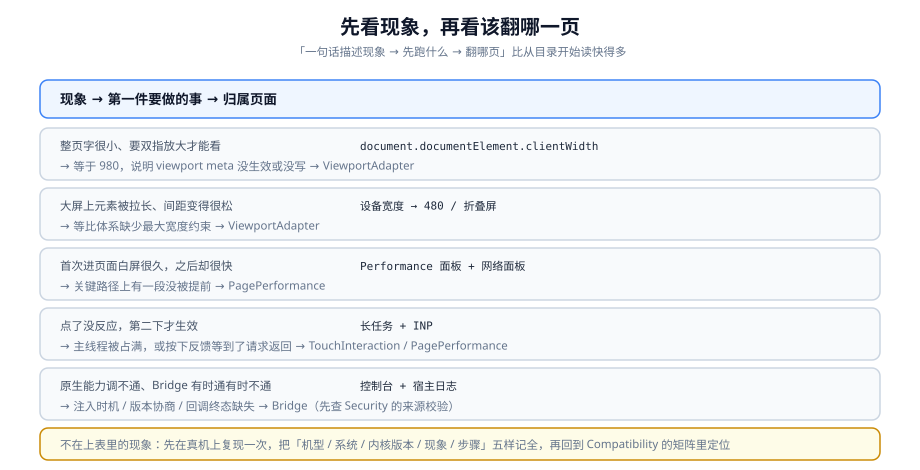

# 常见问题与最佳实践

本页是三件事：**一张分诊表**（从现象快速走到正确的页面）、**一份上线自查清单**（发布前逐条过）、以及**一本术语表**（把容易被混用的词钉死）。

::: tip 一句话理解
先按**现象**找页，不要按**目录**找页。移动端问题的现象与根因往往隔得很远——「点了没反应」可能是主线程被占满，也可能是桥接没回传，还可能是滚动穿透。
:::

## 一、现象分诊表



| 现象 | 先跑什么 | 翻哪页 | 最常见真因 |
| --- | --- | --- | --- |
| 整页字很小、要双指放大 | `document.documentElement.clientWidth` | [视口与适配体系](../ViewportAdapter/index.md) | 打印出 980 → `viewport` meta 没写或没生效 |
| 大屏上元素被拉长、间距变松 | 量 320 与 480 两端的实际尺寸 | [视口与适配体系](../ViewportAdapter/index.md) | 全部等比、没有最大宽度约束 |
| 正文在 320 宽的老机型上挤成一团 | `getComputedStyle` 读字号 | [视口与适配体系](../ViewportAdapter/index.md) | 字号被 % 或 vw 一起缩放，没有 `clamp()` 下限 |
| 底部按钮被 Home 指示条遮挡 | 查 `env()` 与 `viewport-fit` 是否同时存在 | [视口与适配体系](../ViewportAdapter/index.md) | 加了 `env()` 但漏了 `viewport-fit=cover`（此时四个 `env()` 全是 0） |
| 输入框被软键盘挡住 | `window.visualViewport.height` | [视口与适配体系](../ViewportAdapter/index.md) | `dvh` 默认不随键盘变化 |
| 首次打开白屏很久，之后却很快 | 识别 LCP 元素 | [首屏与运行时性能](../PagePerformance/index.md) | 首屏依赖了一段没被提前的资源（第三方 SDK / 字体 / 大图） |
| 点一下要等一会儿才有反应 | 长任务观察器 | [首屏与运行时性能](../PagePerformance/index.md) | 主线程被长任务占满（INP 超标） |
| 滚动明显发黏、不跟手 | 查触摸监听器是否 `passive` | [触摸与手势](../TouchInteraction/index.md) | `touchstart` / `touchmove` 上调了 `preventDefault` |
| 按钮点了之后一直亮着 | 查 `:hover` 样式 | [触摸与手势](../TouchInteraction/index.md) | 用 `:hover` 做按下态，触屏上会残留 |
| 弹窗打开后背景还能滚 | 打开弹窗后读 `document.body` 的 `position` | [触摸与手势](../TouchInteraction/index.md) | 只加了 `overflow: hidden`（iOS 上常无效） |
| 拖动到一半切走，回来元素卡住 | 构造一次 `pointercancel` | [触摸与手势](../TouchInteraction/index.md) | 只处理了 `up`，没处理 `cancel` |
| 桥接有时能用有时不能用 | 打印桥接对象是否存在 | [桥接通信](../Bridge/index.md) | 注入晚于首屏脚本；或页面重载后没重新等待 |
| 调了原生但一直转圈 | 两端日志按 `callId` 对齐 | [桥接通信](../Bridge/index.md) | 没有超时兜底，或原生没回传 |
| 从相机返回后报错 / 状态丢失 | 观察是否发生页面重载 | [桥接通信](../Bridge/index.md)、[首屏与运行时性能](../PagePerformance/index.md) | 系统回收内存导致 WebView 重载，旧回调仍在跑 |
| 部分机型白屏、无提示 | 查生产构建的语法目标 | [兼容与真机排障](../Compatibility/index.md) | 语法超出内核支持范围，脚本直接解析失败 |
| 支付能调通但金额不对 | 检查 `params` 里有没有金额 | [WebView 与桥接的安全面](../Security/index.md) | 金额由页面决定（应只传订单号，由服务端裁决） |
| 埋点抓到明文手机号 | 用包装函数打印上报载荷 | [WebView 与桥接的安全面](../Security/index.md) | 脱敏没做在统一上报入口 |

**不在表里的现象**：先在真机上复现一次，把**机型 / 系统 / 内核版本 / 现象 / 复现步骤**五样记全，再回到 [兼容与真机排障](../Compatibility/index.md) 的矩阵里定位。

## 二、高频十二问

### 1. 现在还要用 `rem` 方案吗

不建议新项目用。`rem` 是**字体相对单位**，用它承载整体布局属于语义误用；而且 `amfe-flexible` 一类依赖已停止维护。要「连续缩放」，`vw` + `clamp()` 已经足够，且不需要运行时 JS。

**存量项目**不必强行迁移——按模块切换、双方案共存，比一次性全局替换安全得多。

### 2. `100vh` 到底该怎么写

```css
.shell {
  height: 100vh;    /* 旧内核回退 */
  height: 100svh;   /* 滚动页面：永远不会被裁 */
  /* height: 100dvh;  应用外壳（聊天、地图）：跟随实时视口 */
}
```

- `svh` = 最小视口（工具栏都显示时的可视高度），**绝不被裁**，适合全文屏区。
- `lvh` = 最大视口（工具栏隐藏时），等于旧 `100vh`。
- `dvh` = 实时跟随，**滚动时会变**——用在滚动页面上会导致内容抖动。

### 3. `dvh` 为什么管不了软键盘

因为软键盘**只改变视觉视口**，而 `dvh` 跟随的是**布局视口**。要用运行时 API 或 `interactive-widget=resizes-content`（WebKit 截至 2026-09 尚未在公开版 Safari 提供）。见[视口与适配体系](../ViewportAdapter/index.md)。

### 4. iOS 上换个浏览器有用吗

没有。iOS 上所有浏览器（含第三方浏览器与 App 内嵌页）**共用 WebKit**，差异来自系统版本，不来自浏览器品牌。用户报「Safari 可以但 Chrome 不行」时，真实差异通常是缓存、登录态或那个 App 的内核版本。

### 5. 300ms 点击延迟还需要处理吗

在视口正确声明（`width=device-width`）的前提下**已经不存在**。继续引入消除延迟的 polyfill 只会带来「一次点击触发两次」的问题。**先确认视口，再谈延迟。**

### 6. Touch Events 是不是被废弃了

没有废弃，但它至今仍是 **Limited availability（非 Baseline）**——桌面 Safari 常不暴露。因此：新代码用 Pointer Events；需要兼容极老内核时补一层 Touch 兜底，但两套事件**必须共用同一个状态机**。

### 7. `@supports` 能不能用来判断键盘行为

不能。`@supports` 只检测**声明能否被解析**，检测不了**行为是否正确**。「浏览器支持 `dvh`」与「浏览器会在键盘弹起时重算 `dvh`」是两件事。行为类差异必须用运行时 API 或真机实测。

### 8. 为什么我的 `preload` 让页面更慢了

三种可能：给太多资源加了 `preload`（等于没有优先级）；给不关键的资源加了 `preload`（挤占带宽）；字体 `preload` **漏了 `crossorigin`**（导致下载两次）。

### 9. 用户没说有问题，是不是就没事

不是。遇到白屏的用户大多直接关掉，不会反馈。**要看的是环境画像的上报分布**（内核版本、关键能力探测的 `false` 比例），不是投诉数量。

### 10. 桥接调用要不要加超时

必须加。超时是「原生未实现 / 原生忘了回传 / 原生在忙」这三种情况下的**唯一兜底**。没有超时，用户会一直看着转圈直到自己关掉页面。

### 11. 桥接的来源校验放在前端行不行

不行。前端判断可以被绕过（注入脚本后，一切前端判断都不再可信）。**白名单必须在原生侧执行**，并且跨域跳转后桥接应当失效。

### 12. 支付金额可以让页面传吗

不可以。页面传金额意味着被注入后金额可被任意修改。**只传订单标识，金额由服务端根据订单查出。**

## 三、上线自查清单

### 视口与尺寸

- [ ] `viewport` meta 含 `width=device-width` 与 `initial-scale=1`
- [ ] 使用 `env(safe-area-inset-*)` 的地方同时声明了 `viewport-fit=cover`
- [ ] 没有使用 `user-scalable=no`（会破坏无障碍缩放）
- [ ] 正文字号用 `clamp()` 夹在绝对上下限内
- [ ] 可点击区域短边 ≥ 44×44 独立像素
- [ ] 1px 分隔线用 `0.5px` 或等价物理像素方案，不随等比缩放变化
- [ ] 600px 以上宽度有换布局或最大宽度约束

### 性能

- [ ] 性能结论带机型与网络档位
- [ ] 首屏 LCP 元素已被识别并记录
- [ ] 首屏 LCP 图不带 `loading="lazy"`，且只有它为 `fetchpriority="high"`
- [ ] 字体 `preload` 带 `crossorigin`
- [ ] 首屏不加载其他路由的代码
- [ ] 长列表有分片渲染或虚拟列表，单次插入 ≤ 50 条
- [ ] 滚动 / 触摸监听器为 `passive`
- [ ] 页面能承受「无预警重载」，关键状态可恢复

### 交互

- [ ] `up` 与 `cancel` 共用收尾函数
- [ ] 拖动方向判定有位移阈值（≥ 8px）
- [ ] 滚动交给浏览器仲裁（`touch-action`），不硬抢 `preventDefault`
- [ ] 弹窗打开时背景不可滚，关闭后恢复到原位置
- [ ] 按下反馈在本地事件内完成，且遵循 `prefers-reduced-motion`

### 桥接与安全

- [ ] 每次调用有唯一 `callId` 与超时
- [ ] 页面销毁时统一拒绝未完成调用
- [ ] 多次回传在 H5 侧幂等
- [ ] 宿主能力由宿主上报，不按版本号比较
- [ ] 桥接暴露面只有具名业务方法，没有通用入口
- [ ] 来源校验在原生侧执行，且跨域跳转后桥接失效
- [ ] 业务关键参数（金额 / 目标 / 权限）不由页面决定
- [ ] 生产构建关闭远程调试入口
- [ ] CSP 不含 `unsafe-inline`，含 `base-uri 'none'` 与 `object-src 'none'`
- [ ] 埋点在统一入口脱敏，载荷中无个人标识明文

### 兼容

- [ ] 支持面文档含**内核版本下限**
- [ ] 支持面每一行都写了「不支持时的表现」
- [ ] 能力判定用特性检测，不按 UA 决定功能可用性
- [ ] 生产构建的语法目标不低于支持面内最老内核
- [ ] 至少一台「最低支持面」的真机参与验证
- [ ] 顶层错误有兜底：首屏失败给可读提示而不是白屏
- [ ] 弱网 / 断网 / 后台恢复三类场景有明确行为并可复现

## 四、十二条最佳实践

1. **先证明视口生效，再谈适配。** 视口是 980 的时候，任何尺寸调整都是在错误的前提上做优化。
2. **把「哪些值不参与缩放」显式写出来。** 字号、可点面积、1px 线三类的下限，是适配方案里唯一需要人拍板的部分。
3. **用 `clamp()` 表达上下限，而不是用多个媒体查询。** 断点只能覆盖有限档位，`clamp()` 是连续的。
4. **首屏只看关键路径。** 优化动作要落在当前最长的那一段，改动之前先确认它是哪一段。
5. **性能结论必须带机型与网络。** 没有这两项的数字无法回归、无法复核、无法比较。
6. **按下反馈永远不依赖网络。** 用户判断「点到了没有」只看界面，不看请求。
7. **`up` 与 `cancel` 共用收尾。** 这是触摸交互里最省事也最容易被漏的一条。
8. **滚动让浏览器管。** `touch-action` 是声明式仲裁，`preventDefault` 是抢方向盘。
9. **桥接按「跨进程请求」设计。** 唯一 id、超时、幂等、销毁四件套一个都不能少。
10. **能力由宿主上报，不由前端推断。** 版本号与实际能力在真实世界里经常对不上。
11. **支持面必须包含「不支持时是什么样」。** 只写支持什么的矩阵，在实现时会自然退化成白屏。
12. **兼容的最后一层是构建目标。** 语法层面的不兼容，运行时兜底是抓不到的。

## 五、术语表

| 术语 | 含义 |
| --- | --- |
| 布局视口 | CSS 布局参照的宽度，由 `viewport` meta 决定 |
| 视觉视口 | 用户当前可见区域，受捏合缩放与软键盘影响 |
| 理想视口 | 设备认为最合适的宽度，约等于独立像素下的屏宽 |
| 独立像素（CSS 像素） | CSS 里书写的 `px` |
| DPR（设备像素比） | 物理像素 ÷ 独立像素，影响图片清晰度 |
| `svh` / `lvh` / `dvh` | 小 / 大 / 动态视口单位；分别对应工具栏可见、隐藏、实时状态 |
| 安全区 | 刘海、圆角、Home 指示条占用的不可用区域 |
| `viewport-fit=cover` | 允许内容延伸到安全区之外的声明；不写则四个 `env()` 全为 0 |
| `interactive-widget` | 声明软键盘如何影响视口；WebKit 截至 2026-09 尚未在公开版提供 |
| Pointer Events | 鼠标 / 触摸 / 触控笔统一的指针事件模型；Level 3 于 2026-06-30 成为 W3C 推荐标准 |
| `pointercancel` | 系统中止当前指针交互的事件（来电、切后台、旋转、掌压等） |
| `touch-action` | 声明式指定哪些手势交给浏览器处理的 CSS 属性 |
| 滚动穿透 | 弹窗打开后背景仍能滚动的缺陷 |
| `overscroll-behavior` | 控制滚动是否传递给父级容器，用于切断滚动链 |
| 长任务 | 占用主线程超过 50ms 的连续任务，INP 的主要成因 |
| LCP / INP / CLS | 最大内容绘制 / 交互到下次绘制 / 累计布局偏移 |
| P75 | 第 75 百分位，Core Web Vitals 的统计口径 |
| 桥接（bridge） | WebView 内 JS 与宿主原生之间的调用通道 |
| 宿主（host） | 承载 WebView 的那个 App |
| 回调留存表 | H5 侧按 `callId` 保存回调与超时定时器的结构 |
| 能力协商 | 宿主上报它支持的方法列表，前端据此选路径 |
| 安全上下文 | `https` 或 `localhost`；`getUserMedia`、`serviceWorker` 等依赖它 |
| 特性检测 | 通过 API 存在性或 `CSS.supports` 判断能力，而非解析 UA |
| 支持面 | 宿主 × 内核 × 版本的可支持范围，含不支持时的表现 |

## 六、验证方式

```shell
# 分诊的第一步永远相同：把现象与「机型 / 系统 / 内核版本」一起记下来
adb shell dumpsys webviewupdate | grep -i "Current WebView package"
# 期望：拿到内核版本，这是所有兼容判断的起点
```

```javascript
// 一条命令采集完整环境画像，用于填支持面与分诊表
(() => ({
  viewport: document.documentElement.clientWidth,
  visualViewport: Math.round(window.visualViewport?.height ?? -1),
  dpr: window.devicePixelRatio,
  dvh: CSS.supports("height", "100dvh"),
  safeArea: CSS.supports("padding-bottom", "env(safe-area-inset-bottom)"),
  pointer: "PointerEvent" in window,
  secure: window.isSecureContext,
  bridge: Boolean(window.appBridge?.invoke || window.webkit?.messageHandlers?.appBridge),
  ua: navigator.userAgent,
}))();
// 期望：所有字段都能读到具体值（不是 undefined / -1）
```

## 七、相关页面

- 起点：[总览：移动端 H5 的四条边界](../Overview/index.md)——六条地基判据 `MH-A`~`MH-F`。
- 分面：[视口与适配体系](../ViewportAdapter/index.md)、[首屏与运行时性能](../PagePerformance/index.md)、[触摸与手势](../TouchInteraction/index.md)、[桥接通信](../Bridge/index.md)、[兼容与真机排障](../Compatibility/index.md)、[WebView 与桥接的安全面](../Security/index.md)。
- 收官：[实战：把 PC 页面改造成移动端 H5](../Practice/index.md)——六步改造与六状态验收表。

## 八、参考资料

- [MDN · Viewport meta 标签](https://developer.mozilla.org/en-US/docs/Web/HTML/Viewport_meta_tag)
- [MDN · 浏览器兼容数据与 Baseline](https://developer.mozilla.org/en-US/docs/Glossary/Baseline/Compatibility)
- [W3C · Pointer Events Level 3](https://www.w3.org/TR/pointerevents3/)
- [web.dev · Web Vitals](https://web.dev/articles/vitals)
- [web.dev · 被动事件监听器](https://web.dev/articles/uses-passive-event-listeners)
- [Android Developers · WebView 安全建议](https://developer.android.com/privacy-and-security/security-tips)
- [Apple Developer · `WKScriptMessageHandler`](https://developer.apple.com/documentation/webkit/wkscriptmessagehandler)
