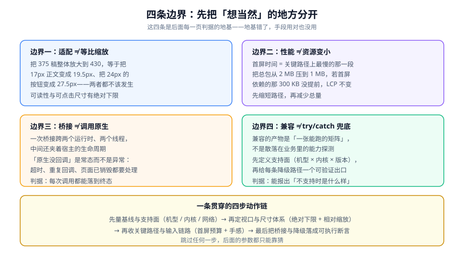

# 总览：移动端 H5 的四条边界

移动端 H5 的全部工作，可以压缩成一句话：**让同一份代码在不同尺寸、不同内核、不同宿主上的行为，从「看运气」变成「写在文档里的已知结果」**。

本页先立四条边界。它们是后面八页所有判据的地基——边界错了，手段用对也没用。

::: tip 一句话理解
**「在我手机上没问题」不是结论，是样本量=1 的观测。** 移动端 H5 的交付物不是页面，而是「一张支持面 + 一组判据 + 一份不支持时的表现说明」。
:::

## 一、先分清四个常被混用的量

### 1. 屏幕宽度 ≠ 布局宽度

这是移动端一切适配问题的起点。手机屏幕的物理宽度（比如 1170 个物理像素）和 CSS 里 `100%` 参照的布局宽度（比如 390 个 CSS 像素）之间隔着一个设备像素比（DPR，Device Pixel Ratio）。

| 量 | 定义 | 典型值 | 谁决定它 |
| --- | --- | --- | --- |
| 物理像素 | 屏幕真实发光点的数量 | 1170 × 2532 | 硬件 |
| 独立像素（CSS 像素） | CSS 里书写的 `px` | 390 × 844 | 系统缩放策略 |
| 设备像素比 DPR | 物理像素 ÷ 独立像素 | 3 | 硬件 + 系统缩放 |
| 布局视口宽度 | `100%` 参照的宽度 | 由 `viewport` meta 决定 | **你可以控制** |
| 视觉视口宽度 | 用户此刻真正看见的范围 | 捏合缩放后 ≠ 布局视口 | 用户操作 |

**关键点**：DPR 不是「适配问题」，它是**图片清晰度问题**。而布局视口宽度才是适配问题——它默认是 980px 左右（模拟桌面），这才是「手机上字很小、要双指放大」的根因。

```shell
# 在手机浏览器里打开控制台，或把下面这行贴进地址栏执行（需去掉换行）
# 期望：打印出来的宽度接近设备逻辑宽度（360~430），而不是 980
document.documentElement.clientWidth
```

**判读方式**：如果打印出 `980`，说明 `viewport` meta 没写或者没生效，后面所有适配讨论都无意义——先去 [视口与适配体系](../ViewportAdapter/index.md)。

### 2. 「适配」≠「等比缩放」

最容易被当成正确答案的做法是：把 375px 的设计稿按屏幕宽度线性放大到所有设备上。

代入一组数字：

| 元素 | 375 稿上的值 | 320 屏（×0.853） | 430 屏（×1.147） |
| --- | --- | --- | --- |
| 正文 | 16px | **13.7px** | **18.4px** |
| 次级说明 | 12px | **10.2px** | 13.8px |
| 图标按钮 | 24px | **20.5px** | 27.5px |

两端的值里各有一个不该出现：13.7px 的中文正文在 320 宽的老机型上已经低于舒适阅读下限；而 27.5px 的图标按钮在大屏上只是「看起来更大」，并没有带来任何可测量的好处。

::: danger 三个由「等比缩放」直接导致的错误结论
1. **「一份设计稿走天下」**——设计稿是在一个特定宽度下画出来的，它的字距与行高都隐含了那个宽度。等比缩放会把「恰好」变成「勉强」。
2. **「屏幕越大越好看」**——等比放大只放大尺寸，不放大信息密度。大屏上正确的做法通常是**换布局**（一行放两项），而不是让每一项变大。
3. **「字号用 rem 就统一了」**——`rem` 只是把换算集中到根字号，换算逻辑本身没变。把字号也交给同一个缩放因子，等于把上面那张表的效果全部接受下来。
:::

### 3. 「性能」≠「资源变小」

首屏时间等于**关键路径上最慢的那一段**，不是资源总量除以带宽。

```text
LCP ≈ DNS + TCP + TLS + TTFB + (关键 CSS 传输) + (关键 JS 下载与执行) + 首屏渲染
```

如果页面的首屏依赖一段 300 KB 的业务 JS，那么把另一个路由的包从 2 MB 压到 1 MB，LCP 一点都不会变。**优化动作必须落在当前最长的那一段上**——先量，再改。

### 4. 「兼容」≠「加 `try/catch`」

兼容的产物是**一张能跑的矩阵**：哪些宿主 × 哪些内核 × 哪些版本要支持，每条路径不支持时会发生什么。业务代码里散落的能力探测不是兼容方案，那是兼容方案缺失时留下的痕迹。

## 二、四条边界



### 边界一：适配不等于等比缩放

**判据**：任何一次适配讨论，都必须同时给出「缩放规则」和「哪些值不参与缩放」，否则这个规则没有意义。

**反面案例**：某项目的适配方案写着「全部尺寸按 750 稿转 vw」。上线后收到三类反馈：老机型上正文挤成一团、大屏上留白过多、以及「我的系统字号调大了但网页没变」。第三条尤其典型——用户把系统字号调大，是为了让文字变大，而 `vw` 方案会让文字**跟着屏幕而不是跟着用户意愿**变化。

正确做法是分两类处理：

| 类别 | 用什么 | 理由 |
| --- | --- | --- |
| 容器宽度、间距、装饰性尺寸 | 相对单位（`vw` / `%` / `rem`） | 它们的作用就是「按屏宽分配空间」 |
| 正文字号、可点击区域、1px 分隔线 | 绝对单位 + `clamp()` 夹逼 | 它们有物理上的可读 / 可点下限 |

```css
/* 字号参与缩放，但有上下限：320 宽时 14px，430 宽时不超过 17px */
/* 行高用无单位数值，随字号自动变化，不需要单独缩放 */
.article p {
  font-size: clamp(14px, 4.2vw, 17px);
  line-height: 1.7;
}

/* 可点击区域：短边不小于 44×44 独立像素 */
.icon-btn {
  min-width: 44px;
  min-height: 44px;
}
```

### 边界二：性能不等于资源变小

**判据**：性能结论必须带**机型与网络档位**，只写「很快」的结论一律无效。

一个真实的量级直觉（用于判断「我该不该担心」）：

| 设备档位 | JS 执行时间 | 相对中端机 |
| --- | --- | --- |
| 当年旗舰 | 基准 × 0.6 | 更快 |
| 三年前中端机 | 基准 × 1 | 参照 |
| 五年前低端机 | 基准 × 3 ~ 5 | 同一个页面会明显卡 |
| 老旧机型（系统已停止更新） | 基准 × 5 ~ 10 | 可能直接白屏 |

**为什么必须真机测**：`Lighthouse` 的模拟节流是一个折中值，它既不像旗舰那么快，也不像低端机那么慢。用它得到「绿灯」，推不出真实用户的实际体验。

::: warning 一条经验判据
**「首屏之后很快」不是好消息，是线索。** 它通常说明首屏被某一段同步的外链或脚本卡住了（第三方面板、字体、埋点 SDK、A/B 实验脚本）。这类问题的定位方式在[首屏与运行时性能](../PagePerformance/index.md)的关键路径一节。
:::

### 边界三：桥接不等于调用原生

WebView 里的 JS 和宿主原生代码之间，隔着：两个 JS 运行时（如果 WebView 与原生各有一个）、一个线程边界、以及**宿主的生命周期**（用户随时可能杀掉 App）。

所以「调用原生能力」这件事的真实形状是：

| 你以为的 | 实际的 |
| --- | --- |
| 调用一个函数，拿到一个返回值 | 发出一个请求，可能在 50ms 后收到回复，也可能永远收不到 |
| 失败会抛异常 | 失败往往是**静默的**：原生忘了调回调，页面就一直 `loading` |
| 每次调用独立 | 页面可能已经销毁，回调回来时 DOM 已经不存在 |
| 参数是 JS 对象 | 参数要经过序列化，函数、`undefined`、`Date` 的语义都会变 |

**判据**：每一次桥接调用都必须能落到四个终态之一——成功、明确失败、超时、页面已销毁。落到不了，就是缺陷。

### 边界四：兼容不等于兜底

**判据**：支持面之外的设备，必须给出**一个明确的、用户看得懂的结果**（可读的提示页），而不是白屏或者半截页面。

一个可用的四层结构（从上到下）：

| 层 | 做什么 | 例子 |
| --- | --- | --- |
| L1 首选实现 | 用现代能力 | `100dvh`、Pointer Events、`env(safe-area-inset-bottom)` |
| L2 静态回退 | 写在前一行，浏览器不认识就丢弃 | `height: 100vh;` 写在 `height: 100dvh;` 之前 |
| L3 运行时兜底 | 能力检测失败时换代码路径 | 用 `visualViewport` 计算键盘高度 |
| L4 明确不支持 | 可读提示 + 引导动作 | 「当前浏览器版本过低，请升级或在 App 内打开」 |

::: danger 最常见的错误：把 L4 做成白屏
白屏不是「不支持」，是「坏了」。用户无法区分「这个页面在维护」和「我的手机被这个网站拉黑了」。**L4 的成本极低（一个静态提示页），收益是客服工单数量的直接下降。**
:::

## 三、三个「以为不会发生」

### 1. 「我们的用户机型很新」

即使产品定位是年轻用户，长尾依然存在，而且长尾用户**恰恰是遇到白屏时最不会反馈的那一批**（他们通常直接关掉页面）。

验证方式：在生产环境里上报内核版本与关键能力探测结果，看分布的头尾。

```javascript
// 采集一条「环境画像」，随首个请求上报（注意不上报任何可识别个人的字段）
const profile = {
  // 不要按 UA 串做分支判断，只用于统计分布
  ua: navigator.userAgent,
  // 这些是能力，不是版本号——统计它们的分布比统计版本号有用得多
  dvh: CSS.supports("height", "100dvh"),
  safeArea: CSS.supports("padding-bottom", "env(safe-area-inset-bottom)"),
  pointer: "PointerEvent" in window,
  visualViewport: "visualViewport" in window,
  dpr: window.devicePixelRatio,
};
```

**判读方式**：如果 `dvh` 或 `pointer` 的 `false` 比例超过 1%，降级路径就不是「理论上要有」，而是必须测的。

### 2. 「真机测过就没问题」

真机测过的是**你手里的那台真机**。同一款机型，系统版本差两个大版本，WebView 内核可能差一年以上。

### 3. 「加个 `@supports` 就够了」

`@supports` 只能检测**声明是否被解析**，检测不了「行为是否正确」。典型的反例是动态视口与软键盘：

```css
/* 这段代码在支持 dvh 的浏览器上语法完全正确，但行为不对 */
/* 因为浏览器支持 dvh ≠ 浏览器会在软键盘弹起时重新计算 dvh */
.chat { height: 100dvh; }
```

**`@supports` 为真，不代表语义正确。** 行为类的差异必须靠运行时 API（`visualViewport`）或者实际测试确认。

## 四、什么时候不需要做这套设计

移动端适配有成本（构建配置、调试设备、维护成本）。以下五类场景**明确不该做**：

1. **只有一个固定宿主的内部工具**：如果这个页面只在公司自己的 App 里、只跑在统一发的测试机上，那么把 `viewport` 写对就够了，不需要适配矩阵。
2. **只服务一种屏幕的内嵌页**：例如固定在平板上的点餐页，屏幕尺寸单一，等比缩放反而是正确的。
3. **展示型静态页**：一篇图文，不需要手势、不需要桥接、不需要长列表，那么只要字号用 `clamp()` 兜住下限即可。
4. **流量极低的长期维护页**：投入产出比不划算，把支持面写窄（例如「仅支持近两年机型」）并在 L4 给提示页，是更诚实的选择。
5. **已经有稳定的设计系统与组件库**：此时适配规则已经沉淀在组件里，需要做的是**审计它们的规则是否自洽**（字号是否被一起缩放），而不是另起一套。

::: tip 一条实用判据
**当你写不出「最大宽度」和「最小字号」这两个数时，说明支持面还没定义。** 这两个数一旦定下来，绝大多数适配争论都会自动结束。
:::

## 五、最小起步三步

如果你刚拿到一个「在手机上打开就错版」的页面，按这个顺序做，每一步都有明确的完成定义。

### 第一步：确认视口生效

```shell
# 在真机浏览器控制台执行（或用移动端调试工具）
# 期望：输出接近设备逻辑宽度（360~430），而不是 980
document.documentElement.clientWidth
document.querySelector('meta[name=viewport]')?.content
```

**期望输出**：第一个命令是三位数且小于 500；第二个命令包含 `width=device-width`。
**完成定义**：视口正确，且 `initial-scale=1` 已写。

### 第二步：量出首屏基线

```shell
# 在真机 Chrome 上连接桌面 DevTools，或使用移动端性能面板
# 期望：拿到三个数：LCP、INP、CLS（P75 口径最好，单次观测先看量级）
```

**完成定义**：LCP / INP / CLS 三个数被记录下来，并注明机型与网络（例如：「中端安卓 + 4G，LCP 4.1s」）。

### 第三步：定支持面，再选降级

```text
支持面 = 宿主（浏览器 / 哪个 App）× 内核（WebKit / Chromium） × 版本下限

低于下限 → L4 提示页
下限之上但缺能力 → L3 运行时兜底
能力齐全 → L1 首选实现
```

**完成定义**：支持面被写进文档，L4 的提示页真实存在且打开过。**注意这是三条不同的路线，不是「越兜底越安全」**——在能力齐全的设备上堆兜底，只会引入没人测过的分支。

## 六、术语对齐

同一批词在不同团队里的含义经常不同，先把口径钉死。

| 术语 | 本专题的口径 | 常见误用 |
| --- | --- | --- |
| 布局视口 | CSS 布局参照的宽度，由 `viewport` meta 决定 | 与「屏幕宽度」混用 |
| 视觉视口 | 用户当前可见区域，受捏合缩放与软键盘影响 | 误以为它等于布局视口 |
| 独立像素（CSS 像素） | CSS 里书写的 `px` | 与物理像素混用 |
| DPR | 物理像素 ÷ 独立像素，影响图片清晰度 | 被当成「适配参数」去缩放布局 |
| 安全区 | 刘海、圆角、Home 指示条占用的不可用区域 | 误以为不加 `viewport-fit=cover` 时也有效（此时四个 `env()` 全是 0） |
| 桥接（bridge） | WebView 内 JS 与宿主原生之间的双向调用通道 | 与「HTTP 接口」混用——桥接不经过网络 |
| 宿主 | 承载 WebView 的那个 App | 被当成「浏览器」——宿主的权限远大于浏览器 |
| 首屏 | 从导航开始到 LCP 元素绘制的这段时间 | 与「首字节时间 TTFB」混用 |
| 长任务 | 占用主线程超过 50ms 的连续任务 | 被当成「慢接口」——长任务与网络无关 |
| 降级（graceful degradation） | 能力缺失时换一条**仍可用**的路径 | 与「报错」混淆——降级要返回可用结果 |

## 七、判据清单

本页是全专题的地基，所以判据写的是**边界**而不是手段：下面六条如果有一条不成立，后面八页的手段再对也会用错地方。

| 编号 | 判据 | 怎么验证 |
| --- | --- | --- |
| `MH-A` | 讨论适配前先证明视口已生效：`document.documentElement.clientWidth` 接近设备逻辑宽度而不是 980 | 真机控制台执行该表达式；等于 980 即前置条件不成立 |
| `MH-B` | 适配规则必须**显式列出不参与缩放的值**（字号下限、可点面积、1px 线） | 在样式文件里能找到 `clamp()` 或绝对单位；找不到即视为「全部等比」 |
| `MH-C` | 性能结论必须带**机型与网络档位**，否则无效 | 让人复述结论；说不出机型即视为无效 |
| `MH-D` | 每次桥接调用都能落到**成功 / 明确失败 / 超时 / 页面已销毁**四个终态之一 | 代码里存在超时定时器与销毁标记；缺任一项即不合格 |
| `MH-E` | 支持面之外的设备得到的是**可读提示**而不是白屏 | 用不在支持面的设备或强制关能力打开；白屏即不合格 |
| `MH-F` | 行为类差异不靠 `@supports` 判定（它只测语法，不测行为） | 检查键盘相关代码是否用了 `visualViewport`；只用 `@supports` 即不合格 |

::: warning `MH-A` 与 `MH-B` 是这两条最常被跳过
它们不是「理论」，而是**两处会让人做出错误适配的地方**：跳过 `MH-A`，后面所有尺寸讨论都建立在一个 980 宽的假设上；跳过 `MH-B`，就会得到「大屏上字更大更好读」这类在真实用户那里被立刻证伪的结论。两处的验证都很便宜——一次控制台执行、一次样式搜索。
:::

## 八、验证方式

本页的结论可以用三条命令在本地或真机环境验证。

```shell
# 1) 确认视口生效（在真机浏览器控制台执行）
document.documentElement.clientWidth
# 期望：三位数且小于 500。等于 980 → 视口未生效

# 2) 确认字号有绝对下限（把视口宽度切到 320 与 480，观察同一段正文）
# 期望：两端字号都在 14~17px 之间；320 端低于 14px 说明没有 clamp
```

```javascript
// 3) 确认能力探测与实际行为一致：在同一台真机上，把键盘弹起，比较 dvh 与视觉视口
const before = document.querySelector('.shell').getBoundingClientRect().height;
document.querySelector('input').focus();          // 弹起软键盘
setTimeout(() => {
  const after = document.querySelector('.shell').getBoundingClientRect().height;
  console.log({
    layoutHeight: before,
    afterKeyboard: after,
    visualHeight: window.visualViewport.height,
  });
}, 600);
// 期望：afterKeyboard 与 before 相同（dvh 不随键盘变化），
//       而 visualHeight 明显变小——这证明「dvh 管不了键盘」，必须另想办法
```

::: danger 三个会让上面三条检查给出错误结论的写法
1. **在桌面浏览器的设备模拟里做这三项检查**：模拟器不会渲染软键盘，也不会模拟地址栏收起，第 3 项一定得到错误结论。必须在真机上做。
2. **只看一次测量就下结论**：首次加载时字体、图片、埋点脚本都还没就位，测出来的 LCP 不可比。**先跑一轮丢弃，再取三轮的中位数。**
3. **把 `100%` 当成「屏幕宽度」**：`100%` 参照的是父元素（最终追溯到布局视口），而 `100vw` 参照的是包含滚动条的视口——两者在桌面端会有差异，在手机上通常一致，但**不要靠「通常一致」来写代码**。
:::

## 九、相关页面与下一篇

- 下一篇：[视口与适配体系](../ViewportAdapter/index.md)——把本页的「边界一」落成三条视口、三套尺寸体系与一张换算表。
- 相邻必读：[HTML meta 元信息](../../Basic/HTML/meta/index.md)（`viewport` 的语法）、[CSS 响应式布局](../../Basic/CSS/Advanced/Responsive/index.md)（跨档位的通用方法）。
- 反面对照：[微信小程序 · 性能](../../Frame/WxMini/Performance/index.md)——同一类「小屏 + 弱算力」约束，在双线程模型下瓶颈换了个位置。

## 十、参考资料

- [MDN · Viewport meta 标签](https://developer.mozilla.org/en-US/docs/Web/HTML/Viewport_meta_tag)
- [MDN · `VisualViewport`](https://developer.mozilla.org/en-US/docs/Web/API/VisualViewport)
- [web.dev · Web Vitals 阈值](https://web.dev/articles/vitals)
- [W3C · Pointer Events Level 3（2026-06-30 推荐标准）](https://www.w3.org/TR/pointerevents3/)
- [web.dev · 长时间任务与主线程阻塞](https://web.dev/articles/long-tasks-devtools)
