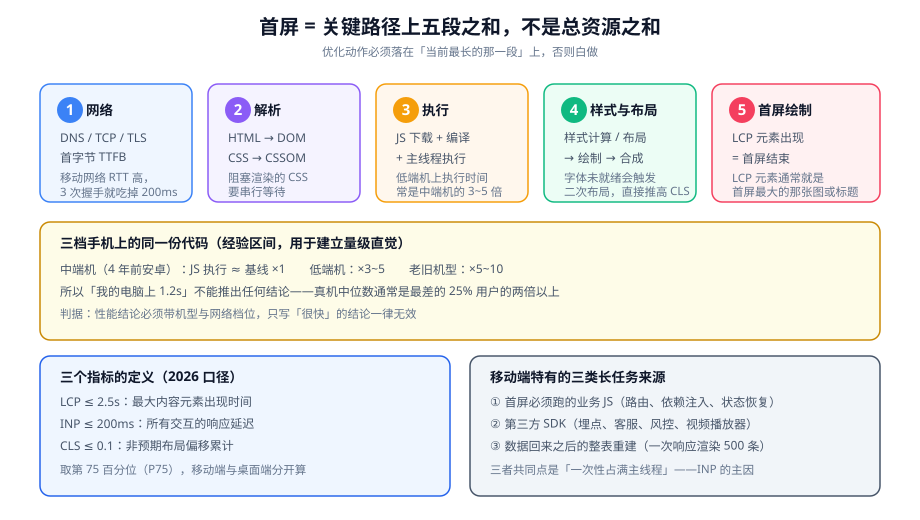

# 首屏与运行时性能

移动端性能有两个独立的战场：**首屏**（第一次看到内容要多久）与**运行中**（点了有没有反应）。它们由不同的原因造成，也要用不同的指标衡量——把两者混在一起讨论，就会得到「优化了加载但还是很卡」或者「点了很快但打开很慢」这类互相矛盾的结论。

::: tip 一句话理解
**首屏看你把什么放进了关键路径；流畅度看你把多少活放在了主线程。** 前者是网络与依赖图问题，后者是任务切分问题。
:::

## 一、先定义「首屏」

「首屏」在不同团队里指不同的事，先钉死口径：

| 口径 | 含义 | 什么时候用它 |
| --- | --- | --- |
| 首次绘制（FP） | 屏幕上出现第一个像素 | 只用来判断「有没有白屏」 |
| 首次内容绘制（FCP） | 出现第一段文本或图片 | 判断「用户是否感到页面开始了」 |
| 最大内容绘制（LCP） | **首屏最大的内容元素**绘制完成 | **本页的主指标** |
| 可交互时间（TTI） | 主线程空闲、可以稳定响应输入 | 判断「能不能点」 |

选择 LCP 作为主指标的理由很实际：它与用户的主观感受最一致——用户说的「打开了」，指的是**主要内容出现了**，而不是「某处出现了像素」。

```text
LCP 元素通常是这两者之一：
  1) 首屏最大的那张图片 / 轮播首图
  2) 首屏那段最大的标题文字（依赖字体与 CSS）
```

::: info 阈值口径（2026 年）
Core Web Vitals 的三条阈值自 2024-03 起未变：**LCP ≤ 2.5s、INP ≤ 200ms、CLS ≤ 0.1**，均取**第 75 百分位**，移动端与桌面端分开统计。注意两点：第一，FID 已被 INP 取代，仍在报 FID 的工具用的是过期数据；第二，这三条是「用户体验」指标，不是「打分」指标，用它做优化目标比用它做考核目标更有意义。
:::

## 二、关键路径五段拆解



把 LCP 拆成五段，每一段都有可测量的来源：

| 段 | 包含什么 | 怎么量 | 常见的「其实卡在这里」 |
| --- | --- | --- | --- |
| 1 网络 | DNS、TCP、TLS、TTFB | 网络面板的首个请求 | 移动网络 RTT 高，三次握手就可能吃掉 200ms |
| 2 解析 | HTML → DOM、CSS → CSSOM | 性能面板的 Parse HTML / Recalculate Style | 阻塞渲染的 CSS（放在 `<head>` 的大样式文件） |
| 3 执行 | JS 下载 + 编译 + 主线程执行 | 性能面板的长任务 | 首屏必须跑的业务 JS |
| 4 样式与布局 | 样式计算 → 布局 → 绘制 → 合成 | 性能面板的 Layout / Paint | 字体未就绪导致的二次布局 |
| 5 首屏绘制 | LCP 元素出现 | LCP 属性（可在控制台读） | 图片没提前、字体在等 |

### 定位 LCP 元素与它的分段

```javascript
// 贴进真机控制台：打印 LCP 元素，并判断它属于哪一类
new PerformanceObserver((list) => {
  const last = list.getEntries().at(-1);
  const el = last.element;
  console.log({
    startTime: Math.round(last.startTime),
    url: last.url || null,
    tag: el?.tagName,
    text: el?.textContent?.slice(0, 40),
  });
}).observe({ type: "largest-contentful-paint", buffered: true });
// 期望：能看到 LCP 元素的标签与时间
// 判读：tag 是 IMG → 先查图片（体积、格式、加载优先级）
//       tag 是 H1/P 且 url 为空 → 多半是字体或阻塞 CSS
```

::: danger 三个会让这段代码给出错误结论的原因
1. **`buffered: true` 忘了加**：不加就只观察观察之后的条目，而 LCP 往往已经发生过了。
2. **在页面加载完之后才贴代码**：此时要看 `buffered` 里的历史条目；如果控制台不支持 `buffered` 回读，就刷新页面并让脚本在 `<head>` 里先执行。
3. **把最后一次 LCP 当成最终 LCP**：LCP 会随着更大元素的出现而更新。**判断标准是「用户交互或页面隐藏之前的那一次」**。
:::

### 网络段：为什么手机上的 TTFB 更贵

| 环节 | 桌面（同城） | 手机 4G（同城） |
| --- | --- | --- |
| DNS | 10~30ms | 30~80ms |
| TCP（1.5 RTT） | 20~40ms | 60~150ms |
| TLS（1~2 RTT） | 30~60ms | 80~250ms |
| 合计地面开销 | 约 60~130ms | **约 170~480ms** |

**推论**：把「三次握手 + TLS」省掉的手段（HTTP/2 连接复用、`preconnect`、合理的 `Cache-Control`）在移动端的收益远大于桌面。

```html
<!-- 提前建立到关键源的连接：只给真正需要的源加，加多了会挤占带宽 -->
<link rel="preconnect" href="https://cdn.example.com" crossorigin />
<link rel="dns-prefetch" href="https://analytics.example.com" />
<!-- 首屏关键资源提前抓取：字体与首屏图 -->
<link rel="preload" as="image" href="/img/hero-750.jpg" fetchpriority="high" />
```

## 三、三档手机上的同一份代码

量级直觉（用于判断「这个问题值不值得修」）：

| 档位 | JS 执行 | 首屏绘制 | 现象 |
| --- | --- | --- | --- |
| 当年旗舰 | ×0.5~0.7 | 1.0~1.5s | 几乎无感 |
| 三年前中端机 | ×1（基准） | 2.0~3.0s | 可接受 |
| 五年前低端机 | ×3~5 | 4.0~8.0s | 明显白屏；INP 超阈值 |
| 老旧机型 / 停更系统 | ×5~10 | 8.0s+ 或白屏 | 用户直接关闭 |

::: warning 一条必须写进性能结论的纪律
**任何性能数字都要带机型与网络档位。** 「我们的首页加载很快」这句话在工程上没有信息量；「中端安卓 + 4G，LCP 3.4s」才是可比较、可回归、可以被别人复核的结论。这也是总览里 `MH-C` 那条判据的具体落地。
:::

## 四、四个优化动作，按性价比排序

优化的顺序不能按「哪个听着高级」排，要按**当前最长的那一段**排。下面是适合作为第一批动作的四项。

### 1. 缩短关键路径：把非首屏的东西移出去

| 动作 | 怎么做 | 效果来源 |
| --- | --- | --- |
| 路由级分包 | 每个页面一个 chunk，首屏只加载当前路由 | 减少首屏必须下载与执行的 JS |
| 组件级懒加载 | 弹窗、图表、编辑器用动态 `import()` | 把「可能用不到」的代码移出关键路径 |
| 第三方脚本延后 | 埋点、客服、A/B 实验在首次交互后加载 | 直接消掉一类长任务 |

```javascript
// 路由级分包（以动态 import 为例，框架无关的写法）
const routes = [
  { path: "/", load: () => import("./pages/Home.js") },     // 首屏
  { path: "/detail", load: () => import("./pages/Detail.js") },
];

// 非关键能力：等到真正需要时再加载
async function openEditor() {
  const { createEditor } = await import("./features/editor.js");
  return createEditor(document.querySelector("#editor"));
}

// 第三方脚本：与首次交互竞争，用户不动就不加载
function loadAfterInteraction(src) {
  const once = () => {
    const s = document.createElement("script");
    s.src = src;
    s.async = true;
    document.head.appendChild(s);
    ["pointerdown", "keydown", "scroll"].forEach((e) =>
      window.removeEventListener(e, once, { passive: true })
    );
  };
  ["pointerdown", "keydown", "scroll"].forEach((e) =>
    window.addEventListener(e, once, { passive: true, once: false })
  );
}
loadAfterInteraction("https://cdn.example.com/customer-service.js");
```

### 2. 把首屏资源提前：`preload` 要克制

```html
<!-- 只提前「关键路径上、且发现得晚」的资源 -->
<!-- 字体：CSS 里的 @font-face 要等 CSSOM 才被发现，所以值得提前 -->
<link rel="preload" as="font" type="font/woff2" href="/fonts/body.woff2" crossorigin />
<!-- 首屏图 -->
<link rel="preload" as="image" href="/img/hero-750.jpg" fetchpriority="high" />
```

::: danger `preload` 最常见的两个误用
1. **把不关键的东西也 preload**：`preload` 是提高优先级，它挤占的是同一带宽。给 5 个资源加 `preload`，等于没有优先级。
2. **字体 `preload` 漏了 `crossorigin`**：字体的请求是 CORS 请求，漏掉这个属性会导致**下载两次**（一次 preload、一次真实引用），比不 preload 更慢。
:::

### 3. 图片：格式 + 尺寸 + 优先级

| 动作 | 效果 | 注意 |
| --- | --- | --- |
| 换成 AVIF / WebP | 体积通常降 25%~50% | 用 `<picture>` 提供 JPEG 兜底 |
| 按屏宽提供多档 | 避免给小屏发大图 | `sizes` 要与真实布局宽度一致 |
| 首屏图加 `fetchpriority="high"` | 提前开始下载 | 只给一张图加 |
| 非首屏图加 `loading="lazy"` | 首屏少下载 | **首屏图绝不能加** |

### 4. 字体：避免二次布局

```css
/* 让文字先用系统字体渲染出来，字体到了再替换 */
@font-face {
  font-family: "Body";
  src: url("/fonts/body.woff2") format("woff2");
  font-display: swap;
  /* 可选：用尺寸调整减少替换时的抖动（新特性，支持面之外的浏览器忽略） */
  size-adjust: 100%;
  ascent-override: 90%;
  descent-override: 22%;
}
```

**权衡**：`font-display: swap` 会让文字短暂使用回退字体（可能出现一次视觉变化），`block` 则会让文字短暂不可见（推后 FCP）。**移动端优先选 `swap`**——内容出现时间比字形一致性更重要。

## 五、运行时性能：长任务与 INP

INP 度量的是「用户操作到下一个画面」的延迟，它的主因是**主线程长任务**。

### 1. 长任务从哪来

| 来源 | 典型形态 | 处置 |
| --- | --- | --- |
| 首屏业务 JS | 路由初始化、依赖注入、状态恢复一次性跑完 | 切分 + 延后非关键部分 |
| 第三方 SDK | 埋点批处理、客服组件初始化、播放器预热 | 延后到首次交互之后 |
| 数据回来后的整表重建 | 一次响应渲染 500 条 DOM | 分片渲染 / 虚拟列表 |
| 事件处理器里的重活 | `pointerdown` 里同步算完整个筛选结果 | 只做置态，计算放到下一个空闲时段 |

### 2. 定位长任务

```javascript
// 贴进真机控制台：把超过 50ms 的任务打出来（含归因）
new PerformanceObserver((list) => {
  for (const t of list.getEntries()) {
    console.warn(`长任务 ${Math.round(t.duration)}ms`, {
      start: Math.round(t.startTime),
      // 归因字段在支持的浏览器上有值；没有时用下方的 attribution 模式
      attribution: t.attribution?.[0]?.name,
    });
  }
}).observe({ type: "longtask", buffered: true });
```

```javascript
// 按「代码位置」归因（需要浏览器支持 long-animation-frame 或对应属性）
new PerformanceObserver((list) => {
  for (const entry of list.getEntries()) {
    const scripts = entry.scripts ?? [];
    for (const s of scripts) {
      console.warn("重活来自", s.name, s.invoker, `${Math.round(s.duration)}ms`);
    }
  }
}).observe({ type: "long-animation-frame", buffered: true });
```

### 3. 把一次重活拆开

```javascript
// 反例：一次性渲染 500 条，主线程被占满，INP 直接爆掉
function renderAll(container, items) {
  container.innerHTML = items.map(toHtml).join("");
}

// 正例一：分片渲染，每帧只做一小块，给输入留出响应机会
async function renderChunked(container, items, chunk = 30) {
  let i = 0;
  while (i < items.length) {
    const slice = items.slice(i, i + chunk);
    container.insertAdjacentHTML("beforeend", slice.map(toHtml).join(""));
    i += chunk;
    // 让出一帧，输入事件才有机会被处理
    await new Promise((r) => requestAnimationFrame(r));
  }
}

// 正例二：条目极多时用虚拟列表，只渲染视口内的一屏
```

::: danger 「用 `requestIdleCallback` 拆活」的两个前提
1. **`requestIdleCallback` 在 Safari 上长期不可用**（可用性随版本变化）。要用就必须写回退：`requestIdleCallback || (cb) => setTimeout(() => cb({ timeRemaining: () => 0 }), 1)`。
2. **空闲回调不保证及时执行**：页面持续忙碌时它可能一直不触发。**对「必须在若干毫秒内完成」的任务，用 `requestAnimationFrame` 分片，不要用空闲回调。**
:::

## 六、长列表：移动端的默认形态

列表页在移动端几乎是必然场景，而它的三个坑是固定的。

| 坑 | 现象 | 正解 |
| --- | --- | --- |
| 全量渲染 | 500 条一次性插入，白屏 1~2s | 分片渲染起步；超过 200 条考虑虚拟列表 |
| 图片一起加载 | 滚动时才一张张下载，滚到底全是空白 | 图片 `loading="lazy"` + 首屏预取前 2~3 屏 |
| 滚动中做重活 | 滚动掉帧，触发「滚动就卡」的反馈 | 滚动监听只置态，重活放到滚动停止之后 |

```javascript
// 滚动停止之后再算（滚动中只记录最新位置）
let ticking = false;
function onScroll() {
  if (ticking) return;
  ticking = true;
  requestAnimationFrame(() => {
    ticking = false;
    // 这里只做极轻的工作：判断是否需要触发下一次加载
    if (window.scrollY + window.innerHeight > document.body.scrollHeight - 400) {
      scheduleLoadMore();
    }
  });
}
window.addEventListener("scroll", onScroll, { passive: true }); // 必须 passive
```

## 七、内存与切后台

手机的内存压力远大于桌面，而且**系统会在后台直接回收内存**。

| 现象 | 原因 | 处置 |
| --- | --- | --- |
| 长时间使用后页面变卡 | DOM 节点只增不减、定时器堆积 | 定期清理离屏节点；卸载时清定时器与监听器 |
| 切回前台后页面重载 | 系统回收了 WebView 内存 | **必须能承受「无预警重载」**：关键状态存 `sessionStorage` |
| 来回切换几次后崩溃 | 每次进入都注册了新的监听器 | 注册/注销成对出现；用 `AbortController` 一次性解绑 |

```javascript
// 用 AbortController 一次性解绑一组监听器（避免「注销漏了一处」）
const ac = new AbortController();
window.addEventListener("scroll", onScroll, { passive: true, signal: ac.signal });
window.addEventListener("pointerdown", onPointerDown, { signal: ac.signal });

// 页面销毁 / 组件卸载时
ac.abort();

// 状态复原：切后台被回收后，重新进入时恢复关键状态
const KEY = "page-state-v1";
window.addEventListener("pagehide", () => {
  sessionStorage.setItem(KEY, JSON.stringify({ scrollY: window.scrollY, tab: currentTab }));
});
const saved = sessionStorage.getItem(KEY);
if (saved) restoreState(JSON.parse(saved));
```

::: warning 一条容易被忽略的判据
**「切后台再回来，页面还是原来那个样子」应当被当作一项功能来验证**，而不是期望。在低内存机型上，从相机、地图或支付 App 返回时页面被系统重载是常态——如果此时用户填了一半的表单清空了，那是产品缺陷，不是「手机的锅」。
:::

## 八、判据清单

| 编号 | 判据 | 怎么验证 |
| --- | --- | --- |
| `PF-A` | 性能结论带机型与网络档位（承接 `MH-C`） | 结论里能读出机型与网络；读不出即无效 |
| `PF-B` | 首屏 LCP 元素已被识别并记录（元素与时间） | 用 `PerformanceObserver` 打印；说不出来即不合格 |
| `PF-C` | 首屏 LCP 图不带 `loading="lazy"`，且唯一指定 `fetchpriority="high"` | 搜索代码；命中两项之一即缺陷 |
| `PF-D` | 字体 `preload` 带 `crossorigin`，且只 preload 关键字体 | 检查 `<link rel="preload" as="font">` 是否有 `crossorigin` |
| `PF-E` | 存在路由级或组件级分包，首屏不加载非首屏页面代码 | 查看构建产物：首屏 chunk 不含其他路由 | 
| `PF-F` | 长列表有分片渲染或虚拟列表；单次 DOM 插入不超过约定条数（建议 ≤ 50） | 代码审查 + 真机滚动观察帧率 |
| `PF-G` | 所有滚动 / 触摸监听器为 `passive: true`（除确实需要 `preventDefault` 的） | 搜索 `addEventListener` 与 `passive` 的重合 |
| `PF-H` | 页面能承受「无预警重载」：关键状态可恢复，监听器有注销路径 | 真机上切后台 → 打开相机 → 返回，观察状态是否丢失 |

## 九、验证方式

```shell
# 1) 采集一份可比较的性能快照（真机 + 桌面 DevTools 远程调试）
# 期望：拿到 LCP / INP / CLS 三个数（至少 3 次取中位数），并记下机型与网络
```

```javascript
// 2) 一次性打印三个核心指标（贴进真机控制台，然后正常使用页面）
(() => {
  const m = {};
  new PerformanceObserver((l) => {
    for (const e of l.getEntries()) m.LCP = Math.round(e.startTime);
  }).observe({ type: "largest-contentful-paint", buffered: true });

  new PerformanceObserver((l) => {
    for (const e of l.getEntries()) if (!e.hadRecentInput) m.CLS = +(m.CLS ?? 0) + e.value;
  }).observe({ type: "layout-shift", buffered: true });

  const probe = { lcp: () => m.LCP, inp: () => m.INP, cls: () => +(m.CLS ?? 0).toFixed(4) };
  // 交互几次后再调用 probe，能读到当时的值
  window.__vitals = probe;
  return "已开始采集；交互几次后执行 __vitals()";
})();
// 期望：__vitals() 返回 { lcp: 2400, inp: undefined, cls: 0.03 } 这类可读数值
// INP 需要 Event Timing 观察器补，或在 DevTools Performance 面板里读
```

```shell
# 3) 长任务与分包验证（在真机上做一次首屏加载，导出 Performance 录制）
# 期望：首屏期间超过 50ms 的长任务不超过 2 个，且没有单个超过 200ms 的任务
# 判读：出现 300ms 以上的单个长任务 → 先定位它的归因，再决定切分方案
```

::: danger 三个让性能测量失真的做法
1. **在开发构建上测**：开发构建不做压缩、不做 tree-shaking、包含 HMR 运行时代码，测出来的数字与线上差一个量级。**必须用生产构建。**
2. **在 USB 连接充电的手机上测**：充电状态下部分机型会放开 CPU 频率限制，测出来的结果比真实用户好。**拔掉线或至少确认没有高频模式。**
3. **只测冷启动一次**：第二次打开会因为缓存变快，而用户第一次打开才是真实体验。**冷启动与热启动都要测，分开报告。**
:::

## 十、相关页面与下一篇

- 下一篇：[触摸、手势与输入](../TouchInteraction/index.md)——把「点了有没有反应」的下半截（输入链路）补齐。
- 上游必读：[视口与适配体系](../ViewportAdapter/index.md)（`VA-G`：首屏图的加载优先级）。
- 相邻必读：[浏览器性能优化](../../Others/PerformanceOptimization/index.md)（通用手段清单）、[浏览器 · 渲染管线](../../Basic/Browser/Performance/index.md)（管线内部怎么走）。

## 十一、参考资料

- [web.dev · Web Vitals（LCP / INP / CLS 阈值与定义）](https://web.dev/articles/vitals)
- [web.dev · 优化 LCP](https://web.dev/articles/optimize-lcp)
- [web.dev · 优化 INP](https://web.dev/articles/optimize-inp)
- [MDN · `PerformanceObserver`](https://developer.mozilla.org/en-US/docs/Web/API/PerformanceObserver)
- [MDN · `requestIdleCallback`](https://developer.mozilla.org/en-US/docs/Web/API/Window/requestIdleCallback)
- [Chrome for Developers · 长动画帧（Long Animation Frames）](https://developer.chrome.com/docs/web-platform/long-animation-frames)
