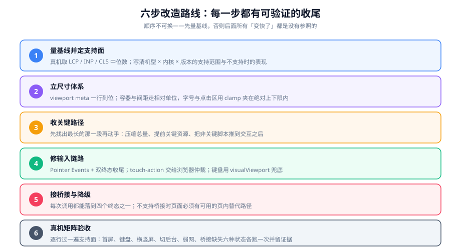

# 实战：把 PC 页面改造成移动端 H5

前面七页讲的是「面」，本页把它们串成一次完整改造：**一个只在桌面浏览器上用过的商品详情页，要在手机浏览器与自家 App 内嵌 WebView 里都能用**。六步、每步有可执行的收尾。

::: tip 一句话理解
改造的顺序不是「哪个问题最明显先修哪个」，而是**先量基线，再定尺寸，再收关键路径，最后处理交互与桥接**。顺序换掉，后面每一步的结论都会失去参照。
:::

## 一、设定场景

| 项 | 值 |
| --- | --- |
| 原页面 | 商品详情页（PC 版）：图片轮播 + 规格选择 + 价格区 + 富文本详情 + 推荐列表 |
| 现状问题 | 手机上字偏小；图片很大加载慢；规格弹窗打开后背景能滚；App 内「立即购买」调不起支付 |
| 支持面 | iOS 16+（全部 WebKit）、Android Chromium 100+（浏览器与 App 内嵌 WebView） |
| 场景分级 | 浏览 = 允许降级；下单支付 = **必须完整能力**，否则明确拒绝 |
| 验证设备 | 一台 4 年前的中端安卓 + 一台当前 iPhone，各装浏览器与自家 App |

::: info 为什么把「支付」单独分级
同一个页面在不同业务场景下的要求可以不同。浏览页降级只是体验问题，而一个降级过的支付流程**风险远大于让用户换个环境**。**把场景分级写进支持面，是这一步最重要的产出**——它决定了后面哪些地方必须给「明确拒绝」而不是「尽力而为」。
:::

## 二、六步改造路线



### 第一步：量基线并定支持面

**做什么**：在真机上把当前状态量出来，写成一份可回归的基线。

```javascript
// 贴进真机控制台，采集环境画像与三项核心指标
(async () => {
  const env = {
    viewport: document.documentElement.clientWidth,
    dpr: window.devicePixelRatio,
    dvh: CSS.supports("height", "100dvh"),
    safeArea: CSS.supports("padding-bottom", "env(safe-area-inset-bottom)"),
    pointer: "PointerEvent" in window,
    visualViewport: "visualViewport" in window,
    secure: window.isSecureContext,
  };

  const vitals = {};
  new PerformanceObserver((l) => {
    for (const e of l.getEntries()) vitals.LCP = Math.round(e.startTime);
  }).observe({ type: "largest-contentful-paint", buffered: true });

  new PerformanceObserver((l) => {
    for (const e of l.getEntries()) if (!e.hadRecentInput) vitals.CLS = +(vitals.CLS ?? 0) + e.value;
  }).observe({ type: "layout-shift", buffered: true });

  setTimeout(() => console.log({ env, vitals }), 6000);
  return "已开始采集，6 秒后打印";
})();
```

**基线样例（这是改造前的真实形状，用于对照）**：

| 指标 | 改造前 | 改造后目标 | 说明 |
| --- | --- | --- | --- |
| 布局视口宽度 | **980** | 390 | 说明 `viewport` meta 完全没写 |
| 正文实际字号 | 12px | 15~17px | 980 宽页面被整体缩小 |
| LCP | 6.8s | ≤ 2.5s | 首屏主图 1.8 MB 且未提前 |
| CLS | 0.31 | ≤ 0.1 | 图片无宽高，轮播初始化后跳动 |
| 「立即购买」可用 | 否（无桥接） | 可用或明确拒绝 | 桥接调用无降级路径 |

**完成定义**：五个数被记录下来，且注明机型与网络（例如「中端安卓 + 4G」）。

::: danger 第一步最容易跳过，后果最贵
跳过基线，后面所有「变快了」都变成没有参照的断言；跳过支持面，「不支持时的表现」就永远没人负责。这两件事加起来只需要半小时，却能省掉后续几轮扯皮。
:::

### 第二步：立尺寸体系

**做什么**：补 `viewport`，然后把「哪些值缩放、哪些值不缩放」写进一份 token 文件。

```html
<!-- index.html 的 <head> 最前面 -->
<meta
  name="viewport"
  content="width=device-width, initial-scale=1, viewport-fit=cover, interactive-widget=resizes-content"
/>
```

```css
/* styles/tokens.css */
:root {
  /* 参与缩放 */
  --gap-sm: 2.13vw;
  --gap-md: 4.27vw;
  --gap-lg: 6.4vw;

  /* 不参与缩放：字号夹在绝对上下限内 */
  --font-title: clamp(18px, 5.3vw, 22px);
  --font-body: clamp(14px, 4.27vw, 17px);
  --font-caption: clamp(11px, 3.2vw, 13px);

  /* 不参与缩放：命中区与物理像素 */
  --tap-min: 44px;
  --hairline: 0.5px;

  /* 安全区（横屏时左右两组同样需要） */
  --safe-bottom: env(safe-area-inset-bottom, 0px);
  --safe-left: env(safe-area-inset-left, 0px);
  --safe-right: env(safe-area-inset-right, 0px);
}

/* 大屏换布局，而不是继续放大 */
@media (min-width: 600px) {
  .spec-list { display: grid; grid-template-columns: repeat(2, 1fr); gap: 24px; }
}
```

**验证**：在 320 / 375 / 430 三个宽度下分别读取正文字号与行高。

```javascript
// 逐宽度验证：字号必须在上下限之内，行高与字号之比保持稳定
(() => {
  const el = document.querySelector(".detail p");
  const s = getComputedStyle(el);
  return {
    width: document.documentElement.clientWidth,
    fontSize: s.fontSize,
    lineHeight: s.lineHeight,
  };
})();
// 期望（三个宽度各跑一次）：fontSize 落在 14~17px，lineHeight / fontSize ≈ 1.6~1.8
```

**完成定义**：`VA-A`、`VA-C`、`VA-D`、`VA-F` 四条在同一次检查中通过。

### 第三步：收关键路径

**做什么**：先找出最长的那一段，再动手。

```javascript
// 找出 LCP 元素属于哪一类（决定后面查图片还是查字体 / CSS）
new PerformanceObserver((list) => {
  const last = list.getEntries().at(-1);
  console.log({
    lcp: Math.round(last.startTime),
    tag: last.element?.tagName,
    url: last.url || "(无，多半是文本 → 查字体与阻塞 CSS)",
  });
}).observe({ type: "largest-contentful-paint", buffered: true });
```

**按「最长的一段」选动作**：

| 如果 LCP 卡在 | 就先做 | 具体动作 |
| --- | --- | --- |
| 网络 | 提前关键资源 | 首屏图 `preload` + `fetchpriority="high"`；`preconnect` 到 CDN |
| 图片本身 | 换格式与尺寸 | AVIF / WebP；按屏宽提供多档；首屏图不懒加载 |
| 执行 | 分包 + 延后 | 路由级分包；富文本与推荐列表动态 `import()`；第三方脚本延后到首次交互 |
| 样式 | 内联关键 CSS | 首屏样式内联，其余异步加载 |
| 字体 | 减少等待 | `font-display: swap`；只 preload 关键字体且带 `crossorigin` |

```html
<!-- 改造后的首屏图：显式宽高、多档尺寸、优先加载、不懒加载 -->


<!-- 首屏之外的推荐列表图：懒加载 -->

```

```javascript
// 富文本详情与推荐列表移出关键路径
async function mountBelowFold() {
  const [{ renderRichText }, { renderRecommend }] = await Promise.all([
    import("./features/rich-text.js"),
    import("./features/recommend.js"),
  ]);
  renderRichText(document.querySelector("#detail"));
  renderRecommend(document.querySelector("#recommend"));
}
// 首屏渲染完成后再挂载
requestAnimationFrame(() => mountBelowFold());
```

**验证**：重跑第一步的采集脚本，LCP 与 CLS 应当同时改善。

**完成定义**：`PF-B`、`PF-C`、`PF-D`、`PF-E` 通过，且 LCP 相比基线至少下降 40%（达不到就说明动作落错了段）。

### 第四步：修输入链路

**做什么**：把规格弹窗、数量步进器、图片轮播三处交互按 `TG-A`~`TG-H` 重写。

```javascript
// 规格弹窗：打开时钉住背景，关闭时恢复滚动位置
let savedScrollY = 0;

function openSpecSheet() {
  savedScrollY = window.scrollY;
  document.body.style.position = "fixed";
  document.body.style.top = `-${savedScrollY}px`;
  document.body.style.width = "100%";
  sheet.hidden = false;
  sheet.querySelector(".sheet-body")?.scrollTo(0, 0);
}

function closeSpecSheet() {
  sheet.hidden = true;
  document.body.style.position = "";
  document.body.style.top = "";
  document.body.style.width = "";
  window.scrollTo(0, savedScrollY);   // 回到打开前的位置
}
```

```css
/* 轮播：纵向滚动交给浏览器，横向自己处理 */
.carousel { touch-action: pan-y pinch-zoom; }

/* 弹窗内部滚动不传递给背景 */
.sheet-body { overflow-y: auto; overscroll-behavior: contain; }

/* 按下反馈：本地事件即生效，不依赖网络 */
.spec-option { transition: background-color 80ms ease-out, border-color 80ms ease-out; }
.spec-option:active { border-color: var(--color-primary); background: var(--color-primary-weak); }

/* 步进器按钮：视觉 20px，命中区 44px */
.stepper-btn { position: relative; width: 20px; height: 20px; }
.stepper-btn::after { content: ""; position: absolute; inset: -12px; }
```

**必做的一项验证**：把「拖动到一半被系统打断」这件事主动构造出来。

```shell
# 构造 pointercancel 的最简方法（真机）
# 1) 按住图片向左拖，不要松手
# 2) 用另一只手把手机旋转成横屏（或按 Home 键切后台）
# 3) 回到页面
# 期望：图片回到原位，没有残留的按下态，后续点击行为正常
```

**完成定义**：`TG-B`、`TG-D`、`TG-E`、`TG-F` 通过；旋转 / 切后台后无残留状态。

### 第五步：接桥接与降级

**做什么**：把「立即购买」从「直接调桥接」改成「先判能力，再走对应路径」。

```javascript
// 统一入口：能力优先，版本号不参与判断
async function buyNow(skuId, qty) {
  if (!window.isSecureContext) {
    return showUnsupported("支付", "当前环境不是安全上下文，请在最新版 App 内完成支付。");
  }

  const caps = await getCapabilities();          // 宿主上报能力，见 HB-F
  if (caps.methods.includes("pay.invoke")) {
    // 只传订单标识，金额由服务端裁决（见 WS-D）
    const order = await createOrder(skuId, qty); // 服务端定价
    return call("pay.invoke", { orderId: order.id }, { timeout: 15000 });
  }

  if (caps.methods.length === 0) {
    // 不在宿主内：走 H5 支付页
    return location.assign(`/pay/h5?orderId=${encodeURIComponent(await createOrder(skuId, qty).then((o) => o.id))}`);
  }

  // 在宿主内但宿主版本过低：明确拒绝，而不是降级支付
  return showUnsupported("支付", "当前 App 版本过低，请升级后再试。");
}
```

```javascript
// 统一收尾：up 与 cancel 共用；四个终态都要落到具体行为
function onBuyResult() {
  const msg = (e) => e.message;
  buyNow(currentSku, qty)
    .then(() => showToast("支付已提交"))
    .catch((err) => {
      const m = msg(err);
      if (m === "BRIDGE_TIMEOUT") return showToast("支付响应超时，请稍后在订单里确认");
      if (m === "PERMISSION_DENIED") return showToast("未获得支付权限，请检查授权设置");
      if (m === "PAGE_DESTROYED") return;                 // 静默：用户已经离开
      return showToast(`支付未完成：${m}`);
    });
}
```

**完成定义**：`HB-B`、`HB-G`、`HB-H`、`WS-D`、`WC-B` 通过；在纯浏览器里打开页面时，「立即购买」**有明确去向**（跳 H5 支付或明确拒绝），不出现「点了没反应」。

### 第六步：真机矩阵验收

**做什么**：按支持面逐行验收，六种状态各跑一次并留证据。

| # | 状态 | 操作 | 通过标准 |
| --- | --- | --- | --- |
| 1 | 正常首屏 | 冷启动打开页面 | LCP ≤ 2.5s，无长任务超过 200ms |
| 2 | 软键盘 | 点击搜索框 / 数量输入框 | 输入框可见，头部不跳动 |
| 3 | 横竖屏 | 旋转设备 | 布局正常重排，无横向滚动条，安全区正确 |
| 4 | 切后台返回 | 切到相机 / 地图再回来 | 状态恢复（滚动位置、已选规格） |
| 5 | 弱网 | 限速到 3G 档位 | 有骨架屏与超时提示，无白屏 |
| 6 | 桥接缺失 | 在纯浏览器里打开 | 「立即购买」有明确去向，不静默失败 |

```shell
# 验收记录模板（每一行都要填）
# 机型 | 系统 | 内核版本 | 状态# | 结果 | 证据（截图 / 录屏 / 日志片段）
```

**完成定义**：六行全部有结论，且「不支持时的表现」与支持面表里写的一致。

## 三、改造前后对照

| 项 | 改造前 | 改造后 | 对应判据 |
| --- | --- | --- | --- |
| 布局视口 | 980 | 390（设备逻辑宽度） | `VA-A` |
| 正文实际字号 | 12px | 15~17px（clamp 夹住） | `VA-C` |
| 可点区域 | 富文本里的小图标 20px | 命中区 ≥ 44px | `VA-D` |
| LCP | 6.8s | ≤ 2.5s | `PF-B`、`PF-C` |
| CLS | 0.31 | ≤ 0.1 | `VA-G` |
| 弹窗背景滚动 | 会跟着滚 | 钉住 + 恢复位置 | `TG-F` |
| 拖动被打断 | 元素卡住 | 正常复位 | `TG-B` |
| App 内支付 | 无反应 | 桥接可用或明确拒绝 | `HB-G`、`WC-B` |
| 不支持环境 | 白屏 | 可读提示页 | `MH-E` |

## 四、这次刻意不做的四件事

1. **不引入 `rem` + 动态根字号的整套方案**：`vw` + `clamp()` 已经覆盖了需求，多一层运行时只会多一处首屏抖动。
2. **不做 PC 与移动端的双套 DOM**：同一份结构 + 媒体查询已经够用；双套 DOM 的维护成本会随着每次需求变更翻倍。
3. **不用虚拟列表**：详情页的推荐列表最多 30 条，分片渲染足够；虚拟列表的复杂度留给真正的长列表页（搜索结果）。
4. **不自己实现摇一摇 / 陀螺仪等传感器能力**：支持面上这些能力的覆盖率不足以支撑一次投入，先不做比做一半更好。

## 五、当日做了什么 / 如何验证 / 下一步

| 项 | 内容 |
| --- | --- |
| 做了什么 | 六步改造的可执行版本：基线采集脚本、token 文件、关键路径改造、三处交互重写、支付能力分发、六状态验收表 |
| 如何验证 | 逐条执行本页的采集脚本与真机操作；对照「改造前后对照表」逐行确认；最后按六状态验收表留证据 |
| 下一步 | 把六状态验收挂进发布前检查；把环境画像上报接进监控，观察支持面之外的真实占比 |

## 六、判据清单

| 编号 | 判据 | 怎么验证 |
| --- | --- | --- |
| `MH-P` 系列中的 `MH-P1` | 改造前已有一份**带机型与网络的基线**（含 LCP / CLS / 视口宽度） | 基线记录里能读到机型、网络与三个数 |
| `MH-P2` | 支持面文档含场景分级（浏览 / 下单分别允许什么降级） | 文档里能读到「支付不允许降级」这类明确结论 |
| `MH-P3` | 尺寸 token 文件存在，且显式区分「参与缩放」与「不参与缩放」 | 打开 token 文件，两类变量分别成组出现 |
| `MH-P4` | 关键路径改造建立在**已识别的 LCP 元素**之上（不是先改再看效果） | 能找到 LCP 元素的记录，且改造动作与其类型对应 |
| `MH-P5` | 三处交互（弹窗、轮播、步进器）全部通过 `TG-A`~`TG-H` | 逐条走交互判据清单 |
| `MH-P6` | 桥接调用有完整降级分发：宿主内 / 宿主外 / 宿主版本过低三条路径 | 在三种环境下分别触发一次购买动作 |
| `MH-P7` | 六状态真机验收全部有结论，且与支持面表一致 | 验收记录表六行均有结果与证据 |

## 七、验证方式

```shell
# 一次性跑完整验收：按上表六种状态逐条执行并记录
# 判读顺序很重要——先跑 1（正常首屏）建立参照，再跑 5（弱网）与 6（桥接缺失）
# 期望：六条全部有明确结论，且「不支持时的表现」与支持面文档一致
```

```javascript
// 改造成果的自动化自检（贴进真机控制台）
(() => {
  const tokenChecked = {
    viewport: document.documentElement.clientWidth,
    bodyFont: getComputedStyle(document.querySelector(".detail p")).fontSize,
    hasClamp: /clamp\(/.test([...document.styleSheets].flatMap((s) => {
      try { return [...s.cssRules].map((r) => r.cssText); } catch { return []; }
    }).join("")),
  };
  const taps = [...document.querySelectorAll("button, .icon-btn")].map((el) => {
    const r = el.getBoundingClientRect();
    return Math.min(r.width, r.height);
  });
  return {
    ...tokenChecked,
    minTapShortSide: Math.min(...taps),
    tapOk: Math.min(...taps) >= 44,
  };
})();
// 期望：viewport 为三位数；bodyFont 在 14~17px；hasClamp 为 true；tapOk 为 true
```

::: danger 三个会让这次验收结论失真的做法
1. **在开发构建上验收**：开发构建不做压缩与降级，性能与兼容结论都不成立。**用生产构建，装到真机上。**
2. **只用一台设备走完六种状态**：六种状态里有四种依赖系统行为（键盘、旋转、后台回收、安全区），单一设备无法覆盖。
3. **把「点了有反应」当成通过**：要区分「按预期走对了路径」和「碰巧没报错」。**每条都要追问它走的是哪一条分支。**
:::

## 八、相关页面与下一篇

- 下一篇：[常见问题与最佳实践](../FAQ/index.md)——把这次改造里遇到的现象收成一张分诊表。
- 上游必读：[总览：四条边界](../Overview/index.md)（`MH-A`~`MH-F` 六条地基判据）。
- 相邻必读：[视口与适配体系](../ViewportAdapter/index.md)、[首屏与运行时性能](../PagePerformance/index.md)、[触摸与手势](../TouchInteraction/index.md)、[桥接通信](../Bridge/index.md)、[兼容与真机排障](../Compatibility/index.md)、[WebView 与桥接的安全面](../Security/index.md)。

## 九、参考资料

- [web.dev · 优化 LCP（识别与优化 LCP 元素）](https://web.dev/articles/optimize-lcp)
- [web.dev · 优化 CLS](https://web.dev/articles/optimize-cls)
- [MDN · Viewport meta 标签](https://developer.mozilla.org/en-US/docs/Web/HTML/Viewport_meta_tag)
- [MDN · `overscroll-behavior`（阻止滚动链）](https://developer.mozilla.org/en-US/docs/Web/CSS/overscroll-behavior)
- [web.dev · 被动事件监听器](https://web.dev/articles/uses-passive-event-listeners)
- [Android Developers · WebView 安全建议](https://developer.android.com/privacy-and-security/security-tips)
