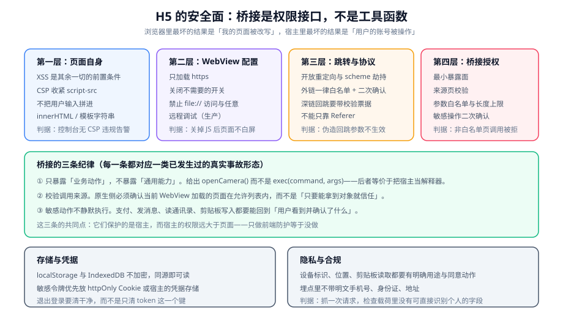

# WebView 与桥接的安全面

页面跑在浏览器里，最坏的结果是「我的页面被改写」；页面跑在宿主 App 的 WebView 里，最坏的结果是「用户的账号被操作」。多出来的这一层风险，全部来自**桥接把宿主的权限带进了页面**。

::: tip 一句话理解
桥接对象不是工具函数库，**它是宿主的权限接口**。暴露它的那一刻，你就把「谁能调用」这个问题交给了页面——而页面是可以被注入脚本的。
:::

## 一、为什么安全面与浏览器不同



| 维度 | 纯浏览器 | 宿主 App 内嵌 |
| --- | --- | --- |
| 最坏后果 | 页面被改写、会话被冒用 | **调用宿主能力**：支付、发消息、读本地文件、读通讯录 |
| 攻击面入口 | 页面自身（XSS、第三方脚本） | 页面自身 + **桥接对象** |
| 谁做权限判断 | 浏览器与用户（授权弹窗） | 浏览器 + **宿主的代码**（你写的） |
| 出错的可见性 | 通常可见（页面坏了） | **常常静默**（越权调用成功了，没人知道） |

最后一行的差别最关键：一次越权调用**不会让页面坏掉**，它只会成功。这也是为什么它必须靠"设计时就收紧"，而不是"出问题再补"。

## 二、四层防线

### 第一层：页面自身

XSS 是其余一切的前置条件——只要能执行任意 JS，它就能调用你暴露的一切。

| 动作 | 做法 |
| --- | --- |
| 收紧 CSP | `script-src` 不用 `unsafe-inline` 与 `unsafe-eval`；用 nonce 或 hash 放行必要脚本 |
| 不拼 HTML | 用户输入一律走 `textContent`，或者必须先经过白名单化 |
| 限制第三方 | 第三方脚本能被它自己的漏洞变成你的漏洞；能延后加载就延后 |

```html
<!-- 通过响应头下发（推荐），或在开发环境用 meta 做等效验证 -->
<!-- 注意：CSP 通过响应头下发比 meta 更完整（meta 不支持 frame-ancestors 等指令） -->
<meta
  http-equiv="Content-Security-Policy"
  content="default-src 'self'; script-src 'self' 'nonce-{{nonce}}'; style-src 'self' 'unsafe-inline'; img-src 'self' data: blob:; connect-src 'self' https://api.example.com; object-src 'none'; base-uri 'none'"
/>
```

```javascript
// 反例：把用户输入拼进 HTML
container.innerHTML = `<p>${userInput}</p>`;

// 正例一：只需要纯文本时，用 textContent
const p = document.createElement("p");
p.textContent = userInput;
container.appendChild(p);

// 正例二：必须渲染富文本时，先经过白名单化（只允许有限标签与属性）
container.innerHTML = sanitize(userInput);
```

::: danger CSP 的三个常见失效写法
1. **`script-src 'self' 'unsafe-inline'` 并存**：一旦出现 `unsafe-inline`，内联脚本的防护就基本失效（此时 nonce 的约束也会被绕过）。
2. **只在开发环境用 meta 验证，生产忘了下发响应头**：两处配置不一致时，生产环境实际没有防护。
3. **漏了 `base-uri`**：攻击者可以注入 `<base>` 把页面里所有相对链接指向自己的域。`base-uri 'none'` 的成本极低。
:::

### 第二层：WebView 配置

| 开关 | 建议 | 理由 |
| --- | --- | --- |
| 只加载 `https` | 必须 | 明文页面上的桥接调用可被中间人注入 |
| 远程调试 | **生产必须关闭** | 打开等于给任何能接触设备的人一个任意 JS 执行入口 |
| 文件访问（`file://` / 本地路径） | 按需最小化 | 允许页面读取本地文件会放大 XSS 的影响面 |
| 混合内容（`http` 子资源） | 禁止 | 与只允许 `https` 是同一条纪律的两面 |
| 新窗口 / 弹窗 | 限制 | 防止通过中间页面间接获得宿主上下文 |
| 域名白名单 | 限制可加载的 `https` 域 | 一个「可以用 WebView 打开任意网址」的入口等于一个内嵌浏览器 |

```javascript
// 页面侧的自我检查：只在确实需要时才开启的开关，用可读的方式标注出来
// （真实开关在原生侧，这里只是把「本页依赖什么」写清楚）
window.__webviewRequirements = {
  // 本页需要：安全上下文（getUserMedia / serviceWorker 依赖它）
  secureContext: window.isSecureContext,
  // 本页不需要：任何本地文件访问
  needsLocalFile: false,
};
```

### 第三层：跳转与协议

| 风险 | 形态 | 防御 |
| --- | --- | --- |
| 开放重定向 | `?redirect=任意地址` → 用户被带到钓鱼页 | 跳转目标**白名单校验**（只允许本站路径或已知域） |
| scheme 劫持 | 页面唤起 `myapp://xxx`，被恶意 App 抢注接管 | 优先用 Universal Link / App Link；scheme 仅作兜底 |
| 深链回跳注入 | 恶意页面构造深链参数，回跳后携带伪造状态 | 回跳票据在服务端校验（一次性、有签名、有有效期） |
| `Referer` 依赖 | 只用 `Referer` 判断来源 | `Referer` 可被裁剪或伪造，**不能作为唯一依据** |

```javascript
// 跳转前做白名单校验：只允许站内相对路径或已知域
const ALLOWED_HOSTS = new Set(["example.com", "www.example.com"]);

function safeRedirect(target) {
  if (typeof target !== "string" || !target) return "/";
  // 站内相对路径：不允许以 // 开头（协议相对地址会跳出站点）
  if (target.startsWith("/") && !target.startsWith("//")) return target;
  try {
    const url = new URL(target, location.origin);
    if (url.protocol === "https:" && ALLOWED_HOSTS.has(url.hostname)) return url.href;
  } catch {
    /* 解析失败即拒绝 */
  }
  return "/";       // 兜底：回到首页而不是原样跳转
}
```

### 第四层：桥接授权

这一层的细节在下一节展开。

## 三、桥接的三条纪律

### 纪律一：只暴露「业务动作」，不暴露「通用能力」

| 反面写法 | 为什么危险 | 正面写法 |
| --- | --- | --- |
| `exec(command, args)` | 等于把宿主当成解释器，攻击面无限 | 每个业务动作一个具名方法 |
| `readFile(path)` | 任意文件读取 | `downloadInvoice(orderId)`，路径由原生自己拼 |
| `openUrl(url)` | 变成任意页面加载器 | `openSupportPage(topic)`，URL 由原生维护 |
| 对象上挂了十几个方法 | 每个方法都是一个入口，难以审计 | 一个入口 + 方法白名单 |

```javascript
// 反面：一旦页面被注入，宿主完全暴露
window.appBridge = {
  exec(command, args) { /* … */ },
  readFile(path) { /* … */ },
  openUrl(url) { /* … */ },
};

// 正面：方法名固定、参数受限、原生侧校验后执行
// H5 侧只调用具名方法，真正的白名单在原生侧
call("camera.open", { quality: "high" });      // 只能开相机
call("pay.invoke", { orderId: "A123" });       // 只能对既有订单支付，金额由服务端定
```

::: danger 参数里传「金额」是经典缺陷
`call("pay.invoke", { amount: 100 })` 意味着**金额由页面决定**。页面被注入后，这个参数可以被改成任意值。**正确做法是只传订单号，金额由服务端根据订单号查出**——页面无权决定钱数。
:::

### 纪律二：校验调用来源，且在原生侧

「来源校验」指的是原生侧确认**当前 WebView 加载的页面在允许列表内**，而不是「前端判断自己在不在宿主里」。

| 校验点 | 做什么 | 谁做 |
| --- | --- | --- |
| 顶层页面 URL | 必须在允许的域列表内 | 原生 |
| iframe | 默认不给 iframe 注入桥接（除非该 iframe 也在白名单） | 原生 |
| 跳转后 | 页面发生跨域跳转后，桥接应被撤销或降权 | 原生 |
| 二次确认 | 敏感动作触发时显示系统级确认（用户看得到发起方） | 原生 |

::: warning 一个被忽略的中间页问题
如果宿主允许页面内跳转到任意 `https` 地址，那么攻击者可以先把你带到 `evil.com`，再由它调用仍然存在的桥接对象。**桥接应在跨域跳转后失效**——这条如果没做，前面所有的白名单都形同虚设。
:::

### 纪律三：敏感动作不静默执行

| 动作 | 要求 |
| --- | --- |
| 支付 | 金额与收款方由服务端确定，且用户看到明确的确认界面 |
| 发送消息 / 发帖 | 内容可见、目标可见、用户主动确认 |
| 读取通讯录 / 相册 | 系统级授权弹窗 + 明确用途说明 |
| 写入剪贴板 | 只在用户主动操作后执行；避免在页面加载时静默写入 |
| 读取剪贴板 | 需要用户手势触发；读到的内容不得直接回填到可执行环境 |

## 四、存储与凭据

| 存储位置 | 是否加密 | 适用 | 不适合 |
| --- | --- | --- | --- |
| `localStorage` | 否 | 非敏感偏好、缓存标记 | 任何可用来冒用身份的令牌 |
| `sessionStorage` | 否 | 页面状态恢复（承接 `PF-H`） | 长期凭据 |
| `IndexedDB` | 否 | 结构化缓存数据 | 凭据 |
| `httpOnly` Cookie | 由浏览器保护 | 会话凭据（推荐） | 需要 JS 读取的场景 |
| 宿主凭据存储 | 由系统保护 | 长期令牌 | 页面直接读写（应经桥接） |

```javascript
// 退出登录：清干净，而不是只清一个键
function clearSession() {
  // 只清本应用前缀下的键，避免影响同源的其他页面
  for (const key of Object.keys(localStorage)) {
    if (key.startsWith("app:")) localStorage.removeItem(key);
  }
  sessionStorage.clear();
  // 服务端侧也要让会话失效（本地清理不等于登出完成）
  return call("auth.logout", {});
}
```

::: danger 三个会让「登出」失效的地方
1. **只清了前端令牌，没通知服务端**：令牌在有效期内仍然可用，换台设备就能继续访问。
2. **残留的缓存里还有个人数据**：列表页缓存、图片缓存、埋点队列都要清。
3. **同源的其他页面不知道已经登出**：需要广播（`storage` 事件或 `BroadcastChannel`），否则用户切回另一个标签页看到的是旧数据。
:::

## 五、隐私与合规

| 数据 | 采集前需要的 | 上报时的处理 |
| --- | --- | --- |
| 设备标识 | 明确用途说明 | 用可重置的匿名标识，不用硬件序列号 |
| 位置 | 系统授权 | 精度按需降低；不上报原始经纬度 |
| 剪贴板 | 用户手势触发 | 不落日志 |
| 手机号 / 身份证 / 地址 | 明确的业务必要性与同意 | **一律脱敏**；日志里不允许出现明文 |
| 页面停留 / 点击 | 通常无需单独同意 | 不上报输入框内容 |

```javascript
// 埋点脱敏：在统一的上报入口做，而不是指望每个调用点都记得
const SENSITIVE = [
  /1[3-9]\d{9}/g,                       // 手机号
  /\b\d{17}[\dXx]\b/g,                  // 身份证
  /\b\d{16,19}\b/g,                     // 银行卡
];

function redact(text) {
  return SENSITIVE.reduce((acc, re) => acc.replace(re, "[REDACTED]"), String(text));
}

function report(event, payload = {}) {
  const safe = JSON.parse(redact(JSON.stringify(payload)));
  // 这里才真正发出请求
  send(event, safe);
}
```

## 六、判据清单

| 编号 | 判据 | 怎么验证 |
| --- | --- | --- |
| `WS-A` | 桥接只暴露**具名业务方法**，不存在 `exec` / `eval` / 通用命令入口 | 列出暴露对象上的全部方法名；出现通用入口即不合格 |
| `WS-B` | 桥接的**来源校验在原生侧**执行（顶层页面 URL 白名单） | 用非白名单页面加载并调用，观察原生是否拒绝 |
| `WS-C` | 跨域跳转后桥接失效（不被中间页继承） | 从白名单页跳到 `evil.com` 后调用桥接，应被拒绝 |
| `WS-D` | 金额、目标、内容等**业务关键参数不由页面决定**（只传标识，由服务端裁决） | 检查 `params`；出现金额 / 收款方 / 权限字段即缺陷 |
| `WS-E` | 敏感动作有用户可见的确认环节（不是静默执行） | 手动触发支付 / 发消息 / 剪贴板写入，观察是否有确认 |
| `WS-F` | CSP 已下发且 `script-src` 不含 `unsafe-inline`，含 `base-uri 'none'` 与 `object-src 'none'` | 用响应头工具查看实际下发的 CSP |
| `WS-G` | 生产构建中远程调试入口关闭 | 用 `chrome://inspect` / Safari 开发菜单确认看不到生产包 |
| `WS-H` | 埋点在统一入口脱敏；抓到的请求载荷中没有可直接识别个人的字段 | 抓一次真实请求，逐字段核对 |

## 七、验证方式

```javascript
// 1) 列出桥接暴露面（在 HTML 侧一眼看清「暴露了多少」）
(() => {
  const obj = window.appBridge || window.webkit?.messageHandlers?.appBridge;
  if (!obj) return "当前环境没有桥接对象";
  const keys = Object.keys(obj);
  return { count: keys.length, keys };
})();
// 期望：key 数量是个位数，且都是「命名空间.动作」或语义明确的方法名
// 判读：出现 exec / eval / run / invoke(任意字符串命令) 这类通用入口 → 立即整改
```

```javascript
// 2) 参数与脱敏检查：抓一次上报（在统一上报函数里打断点，或临时包一层）
const originalSend = window.send;
window.send = function (event, payload) {
  const flat = JSON.stringify(payload);
  console.warn("上报载荷", event, flat);
  // 人工核对：是否出现 11 位手机号 / 18 位身份证 / 明文金额字段
  return originalSend.apply(this, arguments);
};
// 期望：所有个人标识都是 [REDACTED] 或已哈希的匿名值
```

```shell
# 3) 确认生产包关掉了远程调试
# Android：连接设备后打开 chrome://inspect
# 期望：生产包不出现在列表里（只有调试构建会出现）
# iOS：Safari → 开发 → 设备名
# 期望：生产包的页面不出现在菜单里
```

::: danger 三个「看起来安全实际不安全」的写法
1. **前端判断「我在白名单页里」才调用**：前端判断可以被绕过。**白名单必须在原生侧。**
2. **用 `Referer` 做来源校验**：`Referer` 会被裁剪、会被伪造。**用原生拿到的顶层页面 URL。**
3. **在 CSP 里加了 `unsafe-inline` 但有 nonce**：一旦有 `unsafe-inline`，nonce 的防护就被削弱了。**两者不要并存。**
:::

## 八、相关页面与下一篇

- 下一篇：[实战：把 PC 页面改造成移动端 H5](../Practice/index.md)——把前七页的判据落到一次真实改造上。
- 上游必读：[桥接通信](../Bridge/index.md)（`HB-H`：来源校验在原生侧）。
- 相邻必读：[前端安全](../../Others/Security/index.md)（页面自身的安全基线）、[桌面应用 · 安全模型](../../DesktopApp/Security/index.md)（同一类「渲染层与原生层权限差」问题的另一种形态）。

## 九、参考资料

- [Android Developers · WebView 安全建议](https://developer.android.com/privacy-and-security/security-tips)
- [Android Developers · `addJavascriptInterface` 的安全注意事项](https://developer.android.com/reference/android/webkit/WebView#addJavascriptInterface(java.lang.Object,%20java.lang.String))
- [Apple Developer · WKWebView 安全与 `isInspectable`](https://developer.apple.com/documentation/webkit/wkwebview)
- [MDN · 内容安全策略（CSP）](https://developer.mozilla.org/en-US/docs/Web/HTTP/CSP)
- [OWASP · 跨站脚本防护速查表](https://cheatsheetseries.owasp.org/cheatsheets/Cross_Site_Scripting_Prevention_Cheat_Sheet.html)
- [OWASP · 移动应用安全（MASVS）](https://mas.owasp.org/MASVS/)
