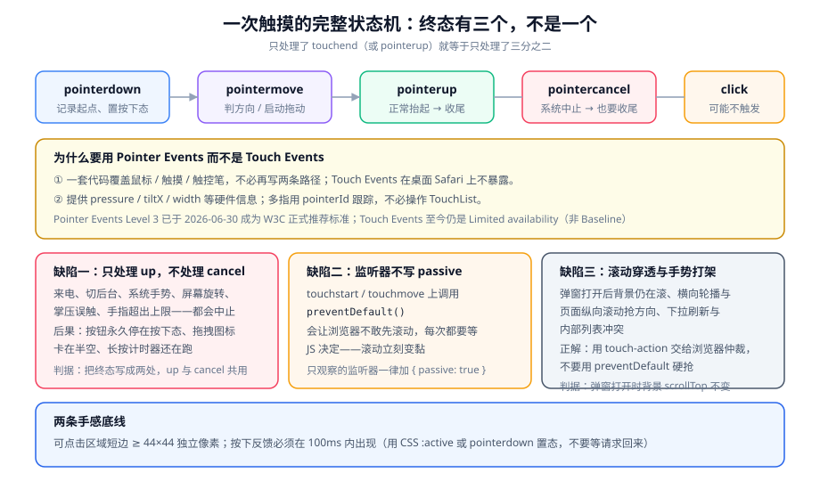

# 触摸、手势与输入

键盘和鼠标是一维输入：一个光标、按下、抬起。触摸是**多点、有压力、会被系统打断**的输入。本页把交互链路拆成四段——事件模型、状态机、滚动仲裁、手势实现——每一段都有一个稳定会踩的坑。

::: tip 一句话理解
触摸交互的失败几乎不是「功能没实现」，而是**终态没覆盖全**：只处理了「手指抬起」，没处理「被系统打断」。前者是常态，后者才是投诉的来源。
:::

## 一、两套事件模型：该用哪一套

| 维度 | Touch Events | Pointer Events |
| --- | --- | --- |
| 覆盖输入 | 仅触屏 | 鼠标、触屏、触控笔**统一抽象** |
| 多指跟踪 | `touches` / `changedTouches` 列表 | `pointerId` 逐个跟踪 |
| 硬件信息 | 位置与目标 | 额外提供压力、接触面积、倾斜角 |
| 桌面浏览器 | 桌面 Safari 常不暴露 | 全平台可用 |
| 规范状态 | 仍是 **Limited availability（非 Baseline）** | **Level 3 于 2026-06-30 成为 W3C 推荐标准** |
| 何时用 | 需要兼容极老的 WebView | **默认选它** |

**结论**：新代码一律用 Pointer Events；只有在需要支持「比预期更老的内核」时才补一层 Touch Events 兜底，而且兜底层应当**共用同一个状态机**，不要写成第二套逻辑。

```javascript
// 统一入口：优先 Pointer，缺失时退回 Touch，但共用同一组处理器
const supportsPointer = "PointerEvent" in window;

if (supportsPointer) {
  el.addEventListener("pointerdown", onStart, { passive: true });
  el.addEventListener("pointermove", onMove, { passive: true });
  el.addEventListener("pointerup", onEnd);
  el.addEventListener("pointercancel", onEnd); // 与 up 共用一个收尾函数
} else {
  el.addEventListener("touchstart", (e) => onStart(toPoint(e)), { passive: true });
  el.addEventListener("touchmove", (e) => onMove(toPoint(e)), { passive: true });
  el.addEventListener("touchend", (e) => onEnd(toPoint(e)));
  el.addEventListener("touchcancel", (e) => onEnd(toPoint(e)));
}

function toPoint(e) {
  const t = e.changedTouches[0];
  return { id: t.identifier, x: t.clientX, y: t.clientY };
}
```

## 二、一次触摸的完整状态机



| 事件 | 什么时候触发 | 必须做什么 |
| --- | --- | --- |
| `pointerdown` | 手指按下 | 记录起点、进入「按下态」、启动长按计时器 |
| `pointermove` | 手指移动 | 判方向、决定是否升级为拖动、更新位置 |
| `pointerup` | 手指正常抬起 | 收尾：退出按下态、清除计时器、提交结果 |
| `pointercancel` | **系统中止**（来电、切后台、系统手势、旋转、掌压、超出触点数上限） | **与 `up` 完全相同的收尾** |

::: danger 只处理 `up` 的三类后果
1. **按钮永久停在按下态**：视觉上「卡住了」，用户会反复点，产生重复提交。
2. **拖拽元素卡在半空**：拖动中的卡片没有归位，页面看起来坏了。
3. **长按计时器继续跑**：用户已经切走了，300ms 后一个弹窗突然冒出来。
:::

```javascript
// 一个能覆盖全部终态的拖动实现骨架
let drag = null;

function onStart(e) {
  drag = {
    id: e.pointerId,
    startX: e.clientX,
    startY: e.clientY,
    moved: false,
    timer: setTimeout(() => enterLongPress(), 500),
  };
  // 指针捕获：让后续 move / up 都送到这个元素，即使手指移出元素范围
  e.currentTarget.setPointerCapture?.(e.pointerId);
}

function onMove(e) {
  if (!drag || e.pointerId !== drag.id) return;
  const dx = e.clientX - drag.startX;
  const dy = e.clientY - drag.startY;
  if (!drag.moved && Math.hypot(dx, dy) > 8) {
    drag.moved = true;
    clearTimeout(drag.timer);      // 一旦开始拖动，长按就不再成立
  }
  if (drag.moved) applyTranslate(dx, dy);
}

// up 与 cancel 走同一个收尾：这是本页最重要的一行设计
function onEnd(e) {
  if (!drag) return;
  clearTimeout(drag.timer);
  const commit = e.type === "pointerup" && drag.moved;
  commit ? commitDrag() : resetDrag();
  drag = null;
}
```

::: warning 方向判定要用「位移阈值」而不是「时间」
常见错误是在 `pointermove` 的**第一次回调**里就定方向。手指刚按下时的抖动（1~3px 的随机移动）会让垂直线被误判成横向滑动。**先积累 8~10px 位移，再判方向**（阈值写在常量里，便于按设备调整）。
:::

## 三、点击延迟与按下反馈

### 1. 那 300ms 还在吗

早年移动浏览器为了区分「单击」与「双击缩放」，会在 `click` 前等 300ms。现代浏览器在**视口正确声明**（`width=device-width`）时会取消这个等待。

| 条件 | 是否还有延迟 | 说明 |
| --- | --- | --- |
| 视口正确 + 现代内核 | 无 | 主流浏览器已消除双击缩放待定 |
| 视口未声明 | 有 | 页面会被当成 980 宽的桌面页面，双击缩放仍有意义 |
| 使用了 `user-scalable=no` | 无（但有害） | 禁用缩放换来的，代价是无障碍能力 |

::: info 关于 fastclick 这类库
「消除 300ms 延迟」的 polyfill 在视口正确的前提下**已经没有作用**。继续引入它们的唯一效果是多一层事件处理，并且会干扰 Pointer Events 的语义（把 `pointerup` 与合成 `click` 混在一起判断），产生「一次点击触发两次」的缺陷。
:::

### 2. 按下反馈必须在 100ms 内

用户判断「我点到了没有」的依据是**视觉反馈**，不是请求结果。

```css
/* 用 :active 做即时反馈；配合 touch-action 避免滚动与按下态冲突 */
.btn {
  transition: transform 80ms ease-out, opacity 80ms ease-out;
}
.btn:active {
  transform: scale(0.97);
  opacity: 0.85;
}

/* 动效敏感用户：把位移与缩放降到最小，但保留颜色反馈 */
@media (prefers-reduced-motion: reduce) {
  .btn:active { transform: none; opacity: 0.7; }
}
```

::: danger 三个让按下反馈失效的写法
1. **把反馈挂在请求回调里**：网络慢时反馈跟着慢。**反馈只依赖本地事件，不依赖网络。**
2. **用 `:hover` 代替 `:active`**：触屏上没有真正的悬停状态，`hover` 在部分内核上会在点击**之后**残留，造成「点了之后一直是高亮」。
3. **使用了 `-webkit-tap-highlight-color` 后又在 `:active` 里加同样的效果**：出现两重高亮。**二者选一**：要么关掉系统高亮（`-webkit-tap-highlight-color: transparent`）自己做，要么关掉自己的样式用系统的。
:::

## 四、滚动与手势的仲裁

### 1. `touch-action`：把仲裁交给浏览器

不要用 `preventDefault()` 硬抢滚动——那会让滚动变成「必须等 JS 决定」，手感立刻变差。

```css
/* 纵向列表：允许浏览器管纵向滚动，横向手势留给 JS（轮播、滑动删除） */
.swipe-row { touch-action: pan-y; }

/* 横向轮播：纵向还归浏览器，横向自己管 */
.carousel { touch-action: pan-y pinch-zoom; }

/* 完全自己处理（画板、自定义手势区）：明确禁止浏览器接管 */
.canvas { touch-action: none; }
```

| 值 | 含义 | 用在哪 |
| --- | --- | --- |
| `auto` | 浏览器全权处理 | 普通内容 |
| `pan-y` | 只允许纵向平移 | 横向滑动的行 |
| `pan-x` | 只允许横向平移 | 纵向滑动的轮播 |
| `manipulation` | 允许平移与缩放，不允许双击缩放 | 按钮密集区 |
| `none` | 全部自己处理 | 画板、自定义手势区 |

### 2. 滚动穿透：弹窗打开后背景还在滚

这是移动端最常见的交互缺陷之一，且**三种做法里只有一种是可靠的**。

| 做法 | 效果 | 问题 |
| --- | --- | --- |
| 打开弹窗时给 `body` 加 `overflow: hidden` | 桌面有效 | **iOS 上常无效**：`body` 隐藏滚动后背景仍会被「橡皮筋」拖动 |
| 记录位置后用 `position: fixed` 钉住 `body` | 有效 | 关闭时需要恢复滚动位置，容易漏 |
| 阻止 `touchmove` 的默认行为 | 有效但笨 | 会让弹窗**内部**也无法滚动，必须再做白名单判断 |

```javascript
// 推荐做法：钉住 body 并保存 / 恢复滚动位置
let savedScrollY = 0;

function lockScroll() {
  savedScrollY = window.scrollY;
  document.body.style.position = "fixed";
  document.body.style.top = `-${savedScrollY}px`;
  document.body.style.width = "100%";
}

function unlockScroll() {
  document.body.style.position = "";
  document.body.style.top = "";
  document.body.style.width = "";
  window.scrollTo(0, savedScrollY);   // 恢复原位
}

// 配套：弹窗内部的滚动容器要显式允许自身滚动
// .sheet { overscroll-behavior: contain; }   ← 阻止滚动链继续传给背景
```

### 3. 滚动链与「下拉刷新抢走手势」

```css
/* 内部滚动容器吃掉滚动链，不再把滚动传给父级 */
.sheet-body {
  overflow-y: auto;
  overscroll-behavior: contain;
}
```

::: warning 方向锁（下拉刷新 / 右滑返回）的两条纪律
1. **不要抢系统手势**：iOS 的左边缘右滑返回、Android 的返回手势属于系统，页面抢不过来，硬抢只会造成「滑到一半页面卡住」。
2. **方向锁一旦判定就不要中途改**：横竖方向判定必须在手势前 10px 内完成，之后整个手势按同一方向解释。中途改方向会让轮播与页面滚动互相打断。
:::

## 五、手势实现的四个常见形态

| 手势 | 关键点 | 最容易漏的 |
| --- | --- | --- |
| 拖动排序 | 指针捕获 + 位移阈值 + 提交/复位双出口 | 中途来电（`pointercancel`）后没有复位 |
| 长按菜单 | 位移超过阈值要取消计时器 | 计时器没清，切走之后弹窗突然出现 |
| 滑动删除 | `touch-action: pan-y` + 位移与阈值比较 | 滑出后没做「回弹」或「确认态」 |
| 双指缩放 | 用 `pointerId` 跟踪两个点、算距离比值 | 第二个点抬手时没有退出缩放态 |

```javascript
// 双指缩放：用 Map 跟踪每个 pointerId，退出时逐个清理
const points = new Map();

function onPointerDown(e) {
  points.set(e.pointerId, { x: e.clientX, y: e.clientY });
  e.currentTarget.setPointerCapture?.(e.pointerId);
}

function onPointerUp(e) {
  points.delete(e.pointerId);         // up 与 cancel 都走这里
  if (points.size < 2) exitPinch();   // 少于两点就退出缩放态
}

function currentDistance() {
  const [a, b] = [...points.values()];
  return a && b ? Math.hypot(a.x - b.x, a.y - b.y) : 0;
}
```

## 六、手感底线：可点面积与误触

| 项 | 下限 | 依据 |
| --- | --- | --- |
| 可点击区域短边 | 44 × 44 独立像素 | 主流平台人机界面指南的共同结论 |
| 相邻可点元素间距 | ≥ 8 独立像素 | 减少误触到相邻项 |
| 视觉元素与可点区域的关系 | 可点区域可以大于视觉元素 | 用 `::after` 撑开命中区，而不是把图标画大 |
| 底部操作区 | 距屏幕底部留出安全区 | 与 Home 指示条冲突 |

```css
/* 视觉上是个 24px 的图标，但命中区是 44px */
.icon-btn {
  position: relative;
  width: 24px;
  height: 24px;
  color: var(--color-text);
}
.icon-btn::after {
  content: "";
  position: absolute;
  inset: -10px;              /* 24 + 20 = 44 */
  /* 命中区不该有可见样式，只是扩大可点范围 */
}
```

```css
/* 底部固定操作条：安全区 + 命中区 */
.bottom-actions {
  position: fixed;
  inset-inline: 0;
  bottom: 0;
  display: flex;
  gap: 8px;
  padding: 8px 16px calc(8px + env(safe-area-inset-bottom, 0px));
}
```

## 七、判据清单

| 编号 | 判据 | 怎么验证 |
| --- | --- | --- |
| `TG-A` | 新代码使用 Pointer Events；若使用 Touch Events，则必须说明目标内核范围 | 搜索事件名；出现 `touchstart` 而无说明即不合格 |
| `TG-B` | `up` 与 `cancel` 共用同一个收尾函数（不允许只写 `up`） | 代码里能找到 `pointercancel` / `touchcancel` 的注册 |
| `TG-C` | 拖动方向判定使用位移阈值（建议 ≥ 8px），不在第一次 `move` 就定方向 | 阅读方向判定代码；无阈值即缺陷 |
| `TG-D` | 只观察的滚动 / 触摸监听器一律 `passive: true` | 搜索 `addEventListener`，命中 `touchmove` / `scroll` 而不带 `passive` 即缺陷 |
| `TG-E` | 滚动交给浏览器仲裁：优先用 `touch-action`，不用 `preventDefault` 硬抢常规滚动 | 搜索 `preventDefault` 与 `touchmove` 的重合 |
| `TG-F` | 弹窗打开时背景不可滚动，且关闭后能恢复到原滚动位置 | 打开弹窗后尝试拖动背景；`scrollTop` 变化即缺陷 |
| `TG-G` | 可点击区域短边 ≥ 44×44 独立像素，相邻可点项间距 ≥ 8px（承接 `VA-D` 的交互侧口径） | 用审查工具量命中区，而不是量图标 |
| `TG-H` | 按下反馈在本地事件内完成（不依赖网络），且动效遵循 `prefers-reduced-motion` | 断网点击按钮，观察是否有按下态 |

## 八、验证方式

```javascript
// 1) 检查被动监听器是否漏了（贴进控制台后加载页面）
(() => {
  const raw = EventTarget.prototype.addEventListener;
  const warn = [];
  EventTarget.prototype.addEventListener = function (type, fn, opts) {
    if (type === "touchmove" || type === "scroll" || type === "touchstart") {
      if (!(opts === true || (opts && opts.passive))) {
        warn.push(`${type} 未声明 passive`);
        console.warn("缺少 passive：", type, this);
      }
    }
    return raw.call(this, type, fn, opts);
  };
  return "已挂钩；操作页面后查看 warn 数量";
})();
// 期望：滚动列表页不产生任何告警
```

```javascript
// 2) 检查终止态覆盖：拖动到一半切后台，回来看元素是否复位
// 步骤：按住一个可拖动元素 → 拖动 → 用手势切到桌面 → 回到页面
// 期望：元素回到原位，页面没有残留的按下态
```

```javascript
// 3) 滚动穿透检查（打开弹窗后执行）
({
  bodyPosition: getComputedStyle(document.body).position,
  scrollYBefore: window.scrollY,
});
// 期望：bodyPosition 为 fixed 或滚动被容器接管（overscroll-behavior: contain）
// 判读：bodyPosition 为 static 且背景仍能拖动 → 存在滚动穿透
```

::: danger 三个让检查失效的做法
1. **在桌面浏览器里用鼠标测触摸交互**：鼠标没有 `pointercancel`，也没有系统手势，第 2 项永远测不出问题。**必须在真机上做。**
2. **只在「空闲手机」上测**：`pointercancel` 的典型触发场景是来电、切后台、旋转、掌压——这些不会在测试里自然出现，要**主动构造**（打电话进来、按 Home 键、旋转屏幕）。
3. **只看视觉不看状态**：有些实现会在 `cancel` 时把 UI 复位但把内部状态留在「拖动中」，下次点击行为就会异常。**复位要同时覆盖 UI 与状态变量。**
:::

## 九、相关页面与下一篇

- 下一篇：[桥接通信](../Bridge/index.md)——从页面内的输入，走到跨运行时的调用。
- 上游必读：[首屏与运行时性能](../PagePerformance/index.md)（`PF-G`：被动监听器）。
- 相邻必读：[JavaScript 事件](../../Basic/JavaScript/Events/index.md)（事件模型与传播）、[IntlA11y · 键盘与焦点](../../IntlA11y/KeyboardFocus/index.md)（触屏之外的另一条访问路径）。

## 十、参考资料

- [W3C · Pointer Events Level 3（2026-06-30 推荐标准）](https://www.w3.org/TR/pointerevents3/)
- [MDN · `touch-action`](https://developer.mozilla.org/en-US/docs/Web/CSS/touch-action)
- [MDN · `Element.setPointerCapture()`](https://developer.mozilla.org/en-US/docs/Web/API/Element/setPointerCapture)
- [MDN · `overscroll-behavior`](https://developer.mozilla.org/en-US/docs/Web/CSS/overscroll-behavior)
- [web.dev · 被动事件监听器](https://web.dev/articles/uses-passive-event-listeners)
- [Apple HIG · 触控目标尺寸建议](https://developer.apple.com/design/human-interface-guidelines/)
