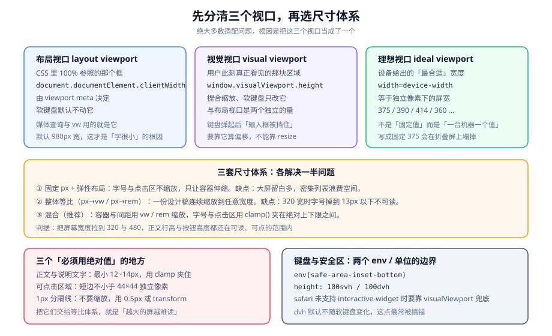

# 视口与适配体系

适配要回答的问题只有三个：**在哪个宽度上排版、哪些值参与缩放、哪些值绝对不动**。本页把这三个问题拆成三条视口、三套尺寸体系、以及五处最容易搞错的具体场景（1px 边框、DPR、安全区、软键盘、图片）。

::: tip 一句话理解
`viewport` meta 决定的是**你在哪个宽度上排版**；尺寸体系决定的是**排版结果怎么映射到不同屏宽上**。前者写错，后者怎么调都是错的。
:::

## 一、三个视口与那一行 meta



### 1. 三个视口

| 视口 | 它是什么 | 怎么读它 | 谁会改变它 |
| --- | --- | --- | --- |
| 布局视口 | CSS 布局参照的框 | `document.documentElement.clientWidth` | `viewport` meta |
| 视觉视口 | 用户此刻看见的区域 | `window.visualViewport.height` | 捏合缩放、软键盘 |
| 理想视口 | 设备认为最合适的宽度 | `screen.width`（近似） | 硬件与系统缩放 |

**为什么必须分清**：媒体查询、`vw`、`100%` 全部参照**布局视口**；而「软键盘弹起后输入框被挡住」「双指放大后 `position: fixed` 的位置不对」这类问题，参照的却是**视觉视口**。把两者当成一个，就会得到「键盘弹起了但 `resize` 事件没触发」这种结论。

::: info 一个历史背景
在移动浏览器早期，为了能正确显示为桌面设计的网页，浏览器的默认布局视口被设成约 980px。这就是「不加 `viewport` 的页面上字非常小、需要双指放大」的根因——页面确实按 980 宽排版，然后被整体缩小显示在 375 宽的屏幕上。
:::

### 2. 那一行 meta

```html
<!-- index.html：放在 <head> 的最前面，早于任何样式与脚本 -->
<meta name="viewport" content="width=device-width, initial-scale=1, viewport-fit=cover" />
```

三个参数的职责必须分清：

| 参数 | 作用 | 不写的后果 |
| --- | --- | --- |
| `width=device-width` | 把布局视口对齐到理想视口 | 布局视口退回约 980，全站字体偏小 |
| `initial-scale=1` | 初始缩放为 1，防止旋转屏幕后缩放异常 | 部分 Android WebView 上横竖屏切换会留下缩放残影 |
| `viewport-fit=cover` | 允许内容延伸到安全区之外 | 四个 `env(safe-area-inset-*)` **全部解析为 0** |

::: danger `user-scalable=no` 为什么不该写
`user-scalable=no` 与 `maximum-scale=1` 会禁用双指缩放。**iOS 10 起 Safari 会主动忽略这两个值**，所以它在 iOS 上无效；在 Android 上有效，但会剥夺「视力不佳的用户放大阅读」这条最基本的无障碍能力（对应 WCAG 1.4.4 与 1.4.10）。**正确做法是把字号做对，而不是把缩放关掉。**
:::

### 3. 在真机上确认视口生效

```shell
# 在真机浏览器控制台执行
# 期望：输出三位数且小于 500（例如 390 / 412 / 360）
document.documentElement.clientWidth
# 期望：输出包含 width=device-width 的内容串
document.querySelector('meta[name=viewport]')?.content
```

**判读方式**：`960`~`980` 这三个数几乎可以确定是「meta 没写或写错」；如果是一个奇怪的数（例如 751），检查是否有脚本在运行时重写了 meta。

## 二、三套尺寸体系

### 1. 方案对照

| 方案 | 原理 | 优点 | 缺点 | 适用 |
| --- | --- | --- | --- | --- |
| 固定 px + 弹性布局 | 字号与尺寸写死，用 flex / grid 分配剩余空间 | 可读性绝对可控；无构建依赖 | 大屏信息密度低；密集区在大屏上留白多 | 表单、设置页、内容型页面 |
| 整体等比（`px` → `vw`） | 构建期把 `px` 按设计稿宽度换算成 `vw` | 一份稿连续适配任意宽度；纯 CSS，无运行时 | 字号一起缩放，小屏不可读、大屏过大 | 活动页、强视觉稿 |
| 整体等比（`px` → `rem` + 动态根字号） | 运行时按屏宽设置根字号，构建期换算成 `rem` | 生态成熟，可给根字号设上下限 | **需要 JS**，首屏可能闪烁；`rem` 本是字体单位 | 存量项目维护 |
| 混合（本页推荐） | 容器与间距走相对单位，字号与点击区用 `clamp()` 夹逼 | 两端都安全；无 JS | 需要明确「哪些值属于哪一类」 | 绝大多数业务页面 |

::: warning 为什么不再推荐 `amfe-flexible` + `postcss-pxtorem`
该方案依赖的 `amfe-flexible` 已停止维护并标记弃用；更根本的问题是 `rem` 是**字体相对单位**，用它承载整体布局属于语义误用——一旦字体相关的设置（浏览器最小字号、用户字号偏好）介入，换算基数就不再可控。**如果只是想要「连续缩放」，`vw` 与 `clamp()` 已经足够，且不需要运行时。**
:::

### 2. 换算表（以 375 宽设计稿为例）

| 设计稿值 | 占比 | `vw` 值 | 320 屏上实际 | 390 屏上实际 | 430 屏上实际 |
| --- | --- | --- | --- | --- | --- |
| 375（满宽） | 100% | `100vw` | 320 | 390 | 430 |
| 300 | 80% | `80vw` | 256 | 312 | 344 |
| 24（间距） | 6.4% | `6.4vw` | 20.5 | 25.0 | 27.5 |
| 16（正文字号） | 4.27% | `4.27vw` | **13.7** | 16.7 | **18.4** |
| 1（分隔线） | 0.27% | `0.27vw` | **0.86** | 1.05 | 1.16 |

最后两行是重点：**字号与 1px 分隔线在两端都出现了不该有的值**，所以它们必须从等比体系里排除出去。

### 3. 混合体系的落地写法

```css
/* styles/tokens.css —— 把规则集中在一处，而不是散落在组件里 */
:root {
  /* 参与缩放：容器内边距、卡片间距、装饰性尺寸 */
  --gap-sm: 2.13vw;   /* 8px  @375 */
  --gap-md: 4.27vw;   /* 16px @375 */
  --gap-lg: 6.4vw;    /* 24px @375 */

  /* 不参与缩放：字号有绝对上下限（320 宽时 14px，430 宽时 17px） */
  --font-body: clamp(14px, 4.27vw, 17px);
  --font-caption: clamp(11px, 3.2vw, 13px);

  /* 不参与缩放：可点击区域短边下限 */
  --tap-min: 44px;

  /* 不参与缩放：分隔线固定为 0.5px，配合 DPR 处理 */
  --hairline: 0.5px;
}

/* 大屏（平板 / 折叠屏展开）上换布局而不是继续放大 */
@media (min-width: 600px) {
  .list {
    display: grid;
    grid-template-columns: repeat(2, 1fr);
    gap: 24px;
  }
}
```

::: danger 三个会在这一步写错的地方
1. **把 `vw` 用在会触发横向滚动的地方**：`width: 100vw` 在某些环境里包含滚动条宽度，会产生一个横向滚动条。整宽元素用 `width: 100%`。
2. **忽略「最大宽度」**：没有上限的等比体系在折叠屏展开（宽达 674px 甚至更宽）上会把布局拉成一张长条。
3. **行高也写成 `vw`**：行高应该是字号的倍数（无单位数值，例如 `1.7`），它会自动跟随字号变化；写成 `vw` 后字号被 `clamp()` 夹住而行高没夹，两端行距会失衡。
:::

### 4. 构建期换算的配置要点

```javascript
// postcss.config.cjs —— 只做「把 px 变成 vw」，不做别的
module.exports = {
  plugins: {
    "postcss-px-to-viewport-8-plugin": {
      viewportWidth: 375,        // 必须与设计稿宽度一致，这是最容易填错的一项
      unitPrecision: 5,
      propList: ["*"],
      minPixelValue: 1,          // 1px 不转换，保留 1px 边框的精细度
      mediaQuery: false,         // 媒体查询里的 px 通常是断点值，不该被转换
      exclude: [/node_modules/], // 第三方组件库自己有适配方案，二次转换会缩水
    },
  },
};
```

::: warning 装配件库时的两个坑
1. **组件库的样式被二次转换**：组件库（如 Vant）自带基于 375 稿的样式，如果它的 CSS 也被你的插件转换一次，组件会比设计稿小一半或大一倍。用 `exclude` 排除，或用 `selectorBlackList` 精确跳过。
2. **内联样式不会被转换**：插件只处理 CSS 文件。`<div style="width: 200px">` 里的 `px` 会原样保留——这正是「本地看起来没问题、真机上某一处特别小」的常见来源。
:::

## 三、1px 边框与 DPR

设计稿上的「1px 分隔线」指的是**一个物理像素**，而在 DPR=3 的设备上，1 个 CSS 像素等于 3 个物理像素——直接用 `1px` 画出来会偏粗、发糊。

| 做法 | 写法 | 评价 |
| --- | --- | --- |
| 直接写 `1px` | `border-bottom: 1px solid #eee` | 最简单；DPR=1 时正确，高 DPR 上略粗，多数场景可接受 |
| 写 `0.5px` | `border-bottom: 0.5px solid #eee` | 现代 WebKit / Chromium 都支持小数边框，语义最直白 |
| `transform: scaleY(0.5)` 伪元素 | 需要一个额外伪元素与定位 | 兼容性最好，但每条线多一个盒子，长列表里成本不可忽略 |
| `box-shadow: 0 1px 0 0 #eee` | 一行搞定，无额外盒子 | 不能做圆角；颜色不支持透明度以外的样式 |

**选型建议**：新项目用 `0.5px`，并在设计系统里定义成 token（`--hairline`）；只有在需要兼容很老的 WebView 时才退回伪元素方案。

```css
/* 用 token 统一表达「一个物理像素」 */
.divider {
  border-bottom: var(--hairline) solid var(--color-border);
}

/* 极少数需要绝对精确的场景（例如表格内网格线）才用这一种 */
.hairline::after {
  content: "";
  position: absolute;
  left: 0;
  right: 0;
  bottom: 0;
  height: 1px;
  background: var(--color-border);
  transform: scaleY(0.5);
  transform-origin: 0 100%;
}
```

## 四、安全区：两个必须同时出现的设置

安全区（刘海、圆角、底部 Home 指示条）的适配需要**两个设置同时存在**：

```css
/* 1) HTML 侧：viewport-fit=cover 告诉浏览器「我自己处理不安全区域」 */
/*    <meta name="viewport" content="width=device-width, initial-scale=1, viewport-fit=cover"> */

/* 2) CSS 侧：把内容推到安全区之内 */
.page {
  padding-top: env(safe-area-inset-top);
  padding-right: env(safe-area-inset-right);
  padding-bottom: env(safe-area-inset-bottom);
  padding-left: env(safe-area-inset-left);
}

/* 底部固定栏：把安全区加在原有内边距之上，而不是替换掉它 */
.bottom-bar {
  position: fixed;
  inset-inline: 0;
  bottom: 0;
  padding: 12px 16px;
  padding-bottom: calc(12px + env(safe-area-inset-bottom, 0px));
}
```

::: danger 四个 `env()` 在不写 `cover` 时全部是 0
这是「明明加了 `env()` 却仍被刘海遮挡」的**唯一根因**。`env(safe-area-inset-*)` 在未声明 `viewport-fit=cover` 时按规范返回 `0`——所以「加了 `env()`」这个动作本身**没有任何效果**，看着像是没生效。两处必须同时存在（对应 `MH-` 系列的 `VA-B`）。
:::

另外注意：安全区的值在**横屏**下会出现在左右两侧（`inset-left` / `inset-right`），只处理上下两组会导致横屏时内容被圆角裁掉。

## 五、软键盘：三种做法与它们的边界

软键盘是移动端布局最容易出错的地方，因为它**只改变视觉视口，不改变布局视口**。

| 做法 | 机制 | 支持面 | 评价 |
| --- | --- | --- | --- |
| 什么都不做 | 浏览器自动把聚焦的输入框滚进视野 | 全部 | 表单类页面够用；聊天 / 全屏编辑不够用 |
| `interactive-widget=resizes-content` | 让浏览器在键盘弹起时**收缩布局视口**，`dvh` 随之变小 | Chromium（Chrome 108+ / Firefox 133+，均指 Android）；**WebKit 已实现但截至 2026-09 尚未进入公开版 Safari** | 聊天类页面最省事，但要按「渐进增强」用 |
| `visualViewport` 计算偏移 | 用 JS 读视觉视口高度差，写进 CSS 变量 | 全部现代浏览器 | 唯一跨平台可靠的做法 |

```html
<!-- 渐进增强：不支持的浏览器直接忽略这个值，不影响其他参数 -->
<meta
  name="viewport"
  content="width=device-width, initial-scale=1, viewport-fit=cover, interactive-widget=resizes-content"
/>
```

```javascript
// 跨平台兜底：把键盘占掉的高度写进 CSS 变量，供布局使用
const vv = window.visualViewport;
const root = document.documentElement;

function syncKeyboardInset() {
  if (!vv) return;
  // 视觉视口之外、被键盘顶掉的那部分高度
  const inset = Math.max(0, window.innerHeight - vv.height - vv.offsetTop);
  root.style.setProperty("--keyboard-inset", `${inset}px`);
}

vv?.addEventListener("resize", syncKeyboardInset);
vv?.addEventListener("scroll", syncKeyboardInset);
```

```css
/* 只在「键盘确实弹起」时才把输入区顶上去 */
.composer {
  position: fixed;
  inset-inline: 0;
  bottom: 0;
  transform: translateY(calc(-1 * var(--keyboard-inset, 0px)));
  transition: transform 150ms ease-out;
  padding-bottom: calc(8px + env(safe-area-inset-bottom, 0px));
}
```

::: warning 关于软键盘的三个事实
1. **`100dvh` 不会因为键盘而变小**（默认 `resizes-visual` 下）：所以 `height: 100dvh` 的聊天外壳会把自己藏在键盘下面。
2. **`window.innerHeight` 在 iOS 上键盘弹起时通常不变**：所以靠 `resize` 事件判断键盘是不可靠的，必须用 `visualViewport`。
3. **`transition` 要短**：键盘动画本身约 250ms，输入区跟手的延迟如果超过 150ms，用户会觉得「输入框在追我的手指」。**不要给位移加超过 150ms 的过渡**，也不要加弹簧动效。
:::

## 六、图片适配

图片是首屏资源里最大的一块，也是唯一能同时影响「清晰度」和「加载时间」的资源。

| 手段 | 解决什么 | 写法要点 |
| --- | --- | --- |
| `width` / `height` 属性 | CLS（布局偏移） | 必须写，且要与 CSS 里的宽高比一致 |
| `srcset` + `sizes` | 按屏宽与 DPR 选图 | `sizes` 要与真实布局宽度一致，否则选错档 |
| `<picture>` + `type` | 按格式选图（AVIF / WebP / JPEG） | 从新到旧排列，浏览器取第一个认识的 |
| `loading="lazy"` | 首屏之外的图延后加载 | **首屏 LCP 图绝不能加**，否则会把 LCP 推后 |
| `fetchpriority="high"` | 把 LCP 图提到最高优先级 | 只给一张图加，加多了等于没加 |
| `aspect-ratio` | 保持占位比例 | 与 `width` / `height` 属性配合，双保险 |

```html
<!-- 首屏大图：不懒加载、显式宽高、优先加载、提供多档尺寸 -->


<!-- 首屏之外的图：懒加载 + 显式宽高 -->

```

::: danger 两个会让图片优化白做的错误
1. **给 LCP 图加了 `loading="lazy"`**：懒加载让浏览器把这张图排到很后面，LCP 直接恶化数百毫秒。判断方法很简单：**打开页面时第一眼看到的那张大图，就是不能懒加载的那张。**
2. **写了 `width` / `height` 属性但 CSS 里又用 `height:auto` 覆盖掉**：这会丢掉「按宽高比预留空间」的能力，CLS 会回来。正确写法是保留宽高属性，CSS 里只设 `width: 100%` 与 `height: auto`，并且**容器用 `aspect-ratio` 占位**。
:::

## 七、判据清单

| 编号 | 判据 | 怎么验证 |
| --- | --- | --- |
| `VA-A` | `viewport` meta 存在且包含 `width=device-width` 与 `initial-scale=1` | 真机控制台打印该 meta 的 `content` |
| `VA-B` | 使用 `env(safe-area-inset-*)` 时**必须**同时声明 `viewport-fit=cover` | 检查两处是否同时存在；只加其一即为缺陷 |
| `VA-C` | 正文字号使用 `clamp()`（或等价方式）夹在绝对上下限内 | 在 320 与 480 宽下量同一段正文的实际字号 |
| `VA-D` | 可点击区域短边不小于 44×44 独立像素 | 用审查工具量按钮盒模型；小于即不合格 |
| `VA-E` | 1px 分隔线用 `0.5px` 或等价的物理像素方案，不直接受等比缩放影响 | 检查是否出现 `0.27vw` 这类换算值 |
| `VA-F` | 存在最大宽度或大屏换布局的规则（媒体查询 / 容器查询） | 在 600px 以上宽度打开；仍是单列长条即不合格 |
| `VA-G` | 首屏 LCP 图**不带** `loading="lazy"`，且唯一指定 `fetchpriority="high"` | 搜索 `lazy` 与首屏图的重合；命中即缺陷 |
| `VA-H` | 软键盘弹起后输入区可见（不靠 `@supports` 判定，靠运行时能力或真机实测） | 真机聚焦输入框，观察输入区是否被遮挡 |

## 八、验证方式

```shell
# 1) 视口与字号上下限：在真机上把设备宽度切到 320 / 375 / 430，各量一次正文
# 期望：字号落在 14~17px 之间，且行高（行距）随字号等比变化
```

```javascript
// 2) 字号上下限的自动化检查（贴进真机控制台）
(() => {
  const el = document.querySelector("p, .text-body");
  if (!el) return "未找到正文元素";
  const s = getComputedStyle(el);
  return { fontSize: s.fontSize, lineHeight: s.lineHeight, width: document.documentElement.clientWidth };
})();
// 期望：width 在 320~430 之间变化时，fontSize 有变化但不越出上下限，
//       lineHeight 与 fontSize 的比值保持稳定（约 1.6~1.8）
```

```javascript
// 3) 安全区是否真的生效（需要在带刘海 / Home 指示条的真机上运行）
(() => {
  const probe = document.createElement("div");
  probe.style.cssText = "position:fixed;left:0;top:0;padding-bottom:env(safe-area-inset-bottom,0px)";
  document.body.appendChild(probe);
  const v = getComputedStyle(probe).paddingBottom;
  probe.remove();
  return {
    safeAreaBottom: v,
    withCover: /viewport-fit\s*=\s*cover/.test(
      document.querySelector("meta[name=viewport]")?.content ?? ""
    ),
  };
})();
// 期望：withCover 为 true 且 safeAreaBottom 不为 0px（在带 Home 指示条的设备上）
//       若 withCover 为 false 而 safeAreaBottom 为 0px —— 正是 VA-B 要抓的缺陷
```

::: danger 让上面三段检查失效的三种做法
1. **在桌面浏览器的设备模拟里做第 2、3 项**：模拟器不渲染安全区，`env()` 恒为 0，第 3 项一定失败。**真机，或至少是带安全区渲染的模拟器。**
2. **用「看起来一致」代替测量**：字号差 1px 肉眼分辨不出，但连续 20 行正文就会明显不同。全部靠 `getComputedStyle` 读数。
3. **只测一个宽度**：适配缺陷几乎都出现在两端（最窄与最宽），中间宽度基本都对。
:::

## 九、相关页面与下一篇

- 下一篇：[首屏与运行时性能](../PagePerformance/index.md)——尺寸体系稳了之后，把首屏的每一段拆开量。
- 上游必读：[总览：四条边界](../Overview/index.md)（`MH-B`：哪些值不参与缩放）。
- 相邻必读：[HTML meta 元信息](../../../Frontend/Basic/HTML/meta/index.md)（`viewport` 的完整参数表）、[CSS 响应式布局](../../../Frontend/Basic/CSS/Advanced/Responsive/index.md)（断点与容器查询）。

## 十、参考资料

- [MDN · Viewport meta 标签（`width` / `viewport-fit` / `interactive-widget`）](https://developer.mozilla.org/en-US/docs/Web/HTML/Viewport_meta_tag)
- [MDN · `env()` 与环境变量（安全区）](https://developer.mozilla.org/en-US/docs/Web/CSS/env)
- [MDN · `clamp()`](https://developer.mozilla.org/en-US/docs/Web/CSS/clamp)
- [MDN · `` 的 `srcset` 与 `sizes`](https://developer.mozilla.org/en-US/docs/Web/HTML/Element/img)
- [web.dev · 为什么 `100vh` 在移动端不好用](https://web.dev/blog/viewport-units)
- [PostCSS · `postcss-px-to-viewport` 生态说明](https://github.com/evrone/postcss-px-to-viewport)
