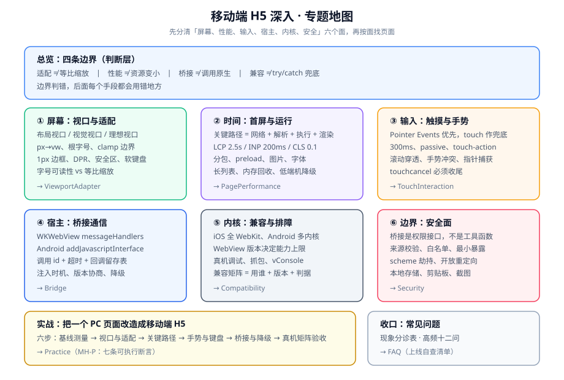

# 移动端 H5 深入

同一个页面，要在 320px 的老机型、430px 的新旗舰、折叠屏展开后的 674px，以及十几个不同版本的 WebView 内核上同时能用——本专题把这件事从反复试错，变成一套能写下来、能量出来、能被别人复核的工程约束。

::: tip 一句话理解
移动端 H5 的难点从来不是「不会写 CSS」，而是**同一个错误在不同设备上表现不同**：在你手上没问题，在别人的机器上白屏。所以它需要的不是更多技巧，而是**先定支持面，再定判据**。
:::

## 与相邻专题的分工

本专题最容易和十个已存在的专题混淆。下表把边界逐条写死——**判据可以互相借用，结论不能互相搬运**。

| 相邻专题 | 它回答什么 | 本专题回答什么 | 为什么不能互相替代 |
| --- | --- | --- | --- |
| [HTML meta 元信息](../Basic/HTML/meta/index.md) | `viewport` 这个标签**怎么写、每个参数什么含义** | 写了之后**尺寸体系怎么搭**：哪些值该缩放、哪些值不该 | 那一页是「一行配置的语法」，本专题是「一整页的换算规则」 |
| [CSS 响应式布局](../Basic/CSS/Advanced/Responsive/index.md) | 媒体查询、断点、栅格与容器查询的**通用方法** | 手机这一档里**连续缩放**与**绝对下限**怎么共存 | 响应式解决「跨设备档位」，本专题解决「档位之内还要连续」 |
| [浏览器性能优化](../Others/PerformanceOptimization/index.md) | 通用的加载与运行时优化手段清单 | 手机上**关键路径为什么与桌面不同**、低端机的量级差从哪来 | 那一页假设设备算力相近，本专题的前提是算力差 5 倍 |
| [浏览器 · 渲染与性能](../Basic/Browser/Performance/index.md) | 浏览器内部的渲染管线：解析、布局、合成 | 这套管线在**软键盘、动态视口、滚动惯性**下会怎么变 | 管线是同一套，手机多出三类会打断管线的系统事件 |
| [PWA 与离线应用](../PWA/index.md) | Service Worker、离线缓存、安装与推送 | 一次会话之内的**首屏、手势、桥接**（离线是另一条线） | PWA 关心「断网还能不能用」，本专题关心「联网时快不快、好不好点」 |
| [跨端方案深入](../Frame/CrossPlatform/index.md) | 一套代码出多端（小程序 / App / H5）的**编译与差异治理** | 只做 H5 这一端时，**这一端内部的适配与桥接** | 跨端是「让代码同时面向多端」，本专题是「端已经定死了，怎么把它做好」 |
| [微信小程序 · 性能](../Frame/WxMini/Performance/index.md) | 小程序自身双线程模型下的性能约束 | WebView 单线程模型下的性能约束 | 两者瓶颈来源不同：小程序卡在 `setData` 通信，H5 卡在主线程长任务 |
| [桌面应用 · IPC 与命令](../DesktopApp/IPC/index.md) | 桌面端主进程与渲染进程之间的**进程间通信设计** | 手机宿主与 WebView 之间的**跨运行时调用设计** | 两者都想解决「超时 / 幂等 / 协议演进」，但桌面可以长连接，WebView 的通道更脆弱 |
| [前端安全](../Others/Security/index.md) | XSS、CSRF、CSP 等**页面自身**的安全基线 | 页面被放进宿主之后**多出来的那一层**：桥接授权与来源校验 | 页面安全做满分，也可能因为暴露了桥接对象而失守 |
| [国际化与无障碍](../IntlA11y/index.md) | 多语言、焦点管理、语义化与 WCAG | 触屏上的**可点面积、字号下限、单手持机**带来的额外约束 | 无障碍问「能不能用」，小屏问「够不够大、够不够到」 |

::: info 版本组织说明
「移动端 H5」不是一个有版本线的产品，而是**一类运行环境**，因此**不建版本目录**——不存在需要长期并存维护的第二条内容线。

它的版本差异体现在**内核与系统**上（iOS 27 的 WebKit、Android 154/155 的 Chromium WebView），处理方式是**在页内用 `::: info` 标注适用版本并保留旧写法**，而不是按版本拆目录。仓库内已有的版本目录范式可供对照（三个都按「旧版本保留 + 页顶标注状态 + 新版不覆盖」的约定组织）：

| 版本目录范式 | 入口 | 组织方式 |
| --- | --- | --- |
| Spring 框架 | [Spring 版本入口](../../Backend/Java/Frame/Spring/index.md) | `Spring5/` 与 `Spring6/` 并存，各自独立目录 |
| Vue 框架 | [Vue3](../Frame/Vue/Vue3/index.md) | `Vue2/` 与 `Vue3/` 并存，`Vue2` 标注为存量项目使用 |
| Spring Boot | `docs/Backend/Java/Frame/SpringBoot/` 下的 `v2` / `v3` / `v4` | 按大版本分目录，共享同一份 `assets/` |
:::

## 专题地图

## 九篇正文

按「先建立判断，再分面学手段，最后动手」的顺序排列。

| # | 页面 | 一句话说明 |
| --- | --- | --- |
| 1 | [总览：移动端 H5 的四条边界](./Overview/index.md) | 适配 ≠ 等比缩放、性能 ≠ 资源变小、桥接 ≠ 调用原生、兼容 ≠ 兜底 |
| 2 | [视口与适配体系](./ViewportAdapter/index.md) | 三个视口、三套尺寸体系、1px 边框、安全区与软键盘 |
| 3 | [首屏与运行时性能](./PagePerformance/index.md) | 关键路径五段拆解、三档手机的差距、长列表与内存 |
| 4 | [触摸、手势与输入](./TouchInteraction/index.md) | Pointer Events 优先、三种终态、滚动与手势仲裁 |
| 5 | [桥接通信](./Bridge/index.md) | 一次调用的六个阶段、四个终态、注入时机与版本协商 |
| 6 | [兼容与真机排障](./Compatibility/index.md) | 一张能跑的兼容矩阵、四层降级、真机调试与抓包 |
| 7 | [WebView 与桥接的安全面](./Security/index.md) | 四层防线、桥接的三条纪律、存储与隐私边界 |
| 8 | [实战：把 PC 页面改造成移动端 H5](./Practice/index.md) | 六步改造，每步都有可执行断言 |
| 9 | [常见问题与最佳实践](./FAQ/index.md) | 现象分诊表、高频十二问、上线自查清单、术语表 |

## 阅读顺序建议

1. **只想建立判断力**：读 [总览](./Overview/index.md) + [视口与适配体系](./ViewportAdapter/index.md)，两页加起来够你在需求评审时问出正确的问题。
2. **正在救一个线上白屏或错版**：先读 [常见问题与最佳实践](./FAQ/index.md) 的分诊表，它会把你送回正确的页面。
3. **要动手改造**：按 2 → 3 → 4 的顺序读，再落到 [实战](./Practice/index.md) 的六步路线。
4. **只关心原生能力调不通**：直接读 [桥接通信](./Bridge/index.md) 的四个终态一节，再回头看 [安全面](./Security/index.md) 的来源校验。

## 事实与规格速览（2026-10 口径）

口径统一为「已联网核对 + 标注版本号」，涉及具体产品与内核的地方**都写了适用版本**。

| 事项 | 结论 | 依据 |
| --- | --- | --- |
| iOS / Safari 当前版本 | **Safari 27.0.1**（2026-09-28），随 **iOS 27**（2026-09-14 起推送）发布；27.2 beta 3 为预览线（2026-10-07） | Apple 发布页与 The Apple Wiki 版本表 |
| Chrome for Android | 稳定 **154**（`154.0.8037.94`，2026-10-02，桌面/Android 同轨发布） | Chrome Releases 官方博客 |
| Android System WebView | **155.0.8059.44**（2026-10-12）；**可独立于系统更新，也可能被用户停用** | Play 商店版本页 |
| 动态视口单位 | `svh` / `lvh` / `dvh`：Safari 15.4+、Chrome/Edge 108+、Firefox 101+，2026 年全球覆盖约 97% | MDN 兼容数据与多篇 2026 年实测文 |
| `interactive-widget` | Chromium 与 Gecko 已支持（Chrome 108 / Firefox 133，均指 Android）；**WebKit 已实现但尚未进入公开版 Safari**（2026-09 仍为在研） | WebKit 源码与社区跟踪文（2026-09-11 更新） |
| `viewport-fit=cover` 与 `env(safe-area-inset-*)` | 不使用 `cover` 时四个 `env()` 全部解析为 **0**，因此「加了 `env()` 却仍被刘海遮挡」几乎必然是漏了 `cover` | MDN `env()` 说明 + 多篇适配实践 |
| 指针事件规范 | **Pointer Events Level 3 于 2026-06-30 成为 W3C 正式推荐标准**；新增 `pointerrawupdate`、合并事件与预测事件 | W3C TR `pointerevents3`（2026-06-30） |
| 触摸事件现状 | Touch Events 至今仍是 **Limited availability（非 Baseline）**，桌面 Safari 常不暴露 | MDN 兼容数据 |
| Core Web Vitals 阈值 | LCP **≤ 2.5 s**、INP **≤ 200 ms**、CLS **≤ 0.1**（取 P75，移动与桌面分开）；INP 自 2024-03 取代 FID | web.dev / Google Search Central |
| `amfe-flexible` + `postcss-pxtorem` | 库已停止维护并标记弃用；`rem` 是字体单位，用作整体布局属于语义误用 | 官方仓库状态 + 主流实践文（2026） |
| `postcss-px-to-viewport` | 仍在维护（社区有 `-8-plugin` 等延续包），需显式排除 `node_modules` 与组件库 | PostCSS 插件生态与配置实践 |

::: warning 三条最容易搞错的事实
1. **`100vh` 在手机上是「最大的那个高度」**，不是「你现在看得见的高度」——地址栏收起时 `100vh` 的元素底部会被裁掉。要用 `svh`（绝不被裁）或 `dvh`（跟随实时状态）。
2. **`dvh` 默认不随软键盘变化**。软键盘只改视觉视口，`dvh` 跟随的是布局视口——所以 `100dvh` 的聊天输入框仍然会被键盘盖住，必须用 `visualViewport` 或（在支持的平台上）`interactive-widget=resizes-content` 补。
3. **iOS 上「换个浏览器试试」没有意义**。iOS 的第三方浏览器与 App 内嵌页共用 WebKit，差异来自系统版本而不是浏览器品牌。
:::

## 本专题的判据纪律

全库有一条约定的写作纪律：**判据编号必须唯一，且要能同时回答三件事**——「约定是什么 / 定错的后果是什么 / 怎么验证它没被破坏」。

本专题共用一个前缀 `MH`，逐页独立成族：

| 页面 | 判据族 | 数量 |
| --- | --- | --- |
| 总览 | `MH-A` | 6 |
| 视口与适配体系 | `VA-A` | 8 |
| 首屏与运行时性能 | `PF-A` | 8 |
| 触摸、手势与输入 | `TG-A` | 8 |
| 桥接通信 | `HB-A` | 8 |
| 兼容与真机排障 | `WC-A` | 8 |
| WebView 与桥接的安全面 | `WS-A` | 8 |
| 实战 | `MH-P` | 7 |

## 参考资料

- [MDN · Viewport meta 标签与移动端视口](https://developer.mozilla.org/en-US/docs/Web/HTML/Viewport_meta_tag)
- [MDN · `env()` 与安全区内边距](https://developer.mozilla.org/en-US/docs/Web/CSS/env)
- [MDN · `visualViewport` API](https://developer.mozilla.org/en-US/docs/Web/API/VisualViewport)
- [W3C · Pointer Events Level 3（推荐标准，2026-06-30）](https://www.w3.org/TR/pointerevents3/)
- [web.dev · Web Vitals（LCP / INP / CLS 阈值）](https://web.dev/articles/vitals)
- [Apple Developer · WKWebView 与 `WKScriptMessageHandler`](https://developer.apple.com/documentation/webkit/wkscriptmessagehandler)
- [Android Developers · `WebView` 安全建议](https://developer.android.com/privacy-and-security/security-tips)
