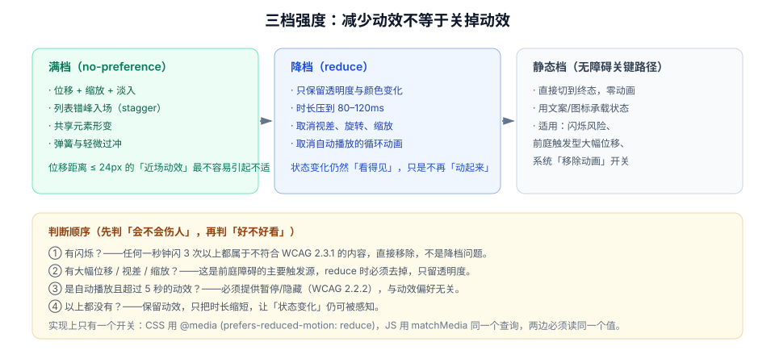

# 无障碍与动效偏好

动效不是「好看不好看」的问题，对一部分人来说它是**能不能用**的问题。前庭功能障碍、偏头痛、癫痫、注意力障碍用户对运动、闪烁、视差的耐受度远低于常人，而系统的「减少动态效果」开关就是他们唯一的表达渠道。

::: tip 一句话理解
`prefers-reduced-motion: reduce` 的含义不是「不要动画」，而是「**不要让我晕**」。所以正确做法是去掉位移、缩放、视差，保留透明度与颜色变化——让状态变化仍然看得见。
:::

## 一、三类真实伤害

| 类型 | 触发 | 后果 | 规范 |
| --- | --- | --- | --- |
| **前庭反应** | 大幅位移、视差、缩放、旋转、镜头推进 | 眩晕、恶心、偏头痛，可持续数小时 | WCAG 2.3.3（AAA） |
| **光敏性癫痫** | 高频闪烁（尤其红/白交替） | 诱发光敏性发作 | WCAG 2.3.1（AA）：**≤ 3 次/秒** |
| **注意力与认知负荷** | 持续循环动效、自动播放 | 无法集中、阅读被打断 | WCAG 2.2.2（A）：超 5s 需可暂停 |

::: danger 一条硬红线
**任何内容都不得在 1 秒内闪烁超过 3 次。** 这条不是「建议」，是 AA 级要求，且**与用户的动效偏好设置无关**——即使用户没有开启「减少动态效果」，闪烁也必须被移除。常见违规：加载骨架的高频闪烁、错误提示的连续抖动、霓虹风格的边框动画。
:::

## 二、三档强度：不是开关，是刻度



| 档位 | 触发条件 | 保留什么 | 去掉什么 |
| --- | --- | --- | --- |
| **满档** | `no-preference` | 位移、缩放、错峰、共享元素 | — |
| **降档** | `reduce` | 透明度、颜色、≤120ms 的短过渡 | 位移 > 24px、缩放、旋转、视差、自动循环 |
| **静态档** | 有闪烁风险 / 系统「移除动画」 | 直接切终态 + 文案/图标 | 所有动画 |

关键在于第二档：很多实现的写法是 `* { animation: none !important; transition: none !important; }`，结果连「保存成功」的绿色渐隐也没了，用户反而更难确认操作结果。

```css
/* 推荐写法：只降级「会晕」的部分，保留「传达状态」的部分 */
@media (prefers-reduced-motion: reduce) {
  /* 1) 所有过渡压到极短，保留属性的变化本身 */
  *,
  *::before,
  *::after {
    animation-duration: 80ms !important;
    animation-iteration-count: 1 !important;
    transition-duration: 80ms !important;
    scroll-behavior: auto !important;
  }

  /* 2) 位移与缩放归零：这类才是前庭反应的主因 */
  .slide-in,
  .toast-enter,
  .card-reorder {
    transform: none !important;
  }

  /* 3) 视差与自动循环直接停掉 */
  .parallax-layer,
  .auto-carousel {
    animation: none !important;
    transform: none !important;
  }

  /* 4) 骨架屏改为静态底色，避免呼吸闪烁 */
  .skeleton {
    animation: none !important;
    background: var(--color-skeleton-static) !important;
  }
}
```

## 三、CSS 与 JS 必须读同一个查询

最容易出的问题：CSS 已经降级了，JS 动画（WAAPI、canvas、图表库）还在满速跑。

```javascript
// 统一入口：所有 JS 动效都从这里读偏好
const mq = window.matchMedia("(prefers-reduced-motion: reduce)");

export function prefersReducedMotion() {
  return mq.matches;
}

// 偏好可能在会话中途变化（系统设置、外接显示器切换），必须监听
mq.addEventListener("change", (e) => {
  document.documentElement.dataset.motion = e.matches ? "reduced" : "full";
});
// 初始化时也要写一次，避免首屏状态不一致
document.documentElement.dataset.motion = mq.matches ? "reduced" : "full";
```

```javascript
// 动效工具函数：自动套用降级规则
export function motion(el, keyframes, options = {}) {
  const reduced = prefersReducedMotion();
  const frames = reduced
    ? keyframes.map(({ transform, scale, rotate, ...rest }) => rest)  // 去掉位移类
    : keyframes;
  return el.animate(frames, {
    duration: reduced ? Math.min(options.duration ?? 200, 100) : options.duration ?? 200,
    easing: reduced ? "linear" : options.easing ?? "cubic-bezier(0.2, 0, 0, 1)",
    fill: options.fill ?? "none",
  });
}
```

::: warning 一个反直觉的细节
`matchMedia` 的 `change` 事件在某些浏览器里**只在页面可见时触发**。因此不要在启动时读一次就缓存到模块变量里，而是每次动画前现读 `mq.matches`——一次属性访问的成本，远低于「用户改了设置但页面还是晕」的代价。
:::

## 四、焦点、朗读与动效的配合

| 场景 | 要求 | 做错的后果 |
| --- | --- | --- |
| 抽屉 / 模态打开 | 焦点移入容器，且容器有 `aria-modal` | 键盘用户仍在背景里 Tab |
| 模态关闭 | 焦点回到触发按钮 | 焦点丢到 `body`，Tab 从页首重新开始 |
| 动画进行中 | 焦点环必须可见（不能被动画的 `opacity` 一起淡掉） | 键盘用户看不到当前位置 |
| 内容异步更新 | 用 `aria-live="polite"` 播报结果，不依赖动画 | 屏幕阅读器用户不知道「已保存」 |
| 列表插入新项 | 播报「已添加 1 项」，并把焦点留在原处 | 焦点被强行移到新项，输入被打断 |

```html
<!-- 状态用「文案 + 图标 + 颜色」三重表达，动画只是第四重增强 -->
<button id="save" data-state="pending" aria-busy="true">
  <span class="btn__spinner" aria-hidden="true"></span>
  <span class="btn__label">保存中…</span>
</button>
<p id="save-status" role="status" aria-live="polite" class="sr-only">正在保存</p>
```

## 五、滚动、视差与「滚动劫持」

滚动是用户对页面的**直接操纵**。任何改变滚动距离、速度、方向的实现（scroll-jacking）都会同时破坏可用性与无障碍：

1. **不要拦截滚轮事件改变滚动距离**。
2. **视差层幅度 ≤ 视口高度的 10%**，且在 `reduce` 下完全关闭。
3. **不要用 `scroll-behavior: smooth` 做长距离跳转**：`reduce` 下必须改为 `auto`（上面那段 CSS 已包含）。
4. **锚点跳转后焦点要跟着走**，否则键盘用户还在原地。

## 六、判据 `MNA-A` ~ `MNA-H`

| 编号 | 判据 | 怎么验证 |
| --- | --- | --- |
| `MNA-A` | 全站存在 `prefers-reduced-motion: reduce` 的降级规则 | `grep -rn "prefers-reduced-motion" src/` 有命中且覆盖全局 |
| `MNA-B` | 降级是「降档」而非「清零」：状态变化仍然可见 | 开模拟后走完提交链路，仍能看到 saving / success |
| `MNA-C` | JS 动效读取同一个媒体查询，且每次动画前现读 | 搜索 `matchMedia`，核对是否被缓存到模块级常量 |
| `MNA-D` | 不存在 1 秒内超过 3 次的闪烁 | 逐个检查循环动画的 `animation-duration` 与 `steps()` |
| `MNA-E` | 自动播放且超过 5s 的动效可暂停 | 检查是否存在暂停控件或默认不自动播放 |
| `MNA-F` | 动画期间焦点环可见，模态关闭后焦点回到触发点 | 全程键盘操作一遍，记录焦点落点 |
| `MNA-G` | 异步结果用 `aria-live` 播报，不只靠动画 | 用屏幕阅读器（或 DevTools 无障碍树）验证播报 |
| `MNA-H` | 视差幅度受限，且 `reduce` 下关闭 | 滚动页面，量最大位移；开模拟后应无位移 |

## 七、验证方式

```javascript
// ① 用 JS 临时模拟系统偏好（Chrome 支持，用于快速回归）
// 打开 DevTools → Rendering → Emulate CSS media feature prefers-reduced-motion: reduce
const mq = window.matchMedia("(prefers-reduced-motion: reduce)");
console.log("当前偏好 =", mq.matches ? "reduce" : "no-preference");
```

```javascript
// ② 检查降级后「是否还有会晕的位移」
const moving = document.getAnimations().filter((a) => {
  const frames = a.effect?.getKeyframes?.() ?? [];
  return frames.some((f) => f.transform && f.transform !== "none");
});
console.log("含 transform 的动画 =", moving.length);
// 期望：在 reduce 模拟下为 0（或仅剩 ≤ 24px 的微位移）
```

```javascript
// ③ 检查焦点是否在转场/模态后正确落位
document.querySelector("#open-drawer").click();
setTimeout(() => {
  console.log("打开后焦点 =", document.activeElement?.className);
  document.querySelector("#close-drawer").click();
  setTimeout(() => console.log("关闭后焦点 =", document.activeElement?.id), 300);
}, 400);
// 期望：打开后焦点在抽屉内，关闭后回到 open-drawer
```

```css
/* ④ 静态检查：是否存在无限循环的装饰动画（应在 reduce 下停掉） */
/* 搜索 animation-iteration-count: infinite，逐个确认是否已被降级规则覆盖 */
```

## 八、相关页面与下一篇

- 下一篇：[实战：看板的动效系统](../Practice/index.md)——把前面所有规则落成一套可验收的实现。
- 上游：[动效性能与掉帧诊断](../Performance/index.md)（不能为了性能牺牲可访问性）。
- 相邻必读：[国际化与无障碍 · 无障碍基础](../../IntlA11y/A11yFoundation/index.md)、[键盘与焦点](../../IntlA11y/KeyboardFocus/index.md)。

## 参考资料

- [MDN · `prefers-reduced-motion`](https://developer.mozilla.org/en-US/docs/Web/CSS/@media/prefers-reduced-motion)
- [WCAG 2.2 · 2.3.1 Three Flashes or Below Threshold](https://www.w3.org/WAI/WCAG22/Understanding/three-flashes-or-below-threshold.html)
- [WCAG 2.2 · 2.3.3 Animation from Interactions](https://www.w3.org/WAI/WCAG22/Understanding/animation-from-interactions.html)
- [WCAG 2.2 · 2.2.2 Pause, Stop, Hide](https://www.w3.org/WAI/WCAG22/Understanding/pause-stop-hide.html)
- [web.dev · Respecting users' motion preferences](https://web.dev/articles/prefers-reduced-motion)
