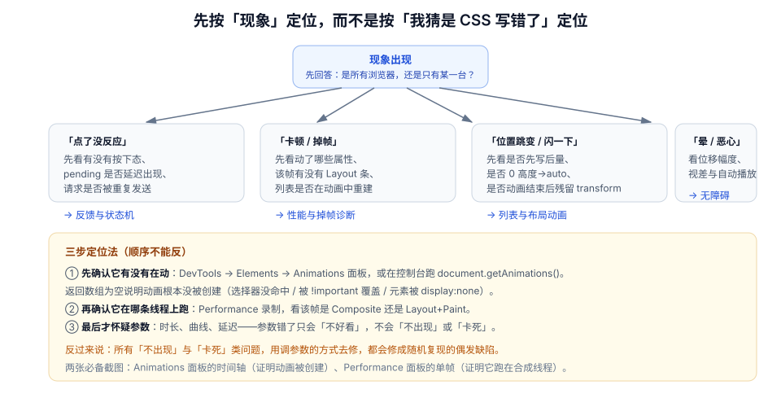

# 常见问题与最佳实践

动效问题有一个共同特征：**现象与原因隔着好几层**。「按钮点了没反应」可能是不有按下态、可能是 pending 覆盖了按下态、也可能是动画被 `!important` 干掉了。本页提供一张分诊表，先把现象归到正确的页面，再动手。

::: tip 一句话理解
修动效 bug 的顺序永远是：**先确认动画有没有被创建 → 再确认它跑在哪条线程 → 最后才调参数**。跳过前两步直接改时长，只会把「必然」修成「偶发」。
:::

## 一、十二类现象分诊



| # | 现象 | 先查什么 | 去哪一页 |
| --- | --- | --- | --- |
| 1 | 点了没反应，没有任何视觉变化 | 元素上是否存在动画（`getAnimations()`）、选择器是否命中 | [反馈与状态机](../Feedback/index.md) |
| 2 | 有按下态，但一直没有后续状态 | 是否缺 `pending` / `success` / `error` 终态 | [反馈与状态机](../Feedback/index.md) |
| 3 | 快速点击时按钮「闪一下」 | loading 是否延迟 200ms 出现、是否被取消 | [反馈与状态机](../Feedback/index.md) |
| 4 | 连点后状态错乱、请求重复 | 是否有 pending 闸门与幂等键 | [反馈与状态机](../Feedback/index.md) |
| 5 | 列表删除时内容「塌一下」 | 是否先移除再补位、有无 FLIP | [列表与布局动画](../ListAnimation/index.md) |
| 6 | 展开折叠「啪」地出现 | 高度是否从 0 过渡到 auto、用了哪种写法 | [列表与布局动画](../ListAnimation/index.md) |
| 7 | 虚拟列表滚动时元素「飞入」 | 是否对复用节点做了 FLIP | [列表与布局动画](../ListAnimation/index.md) |
| 8 | 路由切换「卡在第一帧」 | 转场回调里是否有 `await` 请求 | [页面转场与共享元素](../PageTransition/index.md) |
| 9 | 转场没有生效，但也不报错 | `view-transition-name` 是否重名、元素是否 `display:none` | [页面转场与共享元素](../PageTransition/index.md) |
| 10 | 动画掉帧、卡顿 | 动了哪些属性、该帧有无 Layout / Paint | [动效性能与掉帧诊断](../Performance/index.md) |
| 11 | 动画「越优化越卡」 | `will-change` 是否滥用、层数是否爆炸 | [动效性能与掉帧诊断](../Performance/index.md) |
| 12 | 用户反馈「看着头晕」 | 位移幅度、视差、自动循环、是否响应 reduce | [无障碍与动效偏好](../Accessibility/index.md) |

## 二、高频十问

### 1. 为什么 `transition: all 0.3s` 是坏味道？

因为它把**所有**可动画属性都纳入过渡，包括 `width`、`height`、`top`、`box-shadow`。你以为只过渡了颜色，实际上每次 DOM 变化都可能触发一次布局动画。正确写法是逐属性声明，且只声明 `transform` / `opacity`。

### 2. 动画时长到底取多少？

按「距离 + 频率」两维决定：微反馈 80–120ms、组件内移动 150–200ms、面板 220–300ms、整页 300–400ms；高频操作取低档，且在 `reduce` 下降到 100ms 以内。具体表格见 [动效原则](../Principles/index.md)。

### 3. 为什么按下态要用 `data-state` 而不是 `:active`？

`:active` 在触摸设备上有延迟、键盘操作不一定触发、且无法与 `pending` / `error` 等业务状态联动。用属性承载状态，`:active` 只作为鼠标场景的补充。

### 4. `transform` 动画一定不卡吗？

不一定。`transform` 本身在合成线程，但如果**同一帧里主线程有长任务**，或者元素每帧都在被 JS 改样式（触发了样式重算），依然会卡。另外 `transform` 里的 `scale` 会影响文字清晰度，大倍率缩放后需要 `will-change` 配合。

### 5. 为什么动画结束后元素「跳回原位」？

三种原因：① 用 `fill: "none"` 且没有把终态写进样式，动画结束后回到初始值；② 用 CSS `animation` 且没有 `forwards`；③ 用 WAAPI `fill: "both"` 但之后读取布局拿到了旧位置（动画层不改变计算样式）。

### 6. View Transitions 为什么在我的项目里没反应？

按顺序排查：① 是否在 `startViewTransition` 的回调里**同步**改了 DOM（没改就没有差异，也就没有转场）；② `view-transition-name` 是否在同一快照中重名；③ 是否给 `display: none` 的元素命名；④ 是否在 Safari 17 / Firefox 143 等不支持版本上测试（此时应当「无动画但功能正常」）。

### 7. 抽屉动画用 `transform` 还是 `translate` 属性？

都可以（`translate: 100% 0` 是独立属性，性能等价于 `transform`），但**不要混用**：同时设置 `transform` 与 `translate` 会叠加，位移量翻倍。项目内统一一种写法。

### 8. 骨架屏要不要动画？

要，但只能是**低幅度、长周期**的呼吸（1.2–1.6s），且 `reduce` 下改为静态。高频闪烁的骨架既刺眼又可能触碰闪烁阈值。

### 9. 动效要不要写进设计规范？

要，但只需要三样东西：**时长令牌、曲线令牌、以及「什么情况不加动画」的清单**。把每个动画都画成故事板，维护成本远高于收益。

### 10. 怎么向非技术同事解释「这个动画不能删」？

用「删掉会少知道什么」来回答。例如「删掉按下态，用户不知道点击有没有生效，会重复提交，产生重复订单」——这是业务语言，不是审美语言。

## 三、上线前自查清单（十二项）

- [ ] 所有交互控件都有可见的按下态，且不依赖网络
- [ ] 提交类操作具备 `pressed → pending → success/error` 四态
- [ ] loading 延迟 200ms 出现，快速返回时被取消
- [ ] 列表增删走「离场 → 移除 → 补位」，无瞬移
- [ ] 展开折叠的动画结束后 `height` 交还 `auto`
- [ ] 路由转场的数据请求在转场之外完成
- [ ] `view-transition-name` 在同一快照中唯一
- [ ] 动画只作用于 `transform` / `opacity`（或经实测的 `filter`）
- [ ] `will-change` 在动画结束后撤销
- [ ] 首屏内容没有透明度入场（不推后 LCP）
- [ ] 存在 `prefers-reduced-motion: reduce` 降级，且是降档不是清零
- [ ] 无 1 秒内超过 3 次的闪烁

## 四、术语表

| 术语 | 含义 | 容易混淆的点 |
| --- | --- | --- |
| **微交互（micro-interaction）** | 围绕单个控件的「触发 → 反馈 → 结果」小循环 | 不等于「小动画」，它强调的是闭环 |
| **转场（transition / view transition）** | 视图之间的替换过程 | CSS 的 `transition` 属性是「属性过渡」，与「页面转场」不是一回事 |
| **FLIP** | First / Last / Invert / Play 四步补偿法 | 它不是库，也不需要库 |
| **合成层（compositing layer）** | 独立于主文档、可单独变换的图层 | 层多不等于快，反而吃显存 |
| **掉帧（jank）** | 单帧超过刷新预算，表现为不跟手 | 与「慢」不同：慢是总量大，掉帧是节奏断 |
| **INP** | Interaction to Next Paint，交互到下一帧绘制 | 动画跑在合成线程时不影响 INP |
| **CLS** | Cumulative Layout Shift，累计布局位移 | 用 `transform` 做动画不产生 CLS |
| **Doherty 阈值** | 400ms 内必须有反馈 | 约束的是「反馈出现」，不是「动画结束」 |
| **前庭反应** | 由视觉运动引发的眩晕/恶心 | 主要触发源是大位移、视差、旋转 |
| **降档（degrade）** | 减少动效而不是关闭动效 | `animation: none` 是清零，往往过度 |

## 五、五个反复出现的坏实践

| 坏实践 | 为什么会发生 | 正确做法 |
| --- | --- | --- |
| 用动画掩盖加载慢 | 「先让它动起来，用户就不觉得慢」 | 优化加载；动画只用于状态告知 |
| 全站统一 300ms | 图省事 | 按距离与频率分档 |
| 给每个元素都加 `will-change` | 「听说这个能提升性能」 | 只在动画期间加，结束撤销 |
| 只用颜色表达状态 | 「红色就是错误」 | 颜色 + 图标 + 文案三重表达 |
| 动画做完就完事，无回归手段 | 「动效没法测」 | 用 `getAnimations()`、帧间隔脚本、截图对比做回归 |

## 六、判据 `MNQ-A` ~ `MNQ-H`

| 编号 | 判据 | 怎么验证 |
| --- | --- | --- |
| `MNQ-A` | 每个动效缺陷都能被归入十二类现象之一，并有对应页面 | 抽取最近 5 个动效 bug，逐个标注分类 |
| `MNQ-B` | 排查遵循「是否创建 → 哪条线程 → 参数」的顺序 | 抽查一次排查记录，是否先跑 `getAnimations()` |
| `MNQ-C` | 自查清单十二项在发版前逐项勾选并留痕 | 发版记录中存在勾选清单 |
| `MNQ-D` | 术语表在团队内统一使用（尤其「转场」与「transition 属性」） | 抽查 3 份设计稿或 PR 描述 |
| `MNQ-E` | 不存在「用动画掩盖加载」的实现 | 断网或强限速下走关键链路，确认动画不承担等待 |
| `MNQ-F` | 状态表达不依赖单一颜色 | 灰度模式下检查错误是否仍可辨识 |
| `MNQ-G` | 动效缺陷有回归手段（脚本或截图对比） | CI 或手动清单中存在对应项 |
| `MNQ-H` | 新增动效在评审中回答了「三问」（解释什么、不加会怎样、降级形态） | 抽查 3 个 PR 描述 |

## 七、验证方式

```javascript
// ① 一屏之内有多少动画在跑（异常多说明触发条件写错了）
console.table(
  document.getAnimations().map((a) => ({
    target: a.effect?.target?.className?.toString().slice(0, 40),
    name: a.transitionProperty ?? a.animationName,
    state: a.playState,
  }))
);
// 期望：数量与「此刻真正在变化的元素数」一致
```

```javascript
// ② 一次性检查「动画结束后是否残留」
await new Promise((r) => setTimeout(r, 800));
const dirty = [...document.querySelectorAll("[style]")].filter(
  (el) => el.style.transform || el.style.height || el.style.willChange
);
console.log("残留行内样式的元素 =", dirty.length);
// 期望：0（业务本身需要的行内样式除外）
```

```shell
# ③ 全局扫「清零式」降级（过度降级的信号）
grep -rn "prefers-reduced-motion" src/ -A5 | grep -E "animation:\s*none|transition:\s*none" \
  && echo "疑似过度降级：确认是否仍保留状态可见性"
```

```shell
# ④ 发版前跑一遍构建与测试
pnpm build && pnpm test -- --run
# 期望：构建无错误、测试全绿；再按「上线前自查清单」手动走一遍
```

## 八、相关页面

- 建立判断：[总览：四类用途与四条边界](../Overview/index.md)
- 参数取值：[时长、缓动与弹簧](../Timing/index.md)
- 落地实现：[实战：看板的动效系统](../Practice/index.md)
- 相邻专题：[CSS 进阶 · 动画](../../Basic/CSS/Advanced/Animation/index.md) · [国际化与无障碍](../../IntlA11y/index.md) · [前端性能优化](../../Others/PerformanceOptimization/index.md)

## 参考资料

- [MDN · `Document.getAnimations()`](https://developer.mozilla.org/en-US/docs/Web/API/Document/getAnimations)
- [web.dev · Animations guide](https://web.dev/articles/animations-guide)
- [WCAG 2.2 · 理解 2.3.1 与 2.3.3](https://www.w3.org/WAI/WCAG22/Understanding/)
- [Chrome for Developers · Performance panel reference](https://developer.chrome.com/docs/devtools/performance/reference)
- [Material Design 3 · Motion](https://m3.material.io/styles/motion/overview)
