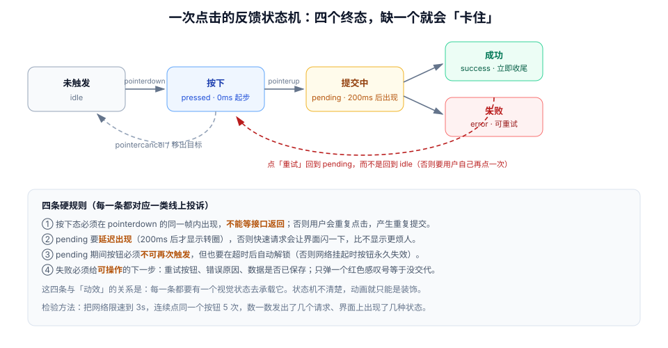

# 反馈与状态机

用户点了按钮之后，界面要回答三个问题：**收到了吗？在做了吗？成了吗？** 这三个问题对应三个状态，而绝大多数「点了没反应」的投诉，本质是某个状态没有被画出来。

::: tip 一句话理解
反馈不是「加一个 loading 动画」，而是**把一次操作的生命周期画成状态机**。状态机缺一个终态，用户就会在某个状态里永远等下去——而动画只是让状态转场看得见。
:::

## 一、一次点击的完整状态机



| 状态 | 进入条件 | 视觉 | 退出条件 |
| --- | --- | --- | --- |
| `idle` | 初始 | 正常按钮 | `pointerdown` |
| `pressed` | `pointerdown` / `keydown(Enter/Space)` | 缩放 0.98 + 底色加深 | `pointerup` 且未移出 / `pointercancel` |
| `pending` | 提交开始（延迟 200ms 后才显示视觉） | 按钮内转圈、禁用再次触发 | 请求成功 / 失败 / 超时 |
| `success` | 2xx | 勾选 200ms 后恢复 | 计时结束回 `idle` |
| `error` | 非 2xx / 超时 | 红色文案 + 重试入口 | 点击重试回 `pending` |

`pressed` 与 `pending` 是两个不同的状态，**必须分开画**。合并成一个「按下就转圈」，会让快速请求也闪一下转圈，观感比什么都不做更差。

## 二、按下态：为什么不能用 `:active` 单独扛

`:active` 有三个问题：

1. **触摸设备上有延迟**：部分老内核会在 `touchend` 后才应用 `:active`，按下瞬间看不到反馈。
2. **无法与业务状态联动**：`pending` 时按钮应当保持「按下感」的残留（禁用态），`:active` 管不了。
3. **键盘用户拿不到**：空格键触发的点击不一定进入 `:active`。

```css
/* 推荐：用属性选择器承载状态，:active 只作为鼠标场景的补充 */
.btn[data-state="pressed"] { transform: scale(0.98); filter: brightness(0.96); }
.btn[data-state="pending"] { cursor: progress; }
.btn[data-state="pending"] .btn__label { opacity: 0.6; }

/* 鼠标场景的兜底：键盘聚焦时不要误触发 */
@media (hover: hover) {
  .btn:active:not([disabled]) { transform: scale(0.98); }
}
```

```javascript
// 状态机落地：一个可复用的提交状态机
function createSubmitState(btn, { request, loadingDelay = 200 }) {
  let state = "idle";
  let timer = null;

  const set = (next) => {
    state = next;
    btn.dataset.state = next;
    btn.toggleAttribute("aria-busy", next === "pending");
    btn.disabled = next === "pending";
  };

  btn.addEventListener("pointerdown", () => {
    if (state === "idle") set("pressed");
  });
  btn.addEventListener("pointercancel", () => {
    if (state === "pressed") set("idle");   // 与 pointerup 同等收尾
  });

  btn.addEventListener("click", async () => {
    if (state === "pending") return;        // 第一道闸门：不允许重入
    set("pressed");
    timer = setTimeout(() => set("pending"), loadingDelay);  // 延迟出现

    try {
      await request();
      clearTimeout(timer);
      set("success");
      setTimeout(() => set("idle"), 1200);
    } catch (err) {
      clearTimeout(timer);
      set("error");
    }
  });
}
```

::: danger 三个会让「按下态」失效的写法
1. **把 `set('pressed')` 写在 `async` 函数的第一行之后**：任何 `await` 之前的同步代码都会延后到微任务，视觉上晚一帧。状态切换必须是事件回调里的**第一条同步语句**。
2. **用 `transition: all 0.3s` 做按下态**：300ms 的过渡意味着「按下」这个瞬间被拉长，快速点击时根本看不到。按下态应当 ≤ 100ms 或干脆不用过渡。
3. **失败后回到 `idle` 而不是 `error`**：用户看不到任何错误提示，只会觉得「点了没反应」——这是重复提交的主要来源。
:::

## 三、loading：延迟出现，超时退出

| 请求耗时 | 该显示什么 | 不该显示什么 |
| --- | --- | --- |
| < 200ms | 什么都不显示（只保留按下态） | 转圈（会闪一下） |
| 200ms–1s | 按钮内转圈 / 局部骨架 | 全屏遮罩 |
| 1s–5s | 局部骨架 + 文案（「正在保存…」） | 不确定进度条 |
| > 5s | 确定进度或「已转到后台，完成后通知你」 | 一直转圈 |

延迟出现的实现要点是**计时器要能被取消**：请求在 150ms 内返回时，计时器必须清掉，否则用户会看到「成功后闪了一个转圈」。

```javascript
// 反例：无脑显示 loading，快速请求时会闪
btn.classList.add("is-loading");
await save();
btn.classList.remove("is-loading");

// 正例：延迟 200ms，且可取消
const t = setTimeout(() => btn.classList.add("is-loading"), 200);
try { await save(); } finally { clearTimeout(t); btn.classList.remove("is-loading"); }
```

## 四、乐观 UI 的边界

「乐观更新」是指先改界面，再等服务端确认。它能让操作「瞬间完成」，但用错地方会造成**数据回滚**这种最伤信任的体验。

| 场景 | 可以乐观吗 | 原因 |
| --- | --- | --- |
| 勾选 todo、点赞、星标 | 可以 | 结果可预测，冲突概率低，回滚代价小 |
| 本地草稿自动保存 | 可以 | 失败可静默重试 |
| 发送评论 | 谨慎 | 需要服务端分配 `id` 与时间戳；用 `tempId` 占位并支持替换 |
| 转账、下单、删除 | **不可以** | 结果是权威的，回滚会造成严重误解 |
| 需要权限校验的操作 | **不可以** | 客户端无法预判是否越权 |

乐观 UI 的三条纪律：

1. **必须能回滚**：失败时恢复原状，并明确告知「已撤销」。
2. **必须防重复**：乐观插入的临时项要带 `tempId`，服务端确认后按 `tempId` 替换，而不是再插一条。
3. **必须有超时**：超过 10s 未确认的乐观项应标记为「同步中」而不是一直假装成功。

## 五、错误反馈：靠近、可操作、不吓人

| 做法 | 评价 | 说明 |
| --- | --- | --- |
| 顶部全局 toast「操作失败」 | 及格 | 离触发点远，且不说明原因 |
| 按钮旁的行内错误 | 好 | 靠近触发点，符合「就近反馈」 |
| 红色边框 + 抖动 | 谨慎 | 抖动是「惩罚性」动效，对焦虑用户不友好；`prefers-reduced-motion` 下必须移除 |
| 全屏弹窗报错 | 差 | 打断当前任务，且需要额外一次点击才能继续 |
| 只改按钮颜色不写原因 | 差 | 用户不知道是网络问题还是校验失败 |

错误文案要回答「发生了什么 + 我能做什么」。例如「网络超时，内容已保留在本地，点此重试」比「保存失败」有用得多。

## 六、骨架屏、转圈与进度条：怎么选

| 指示器 | 适用 | 不适用 |
| --- | --- | --- |
| 骨架屏（skeleton） | 已知结构、内容较多（列表、详情） | 结构未知、内容极少（一个数字） |
| 局部转圈 | 结构不变、只是某个按钮在提交 | 整页加载（会显得整站卡住） |
| 确定进度条 | 有真实进度（上传、安装、批量处理） | 无进度数据时（假进度会被识破） |
| 不确定进度条 | 极短等待（< 2s）且无进度 | 长时间任务（会让人以为卡住） |

::: warning 骨架屏最常见的两个错误
1. **骨架与真实内容尺寸不一致**：骨架高 80px、真实卡片高 120px，切换时整页跳动（CLS）。骨架必须按真实内容的最终尺寸画。
2. **骨架本身带动画且时长很长**：骨架的「呼吸」动画应当是 1.2–1.6s 的匀速循环，且 `prefers-reduced-motion` 下改为静态底色。过快的闪烁骨架会引起不适。
:::

## 七、判据 `MNF-A` ~ `MNF-H`

| 编号 | 判据 | 怎么验证 |
| --- | --- | --- |
| `MNF-A` | 每个提交类操作都有 `pressed` / `pending` / `success` / `error` 四个状态的视觉 | 逐个交互走一遍，缺任一状态即不合格 |
| `MNF-B` | 按下态在 `pointerdown` 同帧出现，不依赖网络 | 断网点击，观察是否仍有按下态 |
| `MNF-C` | loading 延迟 ≥ 200ms 出现，且请求提前返回时被取消 | 用 DevTools 限速到 100ms 返回，观察是否闪转圈 |
| `MNF-D` | `pending` 期间不可重复提交（前端闸门 + 幂等键双保险） | 限速 3s，连点 5 次，服务端只应收到 1 次有效请求 |
| `MNF-E` | 乐观更新的场景可回滚，且回滚有明确提示 | 断网后点赞，恢复网络前检查是否回滚并提示 |
| `MNF-F` | 错误反馈靠近触发点，且包含「原因 + 下一步」 | 抽查 3 个错误提示文案，缺「下一步」即不合格 |
| `MNF-G` | 骨架屏尺寸与真实内容一致，切换时不产生布局位移 | 用 Performance 面板看 CLS，切换瞬间应无 layout shift |
| `MNF-H` | 所有循环类指示器在 `prefers-reduced-motion: reduce` 下改为静态或极低幅度 | 开模拟后观察骨架与转圈 |

## 八、验证方式

```javascript
// ① 数一次操作发出了几个请求（限速 3s，连点 5 次）
let count = 0;
const raw = window.fetch;
window.fetch = (...args) => { count++; return raw(...args); };
const btn = document.querySelector("#save");
for (let i = 0; i < 5; i++) btn.click();
setTimeout(() => console.log("请求数 =", count), 3500);
// 期望：1；若为 5，说明前端没有 pending 闸门（判据 MNF-D）
```

```javascript
// ② 检查状态是否齐全：把按钮的 data-state 打印出来
const btn = document.querySelector("#save");
const states = new Set();
const ob = new MutationObserver(() => states.add(btn.dataset.state));
ob.observe(btn, { attributes: true, attributeFilter: ["data-state"] });
// 走一遍成功与失败两条路径后：
setTimeout(() => console.log([...states]), 4000);
// 期望：包含 pressed / pending / success（或 error）
```

```shell
# ③ 扫出「无延迟、无取消」的 loading 写法
grep -rn "classList.add(\"is-loading\")" src/ | wc -l
# 再人工核对：每处是否都有 setTimeout 延迟与 clearTimeout 收尾
```

```javascript
// ④ 骨架屏切换是否造成位移（在切换瞬间读高度）
const sk = document.querySelector(".skeleton");
const h1 = sk.getBoundingClientRect().height;
// 等真实内容渲染后
setTimeout(() => {
  const h2 = document.querySelector(".card").getBoundingClientRect().height;
  console.log({ skeleton: h1, real: h2, delta: Math.abs(h1 - h2) });
}, 2000);
// 期望：delta ≤ 2px
```

## 九、相关页面与下一篇

- 下一篇：[列表与布局动画](../ListAnimation/index.md)——从单个控件的状态，走到一组元素的变化。
- 上游：[时长、缓动与弹簧](../Timing/index.md)（这些状态该用多长）。
- 相邻必读：[移动端 H5 · 触摸交互](../../MobileH5/TouchInteraction/index.md)（`pointercancel` 的收尾）、[无障碍与动效偏好](../Accessibility/index.md)（状态不能只靠动效表达）。

## 参考资料

- [Nielsen Norman Group · Progress Indicators](https://www.nngroup.com/articles/progress-indicators/)
- [web.dev · Optimistic UI](https://web.dev/learn/forms/)
- [MDN · `aria-busy`](https://developer.mozilla.org/en-US/docs/Web/Accessibility/ARIA/Attributes/aria-busy)
- [Material Design 3 · Loading & progress](https://m3.material.io/components/progress-indicators/overview)
- [WCAG 2.2 · 4.1.3 Status Messages](https://www.w3.org/WAI/WCAG22/Understanding/status-messages.html)
