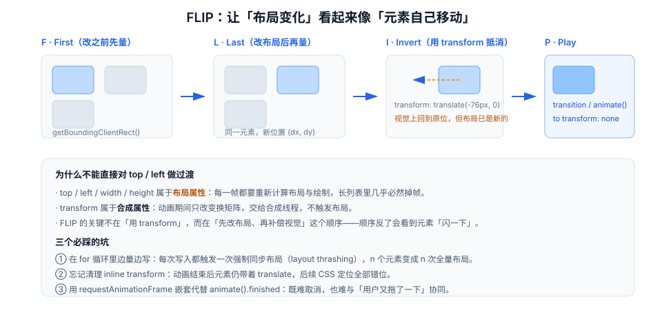

# 列表与布局动画

单个元素的动画是局部问题；列表动画是**全局问题**——因为列表里的元素共享同一套布局，任何一个元素变高、变矮、被删除，都会让其他元素的位置一起变。这就是为什么列表动画几乎总是在「跳一下」。

::: tip 一句话理解
列表动画的本质不是「让元素动起来」，而是**让「布局已经变了」这件事看起来像「元素自己移动了」**。前者由浏览器完成，后者需要你先量、再补偿——这就是 FLIP。
:::

## 一、为什么列表动画容易做坏

| 变化 | 浏览器的行为 | 用户看到的 |
| --- | --- | --- |
| 新增一项 | 所有后续元素**瞬间**下移 | 内容「跳了一下」 |
| 删除一项 | 所有后续元素**瞬间**上移 | 内容「塌了一下」 |
| 排序变化 | DOM 节点被移动，位置瞬变 | 卡片「闪现」到新位置 |
| 展开一项 | 高度从 0 变 auto，无法过渡 | 内容「啪」地出现 |

这四种变化的共同点是：**位置变化是布局的结果，不是样式的过渡**。给 `top` 加 `transition` 不会生效（因为 `top` 没变），给 `transform` 加过渡也不会生效（因为浏览器重排后 `transform` 仍是 `none`）。

## 二、FLIP：先量、再改、反向补偿、播放



```javascript
// 一个能处理「重排 / 增删」的通用 FLIP
function flip(container, mutate) {
  // F · First：先把所有子元素的位置量下来（一次批量读，避免强制同步布局）
  const first = new Map();
  for (const el of container.children) {
    first.set(el, el.getBoundingClientRect());
  }

  // L · Last：改 DOM（这一句会触发一次布局）
  mutate();

  // I · Invert + P · Play：逐个补偿
  for (const el of container.children) {
    const before = first.get(el);
    if (!before) continue;                       // 新增元素没有首帧，交给入场动画
    const after = el.getBoundingClientRect();
    const dx = before.left - after.left;
    const dy = before.top - after.top;
    if (!dx && !dy) continue;                    // 位置没变，不要白跑一个动画

    el.animate(
      [{ transform: `translate(${dx}px, ${dy}px)` }, { transform: "none" }],
      { duration: 200, easing: "cubic-bezier(0.2, 0, 0, 1)" }
    );
  }
}

// 用法：删除一个卡片，其余卡片自动补位
flip(list, () => {
  list.querySelector('[data-id="42"]').remove();
});
```

::: danger FLIP 的三个必踩坑
1. **边量边写**：在 `for` 循环里 `getBoundingClientRect()` 与 `style.transform = ...` 交替执行，每次写入都会让下一次读取触发强制同步布局（layout thrashing）。必须**先全部读完，再全部写**。
2. **忘记清理**：用 `el.style.transform` 做动画，结束后不清理，元素会永久带着偏移量。用 WAAPI 的 `fill: "none"`（默认）即可自动恢复；若用 `fill: "both"`，必须在 `finished` 后手动清空。
3. **对不可见元素做 FLIP**：在折叠区或虚拟列表里，`getBoundingClientRect()` 返回 0，补偿量算成 0，动画看起来「没生效」。判断条件应当是「位置差 > 0.5px」，而不是「元素存在」。
:::

## 三、高度展开：三种写法与各自代价

### 写法一：`grid-template-rows: 0fr → 1fr`（兼容性最好）

```css
.collapsible {
  display: grid;
  grid-template-rows: 0fr;
  transition: grid-template-rows var(--motion-base) var(--ease-standard);
}
.collapsible.is-open { grid-template-rows: 1fr; }
.collapsible > .inner { overflow: hidden; min-height: 0; }
```

优点：不需要测量高度，内容变化也能自适应；缺点：不是所有引擎都能对 `fr` 做插值（部分版本会「跳」），需要实测。

### 写法二：先量 `scrollHeight`，再写死高度

```javascript
function expand(el) {
  el.style.height = "0px";
  el.style.overflow = "hidden";
  const target = `${el.scrollHeight}px`;
  el.animate(
    [{ height: "0px" }, { height: target }],
    { duration: 200, easing: "cubic-bezier(0.2, 0, 0, 1)", fill: "both" }
  ).finished.then(() => {
    el.style.height = "auto";      // 交还给内容，避免内容变化后被裁掉
    el.style.overflow = "";
  });
}
```

优点：行为可预测；缺点：动画期间每一帧都在改 `height`（布局属性），长内容会掉帧；且必须处理「动画结束后改为 auto」这一步，否则内容变高会被截断。

### 写法三：`interpolate-size` + `calc-size()`（新语法）

```css
:root { interpolate-size: allow-keywords; }   /* 允许 height: auto 参与插值 */

.panel { height: 0; overflow: hidden; transition: height 200ms var(--ease-standard); }
.panel.is-open { height: auto; }
```

这是最「正确」的写法，但**支持面仍在收敛**（Chromium 129+ 起支持 `interpolate-size: allow-keywords`，其他引擎的进度以 MDN 兼容表为准）。生产环境应当放在 `@supports` 里做增强，默认仍用写法一或二。

## 四、进出场：删除为什么必须「等动画放完」

删除元素时，如果立刻 `remove()`，后续元素的补位就是瞬时的。正确顺序是：**先播离场动画 → 再真正移除 → 其余元素 FLIP 补位**。

```javascript
async function removeItem(el) {
  // 1) 离场：高度收拢 + 淡出（两个属性都在同一段动画里，避免两段排队）
  await el.animate(
    [
      { opacity: 1, transform: "scale(1)" },
      { opacity: 0, transform: "scale(0.98)" },
    ],
    { duration: 120, easing: "cubic-bezier(0.4, 0, 1, 1)", fill: "forwards" }
  ).finished;

  // 2) 真正移除，并让兄弟元素补位
  flip(el.parentElement, () => el.remove());
}
// 判据：删除时下方元素「滑上来」，而不是「瞬移」
```

::: warning 两个顺序错误
1. **先 remove 再播动画**：元素已经不在文档里，动画不会显示，`finished` 会立刻 resolve——你只会看到一次瞬时的塌陷。
2. **离场与补位同时开始**：下方元素会在被删除元素还占位时就开始上移，视觉上「穿过去了」。必须先腾出空间，再补位。
:::

## 五、错峰入场：stagger 的两条纪律

错峰能让列表看起来「有节奏」，但它有两个隐藏成本：

| 纪律 | 原因 |
| --- | --- |
| 总延迟 ≤ 200ms | 20 个元素 × 50ms = 1s，用户会以为后面的内容「要等」 |
| 只对首屏可见项生效 | 第 30 项之后的错峰没人看得到，纯属浪费 |

```javascript
// 错峰 + 上限：第 i 项的延迟 = min(i * 40, 200)
items.forEach((el, i) => {
  el.animate(
    [{ opacity: 0, transform: "translateY(8px)" }, { opacity: 1, transform: "none" }],
    { duration: 200, delay: Math.min(i * 40, 200), easing: "ease-out", fill: "backwards" }
  );
});
```

## 六、与虚拟列表的冲突

虚拟列表（只渲染可见项）与 FLIP 天然冲突，因为 **DOM 节点会被复用**：滚动时第 10 个节点可能被复用来渲染第 30 项，位置差是「几百像素」，FLIP 会算出一个巨大的位移。

| 冲突 | 表现 | 处理 |
| --- | --- | --- |
| 节点复用 | 滚动时元素「飞入」 | 用 key 追踪身份，节点被复用时跳过 FLIP |
| 只渲染可见项 | 新增项在视口外，入场动画看不到 | 入场动画交给「进入视口」触发 |
| 高度估算 | 展开一项后总高度变化，滚动位置跳动 | 展开时以「展开点」为锚点修正 `scrollTop` |

结论：**虚拟列表里只做「透明度 + 小位移」，不做 FLIP 重排**。重排动画留给非虚拟化的短列表（≤ 50 项）。

## 七、判据 `MNL-A` ~ `MNL-H`

| 编号 | 判据 | 怎么验证 |
| --- | --- | --- |
| `MNL-A` | 列表重排使用 FLIP 或等效方案，不使用 `top` / `margin` 过渡 | 搜索 `transition: top`、`transition: margin` 应为空 |
| `MNL-B` | FLIP 的量与写是分离的（先全部读，再全部写） | 阅读实现：`getBoundingClientRect` 与 `style` 写入不在同一循环里交替出现 |
| `MNL-C` | 删除走「离场动画 → 移除 → 兄弟补位」的顺序 | 删除一项，观察下方元素是否「滑上来」 |
| `MNL-D` | 高度展开的动画结束后交还 `height: auto` | 展开后修改内容，内容不应被裁切 |
| `MNL-E` | 错峰总延迟 ≤ 200ms，且仅对首屏可见项生效 | 打开 30 项列表，最后一个元素应在 200ms 内开始动 |
| `MNL-F` | 虚拟列表内不做 FLIP 重排 | 滚动 20 屏，不应出现「元素飞入」 |
| `MNL-G` | 动画结束后无残留 `transform` / 行内 `height` | 动画完成后读 `el.style.transform` 与 `el.style.height` |
| `MNL-H` | 减少动效模式下，重排与展开变为瞬时（或仅保留透明度） | 开模拟后删除一项，位置变化应为瞬时 |

## 八、验证方式

```javascript
// ① 检查 FLIP 是否真的在补偿：删除前后读同一元素的位置
const list = document.querySelector(".card-list");
const second = list.children[1];
const before = second.getBoundingClientRect().top;
list.children[0].remove();
const after = second.getBoundingClientRect().top;
const anim = second.getAnimations()[0];
console.log({
  layoutJump: Math.round(after - before),
  hasCompensation: !!anim,
  transformAtStart: anim ? getComputedStyle(second).transform : "none",
});
// 期望：layoutJump 为负数（元素位置上移），且 hasCompensation = true
// 若 hasCompensation = false，说明没有 FLIP，用户看到的是瞬移
```

```javascript
// ② 检查「动画结束后是否残留偏移」
await new Promise((r) => setTimeout(r, 400));
console.log(document.querySelector(".card-list").children[1].style.transform);
// 期望：空字符串
```

```javascript
// ③ 检查错峰总时长
const delays = document.querySelectorAll(".card-list > *").length;
console.log("最晚开始时间 =", Math.min((delays - 1) * 40, 200), "ms");
// 期望：≤ 200
```

```css
/* ④ 用 CSS 快速验证「高度是否真的在过渡」 */
/* 在 DevTools 的 Styles 面板勾选 :hover 触发展开，观察 computed height 是否连续变化 */
```

## 九、相关页面与下一篇

- 下一篇：[页面转场与共享元素](../PageTransition/index.md)——从「列表内部的重排」走到「整页视图的切换」。
- 上游：[反馈与状态机](../Feedback/index.md)（单个控件的状态）。
- 相邻必读：[CSS 进阶 · 布局](../../Basic/CSS/Advanced/GridLayout/index.md)、[动效性能](../Performance/index.md)（为什么不能用 `height`）。

## 参考资料

- [web.dev · Animating layouts with FLIP](https://web.dev/articles/animations-guide#flip)
- [CSS Tricks · FLIP 技术详解](https://css-tricks.com/advanced-css-animation-using-cubic-bezier/)
- [MDN · `interpolate-size`](https://developer.mozilla.org/en-US/docs/Web/CSS/interpolate-size)
- [MDN · `Element.animate()`](https://developer.mozilla.org/en-US/docs/Web/API/Element/animate)
- [Chrome for Developers · `calc-size()`](https://developer.chrome.com/blog/calc-size)
