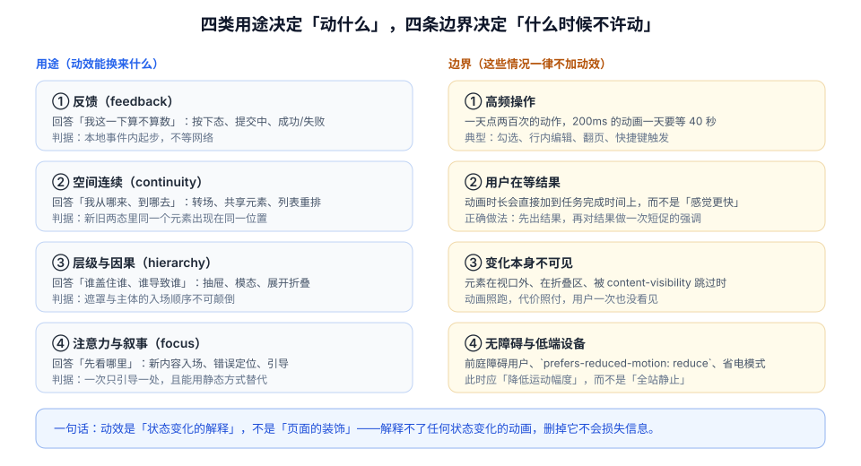

# 总览：四类用途与四条边界

动效在工程里经常被当成「最后美化一下」的收尾工作，于是它成了唯一一类**没有验收标准、没有负责人、出问题只能靠感觉描述**的界面元素。本页给出两件事：动效能换来什么（四类用途），以及它在什么情况下必须被拒绝（四条边界）。

::: tip 一句话理解
动效是**状态变化的解释**，不是页面的装饰。判断一个动画该不该存在，只问一句：**把它删掉，用户会不会少知道一件事？** 如果不会，删掉它。
:::

## 一、四类用途：动效能换来什么

「让界面更顺滑」不是需求，无法验收。真正能验收的是下面四类——每一类都对应一个**具体的信息缺口**。



| 用途 | 它补的信息缺口 | 典型场景 | 删掉之后的后果 |
| --- | --- | --- | --- |
| **反馈** | 「我这一下算不算数」 | 按下态、提交中、成功/失败、开关切换 | 用户重复点击、误以为没生效 |
| **空间连续** | 「我从哪来、到哪去」 | 列表→详情、抽屉、共享元素、重排 | 用户失去位置感，需要重新定位 |
| **层级与因果** | 「谁盖住谁、谁导致谁」 | 模态、气泡、下拉、展开折叠 | 用户不知道新出现的东西从哪冒出来 |
| **注意力** | 「先看哪里」 | 新消息插入、错误定位、引导 | 用户找不到刚刚变化的那一处 |

这四类的共同点是：**它们都在解释一次已经发生的状态变化**。反过来说，如果界面状态没有变化，动效就没有信息可承载——那它就只剩装饰。

::: warning 一个常被忽略的推论
「反馈」类的动效**不能等网络**。按下态必须在 `pointerdown` 的同一帧内出现，因为用户此刻问的是「我的手指被接收到了吗」，而不是「服务器处理完了吗」。把这两件事合成一个动画，等于把 400ms 的网络延迟塞进了「按下」这个动作里。
:::

## 二、四条边界：这些情况一律不加动效

边界比用途更重要，因为**加动画的冲动远大于删动画的自觉**。

### 1. 高频操作

一天点两百次的动作，200ms 的动画一天要等 40 秒。更糟的是，高频操作往往伴随**连续输入**（连点、连续翻页），动画会让输入与显示之间出现持续的滞后感。

| 场景 | 该不该有入场/退场动画 | 理由 |
| --- | --- | --- |
| 勾选复选框 | 只保留 100ms 以内的勾选描边 | 一天几百次，且需要即时确认 |
| 表格行内编辑 | 不加 | 进入编辑态应当是瞬时的 |
| 翻页 / 切 tab | 只保留内容淡入（≤120ms） | 位置不变，不需要空间连续 |
| 键盘快捷键触发 | 不加 | 键盘用户的操作节奏比鼠标快 |
| 打开详情 / 抽屉 | 加（200–300ms） | 位置发生跳变，需要空间连续 |

### 2. 用户在等结果

动画的时长会**直接加到任务完成时间**上。这就是为什么「用动画掩盖加载慢」几乎总是错的：它没有让接口变快，只是让用户多等了一会，而且等的那段时间里什么也没发生。

正确的顺序是：**先出结果，再对结果做一次短促的强调**（例如新插入的行闪一下底色 200ms）。强调是「告知」，不是「等待」。

### 3. 变化本身不可见

元素在视口外、在折叠区、被 `content-visibility: auto` 跳过，或者父级 `display: none` 时，动画照跑，代价照付，用户一次也没看见。长列表里给每一行都加进场动画，是这类浪费的典型：滚动到第 800 行时，前面 799 个动画早已跑完。

可用性判断：**动画的触发条件应当是「进入视口」，而不是「数据到达」**。这两者在长列表里差了整整一个屏幕的高度。

### 4. 无障碍与低端设备

前庭功能障碍用户对**大幅位移、视差、缩放、旋转**敏感，这类动效可能引发真实的眩晕与恶心。系统的「减少动态效果」开关就是为这批用户准备的，它不是「偏好」，是需要被遵守的设置。

低端设备则是另一个维度：同一段动画在旗舰机上 60fps，在四年前的千元机上可能只有 20fps，而 20fps 的动画比没有动画更让人焦虑——它看起来像卡死。

::: danger 四个「看起来没问题」的错误做法
1. **用 `transition: all 0.3s` 兜底**：它会把布局属性也纳入过渡，等于给每一次 DOM 变化都加上一次重排动画。必须逐属性声明。
2. **给 `prefers-reduced-motion` 只写 `animation: none`**：这会让「加载中」的转圈也停掉，用户无法区分「在加载」和「卡住了」。应当降档而不是清零。
3. **用动画延迟（`animation-delay`）做错峰入场**：延迟期间元素已经占位但不可见，列表会出现一段「空洞」。错峰应当基于索引计算，且总延迟有上限（建议 ≤ 200ms）。
4. **把「转场」当「加载」**：路由切换的 300ms 转场结束后数据还没到，用户看到的是空页面淡入——比直接切过去更糟。
:::

## 三、三个必答问题（评审时直接问）

任何新增动效，在代码评审里都应该能回答这三个问题。答不上来的，先别写。

| 问题 | 合格答案的样子 | 不合格答案的样子 |
| --- | --- | --- |
| 它解释哪一个状态变化？ | 「从『已保存』到『保存中』，按钮进入 pending」 | 「让页面更生动」 |
| 不加它会怎样？ | 「用户不知道点击是否被接收，会重复提交」 | 「会有点干」 |
| 减少动效模式下它变成什么？ | 「保留透明度变化，去掉位移，时长压到 100ms」 | 「直接不做」或「没想过」 |

第三问最容易被跳过，但它恰恰是**区分「工程」与「效果」的分界线**：能说清降级形态，说明作者知道这段动画在传递什么信息；说不清，说明它只是视觉效果。

## 四、动效的三个层次

一套能动起来的界面，通常需要三层结构。缺了中间层，就会退化成「每个组件各写一套时长」。

| 层 | 内容 | 没有它会怎样 |
| --- | --- | --- |
| **令牌层** | 时长（fast / base / slow）、曲线（standard / enter / exit）、位移距离 | 三个月后出现 27 个不同的 300ms |
| **原语层** | `fade-in`、`slide-in`、`press`、`flip-move` 等可复用片段 | 每个页面各自实现「淡入」，行为不一致 |
| **模式层** | 列表增删、抽屉开合、卡片重排等组合动作 | 组合动作的顺序（谁先动）无人负责 |

具体的四层结构与参数，在 [实战：看板的动效系统](../Practice/index.md) 里给出完整实现。

## 五、什么时候**不**该做这套东西

本专题的方法论有成本：定义令牌、写原语、补降级、加验收。以下情况不必上这套：

1. **项目只有 3 个页面、2 个交互**：直接写两条 `transition` 更快，别为了架构而架构。
2. **内部工具，用户是固定的 5 个人，且都在同一台机器上**：优先把功能做对。
3. **界面本身还在频繁改结构**：令牌会跟着改，此时投入产出比低。
4. **团队没有前端构建能力**（只能改模板）：先建立「哪些属性不能动」的底线，比建立体系更实际。

但这四条里有一条**永远不能省**：`prefers-reduced-motion` 的判断。它不依赖架构，只要三行 CSS。

## 六、最小起步：三步

1. **定义三个时长与三条曲线**，写进全局 CSS 变量（`--motion-fast: 120ms` 等），并在评审里禁止裸写毫秒数。
2. **给所有「点击类」控件补按下态**（`:active` 或 `data-pressed`），要求在同一帧内出现，且不依赖网络。
3. **加一段减少动效的兜底**：把位移与缩放清零，保留透明度，时长压到 100ms 以内。

三步做完，界面的「响应感」会有可感知的提升——这比再加十个入场动画有效得多。

## 七、判据 `MNO-A` ~ `MNO-H`

| 编号 | 判据 | 怎么验证 |
| --- | --- | --- |
| `MNO-A` | 每个动画都能对应到四类用途之一，并在代码或设计稿里写明 | 抽查 5 个动画，逐个问「删掉会少知道什么」；答不出的计为不合格 |
| `MNO-B` | 不存在 `transition: all`，也不存在对宽高与定位属性的过渡 | 先 `grep -rn "transition: all" src/` 应为空；再对 `width`、`height`、`top`、`left` 各跑一次 `grep` |
| `MNO-C` | 高频操作（勾选、翻页、行内编辑）的动画时长 ≤ 120ms 或不加动画 | 逐个交互录屏数帧；超过 120ms 计为不合格 |
| `MNO-D` | 没有任何动画被用来「掩盖」网络等待：结果先出，强调后加 | 断网点击按钮，观察是否出现「动画放完仍是空」的情况 |
| `MNO-E` | 列表项的进场动画以「进入视口」为触发条件，而不是数据到达 | 打开 500 行的列表，看首屏之外的节点是否也创建了动画（`document.getAnimations().length`） |
| `MNO-F` | 全局存在 `prefers-reduced-motion: reduce` 的降级规则，且是降档不是清零 | `grep -rn "prefers-reduced-motion" src/` 有命中，并核对其中是否仍保留透明度变化 |
| `MNO-G` | 动效的时长与曲线引用令牌，不出现裸写的毫秒与贝塞尔值 | `grep -rnE "transition:[^;]*[0-9]+ms" src/` 的命中应仅限于令牌定义文件 |
| `MNO-H` | 页面在 `prefers-reduced-motion: reduce` 下仍能完整表达状态（加载、成功、失败） | DevTools → Rendering → 勾选 Emulate `prefers-reduced-motion`，逐个走完提交链路 |

## 八、验证方式

```javascript
// ① 当前页面一共有多少动画在跑（含 CSS transition 与 WAAPI）
document.getAnimations().map((a) => ({
  target: a.effect?.target?.className ?? "(unknown)",
  prop: a.transitionProperty ?? a.animationName,
  state: a.playState,
  duration: a.effect?.getTiming?.().duration,
}));
// 期望：数量与「当前正在变化的元素数」一致；
// 若某个不可见元素出现在列表里，说明动画的触发条件写错了（判据 MNO-E）
```

```javascript
// ② 检查是否存在「动画结束了但状态没变」的空转
const t0 = performance.now();
document.querySelector("#submit").click();
requestAnimationFrame(() => {
  const elapsed = performance.now() - t0;
  console.log("从点击到第一帧：", elapsed.toFixed(1), "ms");
});
// 期望：≤ 16.7ms（一帧内出现按下态）
// 若 > 100ms，说明按下态被放在了 await 之后（判据 MNO-D 的反面）
```

```shell
# ③ 一次性扫出「全局过渡」与裸写时长（在项目根目录执行）
grep -rn "transition: all" src/ || echo "OK: 无 transition: all"
grep -rnE "transition:[^;]*[0-9]+ms" src/ | grep -v "tokens.css" || echo "OK: 时长均走令牌"
```

```shell
# ④ 降级是否真的生效（Chrome 可用 DevTools 的 Rendering 面板代替）
# 打开 DevTools → Rendering → Emulate CSS media feature prefers-reduced-motion: reduce
# 期望：位移与缩放消失，透明度仍在变化，且加载指示仍可见
```

::: danger 三个让验证失效的做法
1. **只看首屏**：把窗口拉高到 2000px 再测一次，很多「视口外也在跑」的问题只有在长列表里才暴露。
2. **在满电的旗舰机上测**：用 DevTools 的 CPU 4x/6x 降速，才能看到千元机上的真实帧率。
3. **用鼠标代替触摸**：`pointerdown` 在触摸屏上有 300ms 点击延迟的历史包袱，按下态的时机必须在真机上确认。
:::

## 九、相关页面与下一篇

- 下一篇：[动效原则与感知预算](../Principles/index.md)——从「该不该动」走到「动多久才不打断人」。
- 动手前必读：[时长、缓动与弹簧](../Timing/index.md)（令牌取值）、[无障碍与动效偏好](../Accessibility/index.md)（降级口径）。
- 相邻必读：[CSS 进阶 · 动画](../../Basic/CSS/Advanced/Animation/index.md)（语法）、[浏览器 · 渲染与性能](../../Basic/Browser/Performance/index.md)（管线）。

## 参考资料

- [Material Design 3 · Motion](https://m3.material.io/styles/motion/overview)
- [Nielsen Norman Group · Response Times: The 3 Important Limits](https://www.nngroup.com/articles/response-times-3-important-limits/)
- [MDN · `prefers-reduced-motion`](https://developer.mozilla.org/en-US/docs/Web/CSS/@media/prefers-reduced-motion)
- [web.dev · Animations guide](https://web.dev/articles/animations-guide)
- [WCAG 2.2 · 2.3.3 Animation from Interactions](https://www.w3.org/WAI/WCAG22/Understanding/animation-from-interactions.html)
