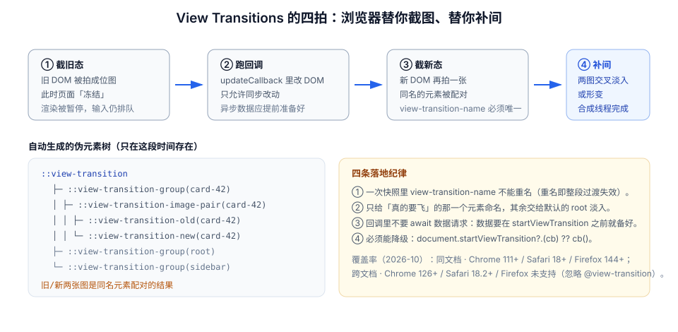

# 页面转场与共享元素

从 A 页面到 B 页面，中间那一小段时间是界面最「无信息」的时刻：旧内容已经走了，新内容还没来。转场要做的不是「放个动画」，而是**在这段时间里维持空间与因果的连续性**。

::: tip 一句话理解
转场只有两种可靠做法：**让旧的淡出、新的淡入**（成本最低），或**让同一个东西从旧位置飞到新位置**（信息量最大）。介于两者之间的「整页滑动」几乎总是错的——它暗示了一个并不存在的层级关系。
:::

## 一、三种转场，各自解决什么

| 类型 | 触发 | 典型实现 | 适用 |
| --- | --- | --- | --- |
| **同文档转场** | SPA 路由切换、tab 切换、列表→详情 | `document.startViewTransition()` | 单页应用内的视图替换 |
| **跨文档转场** | 多页应用的真实导航 | `@view-transition { navigation: auto }` | 内容型站点（文档、博客、电商） |
| **共享元素** | 两个页面里有「同一个东西」 | 两侧同名 `view-transition-name` | 图片放大、卡片→详情、头像→个人页 |

三者的关系是：共享元素既可以发生在同文档转场里，也可以发生在跨文档转场里。**跨文档转场不需要一行 JS**，这是它最有价值的地方。

## 二、View Transitions 的四拍



浏览器做的事情可以概括为：**截旧图 → 改 DOM → 截新图 → 补间**。这带来两个必须记住的约束：

1. **回调必须同步改完 DOM**。异步数据要在调用之前准备好，否则浏览器会等到回调的 Promise resolve 才截新图，期间页面处于「冻结」状态。
2. **旧/新两张图是同名元素配对的结果**。没有 `view-transition-name` 的元素会被并入 `root`，一起做整页交叉淡入。

```javascript
// 最小可用封装：同文档转场 + 优雅降级
async function transition(update) {
  if (!document.startViewTransition) {
    await update();                     // 不支持就直接改，功能不受影响
    return;
  }
  const t = document.startViewTransition(() => update());
  await t.finished;                     // 可用于埋点：转场真正结束的时间
}
```

```javascript
// 路由切换：数据先备好，再进转场
async function navigate(to) {
  const data = await loadRouteData(to);      // ① 先取数据（此时页面还没动）
  await transition(() => {                   // ② 再改 DOM（同步）
    renderRoute(to, data);
  });
}
// 反例：把 fetch 放进 update 回调里 —— 页面会冻结到数据返回
```

## 三、共享元素：唯一性是最常见的失败点

```css
/* 列表页：卡片缩略图 */
.card[data-active="true"] .card__thumb { view-transition-name: hero-image; }

/* 详情页：大图 */
.detail__hero { view-transition-name: hero-image; }

/* 只调这一对的时长与曲线，不影响整页淡入 */
::view-transition-group(hero-image) {
  animation-duration: 320ms;
  animation-timing-function: cubic-bezier(0.2, 0, 0, 1);
}
```

::: danger 三个会让转场「静默失效」的写法
1. **同名元素同时存在两个**：列表页里如果两张卡片都叫 `hero-image`，整段转场直接失效（浏览器只在控制台给一条警告，构建不报错）。必须保证**每次快照里名字唯一**。
2. **给 `display: none` 的元素命名**：旧态里元素不存在，就没有可配对的旧图，效果退化为整页淡入。
3. **在 `overflow: hidden` 的祖先里做形变**：伪元素会被祖先裁剪，看起来像「飞一半被切掉」。共享元素的祖先链上不能有裁剪。
:::

## 四、跨文档转场：两行 CSS

```css
/* 源页面与目标页面都要写 */
@view-transition { navigation: auto; }

/* 可选：给全站一个统一的节奏 */
::view-transition-old(root),
::view-transition-new(root) {
  animation-duration: 220ms;
  animation-timing-function: cubic-bezier(0.2, 0, 0, 1);
}
```

| 事实 | 结论 |
| --- | --- |
| `navigation: auto` 只对**同源**导航生效 | 外链跳转不会有转场 |
| 只对 `push` / `replace` / `traverse` 生效 | 刷新、地址栏直接输入不触发 |
| Firefox 稳定版忽略 `@view-transition` | 不会报错，只是没有动画——天然降级 |
| 跨文档转场需要两侧都声明 | 只有一侧声明时不生效 |

::: info 覆盖率取舍（2026-10）
同文档转场已达 Baseline Newly Available（Chrome 111+ / Safari 18+ / Firefox 144+，全球覆盖约 91.75%）；跨文档转场仍是 Chrome 126+ / Safari 18.2+，**Firefox 未支持**（覆盖约 86.21%）。

因此：**同文档转场可以作为默认体验**（不支持时只是没有动画）；**跨文档转场必须当成纯增强**，不能让它承担任何「内容可见性」的职责。
:::

## 五、与框架路由结合的三处对齐

| 对齐点 | 要做的事 | 做错的后果 |
| --- | --- | --- |
| **数据先行** | 路由守卫里 `await` 数据，再调用 `startViewTransition` | 页面冻结几百毫秒到几秒 |
| **滚动复位** | 转场回调内改 DOM，滚动复位放在 `finished` 之后 | 旧页面在新页面渲染前被滚到顶部，出现错位 |
| **焦点管理** | 转场结束后把焦点移到新页面主标题 | 键盘用户仍停在已经不存在的元素上 |

```javascript
// Vue Router 里的一次转场（组合式写法，思路与框架无关）
router.beforeResolve(async (to) => {
  to.meta.data = await loadRouteData(to);       // 数据先行
});

router.afterEach(async (to) => {
  await transition(() => render(to));           // 只改 DOM
  window.scrollTo({ top: 0, behavior: "instant" });
  document.querySelector("h1")?.focus();        // 焦点落到新页面标题
});
```

## 六、什么时候**不要**用转场

1. **同一个视图内的局部更新**（改一个字段、勾一个选项）：转场会把整页快照一遍，成本高且没有信息量。
2. **高频导航**（连续点侧边栏十个菜单）：每次 300ms，十次就是 3 秒等待。
3. **页面巨大且包含视频 / canvas**：快照会复制整页位图，内存与首帧成本都可能翻倍。
4. **用户已经明确表达「快点」**（连续按 Esc、连点两次同一入口）：应当跳过动画直接切。

## 七、判据 `MNV-A` ~ `MNV-H`

| 编号 | 判据 | 怎么验证 |
| --- | --- | --- |
| `MNV-A` | 转场通过 `startViewTransition?.()` 调用，不支持时功能不受影响 | 在 Safari 17 或禁用 API 的环境走一遍导航，页面应正常切换 |
| `MNV-B` | 数据请求在转场回调之外完成 | 阅读代码：`updateCallback` 内不出现 `await fetch/axios` |
| `MNV-C` | 每次快照中 `view-transition-name` 不重复 | 控制台无「Duplicate view-transition-name」警告 |
| `MNV-D` | 共享元素在源页与目标页都存在且同名 | 两页各打一次 `document.querySelectorAll('[style*="view-transition-name"]')` |
| `MNV-E` | 转场时长 ≤ 400ms，且可被连续操作打断 | 连续点两次导航，第二次应立即开始而不是排队 |
| `MNV-F` | 转场结束后滚动复位、焦点落到新页面主标题 | 键盘 Tab 一次，焦点应在主内容区而不是页面顶部 |
| `MNV-G` | `prefers-reduced-motion: reduce` 下转场时长 ≤ 120ms 或直接跳过 | 开模拟后导航，页面应近乎瞬时切换 |
| `MNV-H` | 跨文档转场只作为增强，不承担内容可见性 | 在 Firefox 中导航，内容应完整显示（只是没有动画） |

## 八、验证方式

```javascript
// ① 确认 API 存在，并测一次转场的实际耗时
console.log("支持同文档转场 =", "startViewTransition" in document);
const t0 = performance.now();
const t = document.startViewTransition(() => {
  document.querySelector("#view").textContent = "B";
});
t.finished.then(() => console.log("转场耗时 =", Math.round(performance.now() - t0), "ms"));
// 期望：支持时为 true，耗时接近设定的时长（含快照开销，通常多 10–40ms）
```

```javascript
// ② 检查同名冲突（这是最容易被忽略的失效原因）
const names = [...document.querySelectorAll("*")]
  .map((el) => getComputedStyle(el).viewTransitionName)
  .filter((n) => n && n !== "none");
console.log("同名检查 =", names.length === new Set(names).size ? "OK" : names);
// 期望：OK
```

```javascript
// ③ 检查转场是否真的跑了（伪元素存在时间很短，需要在转场中读）
const t = document.startViewTransition(() => { /* 改 DOM */ });
t.ready.then(() => {
  console.log("伪元素数量 =", document.getAnimations().length);
});
// 期望：> 0；若为 0，说明转场根本没被创建（多半是 DOM 没有实际变化）
```

```shell
# ④ 扫出「在转场回调里发请求」的写法（人工复核）
grep -rn "startViewTransition" src/ -A3 | grep -E "await (fetch|axios)" && echo "存在数据先行违规"
```

## 九、相关页面与下一篇

- 下一篇：[动效性能与掉帧诊断](../Performance/index.md)——转场为什么有时会「卡在第一帧」。
- 上游：[列表与布局动画](../ListAnimation/index.md)（页面内的重排）。
- 相邻必读：[服务端渲染深入](../../SSR/index.md)（首屏不该有转场）、[无障碍与动效偏好](../Accessibility/index.md)（转场的降级）。

## 参考资料

- [MDN · View Transition API](https://developer.mozilla.org/en-US/docs/Web/API/View_Transitions_API)
- [MDN · `@view-transition`](https://developer.mozilla.org/en-US/docs/Web/CSS/@view-transition)
- [Chrome for Developers · Cross-document view transitions](https://developer.chrome.com/docs/web-platform/view-transitions/cross-document)
- [caniuse · View Transitions](https://caniuse.com/view-transitions)
- [web.dev · Same-document view transitions](https://web.dev/articles/view-transitions)
