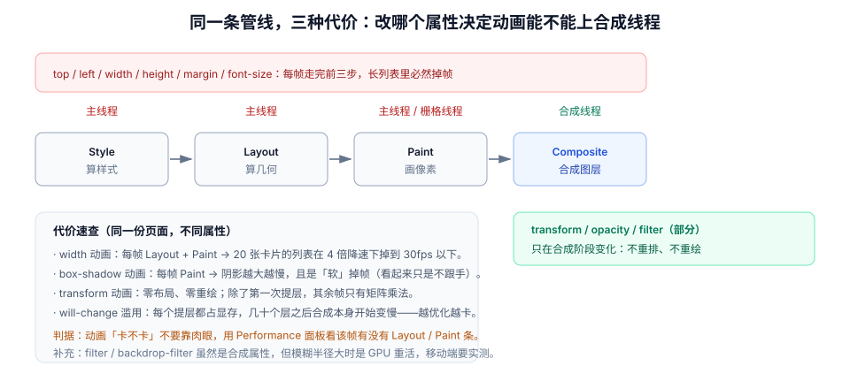

# 动效性能与掉帧诊断

动画卡不卡，和「动画写得好不好看」没有关系，只和**这一帧在主线程上花了多少时间**有关。本页把「卡」拆成三个可测量的量：帧预算、主线程占用、合成层数量。

::: tip 一句话理解
一个动画只要碰了**布局属性**（宽高、位置、间距），它就注定要在主线程上逐帧重算；而主线程同时还在跑你的业务 JS。动效性能的第一原则不是「优化」，而是**别把动画放到会堵车的那条路上**。
:::

## 一、帧预算：16.7ms 与 8.3ms

| 屏幕刷新率 | 每帧预算 | 留给你的时间 |
| --- | --- | --- |
| 60Hz | 16.7ms | 扣除样式计算与合成，实际可用约 **10ms** |
| 90Hz | 11.1ms | 约 6–7ms |
| 120Hz | 8.3ms | 约 4–5ms |

这意味着：一段每帧要花 8ms 的 JS 动画，在 120Hz 屏幕上**必然掉帧**，而在 60Hz 上「看起来还行」。这也是为什么同一个页面在样机上流畅、在旗舰机上反而更卡——预算变小了。

## 二、三种代价：改哪个属性决定走哪条路



| 属性 | 触发的阶段 | 相对代价 | 建议 |
| --- | --- | --- | --- |
| `transform`、`opacity` | 仅合成 | 最低 | **动画只用这两个** |
| `filter`、`backdrop-filter` | 合成（GPU 重活） | 中—高 | 小面积可用，大面积实测 |
| `background-color`、`box-shadow` | 绘制 | 中 | 短动画可用，长动画改用遮罩层 |
| `width`、`height`、`top`、`left`、`margin` | 布局 + 绘制 | 高 | 改用 `transform: scale` 或 FLIP |
| `font-size`、`line-height` | 布局（可能全页重排） | 最高 | 禁止用于动画 |

::: danger `will-change` 的三个误用
1. **全站撒**：`* { will-change: transform; }` 会让每个元素尝试提层，显存迅速耗尽，合成本身变慢——「优化」直接变成「更卡」。
2. **永久保留**：动画结束后不撤销 `will-change`，图层一直占着显存。正确做法是动画前加、`finished` 后移除。
3. **加在会被裁剪的祖先上**：提层后 `overflow: hidden` 的裁剪行为可能变化，出现内容溢出。
:::

```javascript
// 一次只给「真正在动的元素」提层，动画结束立即撤销
async function animateCard(el, keyframes, options) {
  el.style.willChange = "transform";
  try {
    await el.animate(keyframes, options).finished;
  } finally {
    el.style.willChange = "";       // 必须撤销，否则层会一直存在
  }
}
```

## 三、长任务：动画的真正杀手

动画本身跑在合成线程时，主线程的长任务不会让它掉帧；但只要动画**依赖主线程**（JS 驱动、布局属性、频繁读写样式），长任务就会直接卡住它。

| 长任务来源 | 表现 | 处理 |
| --- | --- | --- |
| 路由切换时同步渲染大列表 | 转场「卡在第一帧」 | 分片渲染 / 虚拟列表 / `startTransition` |
| 输入框里每次按键都过滤 5000 条 | 动画期间输入卡顿 | 防抖 + `requestIdleCallback` |
| 一次写入大量 DOM | 动画中途「顿一下」 | `DocumentFragment` 批量插入 |
| 第三方脚本（埋点、AB 实验） | 偶发掉帧，难以复现 | 延后加载 / `scheduler.postTask` 降优先级 |

`Long Animation Frame`（LoAF）API 能把「哪段脚本吃掉了这一帧」直接指出来，比人肉看火焰图快得多。

```javascript
// 观测长动画帧：超过 50ms 的帧会被记录，并给出脚本归因
new PerformanceObserver((list) => {
  for (const entry of list.getEntries()) {
    console.warn("长帧", Math.round(entry.duration), "ms", {
      blockingDuration: entry.blockingDuration,
      scripts: entry.scripts?.map((s) => ({
        source: s.sourceURL,
        duration: Math.round(s.duration),
      })),
    });
  }
}).observe({ type: "long-animation-frame", buffered: true });
```

## 四、掉帧诊断：五步

1. **确认它是「掉帧」而不是「慢」**：Performance 录制 5 秒，看 Frames 轨道上是否有超过 16.7ms 的帧。
2. **定位这一帧在干什么**：展开该帧，看是 `Layout`、`Paint` 还是 `Script` 占了大头。
3. **看有没有强制同步布局**：`Recalculate Style` 与 `Layout` 在同一帧里交替出现多次，通常就是「边写边读」。
4. **看层数**：DevTools → Layers 面板，动画元素附近层数暴涨（几十层）说明 `will-change` 或 3D 变换滥用。
5. **降速复现**：CPU 4x / 6x 降速 + 网络 Slow 4G，才能复现低端机上的真实表现。

| 面板 | 看什么 | 判读 |
| --- | --- | --- |
| Performance → Frames | 单帧是否超预算 | 连续 3 帧超标即为可感知卡顿 |
| Performance → Main | 长任务条（红色三角） | 超过 50ms 的任务必须拆 |
| Rendering → Paint flashing | 绿色区域 | 动画期间仍在重绘 = 属性选错 |
| Rendering → Layer borders | 橙色边框 | 每多一层都占显存 |
| Layers | 层数量与内存 | 单页超过 100 层要复核 |

## 五、把动画挪出主线程：三条路

| 方案 | 原理 | 适用 | 限制 |
| --- | --- | --- | --- |
| CSS `transition` / `animation`（合成属性） | 浏览器在合成线程插值 | 绝大多数 UI 动效 | 只能动 `transform` / `opacity` 等 |
| WAAPI + 合成属性 | 同上，但可编程、可取消 | 需要打断、编排、读进度的场景 | 同样受属性限制 |
| 滚动驱动动画（`animation-timeline`） | 滚动位置直接驱动，无需 JS 监听 | 视差、进度条、进场 | Firefox 稳定版仍需 flag；必须写降级 |

```css
/* 滚动驱动：进度条不需要任何 scroll 监听 */
.progress {
  position: fixed;
  inset-block-start: 0;
  block-size: 3px;
  background: var(--color-accent);
  transform-origin: 0 50%;
  scale: 0 1;
  animation: grow linear both;
  animation-timeline: scroll(root block);
}
@keyframes grow { to { scale: 1 1; } }

/* 降级：不支持时进度条不显示，但页面功能完整 */
@supports not (animation-timeline: scroll()) {
  .progress { display: none; }
}
```

::: warning 滚动驱动动画的两个坑
1. **Firefox 需要非零 `animation-duration`**：即使时间线来自滚动，也要写 `animation-duration: 1ms`，否则动画不生效。
2. **把「可见性」交给滚动进度**：`opacity: 0` 写在基础样式里、靠动画把它变成 1，在无支持的浏览器上内容会永久不可见。**基础样式必须是「已完成的、可见的」状态**，动画只做增强。
:::

## 六、动画与 Core Web Vitals 的关系

| 指标 | 动画会不会影响它 | 说明 |
| --- | --- | --- |
| **LCP** | 间接 | 动画延迟了内容渲染（如入场动画把首屏内容初始设为透明）会推后 LCP |
| **INP** | 会 | 点击回调里同步跑动画计算或读布局，会拉长交互延迟 |
| **CLS** | 会 | 用 `height` / `top` 做动画、骨架尺寸不一致，都会产生布局位移 |

最容易被忽略的是 LCP：把首屏标题做成「淡入 600ms」，LCP 会被记到动画结束那一刻（因为元素在动画前是透明的）。**首屏内容不要做透明度入场**。

## 七、判据 `MNE-A` ~ `MNE-H`

| 编号 | 判据 | 怎么验证 |
| --- | --- | --- |
| `MNE-A` | 动画只作用于 `transform` / `opacity`（或经实测的 `filter`） | 搜索 `transition` / `animate` 的目标属性，出现布局属性即不合格 |
| `MNE-B` | `will-change` 只在动画期间存在，结束后撤销 | 动画结束后读 `el.style.willChange`，应为空 |
| `MNE-C` | 单页合成层数量可控（一般 < 100），无全站 `will-change` | DevTools → Layers 面板数层；搜索 `will-change: transform` 的全局规则 |
| `MNE-D` | 动画期间无长任务（> 50ms） | Performance 录制，Main 轨道无红色长任务条 |
| `MNE-E` | CPU 4x 降速下，关键动画仍 ≥ 50fps | 降速后录 3 秒，统计 Frames 中超标帧数 ≤ 3 |
| `MNE-F` | 不使用滚动监听驱动连续动画 | 搜索 `addEventListener("scroll"` 且回调内有样式写入 |
| `MNE-G` | 首屏内容不做透明度入场（不推后 LCP） | 首屏 H1 / 主图在 CSS 里的初始 `opacity` 为 1 |
| `MNE-H` | 减少动效模式下动画数量显著下降（不是只改时长） | 开模拟后 `document.getAnimations().length` 应明显变少 |

## 八、验证方式

```javascript
// ① 统计一次交互期间创建的动画数量与属性
const before = document.getAnimations().length;
document.querySelector("#trigger").click();
requestAnimationFrame(() => {
  const running = document.getAnimations().filter((a) => a.playState === "running");
  console.log({ before, now: running.length, props: running.map((a) => a.transitionProperty ?? a.animationName) });
});
// 期望：数量与「同时变化的元素数」一致；出现 height / width 即为判据 MNE-A 不合格
```

```javascript
// ② 逐帧测真实帧间隔（比看面板更直接）
const frames = [];
let last = performance.now();
function tick(now) {
  frames.push(now - last);
  last = now;
  if (frames.length < 120) requestAnimationFrame(tick);
  else {
    const over = frames.filter((d) => d > 20).length;
    console.log("超标帧 =", over, "/ 120，最大间隔 =", Math.max(...frames).toFixed(1), "ms");
  }
}
requestAnimationFrame(tick);
// 期望：超标帧 ≤ 3；最大间隔 < 34ms（掉一帧）
```

```shell
# ③ 找「边写边读」的可疑代码（人工复核循环体）
grep -rn "getBoundingClientRect" src/ -B2 -A2 | grep -n "style\." && echo "存在同循环读写"
```

```javascript
// ④ 长任务观察（配合 4x 降速使用）
new PerformanceObserver((l) => console.log("LoAF:", l.getEntries().map((e) => Math.round(e.duration))))
  .observe({ type: "long-animation-frame", buffered: true });
// 期望：交互与动画期间不产生 > 50ms 的记录
```

## 九、相关页面与下一篇

- 下一篇：[无障碍与动效偏好](../Accessibility/index.md)——性能之外的另一个「必须遵守」。
- 上游：[页面转场与共享元素](../PageTransition/index.md)（转场为什么会卡在第一帧）。
- 相邻必读：[浏览器 · 渲染与性能](../../Basic/Browser/Performance/index.md)（管线细节）、[前端性能优化](../../Others/PerformanceOptimization/index.md)（加载侧）。

## 参考资料

- [web.dev · 使用 CSS 动画提升性能](https://web.dev/articles/animations-guide)
- [web.dev · Long Animation Frames API](https://developer.chrome.com/blog/long-animation-frames)
- [MDN · `animation-timeline`](https://developer.mozilla.org/en-US/docs/Web/CSS/animation-timeline)
- [web.dev · Optimize INP](https://web.dev/articles/optimize-inp)
- [Chrome for Developers · Rendering performance](https://developer.chrome.com/docs/devtools/performance/reference)
