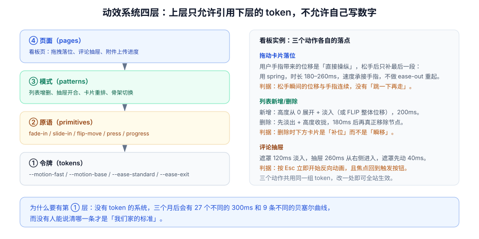

# 实战：看板的动效系统

前面九页讲的是判断与手段，这一页把它们装进一个真实界面：**一个多人在线协作的任务看板**。它有三种完全不同的动效需求——拖拽落位、列表增删、抽屉开合——刚好覆盖「直接操纵 / 布局变化 / 层级切换」三类问题。

::: tip 一句话理解
动效系统的价值不在于「动画好看」，而在于**改一处参数，全站一致地变**。如果每个页面都在自己写 300ms，那就不叫系统，叫一堆巧合。
:::

## 一、三个动作，三种问题

| 动作 | 用户的问题 | 动效类型 | 关键约束 |
| --- | --- | --- | --- |
| 拖动卡片到新位置 | 「它落在哪了？会弹回去吗？」 | 直接操纵（弹簧） | 必须承接手指速度，不能重新起步 |
| 新增 / 删除卡片 | 「多了/少了什么？其他卡片去哪了？」 | 布局变化（FLIP） | 一次拖动只更新一行，其余靠 FLIP 补偿 |
| 打开评论抽屉 | 「这是什么？从哪来的？」 | 层级切换（转场） | 遮罩先动，抽屉后动；Esc 立即可退 |

## 二、四层结构



| 层 | 内容 | 谁维护 | 变更成本 |
| --- | --- | --- | --- |
| ① 令牌 | 时长、曲线、位移距离 | 设计系统 | 改一处，全站生效 |
| ② 原语 | `fade`、`slide`、`press`、`flip-move`、`progress` | 前端基础库 | 少数页面受影响 |
| ③ 模式 | 列表增删、抽屉、拖拽落位 | 业务组件 | 单个组件 |
| ④ 页面 | 看板页、评论抽屉、附件上传 | 业务开发者 | 单页 |

```css
/* ① 令牌：唯一允许出现毫秒与贝塞尔的地方 */
:root {
  --motion-instant: 80ms;
  --motion-fast: 120ms;
  --motion-base: 200ms;
  --motion-slow: 260ms;

  --ease-standard: cubic-bezier(0.2, 0, 0, 1);
  --ease-enter: cubic-bezier(0, 0, 0.2, 1);
  --ease-exit: cubic-bezier(0.4, 0, 1, 1);
  --ease-spring: linear(
    0, 0.009, 0.035 2.1%, 0.141 4.4%, 0.723 12.9%, 0.938 16.7%,
    1.017, 1.077, 1.121, 1.149 24.3%, 1.159, 1.163, 1.161, 1.154 29.9%,
    1.129 32.8%, 1.017 43.1%, 0.991, 0.977 51%, 0.974 53.8%,
    0.975 57.1%, 0.997 69.8%, 1.003 76.9%, 1
  );
}

@media (prefers-reduced-motion: reduce) {
  :root {
    --motion-fast: 80ms;
    --motion-base: 100ms;
    --motion-slow: 120ms;
  }
}
```

## 三、动作一：拖动落位（弹簧，承接速度）

拖动分两段：**手指按住时**由指针位置直接决定（零动画），**松手后**由一段弹簧收尾。

```javascript
// 松手：把手指速度交给动画，避免「跳一下再走」
function settle(card, { fromX, fromY, toX, toY, velocity }) {
  const dx = toX - fromX;
  const dy = toY - fromY;
  // 速度越大，时长越短，但有上下限，避免瞬移或拖沓
  const distance = Math.hypot(dx, dy);
  const duration = Math.min(280, Math.max(140, 240 - Math.abs(velocity) * 0.6));

  return card.animate(
    [
      { transform: `translate(${dx}px, ${dy}px) scale(1.02)`, boxShadow: "0 8px 24px rgba(0,0,0,.18)" },
      { transform: "translate(0, 0) scale(1)", boxShadow: "0 1px 2px rgba(0,0,0,.08)" },
    ],
    { duration, easing: "var(--ease-spring)", fill: "none" }
  ).finished;
}
```

| 参数 | 取值 | 定值理由 |
| --- | --- | --- |
| 时长 | 140–280ms | 低于 140 看不出「落位」，高于 280 会觉得「飘」 |
| 曲线 | 弹簧（过冲约 2%） | 轻微过冲表达「有重量」，超过 5% 会显得廉价 |
| 缩放 | 1.02 → 1 | 拖动中略放大，落位时收回，强化「拿起来又放下」 |
| 阴影 | 拖动中加深 | 阴影是「离开平面」的唯一线索（比缩放更有效） |

::: danger 拖拽动效的三个坑
1. **松手后从零速度重新起步**：手指还在动，动画却从静止开始，观感上「顿一下」。必须把松手瞬间的速度传进去。
2. **落位动画期间允许再次拖动**：用户会看到两张卡片同时飞。应当在 `pointerdown` 时 `cancel()` 未完成的落位动画。
3. **用 `left/top` 实现落位**：一次拖动会让整列重排。位置一律用 `transform`，真实顺序由服务端的 `position_key` 决定（见项目章节「拖动写入路径」）。
:::

## 四、动作二：卡片增删（FLIP，只补位不重排）

```javascript
// 列表容器上的统一入口：所有会改变布局的操作都走这里
export function withFlip(container, mutate) {
  const first = new Map();
  for (const el of container.children) first.set(el, el.getBoundingClientRect());

  mutate();

  for (const el of container.children) {
    const before = first.get(el);
    if (!before) continue;                      // 新增项走入场动画
    const after = el.getBoundingClientRect();
    const dx = before.left - after.left;
    const dy = before.top - after.top;
    if (Math.hypot(dx, dy) < 0.5) continue;     // 没动就别跑

    el.animate(
      [{ transform: `translate(${dx}px, ${dy}px)` }, { transform: "none" }],
      { duration: 200, easing: "var(--ease-standard)" }
    );
  }
}
```

| 操作 | 顺序 | 时长 |
| --- | --- | --- |
| 新增卡片 | 先插入 DOM（高度 0 + 透明）→ 展开到实际高度 + 淡入 | 200ms |
| 删除卡片 | 先淡出 + 收拢 → 真正移除 → 兄弟补位 | 120ms + 200ms |
| 跨列移动 | 移除旧列节点 → 插入新列 → 两列各自 FLIP | 200ms |

## 五、动作三：评论抽屉（层级，遮罩先行）

```css
/* 遮罩先动、抽屉后动：让「谁盖住谁」一眼可见 */
.drawer-mask {
  opacity: 0;
  transition: opacity var(--motion-fast) var(--ease-standard);
}
.drawer-mask.is-open { opacity: 1; }

.drawer {
  transform: translateX(100%);
  transition: transform var(--motion-slow) var(--ease-standard);
}
.drawer.is-open { transform: translateX(0); }

/* 关闭：反向且更快，曲线换成加速 */
.drawer.is-closing {
  transition: transform var(--motion-base) var(--ease-exit);
}
```

```javascript
// 打开 / 关闭的状态机：Esc 必须能立即反向
const drawer = document.querySelector(".drawer");
const mask = document.querySelector(".drawer-mask");
let open = false;

function setOpen(next) {
  open = next;
  document.body.style.overflow = next ? "hidden" : "";
  mask.classList.toggle("is-open", next);
  drawer.classList.toggle("is-open", next);
  drawer.classList.toggle("is-closing", !next);
  drawer.setAttribute("aria-hidden", String(!next));
  if (next) drawer.querySelector("[data-autofocus]")?.focus();
  else document.querySelector("#open-comments")?.focus();     // 焦点回到触发点
}

document.addEventListener("keydown", (e) => {
  if (e.key === "Escape" && open) setOpen(false);             // 立即反向，不排队
});
```

## 六、把三个动作串起来：一次「拖动 + 评论」的完整时序

| 时刻 | 发生什么 | 谁在动 | 用户感知 |
| --- | --- | --- | --- |
| T+0ms | 按下卡片 | 缩放 1.02、阴影加深 | 「拿起来了」 |
| T+0–800ms | 手指拖动 | 元素跟随指针（无动画） | 「跟着我走」 |
| T+800ms | 松手 | 弹簧落位 140–280ms | 「放下了」 |
| T+820ms | PATCH 请求发出 | 无视觉（乐观更新） | 卡片已在新区位 |
| T+1100ms | 服务端广播到达其他端 | 另一端的卡片 FLIP 200ms | 「别人也看到了」 |
| T+1200ms | 打开评论抽屉 | 遮罩 120ms + 抽屉 260ms | 「从右边进来」 |
| T+1500ms | 发送评论成功 | 按钮 success 勾选 200ms | 「发出去了」 |

这张表是**验收的依据**：任何一步的时序错位，都会在这张表上表现为「同时发生」或「顺序颠倒」。

## 七、验收：八条可执行断言

```javascript
// ① 按下态在一帧内出现
const card = document.querySelector('[data-card-id="42"]');
const t0 = performance.now();
card.dispatchEvent(new PointerEvent("pointerdown", { bubbles: true }));
requestAnimationFrame(() => {
  console.log("按下首帧 =", (performance.now() - t0).toFixed(1), "ms",
    getComputedStyle(card).transform);
});
// 期望：≤ 16.7ms，transform 含 scale(1.02)
```

```javascript
// ② 拖动只改一行的代价判据（配合服务端日志）
// 连续拖动 10 次后统计 UPDATE 次数
// 期望：每次拖动只产生 1 条 cards UPDATE + 1 条 board_events INSERT
```

```javascript
// ③ 删除卡片时兄弟元素是「滑上来」而不是「瞬移」
const list = document.querySelector(".card-list");
const target = list.children[2];
const siblingBefore = list.children[3].getBoundingClientRect().top;
target.querySelector("[data-delete]").click();
await new Promise((r) => setTimeout(r, 40));
const siblingAfter = list.children[2].getBoundingClientRect().top;
console.log("补位动画 =", list.children[2].getAnimations().length > 0, {
  siblingBefore, siblingAfter,
});
// 期望：补位动画 = true
```

```javascript
// ④ 抽屉关闭后焦点回到触发按钮
document.querySelector("#open-comments").click();
document.dispatchEvent(new KeyboardEvent("keydown", { key: "Escape" }));
await new Promise((r) => setTimeout(r, 320));
console.log("焦点 =", document.activeElement?.id);
// 期望：open-comments
```

```javascript
// ⑤ 减少动效下仍能看懂三种状态
// DevTools → Rendering → Emulate prefers-reduced-motion: reduce
// 依次：拖动一次、删除一张卡、开关一次抽屉
// 期望：位置变化瞬时，但成功提示仍可见；无任何位移超过 24px 的动画
```

```javascript
// ⑥ 动画结束后没有残留
await new Promise((r) => setTimeout(r, 600));
console.log([...document.querySelectorAll(".card")].map((el) => el.style.transform));
// 期望：全部为空字符串
```

```shell
# ⑦ 令牌覆盖率：组件里不应出现裸写毫秒
grep -rnE "[0-9]+ms" src/components/board --include=*.vue | grep -v "var(--motion" | wc -l
# 期望：0
```

```shell
# ⑧ 一次完整回归（构建 + 单测 + 手动清单）
pnpm build && pnpm test -- --run
# 期望：构建成功、测试全绿；再按上面 ①~⑥ 手动走一遍
```

## 八、判据 `MNR-A` ~ `MNR-H`

| 编号 | 判据 | 怎么验证 |
| --- | --- | --- |
| `MNR-A` | 三个动作都只引用令牌，组件内无裸写时长 | 断言 ⑦ 的输出为 0 |
| `MNR-B` | 拖拽落位承接松手速度，且可被下一次拖动打断 | 快速连续拖两次，第二次应立刻接管 |
| `MNR-C` | 删除走「离场 → 移除 → 补位」，且一次拖动只更新一行 | 断言 ②③ |
| `MNR-D` | 抽屉打开时遮罩先于主体 40–80ms，关闭时反向更快 | 录屏逐帧对比两条动画的起点 |
| `MNR-E` | 抽屉关闭后焦点回到触发点，`aria-hidden` 同步更新 | 断言 ④ + 检查 `aria-hidden` |
| `MNR-F` | 减少动效模式下三个动作均无大幅位移，但状态仍可辨 | 断言 ⑤ |
| `MNR-G` | 所有动画结束后无行内 `transform` / `height` 残留 | 断言 ⑥ |
| `MNR-H` | 动效改动有回归手段（断言脚本或截图对比）纳入 CI | CI 中存在对应脚本或手动清单被勾选 |

## 九、延伸与下一步

- 想把「一次拖动只更新一行」的写入侧做扎实：见项目章节 [拖动写入路径](/project/Complete/TeamBoard/DragWritePath/index.md)。
- 想让动效在多端一致：参考 [移动端 H5 · 触摸交互](../../MobileH5/TouchInteraction/index.md) 的手势终态口径。
- 想把「状态机」补全到表单级：参考 [反馈与状态机](../Feedback/index.md) 的四终态模型。

## 参考资料

- [web.dev · Animations guide](https://web.dev/articles/animations-guide)
- [Material Design 3 · Motion transitions](https://m3.material.io/styles/motion/transitions/transition-patterns)
- [MDN · `Element.animate()`](https://developer.mozilla.org/en-US/docs/Web/API/Element/animate)
- [WCAG 2.2 · 2.3.3 Animation from Interactions](https://www.w3.org/WAI/WCAG22/Understanding/animation-from-interactions.html)
- [Vue · `<TransitionGroup>`](https://vuejs.org/guide/built-ins/transition-group.html)
