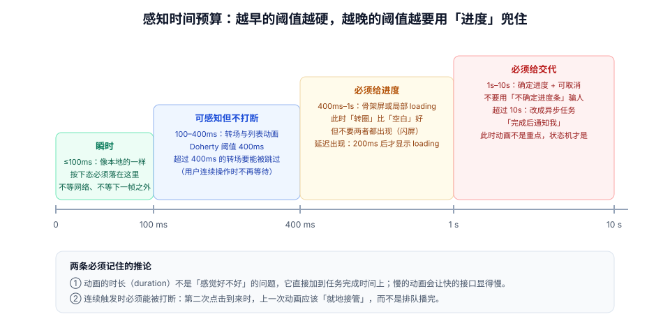

# 动效原则与感知预算

动效的好坏有一半不取决于「怎么实现」，而取决于**它出现在什么时候、持续多久、朝哪个方向**。本页把这三件事拆成可判断的规则：感知阈值的四道线、距离与速度的关系、方向与语法的一致性。

::: tip 一句话理解
用户感知到的不是「动画时长」，而是**「我操作完之后，界面多久给我回应」**。所以要优化的是「从操作到第一帧反馈」的延迟，而不是「动画总时长」——前者必须小于 100ms，后者可以慢慢来。
:::

## 一、三个必答问题，决定动画的形态

任何一次状态变化，先回答三问。答案直接决定用哪种动效，而不是反过来。

| 问题 | 答案决定什么 | 例子 |
| --- | --- | --- |
| **谁在动？** | 是元素自己在动，还是「视图在切换」 | 卡片重排（元素动）vs 路由切换（视图切换） |
| **从哪来、到哪去？** | 方向与位移距离，以及是否要共享元素 | 抽屉从右侧进，就必须从右侧出 |
| **用户此刻在等什么？** | 时长预算与是否需要进度 | 点了「保存」→ 他在等结果，不是在等动画 |

第三问最容易被跳过。同样是 300ms：在「打开详情」里是合理的空间连续，在「保存成功」的提示上就是把任务完成时间拉长了 300ms。

## 二、四道感知阈值



| 阈值 | 用户的主观感受 | 工程含义 |
| --- | --- | --- |
| **0–100ms** | 「即时」——像本地操作 | 按下态、hover、焦点环必须落在这里 |
| **100–400ms** | 「有反应，但不打断」 | 转场、列表动画、骨架切换的合理区间 |
| **400ms–1s** | 「在等，但还忍得住」 | 必须给进度（骨架屏 / 局部 loading） |
| **1s–10s** | 「明显在等」 | 需要确定进度 + 可取消 |
| **> 10s** | 「它是不是坏了」 | 改成异步任务 + 完成通知，动画已不是重点 |

**Doherty 阈值（400ms）** 是这里面最硬的一条：超过 400ms 没有反馈，用户的注意力就会离开当前任务，效率显著下降。注意它约束的是「反馈出现的时间」，不是「动画结束的时间」——一个 600ms 的转场，只要在 100ms 内就开始动了，用户就不会觉得卡。

::: warning 一个反直觉的结论
把动画从 300ms 改成 500ms，用户对「快」的评价可能**变高**——因为更长的动画让人更容易看清发生了什么。但这只在**低频、以理解为目的**的操作上成立（比如首次引导、复杂状态切换）。高频操作上，时长与满意度是单调负相关的。
:::

## 三、距离、速度与时长

### 时长不该是一个固定值

同一个 300ms，在小气泡上看起来「慢」，在全屏抽屉上看起来「快」。原因是**感知速度 = 距离 / 时长**。

| 位移距离 | 建议时长 | 说明 |
| --- | --- | --- |
| ≤ 24px（微位移：按下、微调） | 80–120ms | 只做「确认」，不做「叙事」 |
| 24–120px（组件内移动） | 150–200ms | 卡片重排、气泡出现 |
| 120–400px（面板、抽屉） | 220–300ms | 需要方向感 |
| > 400px（全屏转场） | 300–400ms | 超过 400ms 必须可跳过 |

### 恒定速度的错觉

浏览器默认的 `ease` 会在两端各「慢」一次。长距离动画如果两端都很慢，中段就会显得「飞快」，观感是「窜过去了」。所以：

- **长距离**：用更接近匀速的曲线（`cubic-bezier(0.4, 0, 0.2, 1)`），避免两端过慢。
- **短距离**：用明显的减速曲线（`cubic-bezier(0, 0, 0.2, 1)`），让「停住」这件事更明确。

### 打断比时长更重要

连续操作时（连点、快速切换 tab），动画必须**就地接管**，而不是排队播完。判断标准：第二次操作到来时，元素从**当前位置**继续走，而不是先跳回起点。

```css
/* 正确：可打断的过渡——新的目标值直接覆盖旧的插值 */
.panel {
  transition: transform 260ms cubic-bezier(0.2, 0, 0, 1);
  transform: translateX(var(--panel-x, 0));
}
```

```javascript
// 错误：用 setTimeout 串行动画，第二次点击要等第一次播完
function openNaive() {
  el.classList.add("is-open");
  setTimeout(() => {
    el.classList.add("is-settled");
  }, 260);
}
// 第二次点击时，第一次的 setTimeout 仍在跑，状态会错乱
```

## 四、方向与语法一致性

一套界面上，「同一个动作永远用同一个方向」比「每个动画都精心设计」更有价值——它让用户形成肌肉记忆。

| 动作 | 方向约定 | 破坏它的后果 |
| --- | --- | --- |
| 进入下一层 | 从右侧进（LTR） | 用户失去层级感，返回时不知道往哪走 |
| 返回上一层 | 从左侧回 | 前进与返回方向相同 = 没有层级概念 |
| 展开详情 | 从触发点向下展开 | 从中心放大，用户找不到「它从哪来」 |
| 删除 | 向上收起 / 淡出 | 向下消失会与「新增」混淆 |
| 提交成功 | 轻量强调（闪一下 / 勾选） | 全屏庆祝动画打断后续操作 |

::: danger 三个破坏一致性的写法
1. **A 页面用右侧抽屉、B 页面用底部抽屉**：用户会以为这是两种不同的东西。方向是「组件语义」，不是页面自由。
2. **进入用 `ease-out`、返回也用 `ease-out`**：返回时的「先快后慢」会让它看起来像「又往前冲了一下」。返回应当用 `ease-in`。
3. **列表新增从下方滑入、列表删除向上滑出，但排序变化没有任何动画**：用户会把「排序变化」误读成「内容被删了」。
:::

## 五、注意力：一次只引导一处

动效是最强的注意力工具，所以它也是**最容易滥用**的工具。规则很简单：

1. **同一时刻只允许一个「吸引注意力」的动画**。两个同时闪，等于都不闪。
2. **引导性动画必须能被静态方式替代**：错误定位除了抖动，还要有红色边框与文案。
3. **不要用动画抢夺正在输入的用户**：输入框聚焦时，页面其他位置出现入场动画，会打断输入节奏。

## 六、把原则变成数字：一张取值表

| 场景 | 时长 | 曲线 | 位移 | 备注 |
| --- | --- | --- | --- | --- |
| 按下态 | 80ms | `ease-out` | 缩放 0.98 | 必须在 `pointerdown` 同帧 |
| hover 变化 | 100ms | `ease-out` | 无 | 只变颜色/阴影 |
| 气泡 / 下拉出现 | 140ms | `cubic-bezier(0, 0, 0.2, 1)` | 4–8px | 从触发点方向进入 |
| 抽屉 / 侧栏 | 260ms | `cubic-bezier(0.2, 0, 0, 1)` | 320px | 遮罩 120ms 先行 |
| 模态 | 220ms | `ease-out` | 缩放 0.96 + 淡入 | 出场 160ms `ease-in` |
| 路由转场 | 300ms | `ease-out` | 12px 位移 + 淡入 | 超过 400ms 要可跳过 |
| 列表项增删 | 200ms | `ease-out` | 高度 + 透明度 | 见「列表与布局动画」 |
| 骨架 → 内容 | 150ms | `linear` | 交叉淡入 | 避免闪白 |
| 进度条 | 时长随任务 | `linear` | 宽度 | 匀速才代表真实进度 |

::: info 为什么按下态是 80ms 而不是更快
0ms 的瞬时变化在视觉上会「跳」，用户反而感知不到过渡；80–100ms 刚好让人看到「按下去了」，又不会觉得慢。低于 50ms 的变化，人眼基本只能看到结果，看不到过程。
:::

## 七、判据 `MNP-A` ~ `MNP-H`

| 编号 | 判据 | 怎么验证 |
| --- | --- | --- |
| `MNP-A` | 按下态在 `pointerdown` 后一帧内出现，不依赖任何网络请求 | 断网后点击按钮，观察是否仍有按下态（`transitionend` 前截图） |
| `MNP-B` | 动画时长按位移距离分档，不出现「全站统一 300ms」 | 抽查 5 个动画的位移与时长，对照取值表 |
| `MNP-C` | 进入与退出使用不同曲线（进入减速、退出加速） | 检查 CSS：`is-enter` 与 `is-leave` 类的 `transition-timing-function` 不相等 |
| `MNP-D` | 连续触发的动画可被打断，从当前位置接管 | 快速连点 5 次开关，元素不应「排队播完」或「跳回起点」 |
| `MNP-E` | 同一个动作在全站方向一致（进入右侧、返回左侧等） | 走一遍「列表→详情→返回」，记录两段的方向 |
| `MNP-F` | 同一时刻只有一个吸引注意力的动画 | 触发两个通知，观察是否同时闪；同时闪计为不合格 |
| `MNP-G` | 超过 400ms 的转场可被用户跳过（再次操作或按 Esc） | 在 600ms 的转场中按 Esc，应立即到达终态 |
| `MNP-H` | 引导性动效都有静态替代（颜色、图标、文案） | 开 `prefers-reduced-motion: reduce` 后，错误仍能被定位 |

## 八、验证方式

```javascript
// ① 量「从操作到第一帧」的延迟（而不是动画总时长）
const btn = document.querySelector("#save");
btn.addEventListener("pointerdown", () => {
  const t = performance.now();
  requestAnimationFrame(() => {
    const pressed = getComputedStyle(btn).transform;
    console.log("首帧延迟", (performance.now() - t).toFixed(1), "ms", "transform =", pressed);
  });
});
// 期望：≤ 16.7ms，且 transform 已经变化（不是 none）
```

```javascript
// ② 检查「排队播完」问题：连点 5 次，读动画数量与当前时间
const el = document.querySelector(".panel");
for (let i = 0; i < 5; i++) el.click();
setTimeout(() => {
  console.log(document.getAnimations().map((a) => ({
    state: a.playState,
    currentTime: Math.round(a.currentTime ?? 0),
  })));
}, 50);
// 期望：至多 1 个 running 的动画；
// 若出现多个 running 或 currentTime 归零，说明动画在排队/重置（判据 MNP-D 不合格）
```

```shell
# ③ 扫出「进出场用同一条曲线」的常见写法
grep -rn "transition-timing-function" src/ | grep -c "ease-out"
# 再人工核对：离场类是否也用了 ease-out（应当使用 ease-in）
```

## 九、相关页面与下一篇

- 下一篇：[时长、缓动与弹簧](../Timing/index.md)——把上面这些数字变成可复用的令牌与曲线。
- 上游：[总览：四类用途与四条边界](../Overview/index.md)（先判断该不该动）。
- 相邻必读：[无障碍与动效偏好](../Accessibility/index.md)（降级口径）、[移动端 H5 · 触摸交互](../../MobileH5/TouchInteraction/index.md)（手势的终态）。

## 参考资料

- [Nielsen Norman Group · Response Times: The 3 Important Limits](https://www.nngroup.com/articles/response-times-3-important-limits/)
- [Material Design 3 · Easing and duration](https://m3.material.io/styles/motion/easing-and-duration/tokens-specs)
- [MDN · `transition-timing-function`](https://developer.mozilla.org/en-US/docs/Web/CSS/transition-timing-function)
- [web.dev · Keeping animations interruptible](https://web.dev/articles/animations-guide)
- [Doherty & Thadani (1982) · The Economic Value of Rapid Response Time](https://jlelliotton.blogspot.com/p/the-economic-value-of-rapid-response.html)
