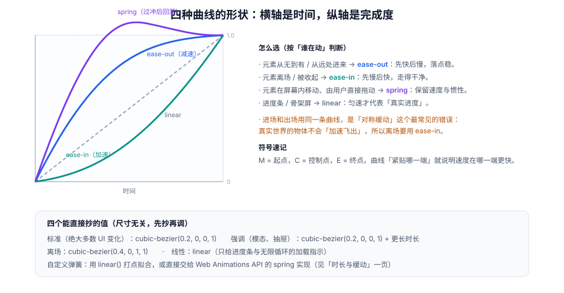

# 时长、缓动与弹簧

时长决定「多快」，缓动决定「怎么起停」。两者组合出来的手感，是动效里最难用语言描述、却最容易用数字固定的部分——所以它必须变成**令牌**，而不是散落在各个组件里的魔法数。

::: tip 一句话理解
`ease-out` 是「东西飞进来停住」，`ease-in` 是「东西被吸走」，`linear` 是「进度条在动」。用错曲线不会报错，只会让人觉得「哪里怪怪的」——而这种「怪」无法在代码评审里被指出来，只能靠约定拦住。
:::

## 一、时长分级：四档足够

Material 3 的动效时长 token 是业界最常被抄的一套，它的好处是**分了四档、每档四值**，覆盖了从微反馈到全屏转场的全部场景。

| 档位 | 值（ms） | 用途 | 典型组件 |
| --- | --- | --- | --- |
| **short1–4** | 50 / 100 / 150 / 200 | 微反馈、状态切换 | 按下态、勾选、hover、开关 |
| **medium1–4** | 250 / 300 / 350 / 400 | 组件级移动 | 卡片重排、气泡、抽屉 |
| **long1–4** | 450 / 500 / 550 / 600 | 大范围转场 | 全屏模态、路由切换 |
| **extraLong1–4** | 700 / 800 / 900 / 1000 | 叙事性、环境动效 | 引导流程、空状态插画 |

落到代码里只需要三个（甚至两个）语义化变量：

```css
/* tokens/motion.css —— 全站唯一的时长与曲线来源 */
:root {
  /* 时长：语义命名，不暴露「快慢」的绝对值 */
  --motion-instant: 80ms;   /* 按下态、焦点环 */
  --motion-fast: 120ms;     /* 勾选、淡入淡出、hover */
  --motion-base: 200ms;     /* 列表增删、气泡、卡片重排 */
  --motion-slow: 260ms;     /* 抽屉、侧栏、模态 */
  --motion-page: 320ms;     /* 路由转场 */

  /* 曲线：按「方向语义」命名，不按形状命名 */
  --ease-standard: cubic-bezier(0.2, 0, 0, 1);    /* 屏内移动 */
  --ease-enter: cubic-bezier(0, 0, 0.2, 1);       /* 进场：先快后慢 */
  --ease-exit: cubic-bezier(0.4, 0, 1, 1);        /* 离场：先慢后快 */
  --ease-linear: linear;                          /* 进度与循环 */

  /* 位移距离：和时长配对，避免「远距离 + 短时长」的窜动感 */
  --motion-distance-sm: 8px;
  --motion-distance-md: 24px;
  --motion-distance-lg: 320px;
}

@media (prefers-reduced-motion: reduce) {
  :root {
    --motion-instant: 1ms;
    --motion-fast: 80ms;
    --motion-base: 100ms;
    --motion-slow: 120ms;
    --motion-page: 120ms;
  }
}
```

::: warning 为什么不直接沿用 Material 的十六个值
十六个值在纸面上很整齐，但在一个只有十几个组件的业务系统里，维护者根本记不住 `medium3` 与 `medium4` 的区别，最后会退化成「随便挑一个」。**语义命名（instant / fast / base / slow / page）比档位编号更抗腐化**，代价是表达能力略弱——够用。
:::

## 二、缓动：三种曲线各自在表达什么



`cubic-bezier(x1, y1, x2, y2)` 的四个参数是两个控制点。理解它只需要一条规则：

> **曲线越靠近哪一端，就说明速度在哪一端更快。**
> 起点附近的曲线陡 → 一开始快（减速，`ease-out`）；终点附近陡 → 最后快（加速，`ease-in`）。

| 曲线 | 数值 | 语义 | 用错的样子 |
| --- | --- | --- | --- |
| 标准 | `cubic-bezier(0.2, 0, 0, 1)` | 屏内移动，两端都略有缓冲 | 用在离场上会显得「拖泥带水」 |
| 进场 | `cubic-bezier(0, 0, 0.2, 1)` | 先快后慢，落点稳 | 用在离场上像「冲出去又回来」 |
| 离场 | `cubic-bezier(0.4, 0, 1, 1)` | 先慢后快，走得干净 | 用在进场上是「憋一下再窜出来」 |
| 线性 | `linear` | 匀速 | 用在 UI 元素上像「机器人」 |

### 对称缓动是最常见的错误

很多实现里 `enter` 与 `leave` 复用同一个类，于是离场也用 `ease-out`。视觉结果是：元素离开时「先冲一下再加速消失」，看起来像被弹出去。

```css
/* 错误：一个类管进出，曲线相同 */
.toast { transition: transform var(--motion-base) var(--ease-enter); }

/* 正确：进出分开，离场用加速曲线，且更短 */
.toast-enter { transition: transform var(--motion-base) var(--ease-enter); }
.toast-leave { transition: transform var(--motion-fast) var(--ease-exit); }
```

## 三、弹簧：什么时候需要「过冲」

「弹簧（spring）」不是一种曲线，而是一套**物理参数**：刚度（stiffness）、阻尼（damping）、质量（mass）。它比贝塞尔多出两件真实世界的东西：**初速度**与**过冲**。

| 场景 | 该不该用弹簧 | 理由 |
| --- | --- | --- |
| 手指拖动后松手 | **该用** | 需要承接手指速度，否则会「跳一下再走」 |
| 卡片被甩出屏幕 | 该用 | 惯性是拖拽语义的一部分 |
| 抽屉开合 | 可以，但阻尼要大 | 轻微的过冲增加「实体感」 |
| 表单校验失败 | 不该用 | 抖动 + 过冲会放大焦虑 |
| 文字/列表内容 | 不该用 | 任何过冲都会造成阅读位移 |

### 用 `linear()` 拟合弹簧

CSS 没有原生的 `spring()`（仍处于提案阶段），最稳的做法是用 `linear()` 打点拟合一条已经解好的弹簧曲线：

```css
/* 阻尼比 0.7、刚度适中：轻微过冲（约 2%），260ms 稳定 */
:root {
  --ease-spring-soft: linear(
    0, 0.009, 0.035 2.1%, 0.141 4.4%, 0.723 12.9%,
    0.938 16.7%, 1.017, 1.077, 1.121, 1.149 24.3%,
    1.159, 1.163, 1.161, 1.154 29.9%, 1.129 32.8%,
    1.017 43.1%, 0.991, 0.977 51%, 0.974 53.8%,
    0.975 57.1%, 0.997 69.8%, 1.003 76.9%, 1
  );
}
```

::: danger 手写 `linear()` 的两个坑
1. **打点太少**：少于 10 个点会出现可见的「折线感」，尤其是在慢速播放或大屏上。建议 15–20 个点，且第一个点必须是 `0`、最后一个必须是 `1`。
2. **把 `linear()` 当贝塞尔用**：`linear()` 的参数是「在某个时间点已经完成了多少」，不是控制点。抄错格式会静默失效（整条 `transition` 被忽略），而不是报错。
:::

```javascript
// 生成 linear() 打点：给定阻尼比与时长，输出 20 个采样点
function springPoints({ damping = 0.7, duration = 260, samples = 20 } = {}) {
  const omega = (2 * Math.PI) / duration;      // 角频率（简化模型）
  const zeta = damping;
  const wd = omega * Math.sqrt(1 - zeta * zeta);
  const pts = [];
  for (let i = 0; i <= samples; i++) {
    const t = (i / samples) * duration;
    const x = 1 - Math.exp(-zeta * omega * t) *
      (Math.cos(wd * t) + ((zeta * omega) / wd) * Math.sin(wd * t));
    pts.push(`${Math.min(1.02, Math.max(0, x)).toFixed(3)} ${((i / samples) * 100).toFixed(1)}%`);
  }
  return `linear(${pts.join(", ")})`;
}
// 用法：把输出贴进 --ease-spring-soft，然后用 4x 慢放检查过冲是否超过 3%
```

## 四、用 Web Animations API 拿到「可编程的时长」

CSS 过渡适合声明式场景，但一旦涉及「打断后从当前速度继续」「动画结束后保留状态」「按顺序编排」，就应该用 WAAPI。

```javascript
// 可打断、可取消、结束后自动清理的抽屉动画
const panel = document.querySelector(".panel");
let current = null;

function toggle(open) {
  current?.cancel();                       // 关键：先取消上一次，避免排队
  const from = panel.getBoundingClientRect().left;
  const to = open ? window.innerWidth - 320 : window.innerWidth;

  current = panel.animate(
    [{ transform: `translateX(${from - to}px)` }, { transform: "translateX(0)" }],
    {
      duration: 260,
      easing: "cubic-bezier(0.2, 0, 0, 1)",
      fill: "both",                        // 结束后保留终态，避免「闪回」
      composite: "replace",
    }
  );

  current.finished.then(() => {
    panel.style.transform = "";            // 清理 inline 样式，防止残留
    current = null;
  }).catch(() => {
    /* 被 cancel() 时会 reject，这是正常路径，不要当错误上报 */
  });
}
```

::: warning `fill: "both"` 与「残留 transform」是同一件事的两面
`fill: both` 让动画结束后保持终态，但**它只作用在动画层**，元素的计算样式不会改变。如果你在动画结束后读取 `getBoundingClientRect()`，拿到的仍是原位置——这是「动画结束了，但点击区域没跟着走」的根因。正确做法是：动画结束时把终态写进行内样式或状态类，再清理动画。
:::

## 五、速度承接：拖拽松手之后

拖拽的动效不是「从 A 到 B 播一段动画」，而是**把手指的速度交给元素**。做法是读取最近的移动速度，换算成动画的初速度。

```javascript
// 记录最近若干帧的速度（px/ms）
const samples = [];
function onMove(e) {
  samples.push({ t: performance.now(), x: e.clientX });
  if (samples.length > 5) samples.shift();
}

function release() {
  const first = samples[0];
  const last = samples[samples.length - 1];
  const velocity = (last.x - first.x) / Math.max(1, last.t - first.t); // px/ms

  // 速度越大，动画越短；并保留一个下限，避免「甩一下」变成瞬移
  const duration = Math.min(320, Math.max(120, 240 - Math.abs(velocity) * 120));
  el.animate(
    [{ transform: `translateX(${startX}px)` }, { transform: "translateX(0)" }],
    { duration, easing: "cubic-bezier(0.2, 0, 0, 1)", fill: "both" }
  );
}
// 判据：松手瞬间的位移速度与手指连续，观感上「没有重新起步」
```

## 六、判据 `MNT-A` ~ `MNT-H`

| 编号 | 判据 | 怎么验证 |
| --- | --- | --- |
| `MNT-A` | 全站时长与曲线只来自令牌文件，组件里不出现裸写的毫秒与 `cubic-bezier` | `grep -rnE "[0-9]+ms" src/components` 的命中需逐个说明 |
| `MNT-B` | 时长按「距离 + 频率」分档，同一档位在全站一致 | 抽查 6 个动画，对照取值表；同场景不同值计为不合格 |
| `MNT-C` | 进场用减速、离场用加速，且离场时长不长于进场 | 对比 `is-enter` / `is-leave` 两个类的 `transition` 声明 |
| `MNT-D` | 弹簧只用于「用户直接操纵」的场景，内容类元素不使用过冲 | 搜索 `--ease-spring` 的引用位置，出现在文本或列表容器上即不合格 |
| `MNT-E` | `linear()` 采样点 ≥ 12，首值为 0、末值为 1 | 正则数点数；首尾值用肉眼核对 |
| `MNT-F` | 可打断动画先 `cancel()` 再新建，不排队 | 连点 5 次，`getAnimations()` 中 running 数 ≤ 1 |
| `MNT-G` | WAAPI 动画结束后清理行内样式，避免终态残留 | 动画结束后读 `el.style.transform`，应为空 |
| `MNT-H` | `prefers-reduced-motion: reduce` 下时长被压缩到 ≤ 120ms，且曲线退化为 `linear` | 开模拟后读 `getComputedStyle` 的 `transition-duration` |

## 七、验证方式

```javascript
// ① 列出某个元素上所有过渡的实际时长与曲线
const el = document.querySelector(".drawer");
const cs = getComputedStyle(el);
console.log({
  property: cs.transitionProperty,
  duration: cs.transitionDuration,
  easing: cs.transitionTimingFunction,
});
// 期望：duration 为 0.26s，easing 为 cubic-bezier(0.2, 0, 0, 1)
// 若 easing 显示 ease（默认值），说明令牌没被应用
```

```javascript
// ② 验证「可打断」：连续切换 6 次，最终状态必须与最后一次意图一致
const panel = document.querySelector(".drawer");
const target = [];
for (let i = 0; i < 6; i++) {
  target.push(i % 2 === 0);
  panel.classList.toggle("is-open", target.at(-1));
  await new Promise((r) => setTimeout(r, 40));
}
console.log("最终 is-open =", panel.classList.contains("is-open"), "期望 =", target.at(-1));
// 期望：一致；若不一致，说明动画在排队争抢终态
```

```shell
# ③ 检查裸写时长（排除令牌文件与测试快照）
grep -rnE "transition:[^;]*[0-9]+m?s" src/ --include=*.vue --include=*.css \
  | grep -v "motion.css" | grep -v "__snapshots__" || echo "OK"
```

```javascript
// ④ 检查 linear() 打点数量（≥12）
const ease = getComputedStyle(document.documentElement)
  .getPropertyValue("--ease-spring-soft");
console.log("采样点数 =", (ease.match(/,/g) || []).length, "（含首尾共 N+1 个）");
// 期望：逗号数 ≥ 11
```

## 八、相关页面与下一篇

- 下一篇：[反馈与状态机](../Feedback/index.md)——时长与曲线的第一消费者。
- 上游：[动效原则与感知预算](../Principles/index.md)（为什么要分档）。
- 相邻必读：[CSS 进阶 · 动画](../../Basic/CSS/Advanced/Animation/index.md)（语法）、[动效性能](../Performance/index.md)（合成属性）。

## 参考资料

- [Material Design 3 · Easing and duration tokens](https://m3.material.io/styles/motion/easing-and-duration/tokens-specs)
- [MDN · `linear()` easing function](https://developer.mozilla.org/en-US/docs/Web/CSS/easing-function/linear)
- [MDN · `Element.animate()`](https://developer.mozilla.org/en-US/docs/Web/API/Element/animate)
- [web.dev · Cubic-bezier 可视化工具](https://cubic-bezier.com/)
- [CSS WG · `spring()` easing 提案](https://github.com/w3c/csswg-drafts/issues/280)
