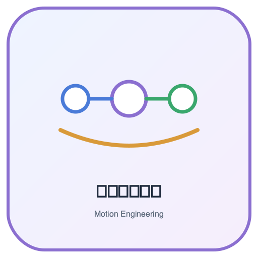
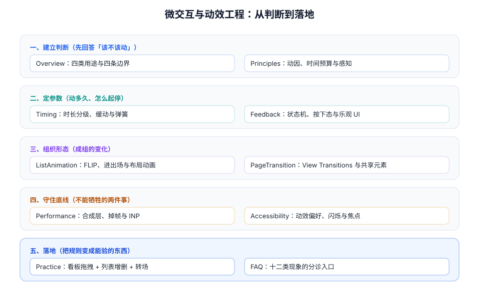

# 微交互与动效工程

界面上的每一次「动」，都在回答用户一个问题：**刚才发生了什么，接下来会发生什么。** 本专题不教怎么做得花哨，而是把动效当成**状态变化的解释器**来工程化——什么时候该动、动多久、跑在哪个线程、谁有权把它关掉，每一件都写成可执行、可验收的约束。

::: tip 一句话理解
动效的失败很少是「做得不好看」，而是**它解释了错的事**：按下没有反馈、删除留下跳变、转场让人晕、动画掉帧让人以为卡死。所以动效工程的第一件事不是调曲线，而是**先定义状态，再定义状态之间的过渡**。
:::

## 与相邻专题的分工

本专题最容易和十个已有专题重叠。下表把边界写死——**判据可以互相借用，结论不能互相搬运**。

| 相邻专题 | 它回答什么 | 本专题回答什么 | 为什么不能互相替代 |
| --- | --- | --- | --- |
| [CSS 进阶 · 动画](../Basic/CSS/Advanced/Animation/index.md) | `@keyframes`、`transition`、`animation` 的**语法与属性清单** | 这些属性该取什么值、为什么取这个值、取错了会怎样 | 那一页是「怎么写出一个动画」，本专题是「什么时候不该写」 |
| [CSS 进阶 · 布局](../Basic/CSS/Advanced/GridLayout/index.md) | 栅格、弹性、容器查询的**排版能力** | 布局变化时**怎么让位移看起来连续**（FLIP） | 布局决定位置，动效决定「位置之间怎么走」 |
| [浏览器 · 渲染与性能](../Basic/Browser/Performance/index.md) | 渲染管线的**内部机制**：解析、布局、绘制、合成 | 动画的每一帧**落在管线的哪一段**、怎么让它只落在最后一段 | 管线是同一套，本专题多出「怎么用 DevTools 证明它在合成线程」 |
| [前端性能优化](../Others/PerformanceOptimization/index.md) | 加载、构建、运行时的**通用优化清单** | 动画对 **INP / CLS** 的具体影响与预算 | 那一页按「资源」分类，本专题按「一帧」分类 |
| [移动端 H5 · 触摸交互](../MobileH5/TouchInteraction/index.md) | 手势识别、滚动仲裁、`pointercancel` | 手势**松手之后**那一段动画怎么接上速度 | 手势决定「输入怎么进来」，动效决定「结果怎么呈现」 |
| [国际化与无障碍 · 无障碍基础](../IntlA11y/A11yFoundation/index.md) | 语义化、对比度、键盘、屏幕阅读器 | **动效偏好**（`prefers-reduced-motion`）、闪烁阈值、动效与焦点 | 那一页讲「能不能用」，本专题讲「用了会不会难受」 |
| [国际化与无障碍 · 键盘与焦点](../IntlA11y/KeyboardFocus/index.md) | 焦点顺序、焦点陷阱、跳转链接 | 动效**结束时焦点该落在哪**、动画期间焦点是否可见 | 焦点管理是静态规则，动效会临时改变可见性 |
| [Vue3 核心](../Frame/Vue/Vue3/index.md) | 组件、响应式、`<Transition>` 的用法 | 框架提供的过渡钩子**什么时候不该用**（列表重建、虚拟滚动） | 框架给的是机制，本专题给的是判据 |
| [富文本编辑器工程](../RichTextEditor/SelectionIME/index.md) | 选区、输入法、光标复位 | 编辑区里的**动效禁区**（输入时不加过渡、不改变行高） | 编辑器对「帧内稳定」的要求比普通页面严得多 |
| [数据可视化 · 大屏看板](../DataVisualization/Dashboard/index.md) | 图表选型、布局、刷新策略 | 数据更新时的**过渡语义**（增长 vs 替换 vs 重排） | 图表库自带过渡，但「该不该过渡」仍是设计判断 |

::: info 版本组织说明
「微交互与动效工程」不是某个产品，而是**一类工程问题**，因此**不建版本目录**——不存在需要长期并存维护的第二条内容线。

它的「版本差异」体现在**平台能力**上（View Transitions、滚动驱动动画、`@starting-style` 各自在不同浏览器版本落地），处理方式是**在页内用 `::: info` 标注适用版本并给出降级写法**，而不是按版本拆目录。仓库内已有的版本目录范式可供对照，三者都遵守「旧版本保留 + 页顶标注状态 + 新版不覆盖」：

| 版本目录范式 | 入口 | 组织方式 |
| --- | --- | --- |
| Spring 框架 | [Spring 版本入口](../../Backend/Java/Frame/Spring/index.md) | `Spring5/` 与 `Spring6/` 并存，各自独立目录 |
| Vue 框架 | [Vue3](../Frame/Vue/Vue3/index.md) | `Vue2/` 与 `Vue3/` 并存，`Vue2` 标注为存量项目使用 |
| Spring Boot | `docs/Backend/Java/Frame/SpringBoot/` 下的 `v2` / `v3` / `v4` | 按大版本分目录，共享同一份 `assets/` |
:::

## 专题地图

## 十篇正文

按「先建立判断，再定参数，再组织形态，最后守底线并落地」的顺序排列。

| # | 页面 | 一句话说明 |
| --- | --- | --- |
| 1 | [总览：四类用途与四条边界](./Overview/index.md) | 反馈、连续、层级、注意力；高频、等待、不可见、无障碍四条红线 |
| 2 | [动效原则与感知预算](./Principles/index.md) | 100 / 400ms / 1s / 10s 四道阈值，以及「谁在动、从哪来、到哪去」三问 |
| 3 | [时长、缓动与弹簧](./Timing/index.md) | 时长分级表、四种曲线、`linear()` 拟合弹簧、可打断与就地接管 |
| 4 | [反馈与状态机](./Feedback/index.md) | 一次点击的四个终态、延迟出现的 loading、乐观 UI 的边界 |
| 5 | [列表与布局动画](./ListAnimation/index.md) | FLIP 四步、高度展开、进出场、虚拟列表与动画的冲突 |
| 6 | [页面转场与共享元素](./PageTransition/index.md) | View Transitions 四拍、跨文档转场、降级与 SSR 注意事项 |
| 7 | [动效性能与掉帧诊断](./Performance/index.md) | 合成层、属性代价、长任务、`Long Animation Frame` 与实测读数 |
| 8 | [无障碍与动效偏好](./Accessibility/index.md) | `prefers-reduced-motion` 三档、闪烁阈值、焦点与动效的配合 |
| 9 | [实战：看板的动效系统](./Practice/index.md) | 四层结构、三个动作的完整参数、八条可执行验收 |
| 10 | [常见问题与最佳实践](./FAQ/index.md) | 十二类现象分诊、高频十问、上线自查清单、术语表 |

## 判据族总览

全专题 **10 族 80 条**判据，每条只回答三件事：**约定是什么 / 定错了会怎样 / 怎么验证它没被破坏**。

| 族 | 前缀 | 页 | 条数 | 关注的失效面 |
| --- | --- | --- | --- | --- |
| 总览 | `MNO` | [四类用途与四条边界](./Overview/index.md) | 8 | 加了不该加的动画 |
| 原则 | `MNP` | [动效原则与感知预算](./Principles/index.md) | 8 | 时长与用户预期错位 |
| 时序 | `MNT` | [时长、缓动与弹簧](./Timing/index.md) | 8 | 曲线与打断方式错误 |
| 反馈 | `MNF` | [反馈与状态机](./Feedback/index.md) | 8 | 终态缺失、重复提交 |
| 列表 | `MNL` | [列表与布局动画](./ListAnimation/index.md) | 8 | 布局抖动与位置跳变 |
| 转场 | `MNV` | [页面转场与共享元素](./PageTransition/index.md) | 8 | 转场失效或错配 |
| 性能 | `MNE` | [动效性能与掉帧诊断](./Performance/index.md) | 8 | 掉帧、长任务、层爆炸 |
| 无障碍 | `MNA` | [无障碍与动效偏好](./Accessibility/index.md) | 8 | 忽略偏好、闪烁、焦点丢失 |
| 实战 | `MNR` | [实战：看板的动效系统](./Practice/index.md) | 8 | 规则无法落地与回归 |
| 分诊 | `MNQ` | [常见问题与最佳实践](./FAQ/index.md) | 8 | 修错地方、问题复发 |

## 阅读顺序建议

1. **只想建立判断力**：读 [总览](./Overview/index.md) + [动效原则与感知预算](./Principles/index.md)。两页够你在评审里问出「这个动画解释了哪个状态变化」。
2. **正在救一个「点了没反应」或「卡住」的问题**：先看 [常见问题](./FAQ/index.md) 的分诊表，它会把你送回正确的页面。
3. **要动手做一套动效规范**：从 [时长、缓动与弹簧](./Timing/index.md) 的 token 表开始，落到 [实战](./Practice/index.md) 的四层结构。
4. **只关心「为什么我的动画在真机上卡」**：直接读 [动效性能](./Performance/index.md) 的读数一节，再回头看 [列表与布局动画](./ListAnimation/index.md) 的重建问题。

## 事实与规格速览（2026-10 口径）

| 事项 | 结论 | 依据 |
| --- | --- | --- |
| View Transitions（同文档 / SPA） | **Baseline Newly Available（2025-10-14）**：Chrome 111+、Safari 18+、Firefox 144+；全球覆盖约 **91.75%** | caniuse 与 Chrome 特性浏览器表（2026-03 更新） |
| View Transitions（跨文档 / MPA） | Chrome 126+（2024-06）、Safari 18.2+（2024-12）；**Firefox 稳定版未支持**，会直接忽略 `@view-transition`；`@view-transition` 覆盖约 **86.21%** | caniuse；MDN `@view-transition` |
| `view-transition-class` / `types` | Chrome/Edge 125+、Safari 18.2+、Firefox 144+（`types` 的对象形式到 Firefox 147+） | Chrome 特性浏览器表 |
| 滚动驱动动画 | Chrome 115+（2023-07）、Safari 26+（2025-09）；**Firefox 稳定版仍在 flag 后**（152，2026-06）；覆盖约 **82.6%** | caniuse；多篇 2026 实测 |
| 滚动驱动的 Firefox 限制 | 需要**非零** `animation-duration` 才会应用滚动时间线，写 `1ms` 即可 | 实测与 MDN 备注 |
| `@starting-style` | 2026 年达到跨引擎 Baseline，用于「从 `display: none` 进场」而不必用 JS 计时 | Interop 2026 与各引擎发布说明 |
| `linear()` 缓动 | Chrome 113+、Safari 17.2+、Firefox 112+，可用多打点方式拟合弹簧曲线 | MDN `linear()` |
| Material 3 动效 token | 时长四档：short **50/100/150/200**、medium **250/300/350/400**、long **450/500/550/600**、extraLong **700/800/900/1000**（ms） | Material 3 motion tokens |
| 感知阈值 | 0.1s 瞬时、**0.4s（Doherty）**、1s 保持流、10s 注意力上限 | Nielsen Norman Group；Doherty & Thadani (1982) |
| 无障碍口径 | WCAG 2.3.1 闪烁 **≤3 次/秒**（AA）；2.3.3 交互动效可关闭（AAA）；2.2.2 自动播放超 5s 需可暂停（A） | WCAG 2.2 |

## 参考资料

- [MDN · View Transition API](https://developer.mozilla.org/en-US/docs/Web/API/View_Transitions_API)
- [MDN · `prefers-reduced-motion`](https://developer.mozilla.org/en-US/docs/Web/CSS/@media/prefers-reduced-motion)
- [MDN · `animation-timeline`](https://developer.mozilla.org/en-US/docs/Web/CSS/animation-timeline)
- [web.dev · 使用 CSS 动画提升性能](https://web.dev/articles/animations-guide)
- [Material Design 3 · Motion](https://m3.material.io/styles/motion/overview)
- [WCAG 2.2 · 2.3.1 / 2.3.3 / 2.2.2](https://www.w3.org/TR/WCAG22/)
- [Nielsen Norman Group · Response Times: The 3 Important Limits](https://www.nngroup.com/articles/response-times-3-important-limits/)
