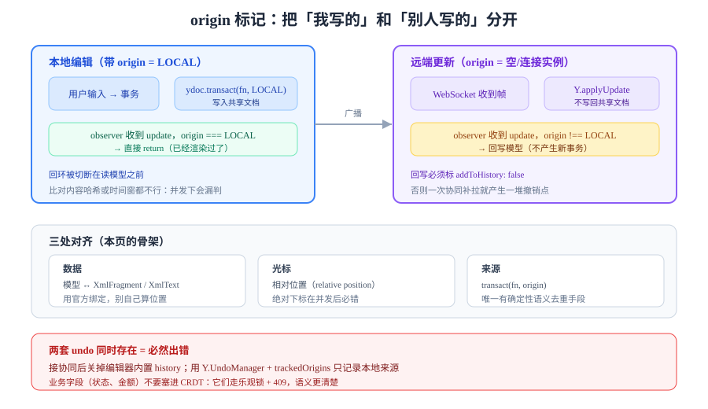

# 接协同：边界与三处对齐

把编辑器接上协同，90% 的工作量不在算法，而在**三处对齐**：文档模型怎么映射到 CRDT 类型、选区怎么变成"别人的光标"、本地事务怎么和远端更新区分开。



::: info 先划边界
**OT / CRDT 的算法、同步协议、presence 的 TTL、断线追平**都在[实时协作与冲突解决](../../../Backend/RealtimeCollaboration/index.md)那一专题里，本页不重复。本页只讲一件事：**编辑器的模型层怎么和那套机制对接而不出错。**
:::

## 判据族声明

本页判据族 `COL-A` ~ `COL-H`，共 8 条。定义表在第七节。

## 一、三处对齐（本页的骨架）

| 对齐点 | 编辑器侧 | 协同侧 | 错位的表现 |
| --- | --- | --- | --- |
| **数据** | 递归文档树 / 扁平节点数组 | `Y.XmlFragment`、`Y.Text`、`Y.Array` | 双方各存一份，刷新后内容"回滚" |
| **光标** | 模型位置 `{from,to}` | awareness（临时状态，不入库） | 光标飘到别人的段落、关闭页面后"幽灵光标" |
| **来源** | 事务 `meta.source` | 远端更新来源（`origin`） | 自己的改动被当成远端再应用一次 → 内容翻倍 |

### 数据对齐：三种映射

| 编辑器 | 绑定 | 映射方式 | 注意 |
| --- | --- | --- | --- |
| ProseMirror | `y-prosemirror` | `XmlFragment` ↔ 文档树；`XmlText` ↔ 文本节点 | 位置映射要经过 `ySyncPluginKey`，不能自己算偏移 |
| Tiptap | `@tiptap/extension-collaboration` | 同上（封装了 `y-prosemirror`） | 必须关掉内置 `history`（否则两套 undo 打架） |
| Lexical | `@lexical/yjs` | `Y.Doc` 映射节点树，`CollaborationPlugin` | 版本随 Lexical 0.x 走，升级要读 release notes |

::: danger "我自己写映射"是最大的坑
很多人以为"文档树 ↔ Y.Map 递归转换"很直观，于是自己写。**一定会错在位置上**：CRDT 的位置是"元素 ID 之间的关系"，不是整数下标。一次并发插入后，整数下标会指向另一个字符，表现为**别人的光标在你这里乱跳、撤销删错字**。用官方绑定，别自己算。
:::

## 二、来源标记：防回环的唯一手段

回环（loop）是这样发生的：

```text
本地改 → 写进 Y.Doc → Y.Doc 触发 observer → observer 认为"文档变了" → 再写一次模型 → 又写进 Y.Doc → …
```

结果要么是被同步插件拦住（表现为"打字没反应"），要么是内容翻倍。

```typescript
// 用 origin 区分"谁引起的变更"
const LOCAL = Symbol('local');

// 本地事务：带 origin 写入
function applyLocal(tr: Transaction) {
  ydoc.transact(() => {
    applyToYjs(tr);                 // 写入共享文档
  }, LOCAL);                        // ← 关键：标记来源
}

// 监听远端/所有变更时，按 origin 过滤
ydoc.on('update', (update: Uint8Array, origin: unknown) => {
  if (origin === LOCAL) return;     // 自己写的，已经渲染过了
  applyRemoteUpdateToModel(update); // 只有远端更新才回写模型
});
```

| 方案 | 是否可靠 | 说明 |
| --- | --- | --- |
| 比对内容哈希 | ❌ | 内容相同但操作不同的情况会漏判 |
| 用时间窗去重 | ❌ | 网络抖动就失效 |
| **`transact(fn, origin)` + 过滤** | ✅ | 唯一有确定性语义的做法 |

## 三、撤销：只能撤自己的

| 场景 | 天真的做法 | 后果 | 正确做法 |
| --- | --- | --- | --- |
| 两人同时编辑 | 用本地历史栈 | 撤销会把**别人的**改动一起撤掉 | `Y.UndoManager` + `trackedOrigins` |
| 离线后重连 | 待发操作进本地历史 | 撤销"撤掉"了还没同步的意图，服务端仍收到 | 待发队列与历史栈分离 |
| 协同 + 表格单元格 | 单元格级撤销 | 撤销一个单元格会打乱别人的行 | 块级（或单元格级）scope，明确写进文档 |

```typescript
import * as Y from 'yjs';

const undoManager = new Y.UndoManager(fragment, {
  trackedOrigins: new Set([LOCAL]),   // 只记录本地来源的操作
  captureTimeout: 400,                // 与编辑器的合并窗口对齐（见命令栈页）
});

// 快捷键：Ctrl+Z 走 UndoManager，不走本地 History
onKey('Mod-z', () => undoManager.undo());
onKey('Mod-Shift-z', () => undoManager.redo());
```

::: warning 两套 undo 同时存在 = 必然出错
Tiptap 的 `StarterKit` 自带 `history` 扩展，接上协同后**必须 `history: false`**。否则 `Ctrl+Z` 有时走 ProseMirror 历史（撤到本次会话开始）、有时走 Yjs（撤自己的操作），表现为"撤销行为不稳定"。
:::

## 四、选区的对齐：presence 不是文档

| 项 | 文档内容 | 光标/选区 |
| --- | --- | --- |
| 是否入库 | ✅ 是 | ❌ 否（临时状态） |
| 更新频率 | 每次编辑 | 每次移动（可达每秒数十次） |
| 一致性要求 | 强（最终一致） | 弱（丢了也无所谓） |
| 失效处理 | 需要迁移 | 超时即消失 |
| 存储位置 | `Y.Doc` / 数据库 | awareness（内存 + 广播） |

```typescript
// 广播光标：只发"相对位置"，不发 DOM 坐标
function broadcastCursor(from: number, to: number) {
  const anchor = Y.createRelativePositionFromTypeIndex(ytext, from);
  const head = Y.createRelativePositionFromTypeIndex(ytext, to);
  awareness.setLocalStateField('cursor', {
    anchor: Y.relativePositionToJSON(anchor),
    head: Y.relativePositionToJSON(head),
    user: { id: userId, name, color },
  });
}
```

**为什么必须用相对位置**：并发插入后，绝对下标会指向别的字符。相对位置（relative position）绑定在元素 ID 上，会自动跟着内容走——这正是[实时协作专题](../../../Backend/RealtimeCollaboration/index.md)里 presence 那一页的核心纪律。

## 五、持久化：存二进制，不存 JSON

| 方案 | 体积 | 恢复速度 | 增量 | 建议 |
| --- | --- | --- | --- | --- |
| 每次存整份 JSON | 大 | 慢（要重建 CRDT 历史） | ❌ | 不要 |
| 存 `Y.encodeStateAsUpdate()` 二进制 | 小 | 快 | ✅ | **主方案** |
| 定期存快照 + 增量 | 最小 | 快 | ✅ | 长文档（> 1 MB）用这个 |

```typescript
// 落库：存二进制 update，同时保留一份 JSON 供服务端校验与检索
const update = Y.encodeStateAsUpdate(ydoc);          // Uint8Array
await api.saveDoc(docId, {
  yjsUpdate: Buffer.from(update).toString('base64'),
  bodyJson: toJson(ydoc),                            // 供全文检索 / 导出 / 校验
  schemaVersion: 3,
});
```

::: danger 只存二进制会失去服务端校验能力
`Y.Doc` 的二进制是"操作历史"，服务端无法直接校验 schema。所以**必须同时存一份 JSON**（由绑定库导出），并在服务端按[序列化页](../Serialization/index.md)的规则校验结构与属性白名单。两份数据的一致性用"更新同事务写入"保证。
:::

## 六、把冲突"变得可见"

算法能保证收敛，但**收敛的结果不一定符合业务意图**。可操作的做法只有一条：**让冲突在 UI 上可见**。

| 冲突类型 | 例子 | 处理 |
| --- | --- | --- |
| 同段落并发编辑 | 两人都改了第 3 段 | 合并（文本级）；在工具栏提示"本段刚刚被 X 修改" |
| 结构性冲突 | 一人删了表格，另一人往里加行 | 块级锁：正在编辑的块显示"X 正在编辑" |
| 语义冲突 | 一人把状态改成"已完成"，另一人改成"已取消" | **不要用 CRDT 解**，用状态机 + 版本号（见[幂等与状态机](../../../Backend/IdempotencyStateMachine/index.md)） |
| 附件替换 | 两人同时换同一张图 | 保留两个版本，让人选 |

::: tip 最后一行是最容易被忽略的
**CRDT 只解决"文本/树结构"的合并，不解决"业务字段"的合并。** 状态、金额、负责人这类字段应该走"乐观锁 + 冲突返回 409"，而不是塞进 CRDT 里让它自由合并。
:::

## 七、判据表

| 编号 | 约定 | 定错了会怎样 | 怎么验证没被破坏 |
| --- | --- | --- | --- |
| `COL-A` | 必须使用官方绑定做模型 ↔ CRDT 映射 | 位置错乱、撤销删错字 | 依赖里有 `y-prosemirror`/`@tiptap/extension-collaboration`/`@lexical/yjs` 之一，且无自研位置换算 |
| `COL-B` | 本地写入必须带 `origin`，监听端按 origin 过滤 | 内容翻倍或打字无反应 | 单人输入 20 字，Y.Doc 与模型都恰好 20 字 |
| `COL-C` | 接协同后必须关闭编辑器内置 undo | 撤销行为不稳定 | 配置里 `history: false`（Tiptap）或未注册 History 扩展 |
| `COL-D` | 撤销必须限定在本用户来源 | 撤销掉别人的改动 | 两人各改一段，A 撤销后 B 的内容仍在 |
| `COL-E` | 光标必须用相对位置广播 | 并发后光标飘到别处 | 断网期间对方插入文字，恢复后光标仍在原字符旁 |
| `COL-F` | 必须同时持久化二进制 update 与 JSON | 服务端无法校验、无法检索 | 表里同时有 `yjs_update` 与 `body_json`，且同事务写入 |
| `COL-G` | 业务字段不得用 CRDT 合并 | 状态被"合并"成非法值 | 状态字段走乐观锁接口，返回 409 |
| `COL-H` | 断线重连必须能追平且不重复应用 | 刷新后内容回滚/重复 | 断网改 3 处，重连后两端内容一致且无重复段落 |

## 如何验证

不需要真服务端，两个浏览器标签页 + 一个本地 `y-websocket` 就够：

```shell
# 起一个最小的协同服务（读者在自己工程里执行）
pnpm add yjs y-websocket
npx y-websocket --port 1234
# 预期：输出 "running at ws://localhost:1234"
```

```javascript
// 两个标签页各执行一次，观察是否互相可见
import * as Y from 'yjs';
import { WebsocketProvider } from 'y-websocket';

const ydoc = new Y.Doc();
const provider = new WebsocketProvider('ws://localhost:1234', 'rte-demo', ydoc);
const ytext = ydoc.getText('content');

ytext.observe(() => console.log('远端/本地变更:', ytext.toString()));
setTimeout(() => ytext.insert(0, '你好'), 1000);
```

**预期输出**：两个标签页都在约 1 秒后打印 `远端/本地变更: 你好`。

**三个必须手工验证的边界**（这三条自动化测不出来）：

1. **断网**：浏览器 DevTools 切 Offline，在 A 里改 3 处，在 B 里也改 3 处，恢复网络后两端必须一致且**无重复段落**；
2. **撤销**：A 按 `Ctrl+Z` 只能撤掉 A 自己的改动，B 的内容不动；
3. **光标**：A 的光标停在某个字后面时，B 在该字前面插入内容，A 的光标仍应跟着那个字。

## 参考资料

- [y-prosemirror](https://github.com/yjs/y-prosemirror)——ProseMirror 与 Yjs 的官方绑定
- [Tiptap · Collaboration](https://tiptap.dev/docs/editor/extensions/functionality/collaboration)——`Collaboration` 扩展与 `history: false` 的要求
- [Lexical · Collaboration](https://lexical.dev/docs/collaboration/react)——`@lexical/yjs` 的接入方式
- [Yjs · UndoManager](https://docs.yjs.dev/api/undo-manager)——`trackedOrigins` 与 `captureTimeout`
- [Yjs · Relative positions](https://docs.yjs.dev/api/relative-positions)——为什么光标必须用相对位置
