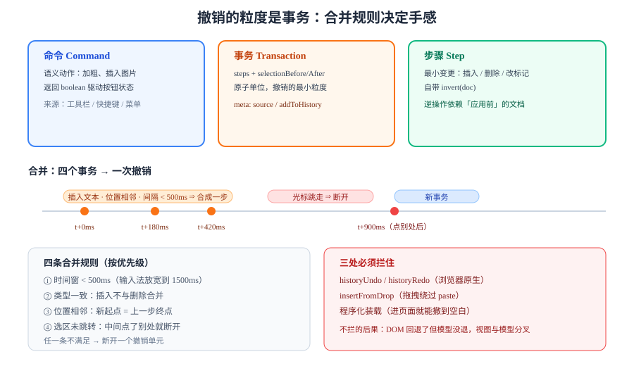

# 命令栈与撤销

撤销（undo）看起来是"存一份历史快照"，实际上是**"每一个操作都自带逆操作，并且要决定哪些操作该被合成一步"**。合成规则错了，用户体验就是"按一次撤销，刚才打的十个字全没了"。



## 判据族声明

本页判据族 `CMD-A` ~ `CMD-H`，共 8 条。定义表在第八节。

## 一、三层结构：命令、事务、步骤

| 层 | 是什么 | 谁产生 | 是否可逆 |
| --- | --- | --- | --- |
| **命令**（command） | 一个语义动作："加粗选中内容" | 工具栏、快捷键、菜单 | 由内部的步骤决定 |
| **事务**（transaction） | 一组步骤 + 选区变化，是**原子单位** | 一次用户交互 | 事务内每一步都可逆 |
| **步骤**（step） | 最小变更："在第 5 位插入 3 个字符" | 命令内部 | ✅ 自带 `invert()` |

**关键认识**：撤销的粒度是**事务**，不是步骤，也不是"一次按键"。所以"该合成什么"这个决定发生在**创建事务的时候**，而不是撤销的时候。

```typescript
// 最小可逆步骤模型（与 ProseMirror 的 Step 语义一致）
interface Step {
  apply(doc: DocNode): DocNode;
  invert(doc: DocNode): Step;      // 逆操作依赖"应用前"的文档
}

interface Transaction {
  steps: Step[];
  selectionBefore: { from: number; to: number };
  selectionAfter?: { from: number; to: number };
  meta: { addToHistory: boolean; source: 'local' | 'remote' | 'api' };
}
```

::: danger `invert` 必须拿到"应用前"的文档
插入步骤的逆操作是"删除同一段区间"，但**删除的区间要用插入前的位置**计算。很多自研实现把 `invert()` 写成无参函数，于是在"插入后又删除"的复合事务里算出错误的回滚位置，表现为**撤销后内容错位**。
:::

## 二、撤销栈的三个实现档次

| 档次 | 做法 | 内存 | 适用 |
| --- | --- | --- | --- |
| **快照栈** | 每次事务存整份文档 JSON | 极高（一份 100 KB 文档 × 100 步 = 10 MB） | 原型、极小文档 |
| **逆操作栈**（推荐） | 只存 `Step[]` 与其逆 | 低（与改动量成正比） | 生产环境的主流做法 |
| **CRDT 内建 undo** | 由协同库的 UndoManager 管理 | 中 | 已有协同的场景 |

```typescript
class History {
  private undoStack: Transaction[] = [];
  private redoStack: Transaction[] = [];
  constructor(private limit = 100) {}

  push(tr: Transaction) {
    if (!tr.meta.addToHistory) return;      // 远端同步、程序化初始化不入栈
    this.undoStack.push(tr);
    if (this.undoStack.length > this.limit) this.undoStack.shift();
    this.redoStack.length = 0;              // 新操作让 redo 失效
  }

  undo(doc: DocNode): { doc: DocNode; selection: { from: number; to: number } } | null {
    const tr = this.undoStack.pop();
    if (!tr) return null;
    let cur = doc;
    for (const step of [...tr.steps].reverse()) cur = step.invert(doc).apply(cur);
    this.redoStack.push(tr);
    return { doc: cur, selection: tr.selectionBefore };
  }
}
```

## 三、合成规则：什么时候该并成一步

这是"手感"的全部来源。四条规则按优先级排列：

| 规则 | 条件 | 效果 |
| --- | --- | --- |
| **1. 时间窗** | 距上一步 < **500 ms**（可调 300~1000） | 连续打字合成一步 |
| **2. 类型一致** | 两步都是"插入文本"或都是"删除" | 打字与删除不合并（否则撤销会"打完又删"） |
| **3. 位置相邻** | 新步骤的起点 = 上一步的终点 | 中间点了别处就不合并 |
| **4. 选区未跳转** | 两次之间没有用户主动移动光标 | 否则合成会"撤销掉另一段的修改" |

```typescript
function shouldMerge(prev: Transaction, next: Transaction): boolean {
  if (next.meta.source !== 'local') return false;
  if (Date.now() - (prev as any).at > 500) return false;      // 规则 1
  if (!isSameKind(prev, next)) return false;                  // 规则 2
  if (!isAdjacent(prev, next)) return false;                  // 规则 3
  return true;                                                // 规则 4 由调用方保证
}
```

::: warning 中文输入法下时间窗要放宽
拼音输入一个词可能耗时 1~2 秒。若时间窗只有 300 ms，**一个词会被拆成 3~4 步撤销**，用户体感是"撤销只删了一个字"。建议对 `insertCompositionText` 之后的那次提交单独放宽到 **1500 ms**，或直接把"一次 compositionend"当作一个不可分割的单元。
:::

## 四、三个必须拦住的输入源

| 输入源 | 不拦的后果 |
| --- | --- |
| 浏览器原生 `Ctrl+Z`（`inputType: historyUndo`） | DOM 回退而模型没回退，视图与模型分叉 |
| 拖拽输入（`insertFromDrop`） | 拖进来的内容不进历史栈，撤销时"跳过"它 |
| 程序化 setDoc（加载文档、协同补拉） | 一进编辑页就能"撤销到空白页" |

```typescript
// 三处都得管
el.addEventListener('beforeinput', (e: InputEvent) => {
  if (e.inputType === 'historyUndo' || e.inputType === 'historyRedo') {
    e.preventDefault();                    // 交给我们自己的 History
    e.inputType === 'historyUndo' ? history.undo(doc) : history.redo(doc);
    return;
  }
  if (e.inputType === 'insertFromDrop') {
    e.preventDefault();
    handleDrop(e as any);                  // 与粘贴共用管线，且入历史栈
  }
});

// 程序化装载：显式标记不入历史
function loadDoc(doc: DocNode) {
  dispatch({ steps: [{ apply: () => doc, invert: () => ({ apply: (d) => d, invert: () => null as any }) }],
             selectionBefore: { from: 1, to: 1 },
             meta: { addToHistory: false, source: 'api' } });
}
```

## 五、命令的三种写法

| 写法 | 例子 | 优点 | 缺点 |
| --- | --- | --- | --- |
| **直接改状态** | `dispatch(tr.insertText('a'))` | 最直接 | 分散在各处，难复用 |
| **命令函数**（`(state, dispatch) => boolean`） | `toggleMark(schema.marks.strong)(state, dispatch)` | 可组合、可判断"当前是否可用" | 需要统一的签名约定 |
| **按键映射表** | `{'Mod-b': toggleMark(strong)}` | 快捷键集中管理 | 要注意输入法期不触发 |

```typescript
// 命令函数的标准签名：能执行就 dispatch 并返回 true，不能执行返回 false
type Command = (state: EditorState, dispatch?: (tr: Transaction) => void) => boolean;

const toggleBold: Command = (state, dispatch) => {
  const { from, to, empty } = state.selection;
  if (empty) return false;                        // 没选中就不处理（或改为"切换当前标记"）
  const tr = state.tr;
  const has = state.doc.rangeHasMark(from, to, state.schema.marks.strong);
  has ? tr.removeMark(from, to, state.schema.marks.strong)
      : tr.addMark(from, to, state.schema.marks.strong.create());
  dispatch?.(tr);
  return true;
};
```

**返回布尔值的意义**：工具栏按钮的 `disabled` 状态就是 `!command(state)`——不用另写一套"当前能不能加粗"的判断，避免两套逻辑漂移。

## 六、历史栈的三个运维细节

| 细节 | 建议值 | 理由 |
| --- | --- | --- |
| 栈深度 | 100~200 步 | 再深用户也不会按，但内存会涨 |
| 单文档内存上限 | 与文档大小挂钩（如 ≤ 8 MB） | 大表格编辑时逆操作很占内存 |
| 切文档时 | **清空历史** | 否则能把 A 文档的修改"撤销"到 B 文档上 |

```typescript
// 切文档必须重置，否则跨文档撤销会破坏数据
function openDocument(id: string, doc: DocNode) {
  history.clear();
  editor.load(doc);
  currentDocId = id;
}
```

::: danger 跨文档撤销是数据事故，不是体验问题
如果用户在 A 文档里删了一整段，切到 B 文档后按 `Ctrl+Z`，逆操作会**按 A 的位置去改 B 的文档**——轻则内容错乱，重则抛出异常导致编辑器白屏。这条必须用"切换即清空"兜住。
:::

## 七、与协同的边界（一句话版）

| 场景 | 撤销语义 |
| --- | --- |
| 单人编辑 | 撤销"我上一次操作" |
| 协同编辑 | 只能撤销**我自己**的操作，且要 `transform` 过别人的改动 |
| 离线后重连 | 待发队列里的操作**不应该**进本地历史（否则撤销会撤回未同步的意图） |

完整做法在[接协同：边界与三处对齐](../CollabIntegration/index.md)。

## 八、判据表

| 编号 | 约定 | 定错了会怎样 | 怎么验证没被破坏 |
| --- | --- | --- | --- |
| `CMD-A` | 撤销粒度是事务，且事务内步骤全部可逆 | 撤销后内容错位、部分回滚 | 任意一次复合操作（如"粘贴三段"）撤销一次即完全复原 |
| `CMD-B` | 连续输入必须按"时间 + 类型 + 位置"三条合并 | 撤销一次只删一个字，用户狂按 | 连续输入 10 个字符，按一次 `Ctrl+Z` 全清 |
| `CMD-C` | 输入法一次上屏视为一个不可分割单元 | 中文输入一个词要撤销 3 次 | 输入"你好世界"四个字，一次撤销全清 |
| `CMD-D` | 必须拦截 `historyUndo`/`historyRedo` | DOM 与模型分叉 | 撤销后 `doc.textContent` 与 DOM 文本逐字相等 |
| `CMD-E` | 程序化装载与远端同步不入历史 | 进页面就能撤销到空白 | 打开文档后 `Ctrl+Z` 无变化 |
| `CMD-F` | 切换文档必须清空历史 | 跨文档撤销破坏数据 | 切文档后 `Ctrl+Z` 无效 |
| `CMD-G` | 命令必须返回布尔值以驱动 UI 状态 | 工具栏按钮状态与能力不一致 | 空选区时"加粗"按钮 `disabled` 与 `command(state) === false` 一致 |
| `CMD-H` | 历史栈必须有深度与内存上限 | 长文档编辑把标签页拖死 | 存在 `limit` 配置，且超限后最旧事务被丢弃 |

## 如何验证

用一段纯 Node 代码验证"合并规则"与"可逆性"，不需要浏览器：

```javascript
// 一个极简的可逆步骤与历史栈
const ins = (pos, text) => ({
  apply: (d) => d.slice(0, pos) + text + d.slice(pos),
  invert: (d) => del(pos, text.length),
});
const del = (pos, len) => ({
  apply: (d) => d.slice(0, pos) + d.slice(pos + len),
  invert: (d) => ins(pos, d.slice(pos, pos + len)),
});

let doc = 'abc';
const steps = [ins(3, 'd'), ins(4, 'e')];
for (const s of steps) doc = s.apply(doc);
console.log(doc);                                   // abcde

// 逆序应用逆操作
for (const s of [...steps].reverse()) doc = s.invert(doc).apply(doc);
console.log(doc);                                   // abc
```

**预期输出**：`abcde` 与 `abc`。注意 `del` 的 `invert` 需要**当时的文档**才能取回被删的内容——这就是判据 `CMD-A` 强调"可逆性依赖应用前状态"的原因。

再把 `ins(3,'d')` 与 `ins(4,'e')` 换成"相隔 800 ms 的两次输入"，按第 3 节的规则它们**不应该**合并，于是需要按两次 `Ctrl+Z` 才能清空——这就是时间窗的可见效果。

## 参考资料

- [ProseMirror · Undo history](https://prosemirror.net/docs/ref/#history)——`history()` 插件与 `closeHistory` 的分组机制
- [ProseMirror · Transform / Step](https://prosemirror.net/docs/ref/#transform.Step)——`invert` 与 `map` 的语义
- [Lexical · HistoryPlugin](https://lexical.dev/docs/concepts/commands)——命令式架构下的撤销实现
- [W3C Input Events Level 2](https://www.w3.org/TR/input-events-2/)——`historyUndo` / `historyRedo` 的定义
- [Yjs · UndoManager](https://docs.yjs.dev/api/undo-manager)——协同场景下"只撤自己的"如何实现
