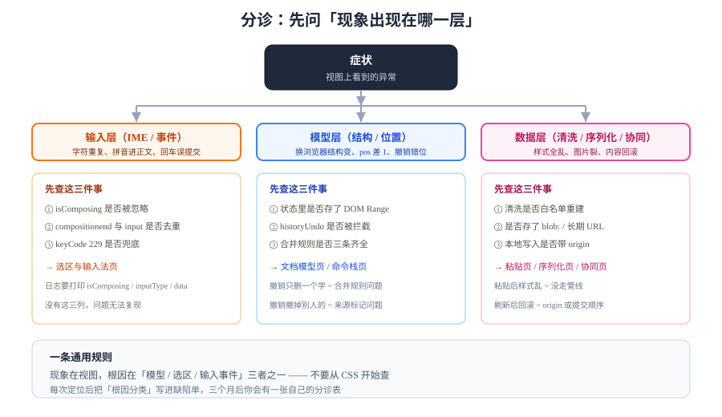

# 常见问题与最佳实践

这一页按"症状 → 可能原因 → 去看哪一页"组织。富文本的 bug 有一个共同点：**现象出现在视图上，根因几乎总在模型、选区或输入事件三处之一。**

## 判据族声明

本页判据族 `EDQ-A` ~ `EDQ-G`，共 7 条。定义表在第五节。

## 一、八类症状分诊

| 症状 | 最可能的原因 | 去看 |
| --- | --- | --- |
| 打字时**字符重复** | `compositionend` 与 `input` 各插了一次；或视图重绘后又触发了一次模型更新 | [选区与输入法](../SelectionIME/index.md) 第三节 |
| 中文输入法**拼音进了正文** | 在 `compositionupdate` 里写了模型 | [选区与输入法](../SelectionIME/index.md) 第三节 |
| **光标跳到段首/行尾** | 整块重绘后没复位选区，或复位时机过早（同步/微任务） | [选区与输入法](../SelectionIME/index.md) 第五节 |
| **撤销行为不稳定** | 浏览器原生 undo 与自研历史同时生效；接协同后没关内置 history | [命令栈](../CommandStack/index.md) 第四节 · [接协同](../CollabIntegration/index.md) 第三节 |
| 撤销**只删一个字** | 合并规则缺时间窗/类型/相邻判断；输入法一次上屏被拆成多步 | [命令栈](../CommandStack/index.md) 第三节 |
| 粘贴后**样式全乱** | 直接 `innerHTML` 插入未清洗内容 | [粘贴与清洗](../PasteSanitize/index.md) 第二节 |
| 粘贴后**图片裂了** | 存了 `blob:` URL；或附件 URL 过期 | [粘贴与清洗](../PasteSanitize/index.md) 第五节 |
| 协同后**内容回滚/翻倍** | 本地写入没带 `origin`，被当成远端更新再应用一次 | [接协同](../CollabIntegration/index.md) 第二节 |
| 换浏览器**结构变了** | 数据源是 DOM 而不是模型 | [文档模型](../DocumentModel/index.md) 第一节 |
| 导出**少格式** | 目标格式表达力不足（如 Markdown 无合并单元格） | [序列化](../Serialization/index.md) 第六节 |

## 二、十二个高频问题

### 1. 用 `contenteditable` 加 `execCommand` 能撑多久？

小工具可以，产品不行。`execCommand` 已废弃，且 `innerHTML` 不是稳定数据。三个月内你会遇到"换浏览器结构变了"和"撤销撤不干净"两件事。见[概述](../Overview/index.md)第二节。

### 2. Tiptap / Lexical / Slate / Quill 怎么选？

按三个问题筛：需要协同吗（有官方 Yjs 绑定优先）、需要自定义节点吗（ProseMirror 系最强）、团队愿意维护 schema 吗（不愿意就用 Quill/StarterKit）。版本与体积对比见[专题首页](../index.md)。

### 3. 为什么我的 `pos` 总是差 1？

ProseMirror 的位置计数包含节点边界：两个各 2 字的段落，`doc.content.size` 是 **8** 不是 4。见[文档模型](../DocumentModel/index.md)第四节。

### 4. 输入法上屏后多了一个字，怎么查？

先确认 `compositionend` 之后是否又处理了 `input`。加一条日志打印 `isComposing` 与 `inputType`，两秒就能定位。见[选区与输入法](../SelectionIME/index.md)第三节。

### 5. 为什么在链接后面打字，字也变蓝了？

`link` 标记没设 `inclusive: false`。见[文档模型](../DocumentModel/index.md)第三节。

### 6. 粘贴 Word 内容怎么才能不炸？

不要试图"尽力保留格式"。走五步管线，白名单只留语义标签，`style` 一律丢。见[粘贴与清洗](../PasteSanitize/index.md)。

### 7. 内容存 JSON 还是 HTML？

**JSON 存，HTML 缓存**。理由有六条，见[序列化](../Serialization/index.md)第二节。

### 8. 接协同后 `Ctrl+Z` 撤掉了别人的内容，怎么办？

两件事：关掉编辑器内置 history；用 `Y.UndoManager` 的 `trackedOrigins` 只记录本地来源。见[接协同](../CollabIntegration/index.md)第三节。

### 9. 为什么两个标签页同时编辑，刷新后少了一段？

大概率是"本地写入没带 origin"，或者"提交顺序与广播顺序不一致"。先在 DevTools 里看 `ydoc.on('update')` 的 `origin` 是不是 `null`。见[接协同](../CollabIntegration/index.md)第二节。

### 10. 编辑器页面越用越卡，是内存泄漏吗？

先看 `EditorView` 有没有 `destroy()`。路由切换 10 次后若内存单调上升，基本可以确认。见[实战](../Practice/index.md)第四节。

### 11. 移动端光标被键盘挡住了怎么办？

监听 `visualViewport.resize` 并滚动光标到可视区中部。见[选区与输入法](../SelectionIME/index.md)第六节。

### 12. `EditContext` 能替代 `contenteditable` 了吗？

2026-10 还不能：Firefox 与 Safari 都不支持。可以作为 Chromium 系的增强路径。见[选区与输入法](../SelectionIME/index.md)第七节。

## 三、十二条最佳实践

1. **数据源只有一份**：模型是唯一真相，DOM 与 HTML 都是派生物。
2. **所有变更走一个入口**：事务/命令，禁止直接改 DOM。
3. **输入法期一律放行**：`isComposing || keyCode === 229` 时不写模型、不拦 `beforeinput`。
4. **粘贴与拖拽共用一条管线**：少一条就多一个 XSS 入口。
5. **清洗用白名单重建**，不用黑名单、不用正则。
6. **服务端按同一份 schema 再校验一次**：前端防线一定会被绕过。
7. **撤销粒度是事务**，合并规则写死并配测试。
8. **切文档清空历史**：跨文档撤销是数据事故。
9. **落库带 `schema_version`**，迁移函数幂等且可 dry-run。
10. **编辑器实例必须销毁**：`destroy()` 写在 `onBeforeUnmount`/`useEffect` 清理里。
11. **协同字段与业务字段分开**：文本走 CRDT，状态/金额走乐观锁。
12. **每次依赖升级都查一遍 `prosemirror-view`**：粘贴路径出过 CVE（< 1.42.3）。

## 四、术语速查

| 术语 | 含义 |
| --- | --- |
| **文档模型**（document model） | 编辑器内部唯一可信的数据结构 |
| **schema** | 文档的文法：哪些节点允许装哪些内容 |
| **事务**（transaction） | 一组原子变更 + 选区变化，撤销的粒度 |
| **步骤**（step） | 最小变更单元，自带逆操作 |
| **组合期**（composition） | 输入法"还没提交"的阶段，DOM 里可能是拼音 |
| **`beforeinput`** | 可取消的输入事件，统一输入入口 |
| **相对位置**（relative position） | 绑定在元素 ID 上的位置，并发安全 |
| **origin** | 变更来源标记，用于防止本地→远端→本地的回环 |
| **往返测试**（round-trip） | `doc → html → doc` 后结构等价的断言 |
| **原子节点**（atom） | 不可进入内部编辑、整块删除的节点（如 @提及） |
| **presence / awareness** | 临时在线状态（光标、在线人），不入库 |
| **plaintext-only** | `contenteditable` 的纯文本模式（Firefox 136+ 支持） |
| **EditContext** | 浏览器把文本输入与渲染解耦的实验性 API |
| **CVE-2026-104847** | `prosemirror-view` < 1.42.3 的粘贴路径 XSS |

## 五、判据表

| 编号 | 约定 | 定错了会怎样 | 怎么验证没被破坏 |
| --- | --- | --- | --- |
| `EDQ-A` | 每个"现象"都必须能归到模型/选区/输入三类之一 | 靠猜修 bug，越修越多 | 缺陷单里有"根因分类"字段，且不为"其他" |
| `EDQ-B` | 输入法相关问题必须附事件序列日志 | 无法复现，只能"再试试" | 缺陷单里有 `composition*` / `beforeinput` 的打印 |
| `EDQ-C` | 撤销类问题必须说明"走了哪套历史" | 两套 undo 打架查不出来 | 缺陷单里写明 `history` 或 `UndoManager` |
| `EDQ-D` | 粘贴类问题必须附恶意样例 | 修了一个绕过，还有十个 | 缺陷单里带 HTML 样本 |
| `EDQ-E` | 协同类问题必须给出两个客户端的操作序列 | "偶发"永远修不掉 | 缺陷单里有可重放的步骤与网络条件 |
| `EDQ-F` | 依赖升级后必须复查安全公告 | 命中已知 CVE | 升级 PR 里附 `pnpm why <pkg>` 与公告链接 |
| `EDQ-G` | 每条最佳实践都要能指向一个判据编号 | 规范变成口号 | 本页十二条里至少八条能对上前面各页的判据 |

## 参考资料

- [ProseMirror Discuss](https://discuss.prosemirror.net/)——大量真实 IME / 选区问题的一手讨论
- [Tiptap · Troubleshooting](https://tiptap.dev/docs/editor/getting-started/troubleshoot)——SSR 与 hydration 的常见错误
- [Lexical · FAQ](https://lexical.dev/docs/faq)——节点与命令的常见误用
- [Yjs · Docs](https://docs.yjs.dev/)——`origin`、`UndoManager`、相对位置
- [CVE-2026-104847](https://www.tenable.com/cve/CVE-2026-104847)——`prosemirror-view` 粘贴路径 XSS
