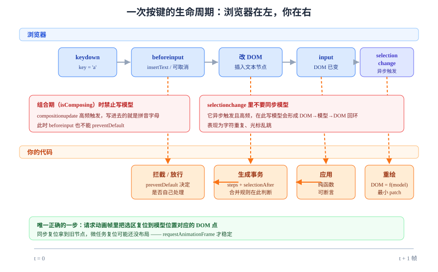

# 概述：三种做法与五步决策

富文本编辑器的第一道分叉不在技术栈，而在**"你打算让浏览器的 DOM 当数据源，还是自己拿一份模型当数据源"**。这个决定一旦定错，后面所有功能（撤销、粘贴、协同、导出）都会以 3 倍的成本补回来。



## 判据族声明

本页判据族 `RTE-A` ~ `RTE-H`，共 8 条。定义表在第七节。

## 一、四个不变量：编辑器"能用了"的判据

一个富文本编辑器在工程上算"及格"，要同时守住四条不变量。任何一条破了，用户就会在某个时刻骂人：

| 不变量 | 具体含义 | 破了的典型症状 |
| --- | --- | --- |
| **模型合法** | 任何时刻的文档都满足 schema（不允许 `<p>` 里嵌 `<p>`、不允许表格里放裸文本） | 某次粘贴后整页样式崩了、导出 PDF 时结构错乱 |
| **视图一致** | DOM 是模型的函数，模型不变则 DOM 不该变 | 打字时整段重排、光标跳到段首 |
| **光标稳定** | 用户改的位置就是光标停的位置，撤销后回到"刚才那个位置附近" | 中文输入法上屏后光标跳到行尾 |
| **内容可信** | 进入模型的每一个节点都经过白名单，且**服务端再校验一次** | 一次粘贴触发 XSS、`onerror` 被存进数据库 |

::: tip 判断要不要自研的一句话
如果你能说出"我的内容结构必须由我定义、且它要和表单/协同/导出打交道"，就该用受控模型；如果只是"让用户写点带加粗的说明"，用 Markdown 或现成编辑器，别自研。
:::

## 二、三种做法：从最省事到最可控

| 做法 | 代表 | 数据源 | 可控性 | 协同难度 | 适用 |
| --- | --- | --- | --- | --- | --- |
| **A. DOM 直改** | `contenteditable` + `document.execCommand` + 自己读 `innerHTML` | 浏览器的 DOM | 极低 | 极高（DOM 无稳定坐标系） | 只读展示、极简输入框、内部工具 |
| **B. 受控模型** | ProseMirror / Tiptap / Slate / Lexical / Quill 2 | 自己的文档树 | 高 | 中（模型可映射到 CRDT/OT） | 内容型产品的主力选择 |
| **C. 结构化块** | Notion 式块编辑器、BlockNote | 块数组 | 最高（但表达力被块约束） | 低（块级并发友好） | 协作文档、知识库、低代码内容区 |

### A 路线为什么"看起来能跑，实际上跑不远"

```javascript
// 最常见的 A 路线写法：用 execCommand 加粗，再从 innerHTML 取值
const el = document.querySelector('#editor');
document.querySelector('#bold').onclick = () => {
  el.focus();
  document.execCommand('bold');           // 已废弃，但各浏览器仍实现
};
const value = () => el.innerHTML;         // 这里就是全部问题的源头
```

三个致命点：

1. **`execCommand` 已废弃**（`Document.execCommand` 在规范里标为 obsolete），行为由浏览器各自维护，未来不保证一致；
2. **`innerHTML` 不是数据**：同一段"加粗的你好"在 Chrome 是 `<b>你好</b>`、在 Firefox 可能是 `<span style="font-weight:bold">你好</span>`，你的后端无法稳定解析；
3. **回车产物因浏览器而异**：Chrome 常插 `<div>`、Firefox 插 `<br>`、Safari 插 `<p>`——同一个用户换台机器，内容结构就变了。

::: danger A 路线上最容易踩的三个坑
1. **用正则清洗 `innerHTML`**：HTML 不是正则语言，`` 有几十种绕过写法。必须用 DOM 解析 + 白名单重建。
2. **把 `innerText` 当"纯文本"**：`innerText` 受 CSS 影响（`display:none` 的内容不计入、`text-transform` 会改大小写），换设备结果不同。要纯文本用 `textContent`。
3. **直接在 `input` 事件里改 DOM**：`input` 触发时浏览器已经开始维护自己的选区，此时改 DOM 会让光标错位。改模型的入口应该是 `beforeinput`（可取消）。
:::

### B 路线的最小闭环

```typescript
// 受控模型的心智模型：状态 → 事务 → 新状态 → 视图
type EditorState = {
  doc: DocNode;                 // 唯一可信的数据
  selection: { from: number; to: number };
};

type Transaction = {
  steps: Step[];                // 每一个 step 都自带逆操作
  selectionAfter?: { from: number; to: number };
};

// 用户输入 → 生成事务 → 应用 → 重绘视图（视图永远不反过来改模型）
function dispatch(tr: Transaction) {
  const next = applyTransaction(state, tr);
  state = next;
  renderView(next);             // 渲染是纯函数，可断言
}
```

这个闭环带来的三个直接好处：**可测试**（模型是纯数据，能跑在 Node 里）、**可协同**（事务就是操作，能发给别人）、**可回滚**（step 可逆）。

### C 路线什么时候更合适

块编辑器的取舍非常明确：**它用"表达力"换"并发友好度"**。一个块内部的并发仍然要算法解决，但块与块之间天然可并行——两个人改不同段落时几乎没有冲突。如果产品形态是"协作文档/知识库"，C 路线常常比"自研一个 Word"更快出成果。

## 三、四种不该用富文本的场景

| 场景 | 为什么不该用 | 更好的做法 |
| --- | --- | --- |
| 只要"少量格式"（加粗、链接、列表） | 富文本的输入法、粘贴、撤销成本远大于收益 | Markdown 输入 + 预览，或 `textarea` + 受限语法 |
| 内容要严格结构化（金额、日期、枚举） | 富文本天生自由，自由就是脏数据的来源 | 表单 + 结构化字段 |
| 复杂排版（分栏、页眉页脚、公式混排） | 浏览器不是排版引擎，最终要导出 PDF 时会全盘重做 | 专业排版工具或服务端渲染排版引擎 |
| 只读展示 | 展示端只需要"渲染"，不需要"编辑" | 存结构化 JSON + 只读渲染器（还能天然防 XSS） |

::: warning "先用富文本，以后再改"是伪选项
内容一旦以 HTML 形式落库，迁移成本会随数据量线性增长，且**旧数据里已经混进了各家浏览器的产物**。第 7 页会给出"存 JSON 而不是存 HTML"的完整理由。
:::

## 四、编辑器不是表单控件：三个结构性差别

很多团队在排期时把它当"一个 `Input` 组件"，于是估 2 天，做了 3 周。差别在这三处：

| 维度 | 普通表单控件 | 富文本编辑器 |
| --- | --- | --- |
| **值** | 一个字符串 | 一棵树（或一个块数组）+ 一份选区 |
| **变更来源** | 用户输入 | 用户输入、输入法、粘贴、拖拽、程序化命令、远端同步 |
| **一致性** | 改了就变了 | 视图可能领先于模型（输入法组合期）、模型可能领先于视图（协同补拉） |

第二行决定了你必须有一个**统一入口**（事务），第三行决定了你必须处理**"视图与模型短暂不一致"**的合法状态——这正是[选区与输入法](../SelectionIME/index.md)那一页的全部内容。

## 五、五步决策路径

```text
① 内容结构固定吗？
   ├─ 不固定（自由写作） → 走 B/C 路线，用成熟库
   └─ 固定（少量字段）   → 走 Markdown 或表单，别上富文本
② 需要多人同时编辑吗？
   ├─ 是 → 选有官方协同绑定的（Tiptap/ProseMirror + Yjs、Lexical + Yjs）
   └─ 否 → 只看体积与生态
③ 内容要导出成别的格式吗（PDF/Word/Markdown）？
   ├─ 是 → 模型必须是结构化的，且序列化测试要当一等公民
   └─ 否 → HTML 输出足以
④ 团队能维护 schema 吗？
   ├─ 能 → 自定 schema（表达力最好）
   └─ 不能 → 用 StarterKit 之类现成集合，别造节点
⑤ 安全边界在哪？
   └─ 任何答案都要有「服务端二次校验 + 白名单」，见第 5 页
```

## 六、一次按键的完整生命周期

以"用户按下 `a`"为例，按时间顺序会发生这些事（顺序是规范定义的，但**各浏览器在输入法介入时会打乱**）：

| 阶段 | 事件 / 动作 | 谁的职责 |
| --- | --- | --- |
| 1 | `keydown`（`key === 'a'`） | 快捷键拦截（`Ctrl+B` 这类） |
| 2 | `beforeinput`（`inputType: 'insertText'`） | **你的拦截点**：可 `preventDefault()` 改为自己处理 |
| 3 | 浏览器改 DOM，触发 `input` | 若走受控模型，此处的 DOM 变化应被忽略 |
| 4 | 生成事务、应用、重绘视图 | 你的代码 |
| 5 | `selectionchange` | 浏览器异步触发，**不要在这里改模型** |
| 6 | 选区恢复到模型位置对应的 DOM 点 | 你的代码（关键一步） |

::: danger 第 5 步是重灾区
`selectionchange` 是**异步**的：它在 DOM 已经变化之后才触发，而且输入法组合期间会高频触发。在这里做"同步模型"会形成"DOM → 模型 → DOM"的回环，表现为**打字时字符重复、光标乱跳**。正确做法是把 `selectionchange` 只当作"用户真的移动了光标"的信号，并在 `isComposing` 为真时直接忽略。
:::

## 七、判据表

| 编号 | 约定 | 定错了会怎样 | 怎么验证没被破坏 |
| --- | --- | --- | --- |
| `RTE-A` | 落库的内容必须是**结构化模型**（JSON），HTML 只能作为派生缓存 | 换浏览器或升级库后解析失败，历史数据无法迁移 | 数据库里存 HTML 的字段数为 0，或明确标注为"可重建缓存" |
| `RTE-B` | 所有内容变更必须经**唯一入口**（事务/命令），禁止直接改 DOM | 撤销、协同、脏检查全部失效 | 全仓 `grep` 编辑器容器上的 `innerHTML =` 命中数为 0 |
| `RTE-C` | 视图渲染必须是模型的**纯函数** | 同一份模型渲染出两种结果，协同后出现"两个人看到的不一样" | 用同一模型渲染两次，DOM 快照逐字节相等 |
| `RTE-D` | 必须能回答"回车产生什么节点" | 不同浏览器产出不同结构，导出与协同全部错乱 | 三个浏览器各按一次回车，模型里都是同一个节点类型 |
| `RTE-E` | 选型必须绑定"是否需要协同" | 选了没有协同绑定的库，后期要么换库要么自己写 OT | 选型文档里有协同方案一栏，且写明绑定库与版本 |
| `RTE-F` | 不得把"少量格式"的需求做成自研富文本 | 3 人月换一个只用加粗的功能 | 需求清单里允许的节点类型 ≤ 5 且不含表格/图片 |
| `RTE-G` | 编辑器必须有"模型层可单测"的能力 | 所有测试都要起浏览器，CI 慢且不稳定 | 存在不依赖 DOM 的模型层测试文件，且在 Node 环境下通过 |
| `RTE-H` | 任何"粘贴进去就行"的结论都必须附一段恶意样例 | XSS 与样式污染只能靠构造样本发现 | 测试用例里至少有一条含 `` 与一条含 `mso-` 样式 |

## 如何验证

在浏览器控制台执行下面三段，能亲手看到"DOM 不可信"这件事：

```javascript
// ① 同一个「加粗」在不同浏览器/不同来源下的产物不同
const d = document.createElement('div');
d.contentEditable = 'true';
d.innerHTML = '<b>你好</b>';
console.log(d.innerHTML);        // Chrome: <b>你好</b>

// ② 浏览器会"修正"你写进去的非法结构（这就是为什么不能拿 DOM 当模型）
const p = document.createElement('div');
p.innerHTML = '<p>外层<p>内层';
console.log(p.innerHTML);        // 浏览器自动补成两个并列 <p>，嵌套被抹平

// ③ 回车产物：把光标放进编辑区按一次回车，再读 innerHTML
// Chrome 常见 <div><br></div>，Firefox 常见 <br>，Safari 常见 <p><br></p>
```

**预期输出**：① 输出 `<b>你好</b>`；② 输出 `<p>外层</p><p>内层</p>`（**嵌套被浏览器自动改写**，这是"DOM 不是数据"的最直接证据）；③ 三种浏览器的 `innerHTML` 互不相同。

如果 ② 的输出和你写进去的一样，说明你用的浏览器版本较旧——这恰好说明**行为随浏览器版本变化**，更加不能依赖它。

## 参考资料

- [ProseMirror Guide · Introduction](https://prosemirror.net/docs/guide/#intro)——"为什么需要受控模型"的官方论述
- [MDN · contenteditable](https://developer.mozilla.org/en-US/docs/Web/HTML/Global_attributes/contenteditable)——`plaintext-only` 的兼容表
- [MDN · Document.execCommand](https://developer.mozilla.org/en-US/docs/Web/API/Document/execCommand)——废弃状态说明
- [W3C Input Events Level 2](https://www.w3.org/TR/input-events-2/)——`beforeinput` 与 `inputType` 清单
- [Lexical · Introduction](https://lexical.dev/docs/intro)——"编辑器框架而非编辑器"的定位
