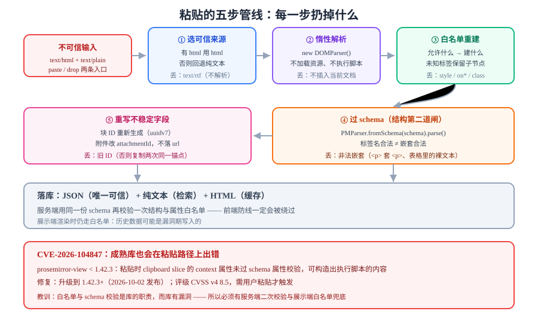

# 粘贴与内容清洗

如果只能在一个位置做安全加固，选**粘贴**。原因是：这是唯一一个"外部不受控 HTML 直接进入你的文档"的通道，也是绝大多数富文本 XSS 的真实入口。



## 判据族声明

本页判据族 `PST-A` ~ `PST-H`，共 8 条。定义表在第八节。

## 一、四条来源，四种脏数据

| 来源 | `clipboardData` 里有什么 | 典型污染 |
| --- | --- | --- |
| **Word / WPS** | `text/html` 带 `mso-*` 样式、`<o:p>`、`<!--[if ...]>` 注释 | 40+ 个内联样式、`<span style="font-family:宋体">`、表格宽度写死 |
| **网页** | 整段站点的结构（`<article>`、`<figure>`、内联 `<style>`） | 站点样式泄漏、外链图片、`class` 冲突 |
| **同产品另一个编辑器** | 自己的 schema 产物 | 节点 ID 重复（复制粘贴）、`attrs` 里的越权字段 |
| **纯文本** | `text/plain` | 换行符差异（`\r\n` vs `\n`）、制表符 |

::: danger 只处理 `text/html` 会漏掉一半攻击面
`event.clipboardData.getData('text/html')` 拿到的是**攻击者可控的字符串**，但还有两条旁路：
1. **拖拽**（`insertFromDrop`）：`dataTransfer` 里同样有 HTML，且**不触发 `paste` 事件**；
2. **程序化写入**：某些浏览器扩展/自动化工具直接调用 `insertHTML`。

所以清洗必须挂在**统一的输入入口**（`beforeinput` 或编辑器的 `handlePaste` + `handleDrop`），而不是只挂 `paste`。
:::

## 二、五步管线

### 第 1 步：选择可信来源

```typescript
function pickSource(dt: DataTransfer) {
  const html = dt.getData('text/html');
  const text = dt.getData('text/plain');
  // 优先 text/html（保留格式），但必须走白名单；没有 HTML 才回退纯文本
  return html ? { kind: 'html' as const, html } : { kind: 'text' as const, text };
}
```

### 第 2 步：解析成独立的 DOM（不是插进页面！）

```typescript
function parseDetached(html: string): Document {
  // DOMParser 生成的文档不加载资源、不执行脚本 —— 这是关键
  return new DOMParser().parseFromString(html, 'text/html');
}
```

**为什么不用 `div.innerHTML = html`**：那样会在**当前文档**里创建节点，`` 在插入的瞬间就可能触发（取决于浏览器与插入方式），而且 `<script>` 之外还有 `<svg onload>`、`<iframe srcdoc>` 等路径。`DOMParser` 的惰性文档不执行任何东西。

### 第 3 步：白名单重建（不是"删除黑名单"）

```typescript
const ALLOWED: Record<string, string[]> = {
  p: [], br: [], strong: [], em: [], u: [], s: [],
  h2: [], h3: [], ul: [], ol: [], li: [], blockquote: [],
  code: [], pre: [],
  a: ['href', 'title'],
  img: ['src', 'alt'],
};

const PROTOCOL_OK = /^(https?:|mailto:|\/)/i;

function cleanNode(src: Node, doc: Document): Node | null {
  if (src.nodeType === Node.TEXT_NODE) {
    return doc.createTextNode(src.nodeValue ?? '');
  }
  if (src.nodeType !== Node.ELEMENT_NODE) return null;

  const el = src as HTMLElement;
  const tag = el.tagName.toLowerCase();
  const allowedAttrs = ALLOWED[tag];
  if (!allowedAttrs) {
    // 不在白名单：保留子节点（丢弃标签本身），而不是整段删掉
    const frag = doc.createDocumentFragment();
    el.childNodes.forEach((c) => {
      const cleaned = cleanNode(c, doc);
      if (cleaned) frag.appendChild(cleaned);
    });
    return frag;
  }

  const out = doc.createElement(tag);
  for (const name of allowedAttrs) {
    const v = el.getAttribute(name);
    if (v == null) continue;
    if ((name === 'href' || name === 'src') && !PROTOCOL_OK.test(v.trim())) continue;
    out.setAttribute(name, v);
  }
  el.childNodes.forEach((c) => {
    const cleaned = cleanNode(c, doc);
    if (cleaned) out.appendChild(cleaned);
  });
  return out;
}
```

三条纪律：

1. **白名单是"允许什么"，不是"禁止什么"**。黑名单永远漏（`<svg><animate onbegin>` 这类组合是无穷的）。
2. **不允许的标签默认"保留子节点"**（`<div>` 拆成内容），否则粘一段网页会丢光文字。
3. **协议白名单必须做**：`javascript:`、`data:text/html`、`vbscript:` 都是链接与图片的经典入口。`data:image/png;base64` 若业务需要，要单独放行并限制大小。

### 第 4 步：转成模型（用 schema 再校验一次）

白名单只保证"标签名与属性合法"，**不保证结构合法**。`<p><p>文字</p></p>` 这种嵌套在白名单里是合法的，但 schema 会拒绝。所以第 4 步必须走 schema 的解析器：

```typescript
import { DOMParser as PMParser } from 'prosemirror-model';

function htmlToDoc(clean: Node, schema: Schema) {
  const wrapper = document.createElement('div');
  wrapper.appendChild(clean.cloneNode(true));
  const doc = PMParser.fromSchema(schema).parse(wrapper);
  return doc;   // 这一步会抛错或丢弃非法结构，是第二道闸
}
```

### 第 5 步：重写不稳定字段（ID、链接）

```typescript
function rewriteForPaste(doc: DocNode): DocNode {
  // 顶层块重新发 ID：防止"复制同一块两次"产生重复锚点
  return {
    ...doc,
    content: (doc.content ?? []).map((b) => ({
      ...b,
      attrs: { ...b.attrs, id: crypto.randomUUID() },
    })),
  };
}
```

## 三、必须升级的一个 CVE（2026-10）

| 项 | 内容 |
| --- | --- |
| 编号 | **CVE-2026-104847** / GHSA-c8x8-7fp4-3x9w |
| 影响 | `prosemirror-view` **< 1.42.3** |
| 成因 | 粘贴处理接受了攻击者构造的 HTML，其中 **clipboard slice 的 context 属性未经过 schema 属性校验**，可构造出能执行脚本的内容 |
| 修复 | 升级到 **1.42.3+**（2026-10-02 发布） |
| 评级 | CVSS v4 **8.5**（High），攻击需要用户交互（粘贴） |

::: danger 这条 CVE 的教训比补丁本身重要
**"我用的是成熟库，所以粘贴是安全的"这个假设不成立。** 白名单与 schema 校验是**库的职责**，而库会有漏洞。工程上必须做三件事：

1. **前端清洗不是唯一防线**：落库前服务端再按同一份 schema 校验一次（判据 `PST-E`）；
2. **依赖要能被打补丁**：`prosemirror-view` 这类间接依赖要通过 `pnpm why prosemirror-view` 能查到实际版本；
3. **展示端也要防**：把 JSON 渲染成 HTML 时仍然走白名单（判据 `PST-G`），因为历史数据可能是漏洞期写入的。
:::

```shell
# 查你工程里实际装的是哪个版本（含间接依赖）
pnpm why prosemirror-view
# 预期输出里能看到 1.42.3 或更高；若低于 1.42.3 立即升级

pnpm add prosemirror-view@latest
```

## 四、Word 内容的三个专属处理

| 现象 | 原因 | 处理 |
| --- | --- | --- |
| 粘进来一堆 `font-family:宋体` | Word 用 `mso-*` 与内联样式表达格式 | 第 3 步白名单直接丢掉 `style` 属性 |
| 出现空的 `<o:p></o:p>` | Word 的命名空间标记 | 不在白名单 → 保留子节点（无子节点即消失） |
| 表格宽度写死、列宽错乱 | `<table width="600">` 与 `mso-column` | 要么整体拒绝表格，要么只保留 `colspan`/`rowspan` 并重算宽度 |

::: tip `text/rtf` 不要碰
Word 有时会同时提供 `text/rtf`。RTF 是一个完整的标记语言，自己解析得不偿失，**忽略它**，用 `text/html` 即可。
:::

## 五、图片粘贴：从 blob 到对象存储

粘贴截图时，`clipboardData` 里是 `File` 而不是 URL。推荐流程（与常见的对象存储预签名直传方案一致）：

```text
① paste 事件里读 files[0]（image/*）
② 立刻插入一个「占位节点」（带本地 blob URL，先让用户看到图）
③ 用预签名 URL 直传对象存储
④ 上传成功 → 把占位节点的 src 换成正式 URL（并写入 attrs.key）
⑤ 上传失败 → 占位节点变红 + 重试按钮，不要静默删除
```

四条纪律：

1. **不要把 `blob:` URL 落库**——刷新后必失效；
2. **占位节点必须能表达"上传中"状态**，否则用户以为图丢了；
3. **限制大小与类型**（前端拦一次，服务端再拦一次）；
4. **正式 URL 要走签名或 CDN**，不要把桶暴露成公开读。

## 六、服务端二次校验（同一份 schema）

```typescript
// 服务端（Node）用同一份 schema 校验客户端提交的 JSON
import { schema } from '../shared/schema';        // 与前端同一份文件
import { Node as PMNode } from 'prosemirror-model';

export function assertValidDoc(json: unknown): PMNode {
  const doc = PMNode.fromJSON(schema, json as any);  // 非法结构会抛错
  const size = JSON.stringify(json).length;
  if (size > 256 * 1024) throw new Error('DOC_TOO_LARGE');
  return doc;
}
```

::: warning `Node.fromJSON` 会校验结构，但不校验"语义"
它保证节点类型与嵌套合法，**不保证 `href` 不是 `javascript:`**。所以服务端要做的检查是两件：`fromJSON`（结构）+ 属性白名单（语义）。两件都不能省。
:::

## 七、清洗结果的自检清单

| 检查项 | 期望 |
| --- | --- |
| 粘一段带 `<style>` 的网页 | 模型里没有任何 `style` 属性 |
| 粘 `` | 无弹窗，`src` 被协议白名单拒绝 |
| 粘 `<a href="javascript:alert(1)">x</a>` | 链接标记被丢弃或 `href` 被清空 |
| 粘同一段内容两次 | 两块 ID 不同 |
| 粘 Word 段落 | 只有 `p` / `strong` / `em` / `ul` 等白名单节点 |
| 拖拽一段 HTML 到编辑器 | 与粘贴结果一致（走同一管线） |

## 八、判据表

| 编号 | 约定 | 定错了会怎样 | 怎么验证没被破坏 |
| --- | --- | --- | --- |
| `PST-A` | 清洗必须用白名单重建，禁止黑名单过滤或正则替换 | 总有绕过写法，XSS 长期存在 | 清洗函数里没有 `replace(/<script/` 这类代码 |
| `PST-B` | 解析必须在惰性文档里做（`DOMParser`），不得先插入当前文档 | 解析瞬间就可能触发 `onerror`/`onload` | 清洗链路里没有对可见 DOM 的 `innerHTML` 赋值 |
| `PST-C` | 粘贴与拖拽必须共用同一条管线 | 拖拽成为绕过清洗的旁路 | `handlePaste` 与 `handleDrop` 调用同一个函数 |
| `PST-D` | `href`/`src` 必须过协议白名单 | `javascript:` 链接可执行 | 构造 `javascript:` 链接粘贴，模型里无该 `href` |
| `PST-E` | 服务端必须用同一份 schema 二次校验 | 前端被绕过（改包、脚本注入）后脏数据直接落库 | 直接 `curl` 提交非法 JSON，接口返回 4xx |
| `PST-F` | 粘贴必须重写块 ID | 复制粘贴后锚点重复，评论挂错位置 | 复制一块再粘贴，两块 `attrs.id` 不同 |
| `PST-G` | 展示端渲染也必须走白名单 | 历史脏数据在展示时执行脚本 | 手工往库里塞一条含 `onerror` 的 JSON，页面无弹窗 |
| `PST-H` | `prosemirror-view` 必须 ≥ 1.42.3 | 命中 CVE-2026-104847 | `pnpm why prosemirror-view` 输出版本号 ≥ 1.42.3 |

## 如何验证

一段可以直接放进单元测试的恶意样例（不需要浏览器，用 `jsdom` 或 `happy-dom` 即可）：

```javascript
const evil = `
  <p style="color:red" onclick="alert(1)">正常文字</p>
  
  <a href="javascript:alert(3)">点我</a>
  <svg><animate onbegin="alert(4)" attributeName="x" dur="1s"></animate></svg>
  <iframe srcdoc="<script>alert(5)</script>"></iframe>
  <o:p></o:p>
`;

const d = new DOMParser().parseFromString(evil, 'text/html');
const cleaned = cleanNode(d.body, document);   // 用本页第 3 步的实现
const host = document.createElement('div');
host.appendChild(cleaned);
console.log(host.innerHTML);
```

**预期输出**：只剩 `<p>正常文字</p>`（`style`/`onclick` 被丢）、一个 `src="x"` 被协议白名单拒绝的图片处理结果（`img` 保留但无 `src`）、`<a>点我</a>`（无 `href`）、svg/iframe/`o:p` 全部消失。

如果输出里出现任何 `on*` 属性、`javascript:` 或 `<svg>`，说明白名单有漏，**不要上线**。

## 九、与「分片上传」的分工

本页讲**粘贴进来的图片怎么变成附件**：blob → 预签名 → 直传五步、服务端二次校验、六项自检。**「大于 25 MiB 的文件怎么传」属于传输协议层**，见[在线协作任务看板 · 分片上传](/project/Complete/TeamBoard/MultipartUpload/index.md)。

分界线很清楚：编辑器只管「把选中的字节交出去」，**不管它被切成几片**。

| 关注点 | 本页 | 分片上传那页 |
| --- | --- | --- |
| 触发时机 | 粘贴 / 拖放 / 选图 | 上传器拿到 `File` 之后 |
| 大小上限 | 25 MiB 以内直接 `PUT` | > 25 MiB 走 multipart |
| 校验 | MIME 白名单 + 服务端二次校验 | 分片 MD5（`InvalidPart`）+ 文件级 `sha256` |
| 失败处理 | 提示「图片过大」 | 单分片重试、`uploadId` 续传 |

::: danger 本页特有的一个坑：ETag 不能当图片哈希
粘贴链路里常用「上传后比对 ETag 判断是不是同一张图」。**单次 `PUT` 时 ETag 是内容 MD5，但走分片后 ETag 变成 `MD5(分片 MD5 拼接) + "-N"`**，与整图 MD5 完全不同。
一旦某天上传器从「单次 PUT」切到「分片」，这条比对会**静默失效**（永远不相等，于是每次都当作新图），而不是报错。要用就去用自己算的 `sha256`。
:::

## 参考资料

- [CVE-2026-104847](https://www.tenable.com/cve/CVE-2026-104847) · [GHSA-c8x8-7fp4-3x9w](https://github.com/ProseMirror/prosemirror-view/security/advisories/GHSA-c8x8-7fp4-3x9w)——粘贴路径 XSS，修复于 1.42.3
- [OWASP · XSS Prevention Cheat Sheet](https://cheatsheetseries.owasp.org/cheatsheets/Cross_Site_Scripting_Prevention_Cheat_Sheet.html)——白名单与输出编码的通用原则
- [MDN · DOMParser](https://developer.mozilla.org/en-US/docs/Web/API/DOMParser)——惰性文档不执行脚本的说明
- [ProseMirror · Parsing HTML](https://prosemirror.net/docs/guide/#schema.parse)——schema 解析器的行为与容错
- [W3C · Clipboard API](https://www.w3.org/TR/clipboard-apis/)——`DataTransfer` 的类型与读写顺序
