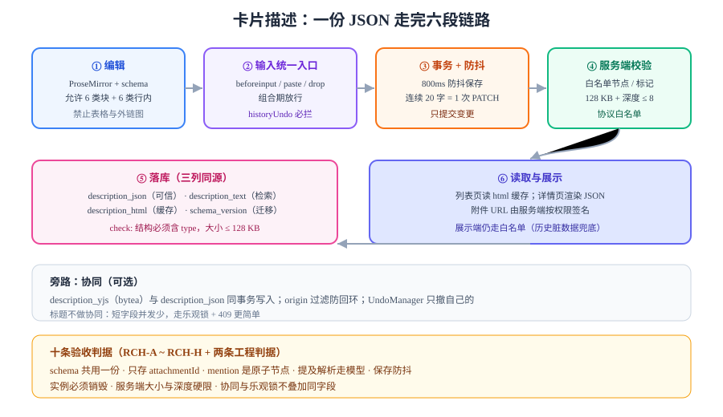

# 实战：给卡片描述做一个可交付的富文本字段

这一页把前七页的结论压成一条可执行的施工路线：**在协作看板里，为卡片加一个"带格式的描述"字段**。它要满足四个约束：允许少量格式、能粘贴、能被服务端校验、接入协同时不出错。



## 判据族声明

本页判据族 `RCH-A` ~ `RCH-H`，共 8 条。定义表在第九节。

## 一、先定口径（不写代码就能定完）

| 项 | 决定 | 理由 |
| --- | --- | --- |
| 允许的块 | `paragraph`、`heading(level=3)`、`bullet_list`、`ordered_list`、`blockquote`、`code_block` | 卡片描述是"说明"，不需要一二级标题（会打乱页面大纲） |
| 禁止的块 | 表格、图片作为块、分割线 | 表格在卡片宽度下不可读；图片走附件而不是正文 |
| 允许的行内 | `strong`、`em`、`strike`、`code`、`link`、`mention` | `mention` 是业务节点，用来 `@人` |
| 长度上限 | 纯文本 **10 000 字符**；JSON **128 KB** | 超过这个量的描述应该写进"文档"而不是卡片 |
| 链接协议 | `https:`、`mailto:`、站内相对路径 | 禁 `javascript:` / `data:` |
| 图片 | 只允许"行内附件引用"节点 `attachment_image`，`src` 由服务端签名 | 防止用户塞外链图（追踪像素、混合内容） |
| 协同 | 卡片描述**做协同**；卡片标题**不做** | 标题短、并发修改少，走乐观锁更简单 |
| 历史数据 | 旧的纯文本 `description` 迁成"单段落"文档 | 迁移一次，之后不再双写 |

::: warning 口径必须由产品与后端一起签字
"允许哪些节点"决定了前端 schema、后端校验、导出能力、协同映射四件事。**这四项必须同时改**，否则会出现"前端能写、后端拒收"或"导不出来"的经典割裂。
:::

## 二、schema：只定义用得上的节点

```typescript
// shared/card-doc-schema.ts —— 前后端共用同一份文件
import { Schema } from 'prosemirror-model';

export const cardDocSchema = new Schema({
  nodes: {
    doc: { content: 'block+' },
    paragraph: { group: 'block', content: 'inline*', toDOM: () => ['p', 0] },
    heading: {
      group: 'block',
      content: 'inline*',
      attrs: { level: { default: 3 } },
      defining: true,
      toDOM: () => ['h3', 0],
      parseDOM: [{ tag: 'h3', attrs: { level: 3 } }],
    },
    blockquote: { group: 'block', content: 'block+', defining: true, toDOM: () => ['blockquote', 0] },
    bullet_list: { group: 'block', content: 'list_item+', toDOM: () => ['ul', 0] },
    ordered_list: {
      group: 'block',
      content: 'list_item+',
      attrs: { start: { default: 1 } },
      toDOM: (n) => ['ol', n.attrs.start === 1 ? {} : { start: n.attrs.start }, 0],
    },
    list_item: { content: 'paragraph block*', defining: true, toDOM: () => ['li', 0] },
    code_block: {
      group: 'block',
      content: 'text*',
      marks: '',                                    // 代码块内不允许标记
      code: true,
      defining: true,
      attrs: { language: { default: '' } },
      toDOM: (n) => ['pre', { 'data-language': n.attrs.language }, ['code', 0]],
    },
    text: { group: 'inline' },
    hard_break: { group: 'inline', inline: true, selectable: false, toDOM: () => ['br'] },
    mention: {
      group: 'inline',
      inline: true,
      atom: true,                                   // 不可拆分、不可内部编辑
      attrs: { userId: {}, name: {} },
      toDOM: (n) => ['span', { 'data-mention': n.attrs.userId, class: 'mention' }, `@${n.attrs.name}`],
      parseDOM: [{
        tag: 'span[data-mention]',
        getAttrs: (dom) => ({
          userId: (dom as HTMLElement).getAttribute('data-mention'),
          name: (dom as HTMLElement).textContent?.replace(/^@/, '') ?? '',
        }),
      }],
    },
    attachment_image: {
      group: 'inline',
      inline: true,
      atom: true,
      attrs: { attachmentId: {}, alt: { default: '' } },
      toDOM: (n) => ['img', { 'data-attachment': n.attrs.attachmentId, alt: n.attrs.alt }],
      parseDOM: [{
        tag: 'img[data-attachment]',
        getAttrs: (dom) => ({
          attachmentId: (dom as HTMLElement).getAttribute('data-attachment'),
          alt: (dom as HTMLElement).getAttribute('alt') ?? '',
        }),
      }],
    },
  },
  marks: {
    strong: { toDOM: () => ['strong', 0], parseDOM: [{ tag: 'strong' }, { tag: 'b' }] },
    em: { toDOM: () => ['em', 0], parseDOM: [{ tag: 'em' }, { tag: 'i' }] },
    strike: { toDOM: () => ['s', 0], parseDOM: [{ tag: 's' }, { tag: 'del' }] },
    code: { toDOM: () => ['code', 0], parseDOM: [{ tag: 'code' }] },
    link: {
      attrs: { href: {} },
      inclusive: false,
      toDOM: (m) => ['a', { href: m.attrs.href, rel: 'noopener noreferrer nofollow' }, 0],
      parseDOM: [{
        tag: 'a[href]',
        getAttrs: (dom) => {
          const href = (dom as HTMLElement).getAttribute('href') ?? '';
          return /^(https?:|mailto:|\/)/i.test(href) ? { href } : false;   // 协议白名单在解析层就拦
        },
      }],
    },
  },
});
```

三个决定值得单独说明：

1. **`mention` 与 `attachment_image` 用 `atom: true`**：它们是"原子节点"，光标不能进入内部，删除时整块删。这避免了"用户把 @张三 改成 @张四"这种"看起来像提及、其实不是"的脏数据。
2. **`attachment_image` 存 `attachmentId` 而不是 `src`**：URL 由服务端按权限签名，**正文里不出现任何长期有效的 URL**。
3. **`code_block` 的 `marks: ''`**：代码块里不允许加粗，否则复制出来带格式。

## 三、存储：JSON 为主，纯文本为辅

```sql
-- 卡片描述：JSON 是唯一可信源，text 供检索，html 是缓存
alter table card
  add column description_json   jsonb,
  add column description_text   text not null default '',
  add column description_html   text,
  add column description_ver    int  not null default 0,     -- 乐观锁（非协同场景用）
  add column description_schema int  not null default 1,     -- schema 版本
  add column description_yjs    bytea;                        -- 协同的二进制 update

-- 结构兜底：必须是对象且带 type
alter table card add constraint card_desc_shape
  check (description_json is null
         or (jsonb_typeof(description_json) = 'object' and description_json ? 'type'));

-- 大小兜底：128 KB
alter table card add constraint card_desc_size
  check (description_json is null or pg_column_size(description_json) <= 131072);

-- 检索索引（走纯文本列，不走 html）
create index idx_card_desc_fts on card
  using gin (to_tsvector('simple', description_text));
```

::: danger 三种"顺手写"的写法都会出事
1. **`description jsonb not null`**：卡片创建时还没有描述，非空约束会逼你塞 `'{}'`，而 `'{}'` 不是合法文档（没有 `type`）。用可空 + `check`。
2. **`description_html` 当唯一源**：换渲染端时无法复用，且展示端的 XSS 风险直接进了数据库。
3. **`description_yjs` 单独存**：服务端就失去了校验能力。必须与 `description_json` **同事务**写入。
:::

## 四、前端组件骨架

```vue
<!-- components/CardDescription.vue -->
<script setup lang="ts">
import { onBeforeUnmount, ref, watch } from 'vue';
import { EditorState } from 'prosemirror-state';
import { EditorView } from 'prosemirror-view';
import { history, undo, redo } from 'prosemirror-history';
import { keymap } from 'prosemirror-keymap';
import { baseKeymap } from 'prosemirror-commands';
import { cardDocSchema } from '@/shared/card-doc-schema';
import { pasteRules } from '@/editor/paste';
import { ydoc, yFragment, provider } from '@/editor/collab';

const props = defineProps<{ cardId: string; initialDoc: unknown }>();
const host = ref<HTMLDivElement | null>(null);
let view: EditorView | null = null;

onBeforeUnmount(() => {
  view?.destroy();
  provider?.destroy();
});

function mount() {
  const state = EditorState.create({
    schema: cardDocSchema,
    doc: cardDocSchema.nodeFromJSON(props.initialDoc),
    plugins: [
      // 接协同时要换成 ySyncPlugin + yUndoPlugin，并去掉 history()
      history(),
      keymap({ 'Mod-z': undo, 'Mod-y': redo, 'Mod-Shift-z': redo }),
      keymap(baseKeymap),
      pasteRules(),               // 见第 5 节：粘贴与拖拽共用
    ],
  });
  view = new EditorView(host.value!, {
    state,
    dispatchTransaction(tr) {
      const next = view!.state.apply(tr);
      view!.updateState(next);
      if (tr.docChanged) scheduleSave(next.doc);   // 防抖 800ms 后保存
    },
  });
}

watch(() => props.initialDoc, (d) => { if (d && view) view.updateState(
  EditorState.create({ schema: cardDocSchema, doc: cardDocSchema.nodeFromJSON(d) })
) });
</script>

<template>
  <div class="card-desc">
    <div ref="host" class="card-desc__surface" />
    <p class="card-desc__hint">支持加粗、列表、代码与 @提及；粘贴内容会自动清洗。</p>
  </div>
</template>
```

::: warning 组件卸载必须 `view.destroy()`
`EditorView` 会挂全局事件（`selectionchange`、`resize`、`beforeinput`）。不销毁就切路由，会留下"僵尸监听器"，表现为**在别的页面打字时旧编辑器也在响应**，内存一路涨。
:::

## 五、粘贴管线接线（复用第 5 页）

```typescript
// editor/paste.ts
import { Plugin } from 'prosemirror-state';

export const pasteRules = () => new Plugin({
  props: {
    handlePaste(view, event) {
      const dt = event.clipboardData;
      if (!dt) return false;
      const html = dt.getData('text/html');
      const text = dt.getData('text/plain');
      if (!html && !text) return false;

      const doc = html ? cleanAndParseHtml(html) : textToDoc(text);   // 五步管线
      const tr = view.state.tr.replaceSelection(
        new Slice(Fragment.from(doc.content), 0, 0)
      );
      view.dispatch(tr.scrollIntoView());
      return true;                                                     // 阻止默认行为
    },
    handleDrop(view, event) {
      const dt = (event as DragEvent).dataTransfer;
      if (!dt) return false;
      const html = dt.getData('text/html');
      if (!html) return false;
      // 与粘贴共用同一条管线（判据 PST-C）
      const doc = cleanAndParseHtml(html);
      const pos = view.posAtCoords({ left: (event as DragEvent).clientX, top: (event as DragEvent).clientY });
      if (!pos) return false;
      view.dispatch(view.state.tr.replaceWith(pos.pos, pos.pos, Fragment.from(doc.content)));
      return true;
    },
  },
});
```

`cleanAndParseHtml` 的第五步必须**重写块 ID**——卡片描述里的块 ID 用来挂评论锚点，复制粘贴重复会导致"两条评论挂在同一段"。

## 六、服务端校验（同一份 schema + 属性白名单）

```java
// CardDescriptionValidator.java —— 结构校验 + 语义校验两件都不能省
@Component
public class CardDescriptionValidator {

    private static final int MAX_JSON_BYTES = 128 * 1024;
    private static final int MAX_TEXT_CHARS = 10_000;
    private static final Set<String> ALLOWED_HREF_PREFIX = Set.of("https://", "http://", "mailto:", "/");
    private static final Set<String> ALLOWED_NODE_TYPES = Set.of(
        "doc", "paragraph", "heading", "blockquote", "bullet_list",
        "ordered_list", "list_item", "code_block", "text", "hard_break",
        "mention", "attachment_image");
    private static final Set<String> ALLOWED_MARKS = Set.of("strong", "em", "strike", "code", "link");

    public void validate(JsonNode doc) {
        if (doc == null || !"doc".equals(doc.path("type").asText())) {
            throw new BizException("DESC_NOT_A_DOC");
        }
        byte[] raw = doc.toString().getBytes(StandardCharsets.UTF_8);
        if (raw.length > MAX_JSON_BYTES) throw new BizException("DESC_TOO_LARGE");

        TextStats stats = new TextStats();
        walk(doc, stats);

        if (stats.chars > MAX_TEXT_CHARS) throw new BizException("DESC_TEXT_TOO_LONG");
        if (stats.depth > 8) throw new BizException("DESC_TOO_DEEP");
    }

    private void walk(JsonNode node, TextStats stats) {
        stats.depth = Math.max(stats.depth, stats.current);
        String type = node.path("type").asText();
        if (!ALLOWED_NODE_TYPES.contains(type)) throw new BizException("DESC_NODE_FORBIDDEN:" + type);

        for (JsonNode mark : node.path("marks")) {
            String mt = mark.path("type").asText();
            if (!ALLOWED_MARKS.contains(mt)) throw new BizException("DESC_MARK_FORBIDDEN:" + mt);
            if ("link".equals(mt)) {
                String href = mark.path("attrs").path("href").asText("");
                if (ALLOWED_HREF_PREFIX.stream().noneMatch(href::startsWith)) {
                    throw new BizException("DESC_HREF_FORBIDDEN");
                }
            }
        }
        if (node.hasNonNull("text")) stats.chars += node.get("text").asText().length();

        stats.current++;
        for (JsonNode child : node.path("content")) walk(child, stats);
        stats.current--;
    }

    static class TextStats { int chars; int depth; int current; }
}
```

::: tip 服务端为什么不用"再解析一遍 HTML"
因为客户端提交的是 JSON。**服务端只需要校验 JSON**（结构 + 属性 + 大小），不需要重新走 HTML 清洗。这也正是"存 JSON 而不是存 HTML"带来的直接好处：**校验成本从"解析 + 清洗"降到"遍历 + 比对"**。
:::

## 七、`@提及` 的三件配套事

| 事 | 做法 |
| --- | --- |
| **解析** | 从模型里收集所有 `mention.attrs.userId`，而不是用正则扫文本 |
| **权限** | 只允许 `@` 本工作区成员；被 `@` 的人没有看板权限时，**降级为纯文本**并记日志 |
| **通知** | 与评论共用 outbox（见[评论与通知](../../../../project/Complete/TeamBoard/Comments/index.md)），`dedup_key = cardId:userId:版本` |

```typescript
// 收集提及：走模型，不走正则
function collectMentions(doc: DocNode): string[] {
  const ids = new Set<string>();
  const walk = (n: DocNode) => {
    if (n.type === 'mention' && typeof n.attrs?.userId === 'string') ids.add(n.attrs.userId);
    n.content?.forEach(walk);
  };
  walk(doc);
  return [...ids];
}
```

::: danger 正则抓 `@名字` 一定会错
用户名可以带空格、可以重名、可以被改名，而且正文里"@张三"可能只是用户手打的字。**提及必须是结构节点**，唯一的真相是 `mention` 节点的 `userId`。
:::

## 八、十步施工表

| 步 | 做什么 | 完成判据 |
| --- | --- | --- |
| 1 | 定口径（第一节那张表） | 产品/后端签字，写进接口文档 |
| 2 | 写 `shared/card-doc-schema.ts` | 前后端 import 同一文件 |
| 3 | 迁移脚本：旧纯文本 → 单段落文档 | 迁移后 `description_json` 无 `null`、`description_text` 与旧值逐字相等 |
| 4 | 表结构变更（第三节 DDL） | `\d card` 能看到六列与两条 `check` |
| 5 | 前端组件挂载 + 卸载销毁 | 切路由 10 次，无监听器泄漏（DevTools Performance 内存平稳） |
| 6 | 粘贴/拖拽管线 | 恶意样例（第 5 页那段）粘进来无脚本、无样式 |
| 7 | 保存接口 + 防抖 | 连续输入 20 字只发 1 次请求 |
| 8 | 服务端校验 | `curl` 提交非法节点返回 4xx 且错误码可读 |
| 9 | `@提及` 解析与通知 | `@` 一个成员，对方收到一条通知（不是两条） |
| 10 | 接协同（可选） | 两个标签页同时编辑，刷新后内容一致、无重复段落 |

## 九、判据表

| 编号 | 约定 | 定错了会怎样 | 怎么验证没被破坏 |
| --- | --- | --- | --- |
| `RCH-A` | schema 必须前后端共用一份文件 | 前端能写、后端拒收 | 存在 `shared/` 下的 schema 文件，且服务端构建依赖它 |
| `RCH-B` | 正文只存 `attachmentId`，不存长期 URL | 附件越权可下载、URL 过期后图片全裂 | `description_json` 里 grep 不到 `http` 形式的图片地址 |
| `RCH-C` | `mention` 必须是原子节点 | 用户改名后历史提及错乱 | 模型里 `mention` 的 `atom === true`，且文本不可编辑 |
| `RCH-D` | 提及解析必须走模型遍历 | 正则误判手打的 `@`、漏判重名 | 正文手打 `@张三`（无节点）时通知数为 0 |
| `RCH-E` | 保存必须防抖，且只提交变更 | 每敲一个字一个请求，接口被打满 | 连续输入 20 字，网络面板只有 1 次 PATCH |
| `RCH-F` | 编辑器实例必须在卸载时销毁 | 内存泄漏、别的页面打字也触发保存 | 路由来回 10 次，`EditorView` 实例数为 0 |
| `RCH-G` | 大小与深度必须有服务端硬限制 | 一份 5 MB 描述把列表接口拖死 | 提交 129 KB JSON 返回 `DESC_TOO_LARGE` |
| `RCH-H` | 协同与乐观锁不能同时作用于同字段 | 两人同时改，一个被 409 一个被合并，结果不可预期 | 描述字段只走协同（无 `description_ver` 校验），标题只走乐观锁 |

## 十、验证命令序列

```shell
# ① 结构校验：非法节点必须被拒
curl -s -X PATCH http://localhost:8080/api/cards/1/description \
  -H 'Content-Type: application/json' -H 'Authorization: Bearer $TOKEN' \
  -d '{"type":"doc","content":[{"type":"table","content":[]}]}'
# 预期：HTTP 400，body 含 "DESC_NODE_FORBIDDEN:table"

# ② 超限校验
python3 -c "print('{\"type\":\"doc\",\"content\":[{\"type\":\"paragraph\",\"content\":[{\"type\":\"text\",\"text\":\"' + 'a'*140000 + '\"}]}]}')" > /tmp/big.json
curl -s -X PATCH http://localhost:8080/api/cards/1/description \
  -H 'Content-Type: application/json' -H 'Authorization: Bearer $TOKEN' --data @/tmp/big.json
# 预期：HTTP 400，body 含 "DESC_TOO_LARGE"

# ③ 正常保存 + 回读一致
curl -s -X PATCH http://localhost:8080/api/cards/1/description \
  -H 'Content-Type: application/json' -H 'Authorization: Bearer $TOKEN' \
  -d '{"type":"doc","content":[{"type":"paragraph","content":[{"type":"text","text":"你好","marks":[{"type":"strong"}]}]}]}'
curl -s http://localhost:8080/api/cards/1 -H 'Authorization: Bearer $TOKEN' | jq '.descriptionJson'
# 预期：回读的 JSON 与提交的逐字段相等（顺序无关）
```

```sql
-- ④ 数据库侧对账：JSON 与纯文本必须同源
select id,
       description_json is not null as has_json,
       length(description_text)   as text_len,
       pg_column_size(description_json) as json_bytes
from card
where description_json is not null
order by json_bytes desc
limit 10;
-- 预期：text_len 与 JSON 里的文本总量一致；json_bytes 均 < 131072
```

**浏览器侧的三条手工验收**：

1. 粘贴一段 Word 内容 → 只剩白名单节点，无 `style`；
2. 输入法输入"你好"→ 只出现一次"你好"，光标不跳；
3. `Ctrl+Z` 撤销一次 → 刚才输入的一整句消失（不是只消失一个字）。

## 参考资料

- [ProseMirror · Schema](https://prosemirror.net/docs/ref/#model.SchemaSpec)——`atom`、`marks: ''`、`parseDOM` 的精确定义
- [Tiptap · Mention 扩展](https://tiptap.dev/docs/editor/extensions/nodes/mention)——提及节点的实现参考
- [ProseMirror · Slice](https://prosemirror.net/docs/ref/#model.Slice)——粘贴时如何构造插入片段
- [PostgreSQL 18 · JSON Types](https://www.postgresql.org/docs/18/datatype-json.html)——`jsonb` 大小与索引注意点
- 项目侧同源章节：[评论与通知：事务内 outbox](../../../../project/Complete/TeamBoard/Comments/index.md) · [卡片拖动：顺序与并发](../../../../project/Complete/TeamBoard/CardMove/index.md)
