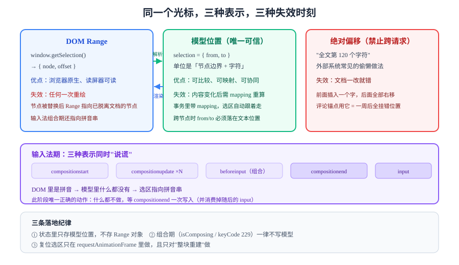

# 选区、输入法与光标

富文本编辑器里最反直觉的一件事：**用户看到的"光标"有三个互不等价的表示，而中文输入法会让这三个表示在同一秒钟内互相矛盾。**

这一页把"选区"和"输入法"放在一起讲，因为它们的问题同源——都是**视图先行、模型滞后**。



## 判据族声明

本页判据族 `SEL-A` ~ `SEL-H`，共 8 条。定义表在第八节。

## 一、三种选区表示

| 表示 | 是什么 | 谁在用 | 什么时候失效 |
| --- | --- | --- | --- |
| **DOM Range / Selection** | `window.getSelection()` 返回的 DOM 节点 + 偏移 | 浏览器原生、读屏器 | 任何一次重绘（节点被替换）后立刻失效 |
| **模型位置** | `{ from, to }`，ProseMirror 的 pos | 编辑器内部、事务、协同 | 文档内容变化后需要 `mapping` 重算 |
| **绝对偏移** | "全文第 N 个字符" | 外部系统（评论锚点、审计） | 文档一改就错，**不能跨请求使用** |

三者之间的换算必须**显式**，且只能沿着一条方向走：

```text
DOM Range  ──解析──▶  模型位置  ──渲染──▶  DOM Selection
     ▲                    │
     └──── 不可信 ────────┘   （禁止用 DOM 反推模型，只能"提示"）
```

::: danger 反过来推是最常见的错误
"从 `getSelection()` 读个 Range，然后计算它在模型里的位置"——这一步在**没有输入法、没有异步重绘**的单机场景下能跑。一旦加上中文输入法，`Range` 指向的可能是正在组合的拼音串，而模型里此时**根本没有这段文字**。此时算出来的位置会把事务插到错误的地方，表现为"拼音上屏后跑到上一段去了"。
:::

## 二、DOM ↔ 模型的映射怎么写

以 ProseMirror 为例，两个方向的 API 是一对：`posAtDOM` 与 `domAtPos`。

```typescript
import { EditorView } from 'prosemirror-view';

// 方向一：模型位置 → DOM（用于"把光标放到这里"）
function selectionToDOM(view: EditorView, from: number, to = from) {
  const { state } = view;
  const sel = state.selection.constructor as any;
  view.dispatch(state.tr.setSelection(sel.create(state.doc, from, to)));
  view.focus();                              // 注意：必须在 dispatch 之后
}

// 方向二：DOM → 模型位置（只在"用户真的移动了光标"时使用）
function domToPos(view: EditorView, node: Node, offset: number): number | null {
  try {
    return view.posAtDOM(node, offset);
  } catch {
    return null;                              // 节点已不在文档里（被重绘过）
  }
}
```

要点：

1. **`posAtDOM` 会抛异常**——当节点不在当前文档树里时。必须 `try/catch`，不能假设它总是成功。
2. **`focus()` 要在 `dispatch` 之后**。反了会导致"点了工具栏，光标回到开头"。
3. **选区跨节点时**，`from`/`to` 必须是"文本位置"，不能落在容器边界内部（ProseMirror 会抛 `RangeError`）。

### 选区的三种形态

| 形态 | 表示 | 常见误判 |
| --- | --- | --- |
| 光标（caret） | `from === to` | 以为 `empty` 就一定是"没选中"，其实还可能是"选中了一个节点"（`NodeSelection`） |
| 文本选区 | `from < to`，都在文本内 | 跨段落时 `to` 落在下一段起始位置（不是上一段末尾） |
| 节点选区 | 选中的是整个 `image` / 表格 | 用 `from === to` 判断会漏掉它 |

## 三、输入法：为什么它把一切都打乱了

中文、日文、韩文输入法（IME）的工作方式是**"先组合、后提交"**：

```text
用户按键：n i h a o
  ↓ 编辑器收到的是拼音串 "nihao"（此时文档里不该出现它）
用户选词：你好
  ↓ 此时才产生一次"插入文本"的语义
```

对应的事件序列（Chromium 实测）：

| 顺序 | 事件 | `isComposing` | 该做什么 |
| --- | --- | --- | --- |
| 1 | `compositionstart` | — | 打标记，进入"组合期" |
| 2 | `compositionupdate`（多次） | `true` | **忽略**，不要写模型 |
| 3 | `beforeinput`（`insertCompositionText`） | `true` | **不要 `preventDefault`**，让浏览器画拼音 |
| 4 | `compositionend`（`data: '你好'`） | — | 这才是"提交"，此时把文本写进模型 |
| 5 | `input`（`insertText`） | `false` | 若已在第 4 步处理过，需要去重 |

::: danger 输入法期的四个必踩坑
1. **在 `compositionupdate` 里写模型**：拼音字母会变成正文，用户删掉后模型里留下碎片。
2. **在 `compositionend` 之后又处理一次 `input`**：文字插入两次（"你好"变"你好你好"）。**去重靠"这一轮的 composition 已处理"标记**，不要靠时间窗。
3. **`keydown` 里判断 `key === 'Enter'` 就提交表单**：输入法选词也是 Enter，用户选个词表单就提交了。必须判 `event.isComposing || event.keyCode === 229`。
4. **在组合期 `preventDefault` 掉 `beforeinput`**：候选框定位会失效，拼音出现在屏幕左上角。
:::

```typescript
// 一个能用的输入法状态机（骨架）
let composing = false;
let handledByComposition = false;

el.addEventListener('compositionstart', () => {
  composing = true;
  handledByComposition = false;
});

el.addEventListener('compositionend', (e) => {
  composing = false;
  if (e.data) {
    insertText(e.data);            // 唯一的写入点
    handledByComposition = true;   // 防止随后的 input 再插一次
  }
});

el.addEventListener('beforeinput', (e: InputEvent) => {
  if (e.isComposing) return;       // 组合期一律交给浏览器
  if (e.inputType === 'insertText' && handledByComposition) {
    handledByComposition = false;  // 消费掉这条重复事件
    return;
  }
  // 其余类型走统一的输入意图分发
  dispatchInput(e.inputType, e.data, e as any);
});

el.addEventListener('keydown', (e: KeyboardEvent) => {
  if (e.isComposing || e.keyCode === 229) return;   // 输入法按键一律放过
  if (e.key === 'Enter' && !e.shiftKey) {
    e.preventDefault();
    commit();                       // 只在真正回车时提交
  }
});
```

::: warning `keyCode === 229` 是必须的兜底
部分浏览器（尤其 Android WebView 与旧版 Safari）在输入法组合期**不会**把 `isComposing` 置为 `true`，但会把 `keyCode` 报成 `229`。只判 `isComposing` 会在这些环境上漏拦。
:::

## 四、`beforeinput` 的 `inputType` 清单

`beforeinput` 是**唯一可取消的输入入口**，`inputType` 决定了你要做什么：

| `inputType` | 触发场景 | 建议处理 |
| --- | --- | --- |
| `insertText` | 键盘输入、输入法上屏（部分浏览器） | 写模型（文本） |
| `insertCompositionText` | 输入法组合中 | 放行，不处理 |
| `insertFromPaste` | `Ctrl+V`、右键粘贴 | 走清洗管线（见[粘贴](../PasteSanitize/index.md)） |
| `insertFromDrop` | 拖拽文本进来 | 同粘贴，**别忘这条**（它绕过 `paste` 事件） |
| `deleteContentBackward` / `Forward` | 退格 / 删除 | 写模型（删除） |
| `deleteByCut` | `Ctrl+X` | 删除 + 写剪贴板 |
| `formatBold` / `formatItalic` | `Ctrl+B` / `Ctrl+I` | 切标记（注意浏览器可能自己先处理了） |
| `insertParagraph` / `insertLineBreak` | 回车 / `Shift+Enter` | 拆块 / 插 `<br>` |
| `historyUndo` / `historyRedo` | `Ctrl+Z` / `Ctrl+Shift+Z` | **必须拦截**，否则浏览器的原生 undo 会改 DOM 而绕过你的模型 |

`historyUndo` 那一行是重灾区：如果不拦截，用户按 `Ctrl+Z` 后**DOM 回退了但模型没有**，视图与模型从此错位，下一次输入就会"复活"已删内容。

## 五、光标复位：三个时机，只有一个是对的

| 时机 | 结果 |
| --- | --- |
| 同步（`dispatch` 后立即设） | 视图还没渲染完，`domAtPos` 拿到的节点是旧的 |
| `queueMicrotask` | 大多数情况可用，但浏览器可能还没完成布局 |
| `requestAnimationFrame`（**推荐**） | 布局已完成，`domAtPos` 稳定 |

```typescript
function restoreSelection(view: EditorView, pos: number) {
  requestAnimationFrame(() => {
    const { node, offset } = view.domAtPos(pos);
    const range = document.createRange();
    range.setStart(node, offset);
    range.collapse(true);
    const sel = window.getSelection()!;
    sel.removeAllRanges();
    sel.addRange(range);
  });
}
```

::: tip 什么时候不需要手动复位
如果视图是"模型驱动的最小重绘"（只 patch 变化的节点），浏览器会自己保住光标，**不要多此一举**。手动复位只在"整块重建"（比如切换节点类型、协同补拉、切换只读态）时才需要。频繁复位是"打字时光标闪烁"的常见原因。
:::

## 六、移动端与软键盘

| 问题 | 现象 | 对策 |
| --- | --- | --- |
| 软键盘顶起页面 | 光标被键盘挡住，用户看不见自己打什么 | 监听 `visualViewport.resize`，把光标滚动到可视区中部 |
| iOS 聚焦行为 | 必须以用户手势触发 `focus()`，否则键盘不弹 | 首次聚焦放在真实点击回调里 |
| 触摸选区手柄 | 拖动选择柄时 `selectionchange` 高频触发 | 用 `isComposing` 同款思路做节流，且不在其中写模型 |
| 键盘类型 | 数字/邮箱场景弹出错误的键盘 | 富文本容器上无法指定 `inputmode`，需要退化为内容类型判断或独立输入框 |

```typescript
// 让光标不被软键盘遮挡（iOS/Android 通用）
if (window.visualViewport) {
  window.visualViewport.addEventListener('resize', () => {
    const sel = window.getSelection();
    if (!sel || sel.rangeCount === 0) return;
    const rect = sel.getRangeAt(0).getBoundingClientRect();
    const vv = window.visualViewport!;
    const visibleBottom = vv.height + vv.offsetTop;
    if (rect.bottom > visibleBottom - 24) {
      window.scrollBy({ top: rect.bottom - visibleBottom + 96, behavior: 'smooth' });
    }
  });
}
```

## 七、`EditContext`：绕开 `contenteditable` 的新路（可选）

`EditContext` 让浏览器把"文本输入"与"DOM 渲染"解耦：你拿到的是纯文本与选区偏移，不再需要跟 `contenteditable` 的怪行为搏斗。

| 浏览器 | 支持情况 |
| --- | --- |
| Chrome / Edge | 121+ 完整支持 |
| Opera | 107+ |
| Safari / Safari iOS | **不支持**（WebKit 仍在考虑） |
| Firefox | **不支持**（2026-05 才提出 Intent to Prototype） |

::: danger 现在不能只走这一条路
它不是 Baseline。**必须保留 `contenteditable` 作为主通道**，把 `EditContext` 当成"Chromium 系增强"。选型时把它写成"未来选项"，而不是"当前方案"。
:::

## 八、判据表

| 编号 | 约定 | 定错了会怎样 | 怎么验证没被破坏 |
| --- | --- | --- | --- |
| `SEL-A` | 模型位置是唯一可信的选区表示，DOM Range 只能由它派生 | 重绘后位置错乱、协同后光标跳到文首 | 选区相关的状态里不存 `Range` 对象（只存 `{from,to}`） |
| `SEL-B` | 组合期（`isComposing` / `keyCode 229`）一律不写模型 | 拼音字母进入正文、上屏后重复插入 | 中文输入法输入"你好"，模型里只有"你好"两字，无 `nihao` |
| `SEL-C` | `compositionend` 与随后的 `input` 必须去重 | 文字插入两次 | 输入一个词后，文档字数只 +词长 |
| `SEL-D` | 必须拦截 `historyUndo` / `historyRedo` | 浏览器原生 undo 让 DOM 与模型分叉 | 按 `Ctrl+Z` 后，DOM 文本与 `doc.textContent` 完全一致 |
| `SEL-E` | 回车提交必须判 `isComposing` | 输入法选词时误提交表单 | 输入法里按 Enter 选词，表单未提交 |
| `SEL-F` | 光标复位只能在 `requestAnimationFrame` 里做，且仅"整块重建"时需要 | 打字时光标闪烁、输入错位 | 连续输入 50 字，无 `selectionchange` 触发的额外 dispatch |
| `SEL-G` | `insertFromDrop` 必须与粘贴共用同一条清洗管线 | 拖拽绕过清洗，成为 XSS 新入口 | 拖一段带 `onerror` 的 HTML 进来，模型里无 `img` 属性泄漏 |
| `SEL-H` | 移动端必须处理软键盘遮挡 | 用户看不见自己打的字 | iOS/Android 真机上，光标始终在可视区内 |

## 如何验证

下面这段在浏览器控制台可跑，用来观察"组合期"事件的真实顺序（需要真实输入法，或 macOS 上把输入法切到拼音）：

```javascript
const el = document.querySelector('[contenteditable]');
['compositionstart', 'compositionupdate', 'compositionend',
 'beforeinput', 'input', 'selectionchange'].forEach((t) => {
  el.addEventListener(t, (e) => {
    const ev = e;
    console.log(t, {
      isComposing: ev.isComposing,
      inputType: ev.inputType ?? '-',
      data: ev.data ?? '-',
    });
  }, true);
});
```

**预期输出**（输入"nihao"并选词"你好"）：

1. 先出现 `compositionstart`；
2. 随后多条 `compositionupdate`，且 `isComposing: true`；
3. 其间有 `beforeinput`，`inputType` 为 `insertCompositionText`；
4. 选词后出现 `compositionend`，`data: '你好'`；
5. 最后一条 `input` 的 `isComposing` 为 `false`。

**关键判断**：如果第 3 步的 `beforeinput` 被你 `preventDefault()` 了，候选框位置会异常——这就是判据 `SEL-B` 要守住的东西。

## 参考资料

- [W3C UI Events · Composition](https://www.w3.org/TR/uievents/#events-compositionevents)——`compositionstart/update/end` 的规范定义
- [W3C Input Events Level 2 · inputType](https://www.w3.org/TR/input-events-2/#input-events-datatypes)——本页清单的权威来源
- [MDN · EditContext](https://developer.mozilla.org/en-US/docs/Web/API/EditContext)——支持度与实验状态
- [ProseMirror · `posAtDOM` / `domAtPos`](https://prosemirror.net/docs/ref/#view.EditorView.posAtDOM)——DOM 与模型位置的双向换算
- [ProseMirror Discuss · IME 与光标问题合集](https://discuss.prosemirror.net/)——真实环境下的边界案例
