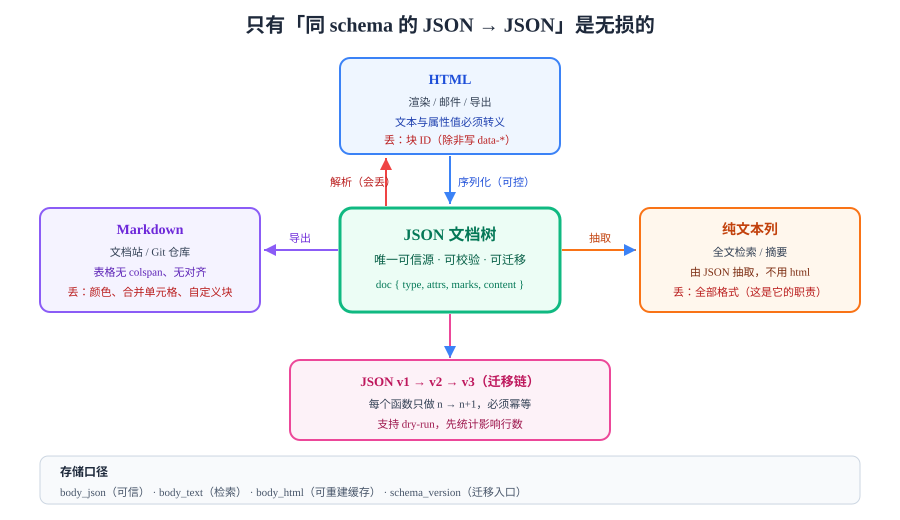

# 序列化与往返

序列化要回答的问题不是"怎么把文档变成 HTML"，而是**"变成 HTML 之后，还能不能原样变回来"**。凡是回答不了往返的格式，都只能当展示缓存，不能当存储格式。



## 判据族声明

本页判据族 `SER-A` ~ `SER-H`，共 8 条。定义表在第七节。

## 一、三个方向，三种失真

| 方向 | 用途 | 会丢什么 | 能否无损 |
| --- | --- | --- | --- |
| **JSON → HTML** | 页面渲染、邮件、导出 | `attrs` 里没有对应属性的字段（如块 ID） | ❌（除非把 ID 写进 `data-*`） |
| **HTML → JSON** | 导入历史数据、粘贴 | 未在白名单里的标签；嵌套被浏览器"修正" | ❌（只能"尽量") |
| **JSON → Markdown** | 文档站、Git 仓库 | 颜色、对齐、复杂表格、自定义块 | ❌（Markdown 表达力更弱） |
| **JSON → JSON（同 schema）** | 存储、协同、复制 | 无 | ✅ |
| **JSON → JSON（跨 schema 版本）** | 升级 | 需要显式迁移函数 | ✅（写了迁移就是无损） |

::: tip 一条可以记住的规则
**只有"同 schema 的 JSON → JSON"是无损的。** 其余所有格式都要在设计时明确"允许丢什么"，并把这个决定写进文档——否则半年后没人说得清"为什么导出的文章没了高亮"。
:::

## 二、存 JSON 还是存 HTML

| 维度 | 存 JSON | 存 HTML |
| --- | --- | --- |
| 结构校验 | ✅ 可用 schema 强校验 | ❌ 只能靠白名单，结构仍可能非法 |
| 换渲染端 | ✅ 一套数据渲染成 Web/App/PDF | ❌ 输出绑定在 HTML 上 |
| 迁移 | ✅ 写迁移函数即可 | ❌ 要重新解析 HTML，产物不可控 |
| 全文检索 | ⚠️ 需额外抽取纯文本列 | ✅ 可近似用 `to_tsvector(html)`（但要先去标签） |
| 展示缓存 | ❌ 每次要渲染 | ✅ 直接输出，省一次渲染 |
| 体积 | 略大（含结构） | 略小 |

**结论**：**JSON 是唯一存储格式，HTML 是可选缓存**。如果确实需要 HTML 缓存（比如列表页要显示摘要），那一列必须命名为 `content_html_cache`，并且有一个"从 JSON 重建"的脚本。

```sql
-- 一个符合本页结论的表结构
create table article (
  id            bigserial primary key,
  tenant_id     bigint not null,
  body_json     jsonb  not null,             -- 唯一可信源
  body_text     text   not null,             -- 纯文本，供全文检索
  body_html     text,                        -- 派生缓存，可随时重建
  schema_version int   not null default 1,   -- 迁移的入口
  updated_at    timestamptz not null default now()
);

-- 校验：body_json 必须是对象且含 type 字段（结构级兜底，语义级校验在应用层）
alter table article add constraint body_json_shape
  check (jsonb_typeof(body_json) = 'object' and body_json ? 'type');
```

::: danger 用 `tsvector` 直接索引 HTML 是个陷阱
`to_tsvector('simple', body_html)` 会把标签名也当词（`p`、`strong`、`href` 全进索引），导致搜 "p" 命中所有文章。必须用 `body_text`（由 JSON 抽取的纯文本）建索引。
:::

## 三、输出 HTML：三条硬纪律

```typescript
// JSON → HTML：属性白名单 + 文本转义 + 属性值转义
const ATTR_ALLOW: Record<string, string[]> = {
  a: ['href', 'title', 'rel', 'target'],
  img: ['src', 'alt', 'width', 'height'],
  code: ['class'],                     // 只允许语言类名，如 language-ts
};

const ESC: Record<string, string> = {
  '&': '&amp;', '<': '&lt;', '>': '&gt;', '"': '&quot;', "'": '&#39;',
};
const esc = (s: string) => s.replace(/[&<>"']/g, (c) => ESC[c]);

function toHtml(node: DocNode, schema: Schema): string {
  if (node.text != null) return esc(node.text);          // ① 文本必须转义

  const spec = schema.nodes[node.type];
  const [tag, attrs] = spec.toDOM(node) as [string, Record<string, string> | 0];

  const allowed = ATTR_ALLOW[tag] ?? [];
  const attrStr = Object.entries(attrs ?? {})
    .filter(([k]) => allowed.includes(k))
    .map(([k, v]) => ` ${k}="${esc(String(v))}"`)        // ② 属性值也必须转义
    .join('');

  const inner = (node.content ?? []).map((c) => toHtml(c, schema)).join('');
  if (tag === 'img' || tag === 'br') return `<${tag}${attrStr}>`;
  return `<${tag}${attrStr}>${inner}</${tag}>`;
}
```

| 纪律 | 为什么 |
| --- | --- |
| 文本必须转义 | 否则内容里的 `<` 会被当成标签，直接把用户输入变成 HTML |
| 属性值必须转义 | `alt='"' onerror='alert(1)'` 这类注入靠的就是属性值不转义 |
| 属性白名单 | `toDOM` 可能带出 `style`/`onclick`，输出前要再过滤一次 |

::: warning `dangerouslySetInnerHTML` 的边界
React/Vue 里渲染这段 HTML 时，**必须确保它来自本页的 `toHtml`**，而不是来自数据库的任意字段。历史数据可能是漏洞期写入的（见[粘贴页的 CVE](../PasteSanitize/index.md)），所以"渲染前再清洗一次"不是多余的。
:::

## 四、往返测试：把"看起来对"变成"断言"

往返测试（round-trip test）是这类系统里性价比最高的测试，因为它能一次性抓出所有"悄悄丢字段"的改动。

```typescript
// 不变式：parse(toHtml(doc)) 与 doc 结构等价
function assertRoundTrip(doc: DocNode) {
  const html = toHtml(doc, schema);
  const back = htmlToDoc(html);
  // 不能直接比 JSON：块 ID 走 data-* 才保留，未保留时应先剥掉再比
  expect(stripVolatile(back)).toEqual(stripVolatile(doc));
}

const stripVolatile = (n: DocNode): DocNode => ({
  ...n,
  attrs: n.attrs ? Object.fromEntries(Object.entries(n.attrs).filter(([k]) => k !== 'id')) : undefined,
  content: n.content?.map(stripVolatile),
});
```

再加一层"随机文档"生成（property-based test），能覆盖手写用例想不到的组合：

```typescript
// 用 fast-check 生成随机文档，跑 200 次往返
import fc from 'fast-check';

const anyDoc = fc.letrec((tie) => ({
  node: fc.oneof(
    fc.record({ type: fc.constant('paragraph'), content: fc.array(tie('inline'), { maxLength: 8 }) }),
    fc.record({ type: fc.constant('heading'), attrs: fc.record({ level: fc.integer({ min: 2, max: 3 }) }),
                content: fc.array(tie('inline'), { maxLength: 8 }) }),
  ),
  inline: fc.oneof(
    fc.record({ type: fc.constant('text'), text: fc.string({ maxLength: 20 }) }),
    fc.record({ type: fc.constant('text'), text: fc.string({ maxLength: 20 }),
                marks: fc.constant([{ type: 'strong' }]) }),
  ),
})).node;

test('round-trip 不丢结构', () => {
  fc.assert(fc.property(anyDoc, (d) => {
    assertRoundTrip({ type: 'doc', content: [d] });
  }), { numRuns: 200 });
});
```

**这段测试的价值**：加了 `heading level: 4` 却忘了在 `parseDOM` 里注册时，它会立刻失败——而手写用例几乎不会覆盖到这一层。

## 五、schema 版本与迁移

```typescript
// 迁移函数按版本号链式调用，每个函数只负责"从 n 到 n+1"
type Migration = (doc: any) => any;

const MIGRATIONS: Record<number, Migration> = {
  1: (doc) => ({                                   // v1 → v2：段落加 blockId
    ...doc,
    content: (doc.content ?? []).map((b: any) => ({
      ...b, attrs: { ...b.attrs, blockId: b.attrs?.blockId ?? crypto.randomUUID() },
    })),
  }),
  2: (doc) => ({                                   // v2 → v3：image 的 src 迁到 key
    ...doc,
    content: (doc.content ?? []).map(function walk(n: any): any {
      if (n.type === 'image' && n.attrs?.src && !n.attrs.key) {
        return { ...n, attrs: { ...n.attrs, key: extractKey(n.attrs.src) } };
      }
      return { ...n, content: n.content?.map(walk) };
    }),
  }),
};

function migrate(doc: any, from: number, to: number) {
  let cur = doc;
  for (let v = from; v < to; v++) {
    const fn = MIGRATIONS[v];
    if (!fn) throw new Error(`MISSING_MIGRATION_${v}`);
    cur = fn(cur);
  }
  return cur;
}
```

三条纪律：

1. **迁移必须幂等**：同一份数据跑两次结果相同（用 `??` 兜底，不要无脑覆盖）。
2. **迁移必须可离线跑**：提供 `pnpm migrate --from 1 --to 3 --dry-run`，先统计影响行数再执行。
3. **渲染端要兼容"旧版本 JSON"**：升级窗口内新旧并存，渲染器必须能处理 `schema_version < current` 的数据（或读时先迁移）。

## 六、Markdown 导出的取舍

| 节点 | Markdown 表示 | 会丢什么 |
| --- | --- | --- |
| 段落 / 标题 | `#` / 空行 | 无 |
| 加粗 / 斜体 / 删除线 | `**` / `*` / `~~` | 无（但嵌套顺序有坑） |
| 链接 / 图片 | `[](url)` / `` | `title` 属性部分解析器不支持 |
| 有序列表起始值 | `1.` | `start` 属性丢失（多数解析器从 1 开始） |
| 表格 | `\|` 语法 | 合并单元格、对齐、列宽全丢 |
| 代码块 | 三反引号 | 语言标记保留，行高亮丢失 |
| 自定义块（如"提示框"） | 无标准语法 | **必须降级为普通段落或引用** |

::: danger 表格是 Markdown 导出的最大失望源
富文本里"合并了两行的表头"在 Markdown 里**没有对应语法**（GFM 不支持 `colspan`）。上线前必须明确：导出的表格要不要拍平成普通表格？如果业务不能接受，就别承诺"导出 Markdown"。
:::

## 七、判据表

| 编号 | 约定 | 定错了会怎样 | 怎么验证没被破坏 |
| --- | --- | --- | --- |
| `SER-A` | 存储格式必须是同 schema 的 JSON，HTML 只能当缓存 | 历史数据无法迁移 | 表结构里正文列是 `jsonb`，HTML 列名含 `cache`/`html` |
| `SER-B` | 必须存在往返测试（含随机文档） | 改 schema 时静默丢字段 | CI 里有 round-trip 用例且跑随机样本 |
| `SER-C` | HTML 输出的文本与属性值都必须转义 | 内容里的 `<` 或引号造成注入 | 输入 `a<b"c` 后输出为 `a&lt;b&quot;c` |
| `SER-D` | 输出 HTML 时属性必须二次白名单 | `toDOM` 带出 `style`/`onclick` | 输出里 grep 不到 ` style=` 与 ` on` |
| `SER-E` | 必须记录 `schema_version` 且有迁移函数 | 升级后旧数据渲染报错 | 表里有版本列，且 `MIGRATIONS` 覆盖所有历史版本 |
| `SER-F` | 迁移必须幂等且支持 dry-run | 重复执行导致数据被二次改写 | 连跑两次迁移，数据哈希不变 |
| `SER-G` | 全文检索必须基于纯文本列，不得直接索引 HTML | 标签名进索引，召回全是噪声 | 检索 "p" 不命中所有文章 |
| `SER-H` | 导出格式必须写明"丢弃项" | 用户以为导全了，其实少了格式 | 导出功能文档里有一节"会丢什么" |

## 如何验证

不用浏览器，纯 Node 就能验证转义与往返：

```javascript
const esc = (s) => s.replace(/[&<>"']/g, (c) => ({ '&': '&amp;', '<': '&lt;', '>': '&gt;', '"': '&quot;', "'": '&#39;' }[c]));

console.log(esc('a<b"c'));
// 预期：a&lt;b&quot;c

// 往返的最小断言：解析回来应与原文一致
const html = `<p>${esc('1 < 2 且 "引号"')}</p>`;
const back = new DOMParser().parseFromString(html, 'text/html').body.textContent;
console.log(back);
// 预期：1 < 2 且 "引号"   —— 与输入逐字相等，说明转义与还原对称
```

**关键判断**：如果 `back` 输出的是 `1 &lt; 2`，说明你在**转义了两次**（或解析后没走 HTML 解码）；如果输出丢了引号，说明属性值没转义。两者都是线上最常见的一类"文字被吃掉"。

## 参考资料

- [ProseMirror · Serializing to HTML](https://prosemirror.net/docs/guide/#serializing)——`DOMSerializer` 的用法与 `toDOM` 约定
- [ProseMirror · Parsing HTML](https://prosemirror.net/docs/guide/#schema.parse)——`parseDOM` 与容错策略
- [CommonMark Spec](https://spec.commonmark.org/) · [GFM Spec](https://github.github.com/gfm/)——Markdown 导出的能力边界（尤其表格）
- [fast-check 文档](https://fast-check.dev/)——property-based test 的用法
- [OWASP · Output Encoding](https://cheatsheetseries.owasp.org/cheatsheets/Cross_Site_Scripting_Prevention_Cheat_Sheet.html#output-encoding-for-html-contexts)——HTML 上下文转义规则
