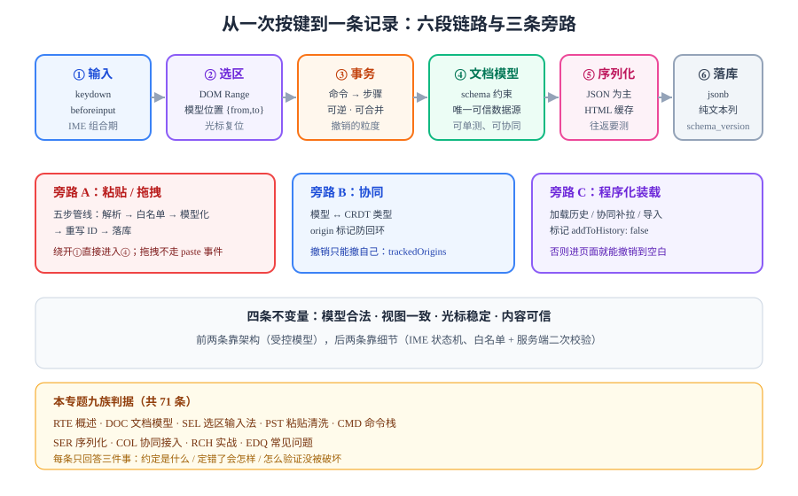

# 富文本编辑器工程

富文本编辑器（Rich Text Editor，RTE）要解决的问题只有一句话：**让用户在浏览器里"像用 Word 一样"改一段带格式的内容，而你把这段内容当成可校验、可迁移、可协同的数据来管。**

<p style="text-align:center;"></p>

难的地方从来不是"怎么加粗"。难的是**浏览器给你的不是数据，而是一棵它随时可以改写的 DOM 树**：`contenteditable` 会在你按回车时插入 `<div>` 还是 `<p>` 取决于浏览器；粘贴一段 Word 内容会带进 40 个 `mso-` 内联样式；中文输入法打到一半时 DOM 里已经出现了拼音字母。你要做的，是**在这棵不受控的树外面套一层受控的模型**。

::: tip 一句话理解
富文本编辑器的本质是**「模型 ↔ 视图」的双向同步**：用户改的是视图，你信的是模型，而两者之间永远隔着浏览器、输入法和粘贴板三个不可靠的中间人。
:::

## 专题地图

| 页面 | 回答什么问题 | 适合谁读 |
| --- | --- | --- |
| [概述：三种做法与五步决策](Overview/index.md) | 什么时候该自研、什么时候该用库、什么时候根本不该用富文本 | 所有人，先读这页 |
| [文档模型：把 HTML 关进 schema](DocumentModel/index.md) | 为什么不能拿 DOM 当模型、位置到底怎么数、节点 ID 用来干什么 | 要设计数据结构的人 |
| [选区、输入法与光标](SelectionIME/index.md) | 三种选区表示怎么互换、输入法为什么会把拼音写进文档、光标为什么跳 | 前端主力 |
| [粘贴与内容清洗](PasteSanitize/index.md) | 五步清洗管线、Word 内容怎么处理、图片怎么进对象存储 | 前端 + 安全 |
| [命令栈与撤销](CommandStack/index.md) | 事务、步骤、可逆性、undo 为什么必须分组 | 要写工具栏与快捷键的人 |
| [序列化与往返](Serialization/index.md) | 存 JSON 还是 HTML、往返为什么会失真、服务端怎么校验 | 后端与全栈 |
| [接协同：边界与三处对齐](CollabIntegration/index.md) | 模型怎么映射到 CRDT、撤销为什么只能撤自己的 | 要做多人编辑的人 |
| [实战：卡片描述字段](Practice/index.md) | 从 schema 到验收脚本的完整落地，含十条可证伪判据 | 想直接照做的人 |
| [常见问题与最佳实践](FAQ/index.md) | 八类症状分诊、十二问、十二条最佳实践 | 所有人 |



## 判据族声明

本专题每一页的约定都编号，每条只回答三件事：**约定是什么 / 定错了会怎样 / 怎么验证它没被破坏**。

| 页面 | 判据族 | 数量 |
| --- | --- | --- |
| 概述 | `RTE-A` ~ `RTE-H` | 8 |
| 文档模型 | `DOC-A` ~ `DOC-H` | 8 |
| 选区与输入法 | `SEL-A` ~ `SEL-H` | 8 |
| 粘贴与清洗 | `PST-A` ~ `PST-H` | 8 |
| 命令栈与撤销 | `CMD-A` ~ `CMD-H` | 8 |
| 序列化 | `SER-A` ~ `SER-H` | 8 |
| 协同接入 | `COL-A` ~ `COL-H` | 8 |
| 实战 | `RCH-A` ~ `RCH-H` | 8 |
| 常见问题 | `EDQ-A` ~ `EDQ-G` | 7 |

## 与相邻专题的分工

富文本是那种"谁都能讲两句、但很少有人讲清楚边界"的题目，先把边界写死：

| 相邻专题 | 那边讲什么 | 本专题讲什么 | 为什么不互相替代 |
| --- | --- | --- | --- |
| [实时协作与冲突解决](../../Backend/RealtimeCollaboration/index.md) | OT / CRDT 的收敛算法、同步协议、presence | 文档模型怎么映射到这些类型上、本地事务怎么标来源 | 那边保证"两人算出同一结果"，这边保证"算出来的东西是合法的文档" |
| [低代码平台](../LowCode/index.md) | 画布、物料、协议渲染 | 一段连续文本的编辑 | 低代码编辑的是**组件树**，富文本编辑的是**行内文本与标记** |
| [浏览器原理](../Basic/Browser/index.md) | DOM、事件循环、渲染管线 | `beforeinput` 与 `selectionchange` 的真实触发顺序 | 那边讲机制，这边讲"机制之上怎么搭状态机" |
| [XSS 与内容安全](../Others/Security/XSS/index.md) | 输出编码、CSP、富文本白名单的一般原则 | 粘贴这一条具体入口怎么堵 | 那边是通用防线，这边是**第一条被攻破的通道** |
| [国际化与无障碍](../IntlA11y/index.md) | 键盘可达、读屏器、locale | 输入法（IME）这一条特例 | 那边的键盘模型假设"按键即字符"，输入法打破了这个假设 |
| [移动端 H5 深入](../MobileH5/index.md) | 视口、手势、桥接 | 软键盘弹出时的选区与滚动 | 那边管布局，这边管"光标被软键盘顶到哪里去了" |
| [前端测试](../Testing/index.md) | 单测、组件测试、E2E | 怎么断言"编辑器里出现了加粗的'你好'" | `contenteditable` 的 DOM 结构因浏览器而异，断言必须落在模型上 |
| [在线协作任务看板](../../../project/Complete/TeamBoard/index.md) | 一个具体项目里怎么用 | 通用原理与可复用做法 | 那边是实例，这边是可迁移的判据 |

## 生态与版本状态（2026-10 核对）

| 组件 | 版本 | 状态与口径 |
| --- | --- | --- |
| Tiptap | **3.31.4**（2026-09-30） | ProseMirror 之上的封装，MIT；`@tiptap/vue-3` 与 `@tiptap/react` 同步发版；核心 gzip 约 34 kB，StarterKit 再加约 105 kB |
| ProseMirror | `view` **1.42.3+** / `model` 1.25.x / `state` 1.4.4 | 模块分开发版；**低于 `prosemirror-view` 1.42.3 存在粘贴路径 XSS（CVE-2026-104847）**，必须升级 |
| Lexical | **0.51.0**（2026-09-17） | Meta 维护，MIT，**仍是 0.x**（139+ 个稳定版但从未承诺 API 稳定）；gzip 约 105 kB |
| Slate | **0.126.2** | React 优先，核心最轻（gzip 约 28 kB），校验能力最弱，更多责任在应用层 |
| Quill 2 | **2.0.3** | 自带 UI 与主题，gzip 约 57 kB，"开箱即用"路线的代表 |
| TinyMCE / CKEditor 5 | 8.8.x / 5.x | 商业授权与体积都要单独评估（TinyMCE gzip 约 167 kB） |
| Yjs（协同） | 13.6.33（2026-09-23） | 与 ProseMirror / Lexical / Tiptap 都有官方绑定，协同细节见[实时协作专题](../../Backend/RealtimeCollaboration/index.md) |
| `contenteditable="plaintext-only"` | Chrome 51 / Edge 12 / Firefox **136** / Safari 5 | 已可放心用于"纯文本"场景；但**回车产物仍因浏览器而异** |
| `EditContext` API | Chrome / Edge **121+**，Firefox 与 Safari **均未支持** | 只是"可选项"，不是 Baseline，不能作为唯一输入通道 |

::: warning 版本组织说明
本专题**不按大版本建目录**：编辑器库的版本号差异（Tiptap 3.x、Lexical 0.x、Slate 0.1xx）背后是**同一套模型-视图范式**。真正会随大版本改变语义的只有 ProseMirror 的模块化拆分，而它对使用者的影响已经收敛为"装哪个包"，用页内 `::: info` 标注即可。**唯一必须按版本处理的是安全补丁**——见[粘贴与内容清洗](PasteSanitize/index.md) 里的 CVE 小节。
:::

## 学习路径

1. **先读概述**，把"三种做法"分清——80% 的选型错误发生在这一步。
2. **再读文档模型**，因为后面所有页（选区、粘贴、撤销、协同）都以模型为坐标系。
3. **然后读选区与输入法 + 粘贴清洗**，这两页覆盖了线上 70% 的"诡异 bug"。
4. **最后读命令栈、序列化与协同**，按你产品的实际需要取舍。
5. **要落地就直接看实战页**，它把前七页的结论压成了十条可执行判据。

## 验证方式

本专题的示例基于 TypeScript 与浏览器控制台，最小验证只需两步：

```shell
node -e "console.log(process.version)"
# 预期输出 v22.x 或更高（本仓文档按 Node 22 LTS 编写）

node -e "console.log(new TextEncoder().encode('你').length)"
# 预期输出 3 —— 这就是「字符数 ≠ 字节数 ≠ UTF-16 码元数」的第一课
```

页面里的 `@tiptap/*` / `prosemirror-*` / `lexical` 示例，按对应页面的 `pnpm add` 命令安装后即可运行。**本仓不提供可执行示例工程**，命令与片段都在正文里，读者在自己的工程中落地。

## 参考资料

- ProseMirror 官方文档 · [Guide](https://prosemirror.net/docs/guide/) · [Reference](https://prosemirror.net/docs/ref/)
- [Tiptap 文档](https://tiptap.dev/docs) · [Lexical 文档](https://lexical.dev/) · [Slate 文档](https://docs.slatejs.org/) · [Quill 2 文档](https://quilljs.com/docs/)
- W3C [Input Events Level 2](https://www.w3.org/TR/input-events-2/)——`beforeinput` 与 `inputType` 的规范定义
- W3C [EditContext API](https://w3c.github.io/edit-context/)——绕开 `contenteditable` 的实验性方案
- WHATWG HTML Standard · [Editing](https://html.spec.whatwg.org/multipage/interaction.html#editing)——`contenteditable` 的行为定义（也是"为什么各浏览器不一样"的根源）
- GHSA-c8x8-7fp4-3x9w / CVE-2026-104847——`prosemirror-view` 粘贴路径 XSS，修复版本 1.42.3
