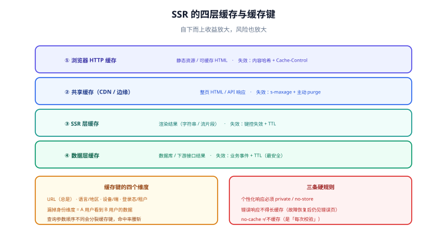

# 缓存体系

不做缓存的 SSR，在生产环境基本撑不住：每个请求都重新取数、重新渲染，服务器成本随流量线性上涨，而用户并不会因此更快。**SSR 的性能上限，几乎等于缓存设计的质量。**



## 四层缓存

| 层 | 缓存什么 | 命中后的效果 | 失效手段 |
| --- | --- | --- | --- |
| 浏览器 HTTP 缓存 | 静态资源、可缓存的 HTML | 不发请求 | 内容哈希文件名、`Cache-Control` |
| 共享缓存（CDN / 边缘） | 整页 HTML、API 响应 | 不回源，TTFB 极低 | `s-maxage` + 过期、主动 purge |
| SSR 层缓存（全页/片段） | 渲染结果（字符串或流片段） | 免去渲染与取数 | 键控失效、TTL、事件驱动失效 |
| 数据层缓存 | 数据库查询/下游接口结果 | 免去慢查询与调用 | 业务事件失效、TTL |

自下而上，收益与风险同时放大：**数据层缓存最安全**（失效边界清晰），**整页缓存最危险**（一旦键里漏了用户维度，就会串号）。

## 缓存键怎么定

缓存键错了，一切白搭。SSR 场景下缓存键至少要考虑四个维度：

| 维度 | 什么时候必须进键 | 反例（漏了会怎样） |
| --- | --- | --- |
| **URL** | 总是 | 不同文章的 HTML 互相覆盖 |
| **语言/地区** | 多语言站点 | 中文用户看到英文页面 |
| **设备/端** | 移动端与桌面端返回不同结构 | 桌面布局发给手机 |
| **登录态/租户** | 内容随身份变化 | **A 用户看到 B 用户的数据（最严重）** |

::: danger 共享缓存 + 个性化 = 事故
只要响应会因为 Cookie/身份而不同，就**必须**做到下面二者之一：

1. **不进入共享缓存**：`Cache-Control: private, no-store`（或至少 `private`）；
2. **进键**：把身份维度写进缓存键（如按 `Vary` 或显式的键片段），并保证不同身份的响应**物理隔离**。

最常见的写法是「用 `Cache-Control: public, s-maxage=...` 缓存个性化页面」——它会在 CDN 层把某个用户的私有页面缓存给所有人。**这类事故通常不会在测试环境暴露**（测试环境往往没有共享缓存），上线后才出现。
:::

## Cache-Control 指令对照

| 指令 | 作用 | 适用 |
| --- | --- | --- |
| `max-age=N` | 浏览器缓存 N 秒 | 静态资源、可缓存 HTML |
| `s-maxage=N` | **共享缓存**（CDN）缓存 N 秒，优先级高于 `max-age` | 需要 CDN 缓存的页面 |
| `stale-while-revalidate=N` | 过期后 N 秒内先返回旧副本，同时后台更新 | 内容更新允许短延迟、追求低延迟的页面 |
| `stale-if-error=N` | 回源失败时可用旧副本兜底 | 上游不稳定时的可用性保障 |
| `private` | 只允许浏览器缓存，共享缓存不得存 | 个性化页面 |
| `no-store` | 完全不允许缓存 | 含敏感信息的响应 |
| `no-cache` | 可存但每次必须校验 | 需要强一致但想省流量的场景 |

```http [HTTP 响应头 —— 公共可缓存页面]
Cache-Control: public, s-maxage=300, stale-while-revalidate=86400
CDN-Cache-Control: max-age=600
```

```http [HTTP 响应头 —— 个性化页面（必须私有）]
Cache-Control: private, no-store
Vary: Cookie, Accept-Language
```

::: warning `no-cache` 不是「不缓存」
它表示「可以存，但每次使用前必须回源校验」。想表达「根本不存」，要用 `no-store`。这两个名字的误导性导致过大量生产配置错误。
:::

## ISR：把「构建时生成」变成「按需再生成」

ISR（Incremental Static Regeneration）的核心是：**用户命中的永远是已经生成好的静态副本，到期后由某一次请求触发后台再生成**。

```text
首次请求 ─→ 无缓存 ─→ 渲染并写入缓存（同时返回给用户）
T 秒内请求 ─→ 命中缓存（静态副本，极快）
T 秒后请求 ─→ 先返回旧副本（stale），同时后台触发再生成
再生成完成 ─→ 后续请求命中新副本
```

| 优点 | 代价 |
| --- | --- |
| 服务器成本与流量解耦（大部分请求不渲染） | 内容有可见的延迟窗口 |
| 首屏快且稳定 | 需要「缓存存储」这一层基础设施 |
| 天然抗流量尖峰 | 首次生成失败时的兜底要额外设计 |

**ISR 的失效策略有两种**：按时间（到期自动）与**按事件**（内容更新时主动失效指定页面）。后者更精确，需要框架/平台的「标签失效」能力或自建失效接口。

```js [server.js —— 内容更新时按标签失效]
// 内容发布后，只失效与该内容相关的页面，而不是清空整个缓存
await fetch(`${CACHE_ENDPOINT}/revalidate`, {
  method: "POST",
  headers: { "content-type": "application/json" },
  body: JSON.stringify({ tags: [`article:${id}`, "article-list"] }),
});
```

## 失效策略怎么选

| 策略 | 精确度 | 复杂度 | 适用 |
| --- | --- | --- | --- |
| TTL 到期 | 低（容忍延迟） | 低 | 内容更新不频繁、能接受分钟级延迟 |
| 主动 purge（按 URL） | 中 | 中 | 可枚举的固定页面 |
| 标签/集合失效 | 高 | 高 | 内容与页面是多对多关系（文章 ↔ 列表/标签页） |
| 版本号进键 | 高 | 中 | 发布即全量更新的场景（`?v=hash`） |

::: tip 判据
**问「这份缓存过期后，用户最多看到多久以前的内容，能接受吗？」** 能接受就用 TTL，不能接受才上主动失效——主动失效要维护「内容 → 受影响页面」的映射，成本远高于 TTL。
:::

## 个性化页面的三种安全做法

| 做法 | 思路 | 代价 |
| --- | --- | --- |
| 壳静态 + 数据客户端拉取 | HTML 公共（可缓存），个性化数据由浏览器带 Cookie 请求 | 个性化内容出现稍晚（需接受一次客户端请求） |
| 边缘渲染（Edge SSR） | 在离用户最近的节点渲染，仍按用户维度生成 | 需要边缘运行时；缓存收益限于数据层 |
| 片段缓存 + 拼接 | 公共片段走共享缓存，个性化片段单独渲染 | 实现复杂度高，需要片段级缓存与拼装能力 |

三者共同的原则是：**把「可共享」与「不可共享」的内容在架构上分开**，而不是指望一个缓存键同时搞定。

## 易错点与最佳实践

::: danger 高频坑
1. **个性化页面用了 `public`**：见上文，属最严重事故类型。
2. **`Vary` 漏项**：响应随语言变化但没写 `Vary: Accept-Language`，CDN 会把一种语言发给所有人。
3. **缓存了「带临时错误」的响应**：下游 500/超时时渲染出的错误页被缓存 5 分钟，故障恢复后用户仍看到错误页。**错误响应必须显式不缓存**。
4. **忘了缓存键里的查询参数顺序**：`?a=1&b=2` 与 `?b=2&a=1` 被当成两个键，命中率腰斩。
5. **发布后旧 HTML 引用了新资源**：HTML 被缓存，而静态资源已换成新哈希 → 404。要么 HTML 短缓存、要么资源保留旧版本一段时间。
:::

::: tip 最佳实践
1. 先做**数据层缓存**，再做整页缓存：前者几乎没有正确性风险，收益也最直接。
2. 任何缓存上线前，用「登录两个不同账号、请求同一个 URL」的方式验证隔离性。
3. 上线后**监控缓存命中率**：命中率低的缓存不仅没收益，还在增加复杂度（见 [性能与成本](../Performance/index.md)）。
4. 把「缓存键的组成」写进文档并做评审，它是这套系统里最难改、最容易出事故的部分。
:::

## 验证方式

```shell [shell]
# 1. 看缓存语义与是否命中（X-Cache / Age 因 CDN 而异）
curl -sI https://example.com/articles/1 | grep -i -E "cache-control|age|x-cache"

# 2. 两次请求，Age 应递增（说明命中共享缓存）
curl -sI https://example.com/articles/1 | grep -i "^age"
sleep 2
curl -sI https://example.com/articles/1 | grep -i "^age"

# 3. 个性化页面必须不可被共享缓存：响应头应含 private 或 no-store
curl -sI -H "Cookie: session=abc" https://example.com/account | grep -i "cache-control"

# 4. 错误响应不应被缓存
curl -sI https://example.com/definitely-404 | grep -i "cache-control"
```

预期：第 2 条第二次的 `Age` 大于等于第一次；第 3 条出现 `private` 或 `no-store`；第 4 条不应出现较长的 `s-maxage`。

## 与「边缘计算与 CDN」专题的分工

渲染与缓存的原理归本页：分层怎么分、缓存键怎么设计、失效面怎么划。这些结论在边缘场景下**全部继续成立**。

边缘只多引入一处变化：**渲染本身可以发生在边缘节点上**。这一处变化会把本页的几个结论同时放大：

- **缓存键的维度变多**：多了一个「哪个节点渲染的」，跨节点的渲染结果如果不能共用，命中率会比单机环境低得多；
- **失效面变大**：本机环境里「刷新缓存」是一次操作，边缘环境里是一段传播窗口，见 [缓存策略](../../../Ops/EdgeCDN/CacheStrategy/index.md)；
- **可观测性变差**：本地渲染能看进程日志，边缘渲染只能看平台投递的日志，且取回有延迟。

所以顺序是：**先在本页把渲染与缓存的边界设计对，再去看 [边缘计算与 CDN](../../../Ops/EdgeCDN/index.md) 多出来什么约束**。反过来做，会写出「本地缓存命中率很高、上了边缘却几乎为零」的配置。

## 参考资料

- [RFC 9111：HTTP Caching](https://www.rfc-editor.org/rfc/rfc9111)
- [RFC 5861：`stale-while-revalidate` 与 `stale-if-error`](https://www.rfc-editor.org/rfc/rfc5861)
- [MDN：`Cache-Control`](https://developer.mozilla.org/en-US/docs/Web/HTTP/Headers/Cache-Control)
- [Next.js：Caching](https://nextjs.org/docs/app/building-your-application/caching)
