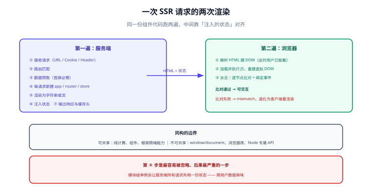

# 渲染管线与同构

SSR 的本质是**同一份组件代码跑两遍**：第一遍在服务端产出 HTML，第二遍在浏览器里「接上」这份 HTML 并让它可交互。理解这两遍各自做了什么、边界在哪，是排查一切 SSR 问题的前提。



## 第一遍：服务端产出一份「可读的 HTML」

一次请求在服务端大致经过七步：

| 步骤 | 做什么 | 出问题的典型症状 |
| --- | --- | --- |
| 1. 接收请求 | 解析 URL、Cookie、Header | 拿不到 Cookie，渲染出「未登录」版本 |
| 2. 路由匹配 | 决定渲染哪个页面组件 | 404 与重定向处理错位 |
| 3. **数据预取** | 在渲染前把页面需要的数据取回来 | TTFB 变长；串行请求叠加 |
| 4. 创建应用实例 | **为每个请求创建全新的实例** | 跨请求状态污染（A 用户看到 B 用户数据） |
| 5. 渲染为字符串/流 | `renderToString` 或 `renderToPipeableStream` | 内容不全、流式顺序错乱 |
| 6. 注入状态 | 把预取数据序列化进 HTML | 客户端重新请求一遍（重复取数） |
| 7. 输出响应 | 写 Header（含缓存语义）与 HTML | 缓存策略与内容不匹配 |

**第 4 步是最容易被忽略、后果最严重的一步。** 服务端进程是长期存活的，如果把应用实例、全局 store、模块级变量当成单例复用，第二个请求就会看到第一个请求的数据。正确做法是**每个请求一个全新的应用实例与独立的状态容器**。

```js [server.js —— 每个请求新建实例的最小骨架]
import { createSSRApp } from "vue";
import { renderToString } from "vue/server-renderer";
import { createRouter } from "vue-router";
import { createPinia } from "pinia";

export async function render(url) {
  // ① 每次请求都新建：app / router / store 三件套缺一不可
  const app = createSSRApp(App);
  const router = createRouter({ history: createMemoryHistory(), routes });
  const pinia = createPinia();
  app.use(router).use(pinia);

  // ② 服务端要把 URL 推给路由，等它 resolve 完再渲染
  await router.push(url);
  await router.isReady();

  // ③ 渲染成字符串，并把状态序列化出来带给浏览器
  const html = await renderToString(app);
  const state = JSON.stringify(pinia.state.value);
  return { html, state };
}
```

对应地，浏览器侧要把这份状态**恢复**回去，而不是重新请求：

```js [client.js —— 用服务端注入的状态水合]
import { createSSRApp } from "vue";
import { createPinia } from "pinia";

const app = createSSRApp(App);
const pinia = createPinia();
app.use(pinia);

// 关键：先恢复状态，再 mount，否则会先渲染出「空态」再闪一下
pinia.state.value = window.__INITIAL_STATE__ ?? {};
app.mount("#app");
```

::: danger 状态注入的两个坑
1. **序列化不安全**：直接把对象拼进 `<script>` 会被 `</script>` 或 `<!--` 截断，形成 XSS。必须用安全的序列化方式（转义 `<`、`>`、`&`、行分隔符），或写到 `<script type="application/json">` 里再 `JSON.parse`。
2. **注入的是「状态」不是「实例」**：只传可序列化的纯数据。传函数、类实例、DOM 节点在跨端时会静默丢失。
:::

## 第二遍：浏览器「接管」这份 HTML

浏览器拿到 HTML 后并不是「重新渲染」，而是走三步找回交互能力：

1. **解析 HTML 建 DOM**：用户此时已经能看到内容（首屏内容可见，这正是 SSR 的价值）。
2. **加载并执行 JS**：框架在客户端重新执行一次组件代码，构建虚拟 DOM 树。
3. **水合（hydration）**：把虚拟 DOM 与已有 DOM **逐节点比对并绑定事件**——不重建 DOM，只补齐交互与状态。

第 3 步就是「水合」，它是 SSR 特有的成本，也是绝大多数 SSR 疑难杂症的来源，独占一页展开：[水合深入](../Hydration/index.md)。

## 同构的边界：哪些代码两端都能跑

「同构」不等于「所有代码两端都跑」。真实项目里必须以这条线为界组织代码：

| 类别 | 例子 | 两端可用？ | 处理方式 |
| --- | --- | --- | --- |
| 纯计算与组件 | 模板、格式化、状态推导 | ✅ | 直接共用 |
| 框架提供的跨端能力 | 框架路由、内置数据获取、`Head` 管理 | ✅ | 用框架封装，不自己造 |
| 平台 API | `window`、`document`、`localStorage`、`navigator` | ❌ 服务端不存在 | 只在客户端生命周期里访问（`onMounted` / `useEffect`），或先判 `typeof window !== "undefined"` |
| 第三方浏览器库 | 图表、地图、富文本编辑器 | ❌ | 动态导入 + 客户端专属渲染 |
| Node 专属能力 | `fs`、`process.env`、数据库驱动 | ❌ 浏览器不存在 | 只在服务端代码里使用，**不要进入共享组件模块** |

::: tip 判据
问自己一句：**「这段代码在服务端执行时，会不会访问一个只存在于浏览器的对象？」** 会，就把它推到客户端生命周期里；不会，就可以共享。
:::

### 环境分支的正确写法

```js [shared/useWindowWidth.js —— 环境分支]
export function useWindowWidth() {
  // 服务端没有 window：返回一个稳定的默认值，保证首屏可渲染
  const width = ref(typeof window === "undefined" ? 1024 : window.innerWidth);

  onMounted(() => {
    // 只有客户端才注册监听；同时必须在卸载时移除，避免内存泄漏
    const onResize = () => (width.value = window.innerWidth);
    window.addEventListener("resize", onResize);
    onUnmounted(() => window.removeEventListener("resize", onResize));
  });

  return width;
}
```

注意这里的顺序：**服务端返回一个确定的默认值**（保证两端首帧一致），**客户端挂载后再校正为真实值**。如果反过来——服务端返回 `0`、客户端首帧就返回真实宽度——HTML 与客户端首帧不一致，就会触发水合不匹配（见 [水合深入](../Hydration/index.md)）。

## 序列化边界：什么能过这条线

从服务端传到浏览器的数据必须经过「序列化 → 字符串 → 反序列化」，这条线上有三条硬约束：

1. **只能是可序列化数据**：字符串、数字、布尔、`null`、数组、纯对象（以及框架显式支持的类型）。函数、类实例、DOM 节点、`Symbol` 一律过不去。
2. **体积要控制**：注入的状态会进入 HTML，直接抬高 TTFB 与首屏字节数。只注入「首屏渲染必需的」数据，不要图省事把整个 store 倒进去。
3. **敏感数据不能注入**：注入到 HTML 里的内容对用户完全可见，**Token、密钥、其他用户的字段绝不能出现在初始状态里**。

```js [server.js —— 只注入首屏必需字段]
// ❌ 把整行用户记录注入：包含手机号、内部标记等不该给前端的字段
const state = { user: await db.user.findUnique({ where: { id } }) };

// ✅ 显式挑选：注入什么，由「首屏渲染需要什么」决定
const state = { user: toPublicUser(await db.user.findUnique({ where: { id } })) };
```

## 服务端与浏览器端的职责划分

| 事项 | 服务端负责 | 浏览器负责 |
| --- | --- | --- |
| 首屏内容 | 生成 HTML（含正文） | 只负责显示 |
| 数据 | 预取「首屏必需」数据 | 取「交互后才有」的数据 |
| 状态 | 产出初始状态快照 | 恢复快照并继续演化 |
| 副作用 | **一律不执行** | 挂载后执行（订阅、埋点、定时器） |
| 缓存 | 生成正确的缓存头与缓存键 | 缓存静态资源（HTTP 缓存） |

## 易错点与最佳实践

::: danger 高频坑
1. **模块级单例**：`const store = createStore()` 写在模块顶层，服务端所有请求共用一份，导致跨用户数据串味。必须改成每请求新建。
2. **在渲染期做副作用**：在组件 `setup` 或函数体里直接 `document.title = ...`、发起埋点，服务端执行时直接抛错。副作用统一放到挂载后。
3. **首帧数据不一致**：服务端用默认值、客户端首帧用真实值（或反过来），必然水合失败。
4. **共享模块里混入 Node 依赖**：组件里 `import fs from "node:fs"`，构建器会尝试把它打进客户端包，构建期或运行期报错。
5. **注入状态与客户端请求重复**：两边都取一遍数据，首屏两次请求、两次渲染，白花了 SSR 的成本。
:::

::: tip 最佳实践
1. 把「共享层」当作**只有纯逻辑与组件**的一层，任何平台 API 都被赶到边界之外。
2. 每个请求的实例创建写在一个显式的工厂函数里，互相不共享引用；这条纪律建议写进代码评审清单。
3. 注入的数据先过一遍「最小化 + 脱敏」函数，再序列化。
4. 用「首帧一致性」作为自测项：关掉 JS 看 HTML 内容，再打开 JS 看是否有水合警告。
:::

## 验证方式

```shell [shell]
# 1. 关掉 JS 也应能看到内容（用 curl 拿到的就是无 JS 的原始 HTML）
curl -s http://localhost:3000/ | grep -c "预期出现的关键文案"

# 2. HTML 中应包含注入的初始状态，且不含敏感字段
curl -s http://localhost:3000/ | grep -c "password"   # 预期 0

# 3. 浏览器控制台不应出现 hydration mismatch 警告（人工或 E2E 断言）
```

预期：第 1 条 ≥ 1；第 2 条敏感字段计数为 0；第 3 条无水合警告。

## 参考资料

- [Vue：SSR 指南](https://vuejs.org/guide/scaling-up/ssr.html)
- [React：Server React DOM APIs](https://react.dev/reference/react-dom/server)
- [Vue Router：SSR 与 `isReady`](https://router.vuejs.org/guide/advanced/ssr.html)
- [Pinia：SSR](https://pinia.vuejs.org/ssr/)
