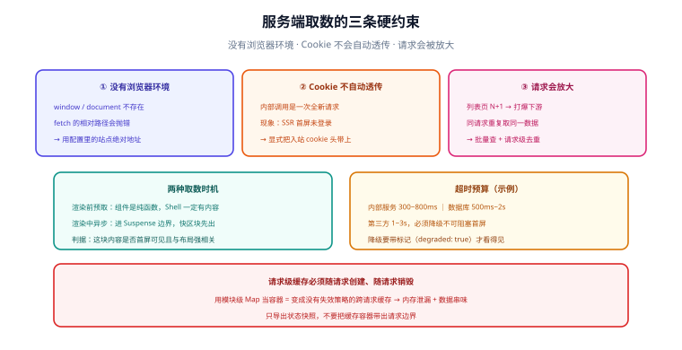

# 服务端数据获取

服务端取数看似只是「把请求从浏览器搬到服务器」，但它改变了三件事：**没有浏览器环境、跨不过 Cookie 边界、多了请求放大与超时的风险**。这一页把这三件事讲清楚，并给出可复用的工程判据。



## 取数发生在两个时刻

| 模式 | 时机 | 优点 | 代价 |
| --- | --- | --- | --- |
| **渲染前预取**（`asyncData` / loader） | 路由解析完成后、渲染开始前 | 渲染期数据已就绪，组件是纯函数；状态易注入 | 串行等待，TTFB 变长 |
| **渲染中异步**（`Suspense` 边界内取数） | 渲染过程中挂起 | 快区块先出，慢区块后补（流式的前提） | 需要边界与占位；错误处理更细 |

**两者不是替代关系**：首屏关键数据用预取（保证 Shell 有内容），非关键区块用渲染中异步（保证 Shell 早出）。判断标准是**「这块内容是不是首屏可见且与布局强相关」**。

## 三条硬约束

### 1. 服务端没有浏览器环境

`fetch` 之外的一切浏览器 API 都不存在。更隐蔽的是**相对路径**：

```js [server.js —— 服务端 fetch 必须写成绝对地址]
// ❌ 服务端会抛 TypeError: Failed to parse URL（没有 location 作为基准）
const res = await fetch("/api/articles");

// ✅ 用配置里的站点地址拼绝对 URL
const res = await fetch(`${process.env.SITE_ORIGIN}/api/articles`);
```

Nuxt 等框架会用 `useRequestFetch()` / `$fetch` 的 SSR 版本把相对路径内部转发掉，但**它转发的是服务端直调，不会带上用户的 Cookie**（见下一条）。

### 2. Cookie 不会自动透传

这是 SSR 最经典的「玄学 bug」：页面在自己浏览器里看着正常，但**刷新后被踢回登录页**，而 `curl` 到的 SSR 响应还是 200 且内容完整。

原因：服务端向自己的 API 发起内部请求时，是一次**全新的请求**，默认不带 `Cookie` 头；同时内部请求也拿不到浏览器与 API 之间的会话。

```js [server.js —— 显式透传 Cookie]
export default defineEventHandler(async (event) => {
  // 从入站请求里取出 Cookie，显式传给内部调用
  const cookie = getRequestHeader(event, "cookie") ?? "";
  const me = await $fetch("/api/me", { headers: { cookie } });

  // 另一个常见缺口：把入站请求的其他头也带上（语言、灰度标记、追踪 ID）
  const traceId = getRequestHeader(event, "x-trace-id") ?? "";
  return { me, traceId };
});
```

::: danger 鉴权相关的三个坑
1. **内部调用不带 Cookie**：表现为「SSR 首屏是未登录态，客户端水合后突然变登录态」——同时是一次水合不匹配。
2. **把 Token 塞进注入状态**：Token 会出现在 HTML 源码里，任何人可见。只注入渲染需要的用户信息。
3. **服务端与客户端走了两套鉴权**：服务端读 Cookie、客户端读 `localStorage`，两者不同步时会出现「首屏登录、点击后掉登录」。
:::

### 3. 请求会放大

服务端渲染一个列表页，如果每个列表项各自调用一次详情接口，就是经典的 N+1：一次页面请求变成 1+N 次下游调用，**在浏览器里只是慢，在服务端会直接打爆下游**。

```js [server.js —— 合并请求：先批量查，再分发]
// ❌ N+1：每个 item 一次请求
const items = await Promise.all(ids.map((id) => fetchDetail(id)));

// ✅ 一次批量请求 + 按 key 分发（也可用 DataLoader 这类批处理工具）
const details = await fetchDetails(ids);            // 1 次
const map = new Map(details.map((d) => [d.id, d]));
const items = ids.map((id) => map.get(id));
```

此外还有两类放大要防：

- **同一请求内重复取同一份数据**：多个组件各自请求同一接口。做法是**请求级缓存**（同一请求内按 key 去重），而不是全局缓存。
- **串行瀑布**：A 的数据依赖 B 的返回。能并行的一定要并行（见 [性能与成本](../Performance/index.md)）。

## 请求级缓存 vs 跨请求缓存

| 类型 | 生命周期 | 用途 | 风险 |
| --- | --- | --- | --- |
| 请求级去重 | 单次 SSR 渲染内 | 同一请求内多处取同一数据只发一次 | 几乎无（注意别跨请求复用容器） |
| 跨请求缓存 | 进程/共享缓存 | 减少下游压力（真正的性能来源） | 键设计错会串号；失效策略要清晰 |

**请求级去重必须随请求创建、随请求销毁**。如果用模块级 Map 当容器，就会变成跨请求缓存，且**没有失效策略**——这是 SSR 里最隐蔽的内存泄漏与数据串味来源。

```js [请求级缓存的正确生命周期]
// ✅ 缓存容器随请求创建，挂在请求上下文里
export async function render(url, cookies) {
  const loader = createLoader({ cookies });      // 内部持有 Map，请求结束即回收
  const app = createSSRApp(App);
  app.provide("loader", loader);
  const html = await renderToString(app);
  return { html, state: loader.snapshot() };      // 只把状态导出，不导出缓存容器
}
```

## 错误与超时预算

服务端取数必须**给每个依赖设超时**，否则一个慢下游会把 SSR 的并发槽位全部占满（这也是「服务端被拖垮」的典型路径）：

| 依赖类型 | 建议超时 | 超时后行为 |
| --- | --- | --- |
| 内部服务（同机房） | 300~800ms | 该区块降级为空态/骨架 |
| 数据库 | 500ms~2s | 视页面而定，非关键区块降级 |
| 第三方 API | 1~3s | 必须降级，不可阻塞首屏 |

```js [server.js —— 带超时与降级的取数]
async function withTimeout(promise, ms, fallback) {
  let timer;
  try {
    return await Promise.race([
      promise,
      new Promise((_, reject) => {
        timer = setTimeout(() => reject(new Error("timeout")), ms);
      }),
    ]);
  } catch (err) {
    logWarn("data.degraded", { ms, err: String(err) });
    return fallback;                       // 降级而非让整页失败
  } finally {
    clearTimeout(timer);                   // 必须清理，否则定时器泄漏
  }
}
```

**降级要能被看见**：返回空数组与「真的没有数据」在页面上一模一样，因此降级时要在返回结构里带标记（如 `degraded: true`），并在页面/日志里体现，否则故障会以「内容莫名变少」的形式潜伏。

## 验证方式

```shell [shell]
# 1. 带 Cookie 请求，SSR 首屏应已是登录态（而不是未登录再跳转）
curl -s -H "Cookie: session=<有效会话>" http://localhost:3000/account | grep -c "退出登录"

# 2. 不带 Cookie 请求，应渲染未登录版本（证明 Cookie 真的被用上了）
curl -s http://localhost:3000/account | grep -c "请登录"

# 3. 看服务端日志里同一页面的下游请求次数（验证请求合并生效）
#    期望：列表页的下游调用次数与列表长度无关

# 4. 注入状态中不应出现凭据类字段
curl -s http://localhost:3000/account | grep -c -E "access_token|refresh_token|password"
```

预期：第 1 条命中且第 2 条命中（两条同时成立才说明 Cookie 透传正确）；第 3 条调用次数为常数；第 4 条为 0。

## 参考资料

- [Nuxt：Data Fetching](https://nuxt.com/docs/getting-started/data-fetching)
- [Next.js：Data Fetching](https://nextjs.org/docs/app/building-your-application/data-fetching)
- [Vue：SSR 与数据预取](https://vuejs.org/guide/scaling-up/ssr.html#data-fetching)
- [MDN：`Cache-Control`](https://developer.mozilla.org/en-US/docs/Web/HTTP/Headers/Cache-Control)
