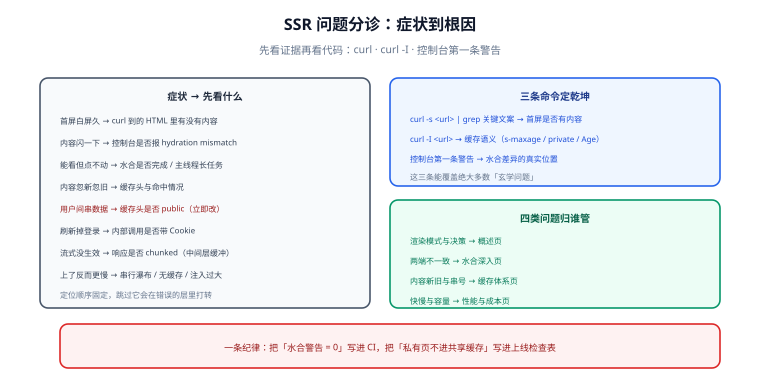

# 常见问题与最佳实践

SSR 的问题有一个特点：**症状与根因几乎从不在同一层**。「页面闪一下」可能是数据不一致，「点不动」可能是水合失败，「变慢了」可能是缓存没命中。这一页先把分诊路径固定下来，再逐条回答高频问题。

## 先分诊，再动手

| 症状 | 第一步看什么 | 常见根因 | 处置 |
| --- | --- | --- | --- |
| 首屏白屏久 | `curl` 到的 HTML 里有没有内容 | 渲染没生效 / 取数串行 / 没有缓存 | 见 [概述](../Overview/index.md) 与 [性能](../Performance/index.md) |
| 内容先出现又闪没 | 控制台是否有 hydration 警告 | 水合不匹配 | 见 [水合深入](../Hydration/index.md) |
| 页面能看但点不动 | 水合是否完成 / 主线程是否被长任务占满 | 水合耗时过长、JS 报错中断 | 见 [水合深入](../Hydration/index.md) |
| 内容一会儿新一会儿旧 | 缓存头与命中情况 | 缓存键过粗/TTL 过长 | 见 [缓存体系](../Caching/index.md) |
| 不同用户看到对方数据 | 缓存头是否为 `public` | 个性化页面进了共享缓存 | **立即改为 `private, no-store`** |
| 刷新后掉登录 | 内部调用是否带 Cookie | Cookie 未透传 | 见 [服务端数据获取](../DataFetching/index.md) |
| 流式没生效 | 响应是否 chunked | 中间层缓冲 | 见 [流式渲染](../Streaming/index.md) |

::: danger 一条纪律
**先看证据再看代码。** SSR 的绝大多数「玄学问题」都能用三条命令定位：`curl`（看原始 HTML）、`curl -I`（看缓存语义）、控制台第一条警告（看水合差异）。跳过这三步直接读代码，通常会在错误的层里打转。
:::

## 高频十二问

### 1. SSR 和 SSG 到底怎么选？

看三个判据：内容是否**随用户变化**、能接受**多久的延迟**、是否依赖 **Cookie**。三者都指向「公共且可延迟」就是 SSG/ISR；有一个指向「实时且个性化」才是 SSR。见 [概述](../Overview/index.md)。

### 2. 上了 SSR 反而更慢了，为什么？

三个最常见原因：**取数串行**（最慢依赖决定 TTFB）、**没有缓存**（每次请求都重新渲染）、**注入状态过大**（HTML 体积暴涨）。按这个顺序查。

### 3. 水合警告可以忽略吗？

不可以。它意味着「服务端 HTML 与客户端首帧不一致」，必然退化成客户端重新渲染——轻则闪动，重则事件绑定错位。把警告纳入 CI 是成本最低的做法。

### 4. 为什么我的页面「看着是登录态，一交互就掉了」？

服务端渲染时用了 Cookie（所以首屏是登录态），但客户端取数或路由守卫读的是 `localStorage`/内存 token，两者不同步。**统一鉴权来源**：要么都以 Cookie 为准，要么把状态注入并复用。

### 5. `ClientOnly` 能解决所有水合问题吗？

不能。它只适合「确实无法同构」的组件（图表、编辑器）。用它掩盖数据不一致，问题会变成「SEO 抓不到 + 首屏空白」。

### 6. 流式渲染一定更快吗？

它让**首字节更早到达**，但不一定让 LCP 更好；如果最大元素恰好在慢区块里，或者占位尺寸不一致导致 CLS 变差，用户体验可能更糟。评估要看 FCP/LCP/CLS 与慢区块填充时间。

### 7. 个性化页面能不能缓存？

能，但必须**分层**：公共部分走共享缓存，个性化部分单独渲染或客户端拉取。**绝不能让个性化响应带 `public` 进入共享缓存。**

### 8. `s-maxage` 和 `max-age` 有什么区别？

`max-age` 约束浏览器，`s-maxage` 约束共享缓存（CDN），且 `s-maxage` 优先级更高。只想让 CDN 缓存、不希望浏览器长期缓存，就写 `s-maxage`。

### 9. 发布新版本后用户还看到旧页面怎么办？

这是缓存的正常行为，处理方式是**缩短 HTML 的 TTL + 主动失效**，并保证「旧 HTML 引用的旧静态资源仍然可访问」（资源保留一段时间或在 HTML 里做版本对齐）。

### 10. SSR 需要多少台机器？

用 `峰值 QPS × 单次渲染耗时 ÷ 单实例并发能力` 估算，再留一倍冗余。注意渲染是 CPU 密集型，且慢下游会让所需实例数成倍上升。见 [性能与成本](../Performance/index.md)。

### 11. 要不要一开始就上边缘渲染？

不要。先在常规服务端把「取数并行 + 缓存分层 + 水合清零」做完，这三件事没做好时，换到边缘只是把同样的问题搬了个地方。

### 12. 怎么判断改造是否成功？

看三组数：**LCP/FCP 是否下降、水合警告是否为 0、缓存命中率与服务端 P95 是否达标**。只看「首屏有内容了」不足以说明成功。

## 上线自查清单

| # | 检查项 | 通过判据 |
| --- | --- | --- |
| 1 | 首屏内容在 HTML 里 | `curl` 命中关键文案 |
| 2 | 水合警告为 0 | CI 门禁通过 |
| 3 | 私有页面不进共享缓存 | 响应头含 `private`/`no-store` |
| 4 | 公共页面可被缓存且命中 | `Age` 递增 |
| 5 | 错误响应不被长缓存 | 500/404 的 `Cache-Control` 合理 |
| 6 | 注入状态无凭据字段 | 关键词扫描为 0 |
| 7 | 每个下游有超时 | 人为拖慢后按预算降级 |
| 8 | 渲染失败有兜底 | 断开下游仍可访问 |
| 9 | 监控四项齐全 | 面板可见 P95/错误率/命中率/降级 |
| 10 | 灰度流程就绪 | 能按比例放量与快速回切 |

## 最佳实践十二条

1. **按路由选模式**，不要按项目选。
2. **先做数据层缓存**，再做整页缓存。
3. **每请求新建实例**，杜绝模块级单例。
4. **首帧只依赖可序列化输入**。
5. **不可缓存的内容在架构上分离出去**。
6. **每个下游都有超时与降级**。
7. **注入状态最小化且脱敏**。
8. **水合警告进 CI**。
9. **占位尺寸与真实内容一致**（流式的 CLS 防线）。
10. **错误响应不缓存**。
11. **监控渲染耗时与命中率**，而不是只看 TTFB。
12. **始终保留降级开关**。

## 参考资料

- [web.dev：Rendering on the Web](https://web.dev/articles/rendering-on-the-web)
- [RFC 9111：HTTP Caching](https://www.rfc-editor.org/rfc/rfc9111)
- [React：`hydrateRoot`](https://react.dev/reference/react-dom/client/hydrateRoot)
- [Vue：SSR 指南](https://vuejs.org/guide/scaling-up/ssr.html)
