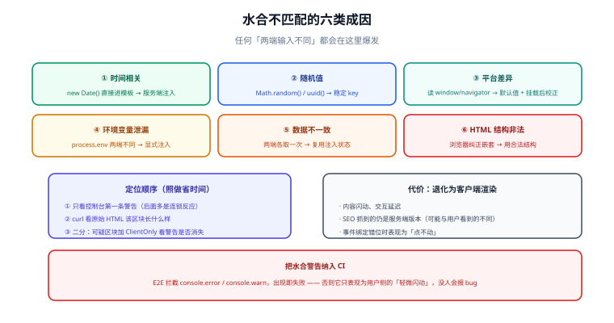

# 水合深入

水合（Hydration）是 SSR 里最容易被忽略、又最容易出问题的一步：它让服务端产出的「只能看」的 HTML，变成「能点」的应用。**水合不重建 DOM，只做「比对 + 绑定」**——正因为如此，任何不一致都不会被覆盖，而是被放大成警告或交互错乱。



## 水合到底在做什么

客户端执行的顺序是：

1. 用同一份组件代码重新执行一次，生成**虚拟 DOM 树**；
2. 沿着已有的真实 DOM 逐节点比对（diff）；
3. 比对通过：把事件监听、ref、状态绑定到现有节点上；
4. 比对失败：**报 mismatch 警告**，并以客户端结果为准做修补（各框架策略略有差异，但「丢弃服务端结果」是共同点）。

关键含义：**水合失败不会「自动修成正确状态」，而是退化成一次客户端重新渲染**——用户可能看到内容闪动、交互延迟，最坏的情况下事件绑定错位。

## 六类成因

| # | 成因 | 典型写法 | 正确做法 |
| --- | --- | --- | --- |
| 1 | **时间相关** | 渲染里直接 `new Date()`、`Date.now()` | 服务端注入时间戳；或标记该区块为「客户端专属」 |
| 2 | **随机值** | `Math.random()`、`uuid()` 在渲染期调用 | 服务端生成后随状态注入；或用稳定 key |
| 3 | **平台差异** | 渲染时读 `window.innerWidth`、`navigator.language` | 首帧用相同默认值，挂载后再校正 |
| 4 | **环境变量泄漏** | 服务端渲染用 `process.env.FLAG`，客户端读不到 | 只把需要的值显式注入；或统一走运行时配置接口 |
| 5 | **数据不一致** | 两端各取一次数据，结果不同（缓存/时区/权限） | 服务端取数并注入状态，客户端**复用**而非重取 |
| 6 | **HTML 结构非法** | `<p>` 里塞块级元素、表格结构被浏览器纠正 | 用合法嵌套；必要处用 `ClientOnly` 包住 |

::: danger 最隐蔽的一类：浏览器纠正 HTML
浏览器解析 HTML 时会**纠正非法嵌套**（例如 `<p>` 里出现 `<div>` 会被自动闭合），于是「服务端输出的 HTML」与「浏览器 DOM」天然不同，水合必然失败——而报错信息通常只指向一个莫名其妙的父节点。**服务端模板也必须遵守 HTML 内容模型**，这不是「浏览器宽容所以无所谓」的事。
:::

### 时间与随机的标准写法

```js [组件内：把不稳定值挡在客户端之外]
// ❌ 服务端与客户端各算一次，几乎必然不一致
const now = new Date().toLocaleString();

// ✅ 服务端算好，随状态注入（同一请求内两端一致）
const now = useInitialState("renderedAt");

// ✅ 或者：该内容本来就只该在客户端出现
const clock = ref("");
onMounted(() => { clock.value = new Date().toLocaleString(); });
```

```vue [只在一端渲染的区块]
<template>
  <!-- ClientOnly：服务端渲染占位，客户端挂载后才渲染真实内容 -->
  <ClientOnly>
    <HeavyChart :data="chartData" />
    <template #fallback>
      <div class="chart-skeleton">图表加载中…</div>
    </template>
  </ClientOnly>
</template>
```

`ClientOnly` 是「承认这里两端不一致，并主动隔离」的手段。用它的代价是这块内容在首屏不可见（SEO 也抓不到），所以**只对确实无法同构的内容使用**，不要拿它当万能药。

## 怎么定位水合问题

定位水合问题有一个固定顺序，照做能省下大量时间：

1. **看控制台第一条警告**：框架通常给出「服务端 HTML」与「客户端期望」的片段差异，**第一条**才是根因，后面的多半是它的连锁反应。
2. **关掉 JS 看 HTML**：`curl` 拿到的原始 HTML 里，问题区块长什么样？与浏览器里看到的是否不同？
3. **二分定位**：把可疑区块用 `ClientOnly` 包起来，如果警告消失，就锁定在这块；再逐行比对两端输入。
4. **检查不稳定输入**：时间、随机、平台 API、`process.env`、locale/时区。
5. **检查 HTML 合法性**：把服务端输出粘进 HTML 校验器，或反查被浏览器改写的位置。

::: tip 生产环境也要能看见它
不少框架在生产构建下**只给出极简的水合错误**（为了体积）。建议在 CI 里用 E2E 打开页面并**拦截控制台警告**，把它当作门禁；否则这类缺陷只会在用户侧表现为「轻微闪动」，没人会报 bug。
:::

## 选择性水合与岛屿架构

「整页水合」的成本是：**必须等所有组件代码下载完，才能开始恢复交互**。规模一大，这条线就很长。业界的三种优化方向：

| 方案 | 思路 | 代价 | 代表 |
| --- | --- | --- | --- |
| 选择性水合 | 按优先级分批水合（先交互区、后次要区） | 需要框架支持；调试复杂度上升 | React 选择性水合 + `Suspense` |
| 岛屿架构（Islands） | HTML 默认静态，只有交互区块被「激活」 | 区块间共享状态变麻烦 | Astro、Fresh |
| 可恢复性（Resumability） | 把状态序列化到 HTML，客户端**不重跑组件** | 生态与心智成本高 | Qwik |

这三种方案的共同目标是**把「水合成本」与「页面大小」解耦**。判断是否需要它们，只需问一个问题：**页面上真正需要交互的区域，占整页的比例大吗？** 如果一篇文章页只有「点赞」和「评论框」是交互的，岛屿架构几乎是天然的答案；如果整页都是表格与表单，选择性水合收益有限。

## 渐进增强：把「能看」和「能用」分开

水合失败的兜底设计，本质上是在回答：**JS 没加载完或执行失败时，用户还能做什么？**

| 层次 | 依赖 JS？ | 设计要点 |
| --- | --- | --- |
| 内容可读 | 否 | SSR 已保证；关键内容不要放在客户端才渲染的区块里 |
| 基本导航可跳转 | 否 | 用真实 `<a href>`，而不是只挂 `onClick` 的 `<div>` |
| 表单可提交 | 否 | 用原生 `<form action>` 或渐进增强的提交 |
| 高级交互 | 是 | 水合后才启用（拖拽、实时校验、快捷键） |

这条分层不只是「优雅降级」的情怀，它有非常实际的回报：**首屏可交互时间与 JS 失败率不再决定内容能否被读到**，也让爬虫与预渲染更可靠。

## 易错点与最佳实践

::: danger 高频坑
1. **用 `ClientOnly` 掩盖真实缺陷**：把数据不一致的区块包起来，警告没了、问题还在（SEO 抓不到、首屏闪空）。
2. **服务端与客户端用了不同的时间/时区**：服务器 UTC、浏览器本地时区，渲染出的日期文本不同 → mismatch。统一 locale 配置或在服务端格式化好再注入。
3. **异步组件的加载态不一致**：服务端直接渲染出内容，客户端首帧还在加载中 → mismatch。loading 占位要两端一致。
4. **`key` 不稳定**：列表 key 用数组下标或随机值，两端顺序/数量不同时整棵子树重建。
5. **把水合警告当噪音**：它几乎总是真问题，且往往是下一个线上事故的前兆。
:::

::: tip 最佳实践
1. **首帧只依赖「可序列化的输入」**：组件在渲染期的所有输入都应当来自 props 或注入的状态，而不是环境。
2. **给不稳定内容显式的归属**：要么由服务端注入固定值，要么明确标记为客户端专属。
3. **把水合警告纳入 CI**：E2E 拦截 `console.error` / `console.warn`，出现即失败。
4. **量一下水合成本**：用 Performance 面板看「主线程被水合占用的时间段」，这通常才是交互延迟差的真实原因。
:::

## 验证方式

```shell [shell]
# 1. 原始 HTML 中问题区块是否已包含内容（而不是占位）
curl -s http://localhost:3000/ | grep -c "评论"

# 2. 页面加载后控制台应无 hydration 相关警告（E2E 断言思路）
#    page.on("console", msg => { if (msg.type() === "error") throw new Error(msg.text()); })

# 3. 关闭 JS 后页面内容与可跳转链接仍可用（DevTools → Settings → Disable JavaScript）
```

预期：第 1 条命中；第 2 条无警告；第 3 条内容可见、链接可点。

## 参考资料

- [React：`hydrateRoot` 与水合不匹配](https://react.dev/reference/react-dom/client/hydrateRoot)
- [Vue：ClientOnly 组件](https://vuejs.org/guide/scaling-up/ssr.html)
- [Astro：Islands 架构](https://docs.astro.build/en/concepts/islands/)
- [MDN：Server-side rendering](https://developer.mozilla.org/en-US/docs/Glossary/SSR)
