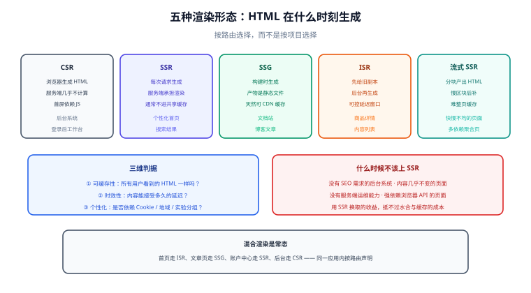

# 概述：渲染模式全景

「上不上 SSR」几乎从不是一个二选一的问题。真实项目里更有用的问法是：**这个页面的 HTML，应该在什么时刻、由谁生成，又该被谁缓存多久**。本页把这几个维度拆成一张可对照的表与一棵可执行的决策树。



## 五种渲染形态

| 形态 | HTML 何时生成 | 每次请求都要服务端计算 | 可被 CDN 缓存 | 内容时效 | 典型场景 |
| --- | --- | --- | --- | --- | --- |
| **CSR**（客户端渲染） | 浏览器拿到空壳后由 JS 生成 | 否（数据由浏览器请求） | 是（只有静态资源） | 实时 | 后台系统、登录后的工作台 |
| **SSR**（服务端渲染） | **每次请求**在服务端生成 | 是 | 通常否（除非命中个性化缓存） | 实时 | 个性化首页、搜索结果、带登录态页面 |
| **SSG**（静态生成） | **构建时**生成，产物是静态文件 | 否 | 是 | 取决于重新构建 | 文档站、博客文章、营销页 |
| **ISR**（增量静态再生成） | 构建时生成，**到期后在后台再生成** | 否（用户命中的是旧副本） | 是 | 可控延迟（秒~分钟级） | 商品详情、内容列表、更新不频繁的大流量页 |
| **Streaming SSR**（流式服务端渲染） | 每次请求，但**分块产出** | 是 | 否 | 实时 | 依赖多、快慢不均的页面（首屏快、慢区块后到） |

::: tip 一句话理解
**CSR 把渲染成本给了用户设备，SSR 给了服务器，SSG/ISR 给了构建机。** 选择哪种，本质上是在「谁买单」和「内容能晚多久」之间做取舍。
:::

## 三个判据

任何页面都能用这三个问题定位到合适的形态：

| 判据 | 关键问题 | 判「是」时倾向 |
| --- | --- | --- |
| **可缓存性** | 所有用户看到的 HTML 完全一样吗？ | 完全一样 → SSG / ISR；因人而异 → SSR |
| **时效性** | 内容能接受多久的延迟？ | 秒级以内 → SSR；分钟级可接受 → ISR；改动即发布 → SSG |
| **个性化** | 页面是否依赖 Cookie / 登录态 / 地理位置？ | 依赖 → SSR（或「壳静态 + 数据客户端拉取」的混合方案） |

三个判据里**只要有一个是「因人而异且必须服务端渲染」，就排除 SSG/ISR**；反之，三个都指向「大家都一样」，那么用 SSR 是纯粹的浪费——每一次请求都在做一次可以只做一次的活。

## 决策树

```text
这个页面的 HTML 对所有人是否相同？
├─ 相同
│   ├─ 内容改动频率低（小时/天级）→ SSG（构建时生成）
│   ├─ 内容会变但能接受分钟级延迟 → ISR（增量再生成）
│   └─ 内容实时（价格、库存）→ SSR + 短 TTL 或客户端补拉
└─ 不同（登录态 / 地域 / A-B 实验）
    ├─ 只有少量区块不同 → 壳用 SSG/ISR + 差异区块 SSR 或客户端拉取（岛屿）
    └─ 整页都不同 → SSR（务必做请求级缓存分层，见缓存专题）
```

这张树的用法是**按路由判定，而不是按项目判定**：一个应用里首页走 ISR、文章页走 SSG、账户中心走 SSR、后台管理走 CSR，是完全正常的组合，多数现代框架（Nuxt、Next）都支持按路由声明。

## 什么时候不该上 SSR

SSR 换来的是首屏与可抓取性，付出的是水合复杂度、缓存设计成本与服务端资源。以下四类情况里，SSR 往往是负收益：

1. **登录后才可见的后台系统**：没有 SEO 需求，用户也是固定人群，CSR 的交互体验更简单直接。
2. **页面内容几乎不变**：应该用 SSG/ISR，用 SSR 等于每次请求都重新算一遍并丢掉缓存能力。
3. **团队没有服务端运维能力**：SSR 意味着 Node/其他运行时进入生产链路，需要监控、扩缩容、故障降级（见「性能与成本」的服务端成本一节）。
4. **页面强依赖浏览器 API**：如果渲染逻辑天然依赖 `window`、`localStorage`、`canvas`，同构改造的成本可能超过收益。

::: danger 最贵的三个误判
1. **「SEO 需要 SSR」当成万能理由**：现代爬虫能执行 JS，SEO 的瓶颈常常是内容质量与结构化数据，而不是渲染方式。先确认目标平台是否真的抓不到 CSR 内容，再决定。
2. **「SSR 一定更快」**：SSR 只优化了「首屏内容可见」这一段。如果服务端取数串行、没有缓存，TTFB 可能比 CSR 更慢，用户看到的是「更久的白屏」。
3. **「上了 SSR 就不能缓存」**：恰恰相反，SSR 的性能取决于**缓存分层做得对不对**（CDN / 全页缓存 / 数据缓存）。不做缓存的 SSR 在生产上通常撑不住（见 [缓存体系](../Caching/index.md)）。
:::

## 混合与渐进：主流框架的现状

当前主流框架都在朝「**同一应用内按路由/组件选择渲染方式**」演进：

| 能力 | 说明 | 代表 |
| --- | --- | --- |
| 路由级模式声明 | 同一项目里不同路由用不同渲染方式 | Nuxt `routeRules`、Next 路由段配置 |
| 岛屿/部分水合 | 静态 HTML 中只有交互区块被激活 | Astro 岛屿、Qwik 可恢复性、React Server Components |
| 流式 + 选择性水合 | 先交付首屏，交互按优先级恢复 | React `Suspense` 流式、Vue 异步组件 + `Suspense` |
| 边缘渲染 | 渲染发生在离用户最近的节点 | CDN 边缘运行时（Edge Functions） |

::: info 版本边界
各框架的具体 API 与默认行为随版本变化较快，本专题只写**判据与取舍**；具体写法请以对应框架页（[Nuxt](../../Frame/Nuxt/index.md)、[Next](../../Frame/Next/index.md)）与官方文档为准。
:::

## 易错点与最佳实践

::: danger 高频坑
1. **按项目选模式**：一个后台系统的登录页被强行 SSR，只是因为「项目要上 SSR」。应改成按路由判定。
2. **SSR 页面里藏着个性化但走了公共 CDN 缓存**：把带登录态的内容缓存成了公共副本，导致 A 用户看到 B 用户的数据。这是本专题最严重的事故类型，见 [缓存体系](../Caching/index.md)。
3. **把 `Cache-Control` 当成「设了就行」**：`s-maxage`、`stale-while-revalidate` 与 `private` 的语义差异必须逐个弄清，否则会出现「缓存了不该缓存的」或「该缓存的命中不了」。
4. **不做降级预案**：SSR 服务挂掉后整站白屏。至少要有「静态壳兜底」或「回退到 CSR」的策略。
:::

::: tip 落地建议
1. 先**列出所有路由**，逐个标注三个判据，产出一张「路由 → 渲染模式 → 缓存策略」的表，再动手改代码。
2. 任何新模式上线前，先用 `curl` 看到 `HTML 里真的有内容`（见下方验证方式），这一步能挡掉大半配置错误。
3. 从**只读、可缓存**的页面开始试点（文章页、商品详情），把个性化的账户中心留到最后。
:::

## 验证方式

渲染模式是否生效，**不要只看浏览器**——浏览器会把 JS 执行后的结果呈现给你，看不出 HTML 里原本有没有内容。用命令验证：

```shell [shell]
# 1. 看服务端返回的原始 HTML 里是否有正文内容（不带 JS 执行）
curl -s http://localhost:3000/articles/1 | grep -c "文章标题"

# 2. 看响应头里的缓存语义（s-maxage / stale-while-revalidate 是否按预期出现）
curl -sI http://localhost:3000/articles/1 | grep -i -E "cache-control|age|x-cache"

# 3. 连续请求两次，观察 Age 头是否递增（递增说明命中了共享缓存）
curl -sI http://localhost:3000/articles/1 | grep -i "^age"
curl -sI http://localhost:3000/articles/1 | grep -i "^age"
```

预期结果：第 1 条返回 ≥ 1（HTML 中确实包含内容）；第 2 条能看到预期的时间参数；第 3 条第二次的 `Age` 不小于第一次。若第 1 条返回 0，说明拿到的仍是空壳，渲染模式没有生效或内容在客户端才插入。

## 参考资料

- [web.dev：Rendering on the Web](https://web.dev/articles/rendering-on-the-web)
- [Next.js：Rendering](https://nextjs.org/docs/app/building-your-application/rendering)
- [Nuxt：Rendering Modes](https://nuxt.com/docs/guide/concepts/rendering)
- [RFC 9111：HTTP Caching](https://www.rfc-editor.org/rfc/rfc9111)
- 本库相邻专题：[SPA 单页应用](../../Others/SPA/index.md)、[前端性能优化](../../Others/PerformanceOptimization/index.md)
