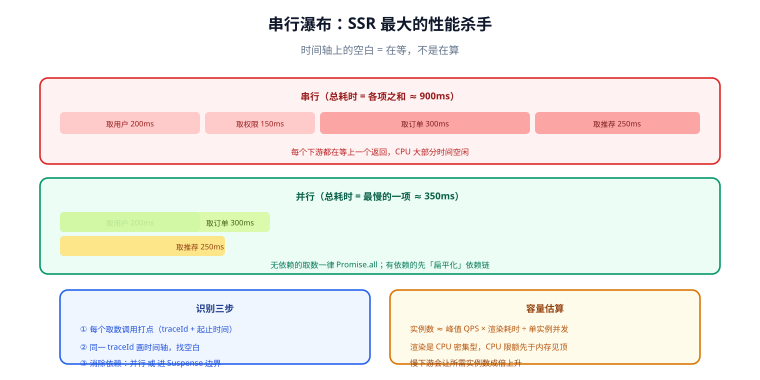

# 性能与成本

SSR 的性能与 CSR 完全不同：瓶颈通常不在浏览器，而在**服务端取数的串行度、缓存命中率和实例成本**。这一页给出 SSR 场景下的指标口径、瀑布识别方法与容量估算方式。



## 指标口径

| 指标 | 测量什么 | SSR 下的解读要点 |
| --- | --- | --- |
| **TTFB** | 第一个字节到达时间 | 流式下它会「虚假变好」（见 [流式渲染](../Streaming/index.md)），**不要单独用它评估** |
| **FCP** | 首次内容绘制 | 反映「HTML 何时可用」，SSR 的主要收益点 |
| **LCP** | 最大内容元素绘制 | 若最大元素来自慢区块，SSR 未必改善它 |
| **INP** | 交互响应延迟 | 受**水合耗时**直接影响，SSR 常见回退项 |
| **CLS** | 布局位移 | 流式占位不一致时恶化 |
| **服务端 P95 渲染耗时** | 单次 SSR 耗时 | 决定容量与超时配置，必须单独监控 |

::: warning 只盯 TTFB 是最常见的误判
「上了 SSR，TTFB 从 400ms 降到 80ms，但用户反馈没变快」——因为用户感知的是 **FCP/LCP**，而这两个指标由「HTML 里有没有内容 + 关键资源是否阻塞」决定。**把 TTFB、FCP、LCP、INP 放在同一张看板上看**，才能判断优化是否真的落地。
:::

## 串行瀑布：SSR 最大的性能杀手

最典型的一类问题：

```text
❌ 串行（总耗时 900ms）
取用户 (200ms) → 取权限 (150ms) → 取订单 (300ms) → 取推荐 (250ms) → 渲染

✅ 并行（总耗时 350ms）
       ┌─ 取用户 (200ms) ─┐
起始 ──├─ 取权限 (150ms) ─┼─ 渲染
       ├─ 取订单 (300ms) ─┤
       └─ 取推荐 (250ms) ─┘
```

识别方法有三步：

1. **打点**：在每个取数调用前后记录时间戳与 traceId，输出成结构化日志（或直接用链路追踪）。
2. **画时间线**：把同一 traceId 的取数区间画在时间轴上——**肉眼能立刻看出哪里有空白**（空白 = 在等，不是在算）。
3. **消除依赖**：只有真正有数据依赖的才保留串行；其余全部并行，或用「先渲染 Shell，慢的进边界」分流。

```js [server.js —— 无依赖的取数一律并行]
// ❌ 串行：总耗时是三者之和
const user = await getUser(id);
const perms = await getPerms(id);
const orders = await getOrders(id);

// ✅ 并行：总耗时是最慢的那个
const [user, perms, orders] = await Promise.all([
  getUser(id), getPerms(id), getOrders(id),
]);

// ⚠️ 有依赖时不能并行，但可以「扁平化」依赖链：一次批量拿到依赖项
const detail = await getDetail(user.orderId);
```

## 缓存命中率：SSR 性能的真正杠杆

| 命中率 | 含义 | 服务端压力 |
| --- | --- | --- |
| 90% 以上 | 绝大多数请求走缓存 | 渲染只发生在 10% 的请求上 |
| 60%~80% | 键设计或 TTL 有问题 | 仍有大量渲染 |
| 低于 50% | 缓存基本没起作用 | 相当于纯 SSR，还多了维护成本 |

命中率低的常见原因：缓存键过细（把无关参数写进键）、TTL 太短、`Vary` 过宽、发布频繁导致批量失效、以及**把不可缓存的内容放进了同一个页面**。

提升命中率的两条主线：

1. **把不可缓存的内容从页面里拆出去**（壳静态 + 数据客户端拉取 / 边缘渲染）。
2. **让缓存键只包含真正影响输出的维度**，并监控「键的基数」——键基数过高的缓存等于没有缓存。

## 服务端成本与容量

SSR 的成本可以直接估算：

```text
所需实例数 ≈ 峰值 QPS × 单次渲染耗时(秒) ÷ 单实例并发能力

例：峰值 500 QPS、单次渲染 50ms、单实例可并发处理 20 个渲染
    → 500 × 0.05 ÷ 20 ≈ 1.25 → 至少 2 个实例（再留一倍冗余 → 4 个）
```

三个容易被低估的因素：

- **渲染是 CPU 密集型的**：模板渲染 + 序列化会吃 CPU，容器 CPU 限额（`limits.cpu`）比内存更容易成为瓶颈。
- **慢下游会放大所需实例数**：单次渲染从 50ms 涨到 500ms，所需实例数直接 ×10。
- **内存随并发上升**：每个并发渲染都持有自己的应用实例与状态快照。

::: danger 上线前必须有的三件事
1. **服务端超时**：SSR 渲染本身要有超时（例如 3s），超时后返回静态壳兜底，而不是让请求挂住。
2. **限流与排队**：SSR 前面要有并发上限，超出部分快速失败或排队，避免雪崩式拖垮。
3. **降级开关**：能一键切回 CSR/静态壳。SSR 服务故障时，「页面稍旧」远好于「整站白屏」。
:::

## 监控与告警

| 指标 | 为什么要看 | 建议告警 |
| --- | --- | --- |
| SSR P95 渲染耗时 | 直接反映容量余量 | 超过预算（如 300ms）持续 5 分钟 |
| 渲染错误率 | 渲染异常会退化成客户端渲染 | 突增即告警 |
| 缓存命中率 | 命中率骤降说明键/TTL 出问题 | 环比下降超过 20% |
| 降级次数 | 降级是「静默故障」 | 出现即需关注 |
| 实例 CPU / 内存 | 容量规划依据 | 持续 > 80% |

## 易错点与最佳实践

::: danger 高频坑
1. **只优化 TTFB**：指标好看、用户无感。必须同时看 FCP/LCP/INP。
2. **不设超时**：一个慢下游拖垮整个 SSR 集群，形成「全站慢」。
3. **水合成本不管**：SSR 把首屏内容提前了，但如果水合要 2 秒，用户「看得到却点不动」，INP 会很差。
4. **压测只压静态页**：真实压力在带缓存失效、带个性化的页面上，压测必须覆盖这两类。
5. **忽略首屏字节数**：注入的状态过大（几百 KB）会抵消 SSR 的收益。
:::

::: tip 最佳实践
1. 给每个页面的 SSR 耗时设**预算**（如 200ms），超预算的页面拉出来单独治理。
2. 把「渲染耗时 / 下游耗时 / 缓存命中」三组指标放在同一个看板上，排障路径才完整。
3. 压测脚本要模拟**缓存未命中**（清空缓存后打流量），否则容量估算会偏乐观。
4. 灰度发布 SSR 变更：先放 5% 流量，观察渲染耗时与错误率再放量。
:::

## 验证方式

```shell [shell]
# 1. 看服务端渲染耗时（以带打点的日志或 trace 为准）
#    期望：P95 在预算内，且慢请求能定位到具体下游

# 2. 对比「缓存未命中」与「命中」两种情况的响应时间
curl -s -o /dev/null -w "miss: %{time_starttransfer}s\n" -H "Cache-Control: no-cache" https://example.com/articles/1
curl -s -o /dev/null -w "hit:  %{time_starttransfer}s\n" https://example.com/articles/1

# 3. 检查是否设置了渲染超时与兜底（人为让下游变慢，观察是否在预期时间内返回兜底页）

# 4. 前端侧指标：LCP / INP / CLS 上报是否齐全
```

预期：第 2 条的命中耗时显著低于未命中（差距就是缓存的价值）；第 3 条在超时后返回兜底而**不是等待**。

## 参考资料

- [web.dev：Core Web Vitals](https://web.dev/articles/vitals)
- [web.dev：Optimize LCP](https://web.dev/articles/optimize-lcp)
- [MDN：Server-Timing](https://developer.mozilla.org/en-US/docs/Web/HTTP/Headers/Server-Timing)
- 本库相邻专题：[前端性能优化](../../Others/PerformanceOptimization/index.md)、[浏览器性能指标](../../Basic/Browser/Performance/index.md)
