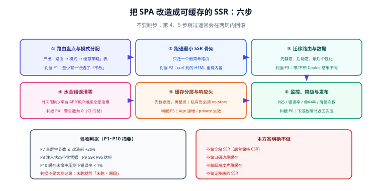

# 实战：把 SPA 改造成可缓存的 SSR

本实战把一个已经上线的 SPA（博客前台：首页列表 + 文章详情 + 评论）改造成「**首屏由服务端渲染、可被 CDN 缓存、个性化部分不串味**」的形态。六步走完，每一步都有可执行的判据，**不要跳步**——尤其是第 4 步（水合清零）与第 5 步（缓存分层），跳过它们上线的 SSR 通常会在两周内回滚。



## 改造前的三条前提

先确认这笔投入值得，再动手：

1. **有明确的首屏/SEO 需求**：例如`文章详情页需要被搜索引擎抓到正文`、`弱网下首屏白屏超过 3 秒`。
2. **页面主体是「读多写少」**：内容型页面才吃得到 SSR + 缓存的红利；重交互的后台不值得改。
3. **有服务端运行时的运维能力**：能部署 Node/边缘运行时、能看它的监控、能做扩缩容与降级。

::: tip 什么时候该只改一部分
如果只有「列表页与详情页」需要首屏，**就只改这两个路由**。账户中心、发布后台继续走 CSR——按路由混合是主流框架的标准能力，不必追求全站统一。
:::

## 第 1 步：路由盘点与模式分配

先产出一张表，**再写代码**：

| 路由 | 是否随用户变化 | 内容时效 | 选定模式 | 缓存策略 |
| --- | --- | --- | --- | --- |
| `/`（首页列表） | 否 | 分钟级 | ISR | `s-maxage=300, stale-while-revalidate=86400` |
| `/articles/:id` | 否（正文）+ 是（点赞态） | 小时级 | SSG/ISR + 点赞态客户端拉取 | `s-maxage=3600` |
| `/tags/:tag` | 否 | 分钟级 | ISR | `s-maxage=300` |
| `/account` | 是 | 实时 | SSR（私有） | `private, no-store` |
| `/admin/**` | 是 | 实时 | CSR（不改） | 不适用 |

**判据 P1**：表里每一行都能回答「为什么选这个模式」，且至少有一行选了「不改」——如果一个都没排除，说明盘点没有真正做。

## 第 2 步：跑通最小 SSR 骨架

先让一个页面（选最简单的 `/tags/:tag`）能被服务端渲染出来，**不要一上来就迁移全部路由**。骨架包含四件事：

```js [server.js —— 最小可用的 SSR 入口]
import express from "express";
import { createServer as createViteServer } from "vite";

const app = express();
const vite = await createViteServer({ server: { middlewareMode: true }, appType: "custom" });
app.use(vite.middlewares);

app.get("*", async (req, res) => {
  try {
    // ① 每个请求独立的模板与实例（生产环境用构建产物，开发用 vite 转换）
    let template = await readFile("index.html", "utf-8");
    template = await vite.transformIndexHtml(req.originalUrl, template);

    // ② 渲染（内部每请求新建 app/router/store）
    const { html } = await render(req.originalUrl, req.headers.cookie);
    const page = template.replace("<!--app-html-->", html);

    // ③ 首屏内容在 HTML 里（不是靠客户端补）
    res.status(200).set({ "Content-Type": "text/html" }).end(page);
  } catch (err) {
    vite.ssrFixStacktrace(err);
    // ④ 渲染失败必须降级，而不是返回 500 白屏
    res.status(500).end(fallbackShell);
  }
});

app.listen(3000);
```

**判据 P2**：`curl -s http://localhost:3000/tags/vue | grep -c "文章标题"` ≥ 1（HTML 里真的有内容），且关掉浏览器 JS 后页面仍可读。

## 第 3 步：迁移路由与数据

按「先静态、后动态、最后个性化」的顺序迁移，每迁一个路由跑一次判据。

```js [routes.js —— 服务端与客户端共用同一份路由表]
export const routes = [
  { path: "/", component: Home, meta: { ssr: "isr" } },
  { path: "/articles/:id", component: Article, meta: { ssr: "isr" } },
  { path: "/tags/:tag", component: TagPage, meta: { ssr: "isr" } },
  { path: "/account", component: Account, meta: { ssr: "private" } },
  { path: "/admin", component: Admin, meta: { ssr: "csr" } },
];
```

取数要遵守 [服务端数据获取](../DataFetching/index.md) 的三条硬约束，重点关注：

1. **Cookie 显式透传**：内部接口调用必须把入站 `cookie` 头带上。
2. **请求合并**：列表页不要按 item 逐个请求详情。
3. **超时与降级**：每个下游都要有超时，慢的下游降级为空态而不是阻塞整页。

**判据 P3**：`带 Cookie 请求 /account` 与 `不带 Cookie 请求 /account` 返回**不同内容**（证明 Cookie 真的被用上，而不是恰好都为未登录态）；服务端日志中列表页的下游调用次数为**常数**。

## 第 4 步：水合错误清零

这是最关键的一步。SPA 迁移过来的代码里有大量「只在客户端成立」的写法，会集中在水合阶段爆发：

| 常见来源 | 迁移时的典型残留 | 处理 |
| --- | --- | --- |
| 时间/随机 | `new Date()` 直接渲染 | 服务端注入或移到 `onMounted` |
| 平台 API | 渲染期读 `window`、`localStorage` | 首帧默认值 + 挂载后校正 |
| 客户端库 | 图表/编辑器在模块顶层初始化 | 动态导入 + `ClientOnly` |
| 状态不同步 | 两端各取一次数据 | 服务端取数注入，客户端复用 |

**判据 P4**：把「控制台出现 hydration 警告即失败」写进 E2E，并让它在 CI 里跑。**验收标准是警告数为 0，不是「看起来正常」**。

```js [e2e/hydration.spec.js —— 用 Playwright 把水合警告变成门禁]
test("页面无水合警告", async ({ page }) => {
  const problems = [];
  page.on("console", (msg) => {
    const text = msg.text();
    if (/hydration|mismatch/i.test(text)) problems.push(text);
  });
  await page.goto("/articles/1");
  await page.waitForLoadState("networkidle");
  expect(problems).toEqual([]);
});
```

## 第 5 步：缓存分层与响应头

先做数据层缓存，再做整页缓存：

| 层 | 做法 | 判据 |
| --- | --- | --- |
| 数据层 | 热点查询加缓存，键含「影响结果的全部维度」 | 缓存命中率可观测且 > 80% |
| 整页（公共页） | `s-maxage` + `stale-while-revalidate` | 第二次请求 `Age` 递增 |
| 个性化页 | `private, no-store`，绝不进共享缓存 | 两账号请求同一 URL 不串数据 |
| 错误响应 | 不缓存（或极短 TTL） | 故障恢复后用户不再看到错误页 |

```js [server.js —— 按路由下发缓存头]
const cacheHeaders = {
  isr: "public, s-maxage=300, stale-while-revalidate=86400",
  private: "private, no-store",
  csr: "no-store",
};

const mode = route.meta.ssr ?? "csr";
res.setHeader("Cache-Control", cacheHeaders[mode]);
res.setHeader("Vary", "Accept-Language");     // 多语言站点必须写
```

**判据 P5**：`curl -I` 看到公共页有 `s-maxage` 且第二次命中（`Age` 递增）；`/account` 返回 `private, no-store`；人为构造 500，确认错误响应**没有**长 TTL。

## 第 6 步：监控、降级与发布

| 事项 | 落地内容 | 判据 |
| --- | --- | --- |
| 监控 | SSR P95 耗时、错误率、缓存命中率、降级次数 | 四项都能在面板上看到 |
| 告警 | P95 超预算、错误率突增、命中率骤降 | 人为触发一次告警 |
| 降级 | 渲染超时返回静态壳；一键切回 CSR | 断掉下游后页面仍可访问 |
| 灰度 | 按流量比例放量，观察指标 | 5% → 50% → 100% 每档看满 30 分钟 |

**判据 P6**：把下游接口人工下线，页面应在**超时预算内**返回兜底内容，而不是一直转圈或 500。

## 验收断言清单

| # | 断言 | 期望 |
| --- | --- | --- |
| P1 | 每个路由都有明确的模式与缓存策略 | 表齐全且含「不改」项 |
| P2 | `curl` 到的 HTML 含正文内容 | 命中 |
| P3 | 带/不带 Cookie 渲染结果不同 | 两条都成立 |
| P4 | 水合警告数 | 0（CI 门禁） |
| P5 | 公共页 `Age` 递增、私有页 `private` | 都成立 |
| P6 | 下游故障时返回兜底 | 在超时预算内 |
| P7 | 首屏字节数 | 不超过改造前 +20% |
| P8 | 注入状态不含凭据字段 | 0 命中 |
| P9 | SSR P95 在预算内 | 达标 |
| P10 | 缓存未命中压测下不雪崩 | 错误率 < 1% |

::: warning 判据不是实测记录
上表是**判据**。没有真实环境跑过的项，在项目文档里要写「未跑 + 原因」，**不要把它标成已通过**——这类「文档上全绿、线上全红」的差距，正是本库反复强调要避免的。
:::

## 本方案明确不做的四件事

1. **不做全站 SSR**：后台与账户中心保持 CSR。
2. **不做自研边缘缓存**：先用现成 CDN/平台能力。
3. **不做细粒度片段缓存**：在整页缓存与数据缓存能解决问题前，不引入第三套机制。
4. **不做无降级的 SSR**：没有兜底策略就不上线。

## 参考资料

- [Vue：SSR 指南](https://vuejs.org/guide/scaling-up/ssr.html)
- [Nuxt：Rendering Modes](https://nuxt.com/docs/guide/concepts/rendering)
- [Next.js：Caching](https://nextjs.org/docs/app/building-your-application/caching)
- 本库项目实战：[博客平台 · 前台 SSR](/project/Complete/BlogPlatform/FrontendSSR/index.md)
