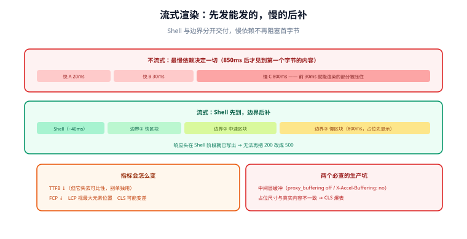

# 流式渲染

流式渲染（Streaming SSR）把「整页渲染完再发」改成「**先发能发的，慢的部分稍后补上**」。它解决的是 SSR 最尴尬的一种处境：页面里有 90% 的内容很快就能渲染，却因为剩下 10% 里有一个慢接口，整页都得等它。



## 不流式时，慢在哪

传统 SSR 的时间线是**最慢依赖决定一切**：

```text
请求到达 ──┬─ 快接口 A（20ms）─┐
           ├─ 快接口 B（30ms）─┤ 全部就绪才渲染
           └─ 慢接口 C（800ms）┘
                                     └─ 850ms 后用户才看到「第一个字节的内容」
```

用户等待的 850ms 里，前 30ms 就已经能渲染的部分被白白压住了。流式渲染要做的事，就是**让 A、B 的结果先落地成 HTML 发出去**，把 C 留在一个「边界」里稍后补齐。

## 两个关键概念

| 概念 | 含义 | 判断方式 |
| --- | --- | --- |
| **Shell（外壳）** | 不依赖慢数据、可以立刻发送的那部分 HTML | 「去掉所有异步区块后，页面还剩什么」 |
| **Boundary（边界）** | 一个可独立等待与补齐的异步区块 | 由 `Suspense` / 异步组件声明，需要给出**一致的 loading 占位** |

框架的做法是：先把 Shell 与每个边界的**占位**发出去（响应头此时已经写好），随后每块数据就绪就把「填充脚本 + 真实 HTML」追加进同一个响应流。浏览器接收后原地替换。

## 代码形态

```js [server.js —— React 的流式输出]
import { renderToPipeableStream } from "react-dom/server";

const { pipe } = renderToPipeableStream(<App url={url} />, {
  // Shell 就绪：此刻就可以开始回写响应，TTFB 大幅提前
  onShellReady() {
    res.statusCode = 200;
    res.setHeader("Content-Type", "text/html; charset=utf-8");
    pipe(res);
  },
  // Shell 自身渲染失败：退化为客户端渲染（注意此时还没写出任何字节）
  onShellError() {
    res.statusCode = 500;
    res.send(fallbackShell);
  },
  onError(err) {
    logError(err);   // 边界内的错误不会中断整个响应
  },
});
```

```tsx [页面里：用 Suspense 划分边界]
export default function ArticlePage() {
  return (
    <main>
      <ArticleHeader />                      {/* 快：属于 Shell */}
      <Suspense fallback={<CommentsSkeleton />}>
        <Comments />                        {/* 慢：独立边界，后到后补 */}
      </Suspense>
      <Suspense fallback={<RecommendSkeleton />}>
        <Recommendations />
      </Suspense>
    </main>
  );
}
```

::: tip 划分边界的判据
**按「就绪时间」划分，不要按「组件层级」划分。** 同一个慢接口驱动的多个区块应该放进**同一个**边界，否则会并发地各等一次；相反，快慢差异大的区块必须分开，否则慢的会把快的拖在同一个边界里。
:::

## 指标会怎么变

流式渲染会让一部分指标「变好看」，另一部分「必须重新定义」：

| 指标 | 影响 | 说明 |
| --- | --- | --- |
| **TTFB** | 显著降低 | 因为它现在测的是「第一个字节」，而流式的第一个字节几乎立刻就有 |
| **FCP** | 降低 | 外壳先到，用户先看到布局与骨架 |
| **LCP** | 视情况 | 若最大元素在慢区块里，LCP 由该区块决定；此时用 `Suspense` 的占位撑住布局很关键 |
| **CLS** | 可能变差 | 占位与真实内容尺寸不一致会导致布局位移——**这是流式最常见的副作用** |

::: warning TTFB 降低不等于页面变快
流式会让 TTFB 失去原有的可比性：过去 TTFB≈「页面内容开始到达」，现在它只是「响应开始了」。**评估流式效果要看 FCP/LCP/CLS 与「慢区块填充完成时间」**，不要拿 TTFB 的下降当成整体变快的证据。
:::

## 错误处理与回退

流式下错误处理的规则与整页渲染**不同**，这是上线前必须弄清的：

1. **边界内的错误不中断响应**：边界渲染失败时，框架把一个错误回退内容填进去（或保留 fallback），其余部分照常。响应状态码此时**已经是 200**。
2. **Shell 阶段失败还能改状态码**：`onShellError` 时尚未写出任何字节，可以改成 500 并给出兜底页面。**这是一次性的机会**。
3. **已经开始流式后无法改状态码**：客户端已经收到 200 与部分内容，再想返回 500 是不可能的。所以「页面是否可渲染」的判断必须在 Shell 阶段完成。

::: danger 三个高频坑
1. **慢区块的错误被当成整页失败**：实际上响应早已是 200，监控里看到的却是「成功」，而用户看到的是「这块内容空白」。
2. **占位尺寸与内容不一致**：CLS 爆表。占位必须**预留与真实内容接近的高度**。
3. **中间层缓冲了响应**：Nginx、CDN、压缩中间件默认会缓冲整个响应，导致「流式」在生产上退化为「一次性输出」。需要显式关闭缓冲（如 `proxy_buffering off`、`X-Accel-Buffering: no`）。
:::

```nginx [nginx.conf —— 关闭代理缓冲，否则流式会被吃掉]
location / {
    proxy_pass http://ssr_upstream;
    proxy_buffering off;          # 关键：不缓冲响应体
    proxy_read_timeout 60s;       # 慢区块需要更长的读超时
}
```

## 流式与缓存的关系

流式的响应**天然难以整页缓存**：它是一段「边生成边发送」的流，而不是一份稳定的 HTML 字符串。因此实际做法通常是分层：

| 内容 | 缓存方式 |
| --- | --- |
| 静态资源（JS/CSS/图片） | 强缓存 + 内容哈希（不受流式影响） |
| Shell 与可复用片段 | 组件级/片段缓存（框架能力或自建片段缓存） |
| 数据 | **在数据层缓存**（最重要的一层，见 [缓存体系](../Caching/index.md)） |
| 整页 HTML | 一般不缓存；若缓存，需接受「缓存的是某一瞬间的完整结果」 |

**把缓存做在数据层，是流式与缓存共存的关键**：只要每个数据源都命中缓存，边界通常在毫秒级就绪，流式的意义就退化为「更早开始传输」——这依然是收益，但真正的性能来自数据层缓存。

## 验证方式

```shell [shell]
# 1. 观察响应是否分块到达（--no-buffer 关闭 curl 自身缓冲）
curl -s --no-buffer http://localhost:3000/articles/1 | while read -r line; do
  echo "$(date +%T.%3N) ${line:0:60}"
done

# 2. 确认响应头没有 Content-Length（流式应为 chunked）
curl -sI http://localhost:3000/articles/1 | grep -i -E "transfer-encoding|content-length"

# 3. 确认中间层没有缓冲（响应头里出现 X-Accel-Buffering: no 是常见做法）
curl -sI http://localhost:3000/articles/1 | grep -i "x-accel-buffering"
```

预期：第 1 条能看到**时间戳递增的多批输出**（而不是同一时刻一次性刷出）；第 2 条出现 `Transfer-Encoding: chunked`；第 3 条按你的部署方式命中。

## 参考资料

- [React：`renderToPipeableStream`](https://react.dev/reference/react-dom/server/renderToPipeableStream)
- [React：`<Suspense>`](https://react.dev/reference/react/Suspense)
- [Vue：`<Suspense>` 与异步组件](https://vuejs.org/guide/built-ins/suspense.html)
- [web.dev：LCP 与布局位移](https://web.dev/articles/lcp)
