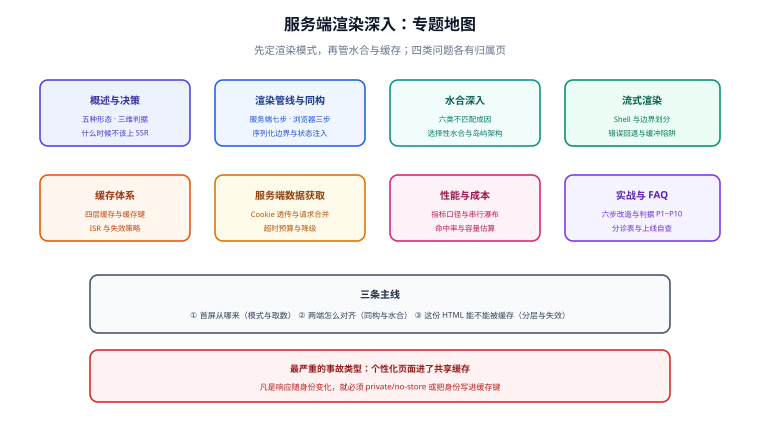

# 服务端渲染深入

**SSR（Server-Side Rendering，服务端渲染）** 指的是「HTML 由服务端生成、浏览器拿到就能显示、随后再由前端框架接管交互」这条链路。它不是一个框架特性，而是一组**关于「首屏从哪来、内容何时可读、交互何时可用、这份 HTML 能不能被缓存」的工程取舍**。

一句话定位：**这个专题讲的是「同一份组件代码，在服务端与浏览器两端各跑一次时，怎么保证结果一致、首屏够快、缓存又不会被做坏」**——凡是「首屏白屏久」「SEO 抓不到内容」「水合报错」「上了 SSR 反而更慢」这类问题，根因几乎都落在这四件事上。

::: info 版本与标准状态（2026-10 核对）
本专题讲**框架无关**的原理与判据，示例以当前主流的 React 19 / Vue 3.5+ / Nuxt 4 / Next.js 16 形态为参照。所有版本事实以官方文档与发布说明为准，各框架的具体 API 见 [框架专题](../Frame/index.md) 下的对应页面。
:::

## 为什么需要这个专题

客户端渲染（CSR）的单页应用把「渲染」全部放到浏览器里：用户先拿到一个空壳 HTML，等 JS 下载、解析、执行、请求数据，才看到内容。这条链路有三个绕不开的代价：

| 代价 | 表现 | SSR 如何缓解 |
| --- | --- | --- |
| 首屏空窗 | 白屏时间长，弱网下尤其明显 | 服务端直接返回**带内容的 HTML**，首屏不依赖 JS |
| 内容不可抓 | 爬虫与社交平台拿到空壳，SEO/分享卡片失效 | 服务端产物**本身就是可读内容** |
| 慢在客户端 | 低端设备上「下载 + 解析 + 执行 + 请求」串行叠加 | 把「取数 + 渲染」前移到服务端，靠近数据源 |

但 SSR 不是免费的：它把一部分复杂度从浏览器搬到了服务端——**多了一次水合（hydration）、多了一份缓存设计、多了一层服务端成本**。本专题的每一页都在回答「这笔账怎么算才划算」。

## 专题地图

## 页面导航

1. [概述：渲染模式全景](Overview/index.md) —— CSR / SSR / SSG / ISR / 流式 SSR 的五种形态、三维判据（可缓存性 / 时效性 / 个性化）、决策树与「什么时候不该上 SSR」
2. [渲染管线与同构](CoreConcepts/index.md) —— 一次请求在服务端与浏览器两端分别经过哪几步、同构的边界在哪、序列化与状态脱水的口径
3. [水合深入](Hydration/index.md) —— 水合到底在做什么、mismatch 的六类成因与定位方法、选择性水合与岛屿架构、渐进增强
4. [流式渲染](Streaming/index.md) —— 从「整页产出」到「分块产出」、Suspense/异步边界、TTFB 与 LCP 的位移、流式下的错误与回退
5. [缓存体系](Caching/index.md) —— 缓存键怎么定、CDN 与边缘缓存、ISR 与 stale-while-revalidate、按用户个性化的内容怎么不被缓存串味
6. [服务端数据获取](DataFetching/index.md) —— 取数发生在服务端之后的三条硬约束（无 `window`、要显式透传 Cookie、要注意请求合并与去重）、序列化边界
7. [性能与成本](Performance/index.md) —— 指标口径（TTFB / FCP / LCP / INP）、串行瀑布的识别与消除、缓存命中率、服务端成本与限流
8. [实战：把 SPA 改造成可缓存的 SSR](Practice/index.md) —— 六步改造（含每步判据）、水合错误清零、缓存分层与验收断言清单
9. [常见问题与最佳实践](FAQ/index.md) —— 按现象分诊的排查树、十二个高频问题、上线自查清单

## 建议的阅读顺序

- **只想知道「该不该上 SSR」**：先读 [概述](Overview/index.md) 的第二节三维判据与第三节决策树，再跳到 [性能与成本](Performance/index.md) 的「服务端成本」一节。
- **首屏白屏久、SEO 抓不到**：[概述](Overview/index.md) → [渲染管线与同构](CoreConcepts/index.md)，先把「HTML 从哪来」这件事定下来。
- **水合报错 / 页面上有内容但点不动**：[水合深入](Hydration/index.md) 是主战场，重点看「mismatch 六类成因」与「定位方法」。
- **想做流式与渐进交付**：[流式渲染](Streaming/index.md)，务必读完「流式下的错误与回退」再上生产。
- **已经上了 SSR 但很慢**：[缓存体系](Caching/index.md) 与 [性能与成本](Performance/index.md) 两页各读一遍，先看缓存命中率，再看串行瀑布。
- **要动手改造存量 SPA**：[实战](Practice/index.md) 的六步顺序与判据清单，照做即可，不要跳步。

## 本专题与相邻专题的分工

这几处边界**写死在页面上**，互不替代：

| 相邻专题 | 它讲什么 | 本专题讲什么 |
| --- | --- | --- |
| [Nuxt](../Frame/Nuxt/index.md) | Nuxt 的文件路由、数据获取、Server Routes 与部署的**具体用法** | Nuxt 只是本专题判据的一个实现：**为什么**要这么做、**怎么判断**做对了；同一判据在 Next.js 上同样成立 |
| [Next.js](../Frame/Next/index.md) | Next 的 App Router、Server Components、路由约定 | 同上：框架 API 归框架页，**缓存与流式的取舍口径**归本专题 |
| [浏览器原理](../Basic/Browser/index.md) | 浏览器如何解析 HTML、构建 DOM、渲染与事件循环 | 本专题讲**服务端产出的 HTML 与后续水合**之间的契约；浏览器侧原理不重复 |
| [前端性能优化](../Others/PerformanceOptimization/index.md) | 通用加载/运行时优化手段与性能预算 | 本专题只讲 **SSR 特有的**性能问题：TTFB 归类、串行瀑布、缓存命中率、服务端成本 |
| [PWA 与离线应用](../PWA/index.md) | Service Worker、离线缓存与推送 | SSR 的 HTML 缓存**不在浏览器里**（CDN/边缘/服务端），两者层次不同、可叠加使用 |
| [SPA 单页应用](../Others/SPA/index.md) | 纯客户端路由与渲染的形态 | 本专题讲**从 CSR 迁移到 SSR** 的判据与代价，是同一件事的两个阶段 |
| [完整项目实战 · 博客 SSR](/project/Complete/BlogPlatform/FrontendSSR/index.md) | 某个真实项目里**怎么落地**（具体配置、命令与验收） | 项目页负责「照着做一遍」，本专题负责「为什么这么做、判据是什么」 |

## 参考资料

- [MDN：Server-side rendering](https://developer.mozilla.org/en-US/docs/Glossary/SSR)
- [web.dev：Rendering on the Web](https://web.dev/articles/rendering-on-the-web)
- [React：Server React DOM APIs（`hydrateRoot` / `renderToPipeableStream`）](https://react.dev/reference/react-dom/server)
- [Vue：Server-Side Rendering 指南](https://vuejs.org/guide/scaling-up/ssr.html)
- [Nuxt：Rendering Modes](https://nuxt.com/docs/guide/concepts/rendering)
- [Next.js：Rendering 与 Caching](https://nextjs.org/docs/app/building-your-application/rendering)
- [HTTP Caching（RFC 9111）](https://www.rfc-editor.org/rfc/rfc9111)
- [stale-while-revalidate（RFC 5861）](https://www.rfc-editor.org/rfc/rfc5861)
