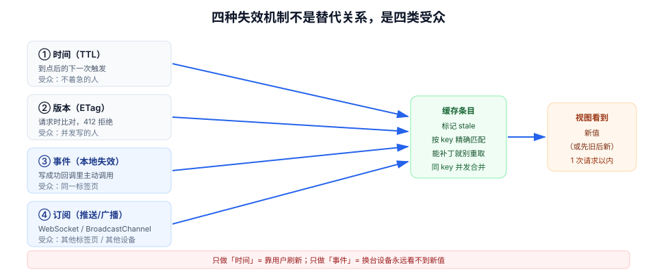

# 缓存失效：写操作的后半程

「保存成功」这四个字在工程上只完成了一半。另一半是：**让所有读到过旧值的地方知道它旧了**。漏掉这半程，用户会看到「提示成功了，列表还是旧的」，然后判断这个系统不可靠——比保存失败更糟，因为失败至少会报错。

本页把失效拆成四种机制、三种写后读策略、两处广播边界，并给出每一条的可验证判据。

## 判据族声明

本页判据族 `SDI-A` ~ `SDI-H`，共 8 条。定义表在第六节。

## 本页不讲什么

- 不讲 `staleTime` 怎么分档，归 [本地态与远端态](../LocalRemote/index.md)。
- 不讲乐观更新的回滚实现，归 [乐观更新](../OptimisticUpdate/index.md)；本页只讲「乐观补丁与失效谁先谁后」。
- 不讲服务端缓存一致性（Redis、多级缓存），归 [分布式缓存](/docs/Backend/DistributedCache/index.md)。
- 不讲 HTTP 缓存头的完整语义，归 [浏览器原理 · 缓存](/docs/Frontend/Basic/Browser/index.md)；本页只讲条件请求在「写后读」里的用法。



## 一、四种失效机制

失效不是一个动作，而是四种机制的组合。选错机制，失效就会「有时生效、有时不生效」。

| 机制 | 触发条件 | 延迟 | 适用 | 失效时的表象 |
| --- | --- | --- | --- | --- |
| **时间**（`staleTime` / TTL） | 到点后的下一次触发 | 最长一个 TTL | 变化慢、可容忍延迟 | 「等一会儿就好了」，用户不会等 |
| **版本**（`version` / `ETag`） | 请求时比对版本 | 一次往返 | 写后读、并发控制 | 版本没带或没比，静默返回旧值 |
| **事件**（本地失效调用） | 写成功回调里主动调用 | 立即（同一标签页） | 同标签页内的写 → 读 | 只影响调用了 `invalidateQueries` 的那个实例 |
| **订阅**（推送 / 广播） | 服务端推送、跨标签页广播 | 一个网络往返 / 毫秒级 | 多端、多标签页 | 没订阅的端永远不知道变了 |

四者**不是替代关系**。成熟的做法是：事件负责同页一致，订阅负责跨端一致，版本负责并发正确，时间只做兜底。只做时间 = 靠用户刷新；只做事件 = 换台设备就看不到。

::: tip 一句话判断该用哪个
**改动之后，谁需要立刻看到？** 同页 → 事件；同浏览器另一个标签页 → 广播；另一台设备 → 推送；都不需要立刻 → 时间。四类受众分别对应四种机制，缺一类就有一类用户看到旧值。
:::

## 二、失效风暴：一次保存引发二十个请求

失效的粒度最容易失守。写一个「看板重命名」，如果失效了 `["boards"]` 前缀，而这个前缀下挂着：看板列表、5 个看板的详情、每个看板的成员、每个看板的统计……一次保存可能触发二十多个请求。

```ts
// 反例：前缀失效范围过大
onSuccess: () => {
  queryClient.invalidateQueries({ queryKey: ["boards"] }); // 前缀命中全部
}

// 正例：只失效真正被这次写影响的部分
onSuccess: (data) => {
  queryClient.setQueryData(keys.detail(data.id), data);   // 精确补丁：自己是最新真相
  queryClient.invalidateQueries({ queryKey: keys.list() }); // 列表需要重排/重算，交给服务端
}
```

判断标准是**服务端返回的东西能不能直接当真相**：

| 写操作返回 | 处理方式 | 理由 |
| --- | --- | --- |
| 返回完整的新实体 | `setQueryData` 直接补丁 | 省一次往返，且不会出现「补丁后又重取」的闪动 |
| 只返回 `{ ok: true }` | 必须 `invalidateQueries` | 本地无法构造新实体 |
| 返回新实体 + 影响其他聚合（计数、排序） | 自己补丁 + 聚合失效 | 聚合结果本地算不准 |

::: danger 失效风暴的三个连锁反应
1. **接口被打爆**：同一次失效打到同一接口多次。查询层会按 key 合并并发重取（同一 key 只发一个请求），但**不同 key 不会合并**——20 个 key 就是 20 个请求。
2. **界面闪动**：每个请求返回都触发一次渲染，20 次重取会让列表在几百毫秒内抖动多次。
3. **雪崩式慢查询**：服务端同时在跑 20 个重查询，P99 一起升高，用户感知为「保存后整页卡住」。
:::

## 三、写后读：三种策略与各自代价

「保存完立刻要看到新值」是产品最常见的要求，也是三种策略的分水岭。

| 策略 | 做法 | 延迟 | 代价 | 适用 |
| --- | --- | --- | --- | --- |
| **A. 等待失效完成** | `await invalidateQueries({ refetchType: 'all' })` | 一次往返 | 保存按钮转圈到新数据回来 | 金额、库存等「必须看到新值」的页面 |
| **B. 用响应直接补丁** | `setQueryData` + 局部失效聚合 | 0 | 依赖服务端返回完整实体 | 绝大多数编辑操作 |
| **C. 乐观更新** | 先改 UI，成功后以响应为准 | 0（视觉） | 复杂：快照、回滚、临时 ID | 交互密集、失败率低（拖动、勾选） |

三个策略可以叠加：**乐观更新（C）打头，响应补丁（B）落地，聚合失效（A）兜底**。这就是 [实战](../Practice/index.md) 里拖动卡片的完整链路。

### A 的一个坑：`refetchType` 的默认值

`invalidateQueries` 默认只把查询标记为 stale 并重取**活跃**的查询（`refetchType: 'active'`）。如果读侧页面已经被卸载（比如从详情返回列表的过程中），它就只被标脏、不重取。等用户回到列表，才会因为「stale + 挂载」重取——通常没问题，但如果你的列表用了 `staleTime: Infinity`，就永远不重取。

```ts
// 需要「立刻保证所有观察者都更新」时显式指定
await queryClient.invalidateQueries({ queryKey: keys.all, refetchType: "all" });
```

## 四、跨标签页：广播的三种实现

同一个用户在两个标签页里打开同一个看板，A 标签页改了名字，B 标签页不会知道——除非你广播。

| 方案 | 机制 | 延迟 | 限制 |
| --- | --- | --- | --- |
| `BroadcastChannel` | 同源标签页之间的消息通道 | 毫秒级 | 同源；老浏览器需降级 |
| `storage` 事件 | `localStorage` 变更触发 | 毫秒级 | 只在**其他**标签页触发（当前页不触发）；值必须是字符串 |
| 轮询版本号 | 定时问服务端「有变化吗」 | 一个轮询间隔 | 有请求成本，且有最大延迟 |

```ts
// 广播失效：写成功后通知其他标签页
const bc = new BroadcastChannel("state-sync");

export function broadcastInvalidate(keys: readonly unknown[]) {
  bc.postMessage({ type: "invalidate", keys, at: Date.now() });
}

bc.onmessage = (e) => {
  if (e.data?.type !== "invalidate") return;
  queryClient.invalidateQueries({ queryKey: e.data.keys });
};
```

::: danger 广播实现里最容易漏的四件事
1. **收到的消息不校验来源结构**：`e.data.keys` 可能不是数组，直接传给 `invalidateQueries` 会抛错或误失效全部。必须先判类型。
2. **用 `storage` 事件却写在 `sessionStorage`**：`sessionStorage` 根本不跨标签页，事件也不会触发。跨标签页必须用 `localStorage`。
3. **自己发自己也收**：`BroadcastChannel` **不会**把消息回送给发送者，但 `storage` 事件也不会在**当前**标签页触发——两者都不需要额外去重。真正需要去重的是「收到广播 → 又触发一次广播」的回路。
4. **广播的是数据而不是失效信号**：把整个列表塞进消息里，就要处理「消息乱序 / 版本比较 / 字段缺省」；只广播「哪个 key 旧了」，让每个标签页自己去取，逻辑简单得多。
:::

## 五、版本与条件请求：并发正确性的底座

失效解决「看到旧值」，版本解决「写坏别人的改动」。两者的分界：

- 失效是**读侧**问题：我读到的是不是最新的？
- 版本是**写侧**问题：我基于的那份数据，在我写之前有没有被别人改过？

HTTP 原生提供了这套机制：

```http
GET /api/cards/card_1
→ 200 OK
   ETag: "v42"

PUT /api/cards/card_1
If-Match: "v42"
{"title":"新标题"}
→ 200 OK  （版本已是 v42，接受）
→ 412 Precondition Failed （别人已经改成 v43）
```

前端要做的三件事：

1. **把 `ETag`（或响应体里的 `version`）跟着数据一起存**，不要只存业务字段。
2. **写请求带上 `If-Match`**（或 `If-Unmodified-Since`，精度只到秒，不推荐）。
3. **区分 `412` 与网络错误**：`412` 是「你的数据旧了」，应该提示「有人已修改，请刷新后重试」并自动重取；网络错误应该重试。

本机模拟（Node 22.22.2，固定种子，1000 轮，两个客户端的读时刻在 0~400 ms 内均匀分布，写回延迟 30~50 ms）：

| 策略 | 读旧版本的比例 | 静默覆盖 | 冲突被感知 |
| --- | --- | --- | --- |
| 最后写入者赢（LWW） | 11.6% | **116 次** | 0 次 |
| `If-Match` 版本号 | 11.6% | **0 次** | 116 次 |

也就是说：**11.6% 的并发写会丢数据，而其中 100% 都可以被一次版本比对拦下来**。这个比例与「用户手速」强相关，协作越密集越高。

::: warning 版本号必须来自服务端
前端自己 `version + 1` 不算数：两端都从 42 开始，都会算出 43。版本必须由服务端在事务里递增并返回，客户端只负责回传。
:::

## 六、判据表

| 编号 | 规则 | 违反时的样子 | 怎么验证 |
| --- | --- | --- | --- |
| `SDI-A` | 每个写操作列出受影响的读 key 清单 | 保存后某处仍是旧值 | 逐个写操作对照「谁会读这份数据」，清单外的读点必须能解释 |
| `SDI-B` | 失效粒度精确到 key，不用大前缀兜底 | 一次保存触发几十个请求 | 保存一次，Network 面板请求数 ≤ 3（含自身写请求） |
| `SDI-C` | 服务端返回完整实体时优先补丁，不重复重取 | 保存后列表闪动两次 | 保存一次，该实体请求数恰好 1 |
| `SDI-D` | 写后读按场景选择 A/B/C，且写明理由 | 「必须看到新值」的页面靠刷新 | 每个写操作有策略标注，金额类必须为 A 或带校验的 B |
| `SDI-E` | 跨标签页有广播或版本轮询 | A 标签改完，B 标签还是旧的 | 双标签页并排，改一侧，另一侧 ≤ 2 s 更新 |
| `SDI-F` | 广播消息先校验再使用 | 收到异常消息后整页失效/报错 | 手发一条畸形消息（`{type:'invalidate'}`），页面不崩且不误失效 |
| `SDI-G` | 写请求带版本条件，`412` 有专门文案 | 两人同时改，后者静默覆盖前者 | 两个客户端同时提交，后者必须看到「已被修改」提示 |
| `SDI-H` | `invalidateQueries` 的 `refetchType` 与「谁需要立即更新」匹配 | 返回列表看到的还是旧值 | 详情页保存 → 立刻返回列表，值必须是新的 |

## 验证方式

`SDI-B` / `SDI-E` / `SDI-G` 的可执行验证：

```text
SDI-B：DevTools → Network 清空 → 在详情页改标题保存
  期望：请求共 2 个（PUT + 列表/聚合的 1 次重取）
  判读：> 5 个说明失效用了大前缀；= 1 个说明聚合没失效（可能显示旧计数）

SDI-E：两个标签页并排打开同一看板 → 在 A 改看板名保存
  期望：B 标签页 ≤ 2 s 内显示新名字
  判读：B 一直不变 = 没广播；B 变了但数据闪 = 广播了数据而不是失效信号

SDI-G：两个标签页打开同一张卡片详情 → 都改标题 → 先后保存
  期望：后保存的一方看到「已被他人修改」并自动重取
  判读：两次都提示成功 = 服务端没做版本校验（前端无从感知）
```

静态检查：

```shell
# SDI-A：统计写操作与失效动作的比例（含 setQueryData 与广播）
grep -rn "useMutation\|\.mutate(" src/ | wc -l
grep -rn "invalidateQueries\|setQueryData\|broadcastInvalidate" src/ | wc -l
# 期望：后者 ≥ 前者

# SDI-G：写请求是否带版本条件
grep -rn "If-Match\|if-match\|X-Resource-Version" src/ || echo "未使用版本条件"
```

## 参考资料

- [TanStack Query v5 · Query Invalidation](https://tanstack.com/query/v5/docs/react/guides/query-invalidation)——`refetchType` 与 `exact` 的语义
- [TanStack Query v5 · Updates from Mutations](https://tanstack.com/query/v5/docs/react/guides/updates-from-mutation-responses)——补丁与失效的取舍
- [MDN · BroadcastChannel](https://developer.mozilla.org/docs/Web/API/BroadcastChannel)——同源标签页通信
- [MDN · Window: storage event](https://developer.mozilla.org/docs/Web/API/Window/storage_event)——只在其他标签页触发
- [RFC 9110 · If-Match](https://www.rfc-editor.org/rfc/rfc9110.html#name-if-match)——`412` 的准确语义
- 相邻：[本地态与远端态](../LocalRemote/index.md) · [乐观更新](../OptimisticUpdate/index.md) · [分布式缓存](/docs/Backend/DistributedCache/index.md)
