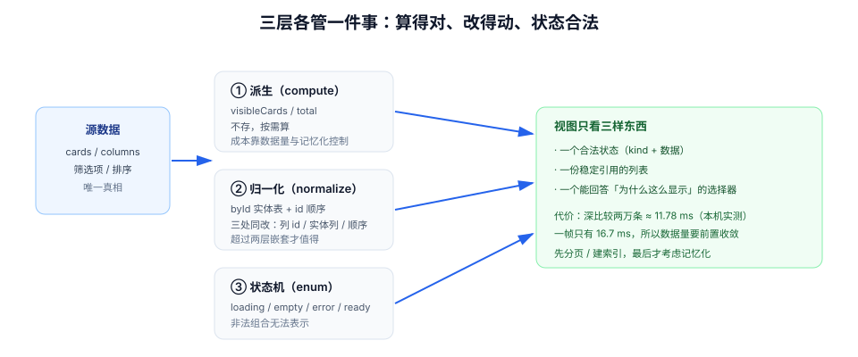

# 派生状态与归一化：不存就能不错

一个 store 里出现 `fullName`、`visibleCards`、`selectedCount`、`hasUnsavedChanges` 这些字段时，几乎可以断定：某一天它们会和源数据不一致。因为它们都是**能算出来的**——能算出来的东西一旦被存起来，就有了第二次被写错的机会。

本页讲三件事：哪些值不该存、必须存的时候怎么组织（归一化）、以及「算」的代价怎么控制（记忆化与引用稳定）。

## 判据族声明

本页判据族 `SDD-A` ~ `SDD-H`，共 8 条。定义表在第六节。

## 本页不讲什么

- 不讲远端态怎么缓存，归 [本地态与远端态](../LocalRemote/index.md)。
- 不讲多端同步与冲突，归 [多端同步与收敛](../RealtimeSync/index.md)。
- 不讲具体框架的 `computed` / `useMemo` API 细节，归框架专题；本页只讲**什么时候该用**。
- 不讲状态机的服务端实现，归 [工作流与规则引擎](/docs/Backend/WorkflowEngine/index.md)。



## 一、派生 vs 存储：一条判据

| 值 | 该存吗 | 理由 |
| --- | --- | --- |
| `fullName = first + ' ' + last` | **不存** | 纯函数，零成本可算 |
| `visibleCards = cards.filter(...)` | **不存**（除非列表上万且筛选昂贵） | 可算；存了就要在 `cards`、筛选条件、排序三处都同步 |
| `selectedCount = selected.size` | **不存** | `Set.size` 是 O(1) |
| `hasUnsavedChanges` | 存**基线快照**，值派生 | 需要「提交时的原值」才能比较；存布尔值就无法回答「改了哪些」 |
| `totalPrice`（含税、折扣、运费） | **不存** | 规则会变，存了就出现「改了规则旧数据不更新」 |
| 服务端算好的聚合（如 `commentCount`） | **存** | 本地算不准（分页、软删除、权限过滤），此时服务端是真相 |

判据可以写成一句话：**「如果源数据变了，这个值能不能自动跟着变？」能 → 不存；不能 → 存，并且必须定义「谁负责在什么时候更新它」。**

::: danger 派生字段的三种典型事故
1. **双向同步死循环**：`watch(a → b)` 与 `watch(b → a)` 同时存在，值来回抖动，控制台刷警告。
2. **派生值过期**：`visibleCards` 在筛选条件变化时忘了重算，用户切换筛选没反应。
3. **派生值成为第二真相**：有人直接改 `visibleCards` 想「临时隐藏一条」，结果下次重算又冒出来——因为源数据没变。
:::

## 二、记忆化：算的代价与引用的稳定

「能算就算」不等于「每次渲染都算」。当派生逻辑涉及上千条数据时，需要记忆化；而记忆化是否生效，取决于**依赖的引用是否稳定**。

### 深比较到底有多贵（本机实测）

对同一份响应（内容相同、引用不同）做递归深比较，Node 22.22.2：

| 数据量 | 深比较耗时 | 载荷大小 |
| --- | --- | --- |
| 2,000 条 | **4.07 ms** | 143 KiB |
| 20,000 条 | **11.78 ms** | 1,465 KiB |
| 50,000 条 | **44.29 ms** | 3,694 KiB |

一帧的预算是 16.7 ms。也就是说：**两万条的深比较已经吃掉大半帧**，五万条直接掉帧。这就是为什么查询层的 `structuralSharing`（默认开启）值得关注——它在每次响应到达时做一次结构共享比较，数据大时应该考虑关闭并改用更粗的失效判断。

::: tip 三条降低比较成本的顺序
① **先缩小数据**：列表只取当前页 20 条，而不是把 5 万条塞进缓存再前端分页；② **再稳定引用**：服务端返回的实体保持引用不变（只替换变更的那几条），让 `===` 能命中；③ **最后才考虑深比较**，并且只在必要时（例如表单脏检查）打开。
:::

### 选择器要返回「稳定的形状」

```ts
// 反例：每次返回新对象，浅比较永远不相等 → 每次 store 变化都重渲染
const { a, b } = useStore((s) => ({ a: s.a, b: s.b }));

// 正例 1：分开选（两次订阅，但各自稳定）
const a = useStore((s) => s.a);
const b = useStore((s) => s.b);

// 正例 2：需要对象时显式浅比较（Zustand 5：useShallow 从 zustand/react/shallow 引入）
const { a, b } = useStore(useShallow((s) => ({ a: s.a, b: s.b })));
```

Vue 侧同理：`computed` 返回新数组时，下游 `watch` 会因为引用变化而触发；需要按内容比较时用 `watch(..., { deep: true })`（昂贵）或让 `computed` 返回稳定的原始值。

### 不要用「记忆化」掩盖结构问题

如果一次派生要遍历五万条，正确的做法通常不是加 `useMemo`，而是：

1. 让服务端分页/过滤（减少数据量）；
2. 把结果建成索引（`Map<columnId, Card[]>`），让「按列取卡片」变成 O(1)；
3. 只有在同一份数据上频繁做同一昂贵计算时才记忆化。

## 三、归一化：把嵌套树拍平成实体表

看板数据天然是嵌套的：`board → columns[] → cards[]`。嵌套结构有两个问题：**更新深、重复多**。

| 问题 | 嵌套结构 | 归一化结构 |
| --- | --- | --- |
| 更新一张卡片 | 逐层 `map` + 展开，路径长达 4 层 | `cards[cardId] = {...}` 一行 |
| 同一张卡片出现在两处（搜索命中、最近访问） | 两份副本，改一处另一处不变 | 只有一份，两处都引用同一个 id |
| 判断「这条是否已存在」 | 遍历 | `byId` 查表 O(1) |
| 序列化/持久化 | 树大且重复 | 表小且扁平 |

```ts
type NormalizedBoard = {
  boardId: string;
  columnIds: string[];                 // 顺序
  columns: Record<string, { id: string; title: string; cardIds: string[] }>;
  cards: Record<string, { id: string; title: string; columnId: string; order: number }>;
};
```

三条纪律：

1. **顺序用数组存，实体用字典存**：`cardIds` 决定顺序，`cards` 决定内容。只存一个就会在「重排」与「改字段」之间二选一。
2. **实体里冗余一个 `columnId`**：否则「这张卡在哪一列」要遍历所有列。这个冗余是**受控的**——它只能由「移动操作」同时改两处（从旧列 `cardIds` 删、到新列 `cardIds` 加、`cards[id].columnId` 改），三处必须在同一个函数里完成。
3. **不要把归一化结构暴露给视图**：视图要的是「这一列的卡片列表」，用选择器组装，不要让它知道 `cardIds` 的存在。

::: warning 归一化不是万能的
- 数据量小于几百条时，嵌套结构更直观，归一化的收益抵不过复杂度。
- 归一化会让「整体替换」变麻烦：服务端返回整棵树时，你要写一个 `normalize()`，而这个函数是 bug 高发区（漏字段、顺序丢失）。**必须有单测**：`normalize(denormalize(x))` 应等于 `x`。
:::

## 四、布尔组合 → 状态机

界面上最容易失控的是「多个布尔值描述一个状态」：

```ts
// 反例：3 个布尔 = 8 种组合，其中 4 种非法
type Bad = { isLoading: boolean; isError: boolean; isEmpty: boolean };
```

8 种组合里，`isLoading && isError`、`isLoading && isEmpty`、三者全真……都是不应该存在的状态，但类型系统拦不住，UI 只能靠 `if` 顺序兜底，顺序一改表现就变。

```ts
// 正例：显式状态机（4 个合法状态，互斥）
type ListState =
  | { kind: "loading" }
  | { kind: "empty" }
  | { kind: "error"; message: string; retryable: boolean }
  | { kind: "ready"; items: Item[]; refreshing: boolean };
```

好处不只是「少几个 bool」：

1. **非法状态无法表示**：要写 `kind: "ready"` 就必须有 `items`。
2. **`switch` 穷尽检查**：新增一个状态时 TypeScript 会在 `default` 上报错（配合 `never`）。
3. **状态转移可枚举**：`loading → ready | empty | error`，`error → loading`（重试）。这张转移表就是测试用例清单。

注意 `refreshing` 与 `kind` 的关系：**「正在后台刷新」不是独立状态，而是 `ready` 的一个修饰**。把它做成独立状态，就会出现「刷新时列表消失」——这是骨架屏最常见的误用。

## 五、判据表

| 编号 | 规则 | 违反时的样子 | 怎么验证 |
| --- | --- | --- | --- |
| `SDD-A` | 能由源数据算出的值不进入存储 | 派生字段与源数据不一致 | store 字段逐个问「源变了它会自动变吗」；答「不会」的必须有更新责任人 |
| `SDD-B` | 派生字段不存在「反向写入」 | 临时改派生值，下次重算被覆盖 | `grep` 派生字段的赋值点，只能出现在计算函数里 |
| `SDD-C` | 选择器返回稳定形状（原始值或浅比较） | 组件在无关更新时也重渲染 | React Profiler：改无关字段时目标组件不应提交 |
| `SDD-D` | 大列表按页取，不在前端做全量派生 | 首屏卡顿、滚动掉帧 | 单页数据量 ≤ 100；`performance` 面板无 > 50 ms 的长任务 |
| `SDD-E` | 昂贵派生有索引或记忆化，且有理由 | 每次渲染都遍历万级数组 | 存在 `Map` 索引或记忆化，且注释写明数据量级 |
| `SDD-F` | 嵌套数据超过两层时归一化，且有往返单测 | 更新一处要四层 `map`；两份副本不同步 | 存在 `normalize` 单测，且 `denormalize(normalize(x))` 相等 |
| `SDD-G` | 界面状态用互斥枚举，不用布尔组合 | `isLoading && isError` 同时为真 | 统计组件的布尔状态字段，≥ 3 个即应重构 |
| `SDD-H` | 「后台刷新」是 ready 的修饰，不是独立状态 | 刷新时列表整片消失 | 触发一次后台重取，列表内容应保持可见 |

## 验证方式

`SDD-C` / `SDD-D` / `SDD-H` 可在浏览器验证：

```text
SDD-C：React DevTools → Profiler → 打开「记录组件渲染原因」
  改动一个与目标列表无关的状态（如切换主题）
  期望：列表组件不出现新的提交
  判读：每次主题切换都重渲染 = 选择器返回了新对象

SDD-D：Performance 面板录制「进入列表页 + 滚动 3 屏」
  期望：无 > 50 ms 的长任务；单页请求条数 ≤ 100
  判读：出现 200 ms 级任务 = 前端在派生全量数据

SDD-H：在列表页点「刷新」
  期望：列表内容保持可见，顶部出现细进度条或按钮转圈
  判读：列表整片变骨架 = 把 refreshing 做成了独立状态
```

代码类判据的静态检查：

```shell
# SDD-A/B：找出对「疑似派生字段」的赋值（排除计算函数所在文件）
grep -rnE "(fullName|visibleCards|selectedCount|totalPrice)\s*=" src/ || echo "无直接赋值"
# 期望：只出现在 computed / selector / derive 文件中

# SDD-G：统计组件的布尔状态字段数量
grep -rnE "isLoading|isError|isEmpty|isReady" src/ | wc -l
# 期望：同一组件内 ≤ 1（其余应合并为 kind 枚举）
```

::: info 本页数字的来源
深比较耗时是**本机实测**（Node 22.22.2，`performance.now()` 计时，递归深比较实现，数据为程序生成的结构化对象）。它说明的是「深比较在万级数据上会吃掉一帧」，具体数值随机器与数据形状变化；换成线上数据前请自行复测。
:::

## 参考资料

- [React · You Might Not Need an Effect](https://react.dev/learn/you-might-not-need-an-effect)——「能算就不要存」的官方表述
- [React · useMemo](https://react.dev/reference/react/useMemo)——记忆化何时有效、何时是负担
- [Zustand · useShallow](https://zustand.docs.pmnd.rs/hooks/use-shallow)——选择器返回对象时的浅比较
- [Vue · computed](https://vuejs.org/api/reactivity-core.html#computed)——计算属性的缓存与依赖追踪
- [Redux Style Guide · Normalizing State Shape](https://redux.js.org/style-guide/#normalize-state-shape)——归一化的经典论证
- 相邻：[本地态与远端态](../LocalRemote/index.md) · [多端同步与收敛](../RealtimeSync/index.md) · [工作流与规则引擎](/docs/Backend/WorkflowEngine/index.md)
