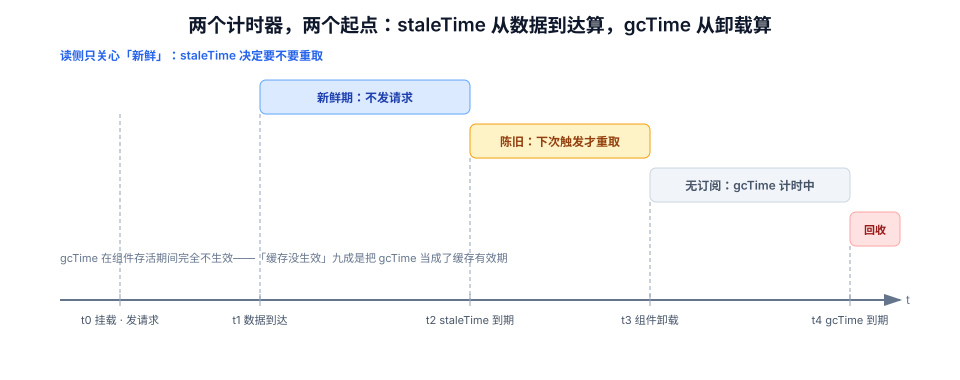

# 本地态与远端态：两面墙与一条时间轴

列表页写多了会撞上两堵墙。第一堵叫**重复**：五个组件各取一次，页面一挂载就打五个请求。第二堵叫**失联**：为了省请求把数据缓存起来，结果用户改完保存，页面上还是旧的。两堵墙看起来矛盾——一个要你少取，一个要你多取——其实是同一个问题的两端：**你没有给「新鲜」下定义**。

本页给出一套可执行的划分：什么进本地、什么留远端、`staleTime` 与 `gcTime` 到底各管什么、query key 怎么设计才能让列表与详情共享同一份数据。

## 判据族声明

本页判据族 `SDL-A` ~ `SDL-H`，共 8 条。定义表在第六节。

## 本页不讲什么

- 不讲失效怎么广播、跨标签页怎么同步，归 [缓存失效](../CacheInvalidation/index.md)。
- 不讲乐观更新的回滚，归 [乐观更新](../OptimisticUpdate/index.md)。
- 不讲 store 的 API（`create` / `defineStore`），归 [React 状态管理](/docs/Frontend/Frame/React/StateManagement/index.md) 与 [Pinia 进阶](/docs/Frontend/Frame/Vue/Vue3/PiniaAdvanced/index.md)。
- 不讲服务端 HTTP 缓存与 CDN，归 [浏览器原理 · 缓存](/docs/Frontend/Basic/Browser/index.md)。



## 一、两个计时器：staleTime 与 gcTime

这两个参数被混用得非常普遍，而它们回答的是完全不同的问题：

| 参数 | 回答的问题 | 默认值 | 到点之后发生什么 |
| --- | --- | --- | --- |
| `staleTime` | 这份数据**还算新鲜**吗？ | `0`（一到手就旧） | 下次触发（挂载 / 聚焦 / 重连）时**后台重取**，界面继续显示旧值 |
| `gcTime` | 没有组件用它时，**多久后扔掉**？ | `5 * 60 * 1000` | 缓存条目被回收，下次挂载**从零取**（没有旧值可显示） |

关键点：**`gcTime` 在组件还活着的时候完全不生效**。所以「缓存没生效」的抱怨，九成是把 `gcTime` 当成了「缓存有效期」调大——真正决定「要不要发请求」的是 `staleTime`。

::: danger 三个反直觉的默认值
1. **`staleTime: 0` 不等于「不缓存」**：数据仍然在缓存里，UI 会立刻显示旧值，同时后台重取。所以你会看到「先闪一下旧数据，再变成新数据」。
2. **`gcTime: Infinity` 不等于「永不回收」**：它只保住数据，查询对象本身仍被追踪；`["user", id]` 这种高基数 key 依然会把内存吃满。
3. **`refetchOnWindowFocus` 默认开启**：切走再切回来会重取。对「列表页」是好事，对「正在填写的长表单所在页」可能把用户刚改的字段冲掉——前提是你把表单值也放进了查询缓存。
:::

### 一条时间轴看清两者

```text
t0  首次挂载 → 发请求 → t1 数据到达（此时 staleTime 开始计时）
t1~t2  新鲜期：挂载 / 聚焦 / 重连 都不发请求
t2  staleTime 到期 → 标记为 stale（但不发请求，等下一次触发）
t3  组件卸载 → gcTime 开始计时
t4  gcTime 到期 → 缓存条目被回收
```

容易混淆的是 `t2` 与 `t3`：**`staleTime` 从数据到达算起，`gcTime` 从最后一个订阅者卸载算起**，两者独立计时，可以同时进行。

## 二、`staleTime` 按变化频率分档

不该给所有查询写同一个 `staleTime`。按「这份数据多久会变」分四档，是成本最低的收敛办法：

| 档位 | 典型数据 | 建议 `staleTime` | 理由 |
| --- | --- | --- | --- |
| **近乎不变** | 字典表、枚举、功能开关、当前用户权限 | `Infinity` 或 `'static'` | 登录时取一次；`'static'` 连手动失效都不触发，适合「运行期不可能变」的数据 |
| **低频变化** | 组织架构、成员列表、看板元信息 | `5~10 min` | 变一次要人工操作，用户能接受几分钟延迟 |
| **中频变化** | 卡片列表、评论、通知 | `30~60 s` | 别人的改动最多延迟一分钟；配合推送可再放宽 |
| **高频变化** | 在线人数、未读数、协同光标 | `0~5 s` + 轮询/推送 | 这里用缓存省不了请求，应该换传输方式 |

这张表的价值在于**它逼你回答一个问题**：这份数据到底多久变一次？答不上来的，说明业务口径没定，此时写任何数字都是猜。

### 分档后的效果（本机模拟）

100 次 tab 切换、`staleTime = 30 s`、每次切换都触发重取判断：

| 切换间隔 | 重取次数 | 说明 |
| --- | --- | --- |
| 1 s | **4** | 快速来回切，绝大多数命中新鲜期 |
| 5 s | **17** | 5 秒一切，每 6 次切换重取一次 |
| 30 s | **100** | 间隔恰好等于 `staleTime`，等于没有缓存 |
| 120 s | **100** | 每次都过期，全部重取 |

所以「加了缓存但没效果」的常见原因是：**`staleTime` 定得比用户的操作节奏还短**。以协作看板为例，用户在两个看板之间来回切通常间隔 10~30 秒，`staleTime` 应取 **60 秒**而不是 30 秒——多一分钟的新鲜度，换来一半的请求。

## 三、两面墙：重复与失联

| | 重复（请求太多） | 失联（显示旧值） |
| --- | --- | --- |
| **症状** | Network 面板同一接口刷屏，接口 QPS 随页面数线性增长 | 保存成功但列表仍旧；两个页面显示不同值 |
| **根因** | `staleTime: 0` + 每个组件独立 `useQuery` | 写操作没失效、或失效的 key 与读的 key 不匹配 |
| **错误解法** | 把所有请求塞进一个「全局 loading」里手工控制 | 把 `staleTime` 调到很大，靠「用户会刷新」兜底 |
| **正确解法** | 共享 query key + 在途合并 + 按频率设 `staleTime` | 写操作显式失效**读侧 key**，并覆盖跨标签页 |

两面墙不能同时用「调参数」解决：调大 `staleTime` 会让失联更严重，调小会让重复更严重。真正的解法是**让失效变成写操作的一部分**（下一节与 [缓存失效](../CacheInvalidation/index.md)），此时 `staleTime` 可以放得很宽——因为「该旧的时候」会被精确地标旧。

## 四、query key 设计：让列表与详情共享

这是「重复」问题里最容易被忽略的一层：列表里有 60 张卡片，点进详情又取一次卡片，返回列表再取一次列表。

### 分层 key 与按 id 索引

```ts
// 反例：列表与详情各用各的 key，互相不知道对方存在
useQuery({ queryKey: ["cards", boardId], queryFn: () => fetchCards(boardId) });
useQuery({ queryKey: ["card", cardId], queryFn: () => fetchCard(cardId) });

// 正例：同一资源族，用「集合 + 单条」两级 key，失效时可以按前缀覆盖
const keys = {
  all: ["cards"] as const,
  list: (boardId: string) => [...keys.all, "list", boardId] as const,
  detail: (cardId: string) => [...keys.all, "detail", cardId] as const,
};
```

`keys.all` 的存在是为了**前缀失效**：`invalidateQueries({ queryKey: ["cards"] })` 一次覆盖列表与所有详情。没有这一层，你就得逐个列举，必然漏。

### 详情优先用列表数据「垫一下」

用户点进详情时，列表里已经有这条数据（只是字段少）。此时不该显示骨架屏，而该先把列表里的那条当占位：

```ts
const { data: card } = useQuery({
  queryKey: keys.detail(cardId),
  queryFn: () => fetchCard(cardId),
  // v5：用 placeholderData + 身份函数替代 v4 的 keepPreviousData
  placeholderData: () => {
    const list = queryClient.getQueryData<Card[]>(keys.list(boardId));
    return list?.find((c) => c.id === cardId);
  },
});
```

::: warning `placeholderData` 的三个副作用
① 它会让你**一直处于 success 状态**，`isLoading` 永远是 `false`，所以「首屏骨架」要用 `isPlaceholderData` 判断；② `dataUpdatedAt` 会保持为 0，任何「几秒前更新」的展示都要另取时间；③ 占位数据是**部分字段**，若详情页直接读 `card.description`，会渲染 `undefined`——必须给缺字段兜底。
:::

### 什么时候该「拆 key」，什么时候该「合 key」

| 场景 | 做法 | 理由 |
| --- | --- | --- |
| 同一份数据被多个页面读 | 合（同一 key） | 共享缓存，天然一致 |
| 同一资源不同字段集（列表精简 / 详情完整） | 拆（`list` / `detail`）+ 占位 | 请求体积不同，缓存寿命也不同 |
| 权限不同导致返回不同 | **key 里必须含租户/用户** | 否则切账号串数据（这是最严重的一类） |
| 同一接口不同 `params` | key 里含**全部影响结果的参数** | 漏一个参数就会「改了筛选没反应」 |

最后一条是高频事故：`queryFn` 里 `fetch(`/api/cards?board=${boardId}&status=${status}`)`，但 key 只写了 `["cards", boardId]`。改 `status` 时 key 没变，缓存命中，界面纹丝不动。

## 五、轮询、聚焦重取与「不重取」

三种「自动重取」的触发源各有适用面：

| 触发源 | 默认 | 适用 | 不该用的场景 |
| --- | --- | --- | --- |
| 挂载重取 | 开 | 绝大多数列表 | —— |
| 窗口聚焦重取 | 开 | 用户离开又回来的页面（收件箱、看板） | 长表单页、含未提交改动的页面 |
| 网络重连重取 | 开 | 移动端、弱网 | —— |
| 定时轮询 `refetchInterval` | 关 | 无推送能力但要「近实时」（如任务进度） | 有 WebSocket 的页面（双份流量） |

::: tip 轮询的三个纪律
① **后台不轮询**：`refetchIntervalInBackground` 保持 `false`，否则一百个后台标签页就是一百个定时器；② **轮询间隔要大于接口 P95**，否则请求会堆叠；③ **轮询失败不要静默**：连续 3 次失败应降级为「数据可能不是最新」的可见提示，而不是继续默默轮询。
:::

## 六、判据表

| 编号 | 规则 | 违反时的样子 | 怎么验证 |
| --- | --- | --- | --- |
| `SDL-A` | 每个查询都能回答「多久变一次」，`staleTime` 与之匹配 | 切页面就打请求 / 数据总是旧的 | 列出所有 `useQuery` 与 `staleTime`，出现「无理由的 0」即违规 |
| `SDL-B` | `gcTime` 不被当作「缓存有效期」使用 | 调大 `gcTime` 后请求数没降 | 改 `gcTime` 前后请求数不变，改 `staleTime` 才变 |
| `SDL-C` | key 包含所有影响结果的参数（含租户/用户） | 改筛选没反应 / 切账号串数据 | 逐个 key 与 `queryFn` 的入参对照；漏一个即违规 |
| `SDL-D` | 同族资源有前缀 key，支持一次性失效 | 失效要写很多行，且总有遗漏 | 存在 `keys.all`，且存在按前缀失效的调用 |
| `SDL-E` | 列表 → 详情有占位数据，不出现无谓骨架屏 | 点进详情整页骨架、返回列表重新加载 | 慢速网络下点进详情，应立刻看到标题等已有字段 |
| `SDL-F` | 含未提交改动的页面关闭聚焦重取 | 切走再回来，输入框内容被冲掉 | 在输入框打字 → 切到别的应用 → 切回，内容必须还在 |
| `SDL-G` | 轮询不在后台跑，且失败可见 | 后台标签页也在请求；接口挂了没人知道 | DevTools 观察后台标签是否仍发请求；断网 60 秒后应有提示 |
| `SDL-H` | 一次性数据（验证码/下载链接）不缓存 | 第二次点击拿到失效链接 | 连续两次点击同一按钮，两次都成功 |

## 验证方式

`SDL-A` / `SDL-E` / `SDL-F` 可以在浏览器里直接验证：

```text
SDL-A：Network 限速 Fast 3G，依次「列表 → 详情 → 返回 → 详情 → 返回」
  期望：同一列表接口 60 秒内只出现 1 次
  判读：出现 3 次说明 staleTime 仍为 0；出现 2 次说明 30 秒窗口太小

SDL-E：在列表页点第一张卡片
  期望：标题/负责人/标签立即可见（来自列表数据），只有描述区显示骨架
  判读：整页骨架 = 没用 placeholderData；描述区不骨架 = 忘了 isPlaceholderData

SDL-F：在详情页的「描述」输入框打「测试」→ 切到别的窗口 → 切回
  期望：输入内容仍在
  判读：内容消失 = refetchOnWindowFocus 把未提交值覆盖了
```

代码类判据的静态检查：

```shell
# SDL-A：列出所有查询与它们的 staleTime，人工确认每一档都有理由
grep -rn "useQuery(" src/ | wc -l
grep -rn "staleTime" src/ | wc -l
# 期望：后者接近前者（含全局 defaultOptions）；差异部分必须能解释

# SDL-C：找出 key 用了变量、queryFn 里还用了别的变量（常见漏参数）
grep -rn "queryKey: \[" src/ | wc -l
grep -rn "queryFn:" src/ | wc -l
# 期望：两数相等，且逐条检查 queryFn 引用的变量都在 key 里
```

::: info 关于阈值
`staleTime` 的具体数字没有普适答案，本页表格给的是**起点**。真正的定法是从日志里取「同一 key 两次读取的间隔中位数」，取它的 2 倍作为 `staleTime`——这样命中率与新鲜度最平衡。
:::

## 与本专题的分工

| 本页 | [本地数据存储与容量治理](../../LocalDataStore/index.md) |
| --- | --- |
| 内存缓存：`staleTime` / `gcTime`、重取时机 | 落到磁盘的持久层怎么建、怎么升版本 |
| 内存态与远端态的「新鲜度」定义 | 页面刷新后内存态全丢，靠本地库重建 |
| query key 设计 | 本地库的主键与索引设计 |

**本页特有的一个坑**：把 `gcTime` 设成 `Infinity` 之后，内存里的旧数据**不会**被回收，而页面关闭后又全部丢失——于是「持久化」这件事被误以为已经由缓存解决了。真正的持久化仍要写 IndexedDB，并且要接受它的两个约束：**按源隔离**与**随时可被回收**（见[配额](../../LocalDataStore/Quota/index.md)）。

## 参考资料

- [TanStack Query v5 · Important Defaults](https://tanstack.com/query/v5/docs/react/guides/important-defaults)——`staleTime` 0 / `gcTime` 5 分钟 / `staleTime: 'static'`
- [TanStack Query v5 · Query Keys](https://tanstack.com/query/v5/docs/react/guides/query-keys)——key 的序列化与失效匹配规则
- [TanStack Query v5 · Placeholder Data](https://tanstack.com/query/v5/docs/react/guides/placeholder-query-data)——`placeholderData` 与 `initialData` 的区别
- [SWR · 自动重新验证](https://swr.vercel.app/docs/revalidation)——`dedupingInterval` 的时间窗去重
- 相邻：[缓存失效](../CacheInvalidation/index.md) · [派生状态](../DerivedState/index.md) · [前端性能优化](/docs/Frontend/Others/PerformanceOptimization/index.md)
