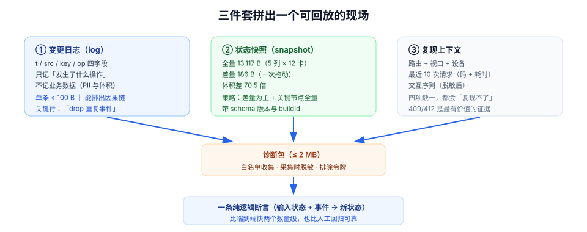

# 状态可观测：把「偶现」变成可回放

前端最贵的 bug 是「偶现」。用户说「有时候列表是空的」，你在本地刷二十次都正常——因为缺的不是复现技巧，而是**记录**：那个时刻的缓存里有什么、哪条事件被丢了、哪个请求回了 409。

后端有日志、指标、链路追踪。前端的状态变更却通常只活在 DevTools 里，页面一刷新就没了。本页给出三件套：**变更日志、状态快照、复现上下文**，以及怎么让它们体积可控、隐私可控。

## 判据族声明

本页判据族 `SDV-A` ~ `SDV-H`，共 8 条。定义表在第六节。

## 本页不讲什么

- 不讲后端可观测性（指标、链路、日志聚合），归 [可观测性](/docs/Ops/Observability/index.md) 与 [LLM 应用可观测](/docs/AI/LLMObservability/index.md)。
- 不讲性能指标（LCP、INP），归 [前端性能优化](/docs/Frontend/Others/PerformanceOptimization/index.md)。
- 不讲埋点平台选型与数据仓库，本页只讲「状态相关的最小事件集」。
- 不讲脱敏算法细节，归 [测试数据与仿真环境 · 数据脱敏](/docs/Tools/TestDataSimulation/DataMasking/index.md)。



## 一、为什么前端状态天然不可观测

| 差异 | 后端 | 前端 |
| --- | --- | --- |
| 状态在哪 | 进程内存 + 数据库，可随时查 | 每个标签页各一份，刷新即销毁 |
| 变更记录 | 请求日志天然存在 | 只有主动打点才有 |
| 复现方式 | 重放请求 | 需要「数据 + 交互序列 + 时序」三者同时还原 |
| 观测成本 | 服务端统一采集 | 每多打一条日志都增加用户流量 |

所以前端的可观测不是「照搬后端」，而是回答一个更窄的问题：**这个用户在这次会话里，状态是怎么一步步变成现在这样的？**

## 二、第一件：变更日志（log）

最小可用的状态日志包含四个字段，多一个都不要：

```ts
type StateEvent = {
  t: number;        // 相对会话开始的毫秒数（不是绝对时间，避免时钟问题）
  src: "query" | "mutation" | "socket" | "ui";  // 谁改的
  key: string;      // 改的是哪份状态（query key 或 store 字段）
  op: "set" | "invalidate" | "patch" | "drop";  // 做了什么
  // 可选：reason，用于解释「为什么」
  reason?: string;
};
```

四个字段的价值在于**能排出因果链**：

```text
t=0     ui        list          set        进入看板页
t=12    query     board:1       set        首次取数返回 60 张卡
t=840   ui        list          patch      拖动 card_7 到「进行中」
t=845   mutation  card:7        set        服务端返回 version=43
t=846   socket    board:1       patch      广播 card.moved seq=118
t=847   socket    board:1       drop       重复事件 seq=118（已应用）
```

最后两行是排障关键：**它直接告诉你「事件到了、并且被正确丢弃了」**。没有日志时，你只能猜「是不是没收到」。

::: tip 日志只记「决策」，不记「数据」
上面六行没有一行包含卡片标题、描述。日志记的是**发生了什么操作**，快照记的是**当时的数据**。把数据写进日志，既贵又危险（PII）。需要看数据时用快照，两者用 `t` 对齐。
:::

## 三、第二件：状态快照（snapshot）

快照是「某一刻所有相关状态的一份拷贝」。它的成本主要是**体积**——本机实测（Node 22.22.2，JSON 序列化后的字节数）：

| 内容 | 字节数 | 说明 |
| --- | --- | --- |
| 一个看板全量快照（5 列 × 12 卡、含描述） | **13,117 B** | 约 13 KiB |
| 一次拖动的差量（JSON Patch 三条操作） | **186 B** | 约 0.18 KiB |
| 倍数 | **70.5×** | —— |

结论：**快照不能每条日志都存**。可行的策略是「定期 + 关键节点」：

| 时机 | 是否存快照 | 理由 |
| --- | --- | --- |
| 会话开始（页面加载完成） | 存 | 复现的起点 |
| 每次写操作前后 | 存**差量**，不存全量 | 70 倍体积差 |
| 出错时（4xx/5xx、冲突、回滚） | 存全量 | 这是最需要还原的时刻 |
| 固定间隔（如 30 秒） | 存全量 | 兜底，防止漏掉关键节点 |

按这个策略，一次 10 分钟的会话大约产生：1 份初始快照 + 20~40 条差量 + 3~5 份错误快照 ≈ **80 KiB**，相当于一张中等图片。这个量级可以随错误上报一起发。

### 快照要能「装回去」

快照的价值取决于**能不能被加载回应用**。三条要求：

1. **只包含可序列化数据**：`Map`、`Set`、`Date`、类实例要先转成普通结构（`Array.from`、`toISOString`），否则 `JSON.stringify` 会静默丢数据。
2. **带 schema 版本**：`{ v: 2, data: ... }`。数据结构变了之后，旧快照要能识别为「不可回放」，而不是加载出一个半残状态。
3. **与代码版本绑定**：快照里记录 `buildId`（前端构建号）。不同构建号的快照只能参考，不能回放。

## 四、第三件：复现上下文

只有日志和快照还不够——你还得知道**用户点的是什么**。复现上下文是四样东西：

| 项 | 例子 | 为什么需要 |
| --- | --- | --- |
| 路由 | `/boards/1?tab=active` | 同一份数据在不同页面表现不同 |
| 视口与设备 | `1440×900 / dpr 2 / Chrome 141` | 移动端才有的事件顺序问题 |
| 网络 | 最近 10 次请求的状态码与耗时 | 409/412 是冲突类 bug 的直接证据 |
| 交互序列 | `click #card-7 → dragstart → drop #col-2`（脱敏后） | 重现「先点了什么」 |

四样加日志、快照，构成一个**可回放的现场**。工程上把它做成一个「导出诊断包」按钮：用户报障时点一下，下载一个 zip（或直接上传），支持人员用它可以重放。

::: danger 诊断包里最容易出的事
1. **把令牌一起带出去**：`localStorage` 里的 access token、Cookie 必须**完全排除**，白名单收集而不是黑名单过滤。
2. **PII 未脱敏**：卡片标题、评论内容、邮箱都可能含个人信息。脱敏要在**采集时**做，不是在服务端接收时做。
3. **包太大**：全量快照 + 所有请求体，动辄几十 MB，用户上传失败。限制在 1~2 MB，超限时只保留最后 200 条日志。
:::

## 五、把 bug 写成断言

可观测的终点不是「能看」，而是**同类问题不再复发**。做法是把每一次线上问题转成一条可执行的断言：

| bug 类型 | 断言写法（伪代码） |
| --- | --- |
| 事件重复应用导致计数翻倍 | `apply(evt); apply(evt); expect(count).toBe(1)` |
| 冲突静默覆盖 | `expect(await save(staleVersion)).toMatchObject({ status: 412 })` |
| 回滚没执行 | `expect(afterFailedMove().position).toBe(originalPosition)` |
| `staleTime` 回归 0 | `expect(requestCountAfter5Navigations()).toBeLessThanOrEqual(1)` |

这些都是**纯逻辑测试**，不需要浏览器：把「状态 + 事件」当输入，把「新状态」当输出。它们比端到端测试快两个数量级，也比人工回归可靠。

::: tip 一条经验
每修一个「偶现」bug，至少留下一条这样的断言。否则三个月后它一定会以另一个入口回来——因为当初的原因（缺判序、缺回滚、缺失效）通常不止影响一个页面。
:::

## 六、判据表

| 编号 | 规则 | 违反时的样子 | 怎么验证 |
| --- | --- | --- | --- |
| `SDV-A` | 有统一的状态事件日志（`t`/`src`/`key`/`op`） | 排障只能靠复现 | `window.__stateLog` 可导出，且包含四字段 |
| `SDV-B` | 日志只记操作，不记业务数据 | 日志里有用户内容，体积暴涨 | 抽样日志，不应出现标题/描述/邮箱原文 |
| `SDV-C` | 快照按「关键节点 + 差量」采集 | 每条日志都存全量，包体积失控 | 单次会话诊断包 ≤ 2 MB |
| `SDV-D` | 快照可反序列化回放，且带 schema 版本与 buildId | 加载旧快照得到半残状态 | 用上一版本快照加载，应被识别为不可回放而非崩溃 |
| `SDV-E` | 复现上下文含路由、视口、网络、交互序列 | 「偶现」无法定位 | 诊断包里四项齐全 |
| `SDV-F` | 诊断包不含令牌，PII 采集时脱敏 | 令牌泄漏 / 个人信息外流 | 包里 `grep` 不到 token 与邮箱原文 |
| `SDV-G` | 每个已修 bug 有对应状态断言 | 同类问题换个入口复发 | 回归用例数 ≥ 已修状态类 bug 数 |
| `SDV-H` | 生产采样可调，异常必采 | 全量采集拖慢应用 / 出事时没数据 | 采样率有配置项；错误路径采样率为 100% |

## 验证方式

`SDV-A` / `SDV-C` / `SDV-F` 的验证步骤：

```text
SDV-A：控制台执行 copy(JSON.stringify(window.__stateLog))
  期望：得到数组，每条含 t / src / key / op
  判读：undefined = 没接入；缺少 src = 无法判断「谁改的」

SDV-C：点「导出诊断包」→ 查看文件大小
  期望：≤ 2 MB
  判读：> 10 MB = 每步都存了全量快照

SDV-F：解开诊断包，搜索敏感串
  grep -rE "Bearer |eyJhbGciOi|@[a-z0-9]+\.(com|cn)" ./diag
  期望：无输出
  判读：命中任一 = 令牌或 PII 泄漏，必须立即修复
```

日志实现的静态检查：

```shell
# SDV-B：日志调用里是否夹带了业务字段
grep -rnE "stateLog\.(push|add)\(" src/ -A 2 | grep -E "title|desc|email|content" || echo "未发现业务数据入日志"
# 期望：无输出

# SDV-G：状态断言与已修 bug 的比例
grep -rn "describe(\"state" test/ | wc -l
# 期望：与「状态类 bug」清单条数相当；明显偏少说明只修没测
```

::: warning 采样与隐私的边界
生产环境默认采样率建议 **1%~5%**（错误路径 100%）。脱敏必须在**采集函数内部**完成，不能依赖「调用方记得脱敏」——那是迟早会漏的约定。更完整的脱敏规则见 [测试数据与仿真环境 · 数据脱敏](/docs/Tools/TestDataSimulation/DataMasking/index.md)。
:::

## 参考资料

- [Chrome DevTools · Performance](https://developer.chrome.com/docs/devtools/performance/)——用录制还原交互序列
- [TanStack Query v5 · Query Cache](https://tanstack.com/query/v5/docs/reference/QueryCache)——订阅缓存事件做日志
- [web.dev · Debugging](https://web.dev/learn/)——前端排障的通用方法
- [RFC 6902 · JSON Patch](https://www.rfc-editor.org/rfc/rfc6902.html)——差量快照的标准格式
- 相邻：[多端同步与收敛](../RealtimeSync/index.md) · [缓存失效](../CacheInvalidation/index.md) · [测试数据与仿真环境 · 数据脱敏](/docs/Tools/TestDataSimulation/DataMasking/index.md)
