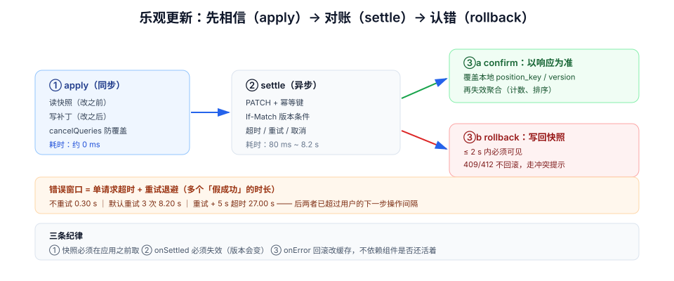

# 乐观更新：先相信，再对账

拖动一张卡片，松手后它立刻停在新位置——这就是乐观更新。它让交互从「等一下」变成「就是这样」，代价是**你必须准备好它可能是错的**：服务端可能拒绝（权限不足、版本冲突、配额用尽），网络可能断，响应可能永远不来。

乐观更新的难点不在「先改 UI」，而在**改完之后的三件事**：改回什么、改回来的这段时间里用户看到了什么、以及这一次失败会不会连带把后面的操作也弄坏。

## 判据族声明

本页判据族 `SDU-A` ~ `SDU-H`，共 8 条。定义表在第六节。

## 本页不讲什么

- 不讲失效与广播，归 [缓存失效](../CacheInvalidation/index.md)；本页只讲「乐观补丁」与「失效」的先后。
- 不讲拖拽动画与 FLIP，归 [微交互与动效工程](/docs/Frontend/Motion/index.md)。
- 不讲幂等键的服务端实现，归 [幂等与状态机 · 幂等键](/docs/Backend/IdempotencyStateMachine/IdempotencyKey/index.md)；本页只讲「前端为什么必须带」。
- 不讲 React 的 `useOptimistic` 与 Vue 的写法差异，两者只在示例里各出现一次。



## 一、三阶段：apply / settle / rollback

任何乐观更新都可以拆成三步，缺一步就会露出「假的成功」：

| 阶段 | 做什么 | 必须留下的东西 | 漏掉的后果 |
| --- | --- | --- | --- |
| **① apply** | 本地先应用变更 | **回滚快照**（变更前的完整状态） | 失败时不知道改回什么，只能整页重取 |
| **② settle** | 等服务端结果 | 请求标识（幂等键）、超时与取消 | 响应回来时不知道该落到哪个状态 |
| **③ rollback / confirm** | 失败回滚 / 成功确认 | 回滚函数 + 用户可见提示 | UI 停在假值，用户以为成功 |

::: danger 最常见的错误：快照取晚了
```ts
// 反例：先改，再取「当前值」当快照 —— 快照已经是改后的值
const optimistic = (next) => {
  setCards(next);
  const snapshot = cards;      // 闭包里还是旧值？在并发更新下不一定
  return () => setCards(snapshot);
};
```
正确写法是**在应用之前把状态读出来**，且读的是同一份来源：
```ts
const snapshot = queryClient.getQueryData(keys.list(boardId)); // 应用前
queryClient.setQueryData(keys.list(boardId), applyMove(snapshot, move));
// 回滚就是 setQueryData(keys.list(boardId), snapshot)
```
:::

### 用 React 19 的 `useOptimistic`

```tsx
function CardTitle({ card, onRename }: { card: Card; onRename: (t: string) => Promise<void> }) {
  const [optimisticTitle, setOptimisticTitle] = useOptimistic(card.title);
  const [error, setError] = useState<string | null>(null);

  async function submit(formData: FormData) {
    const next = String(formData.get("title") ?? "");
    setOptimisticTitle(next);            // ① apply（作用域限于本次过渡）
    try {
      await onRename(next);              // ② settle
    } catch {
      setError("保存失败，已恢复原标题");  // ③ rollback 由 React 自动完成
    }
  }

  return (
    <form action={submit}>
      <input name="title" defaultValue={optimisticTitle} />
      {error ? <p role="alert">{error}</p> : null}
    </form>
  );
}
```

`useOptimistic` 的回滚是**自动的**：过渡结束（成功或失败）后，乐观值被丢弃，回到 `card.title`。这省掉了手写快照，但代价是——**它只适用于「过渡作用域内」的状态**，跨页面的缓存（比如列表里的顺序）不在它的管辖范围，仍需手写 `setQueryData` + 回滚。

### 用查询层的 `onMutate` / `onError`

```ts
const moveCard = useMutation({
  mutationFn: (v: MoveInput) => api.moveCard(v, { idempotencyKey: v.opId }),
  onMutate: async (v) => {
    await queryClient.cancelQueries({ queryKey: keys.list(v.boardId) }); // 防止在途重取覆盖
    const prev = queryClient.getQueryData(keys.list(v.boardId));         // ① 快照
    queryClient.setQueryData(keys.list(v.boardId), applyMove(prev, v));  // ① apply
    return { prev };                                                     // 传给 onError
  },
  onError: (_e, _v, ctx) => {
    queryClient.setQueryData(keys.list(_v.boardId), ctx?.prev);          // ③ 回滚
  },
  onSettled: (_d, _e, v) => {
    queryClient.invalidateQueries({ queryKey: keys.list(v.boardId) });   // 以服务端为准
  },
});
```

三处容易漏的细节：

1. **`cancelQueries` 必须在改缓存之前**：否则一个在途的后台重取可能在你的乐观值之后落地，把乐观值覆盖成旧数据——用户看到卡片「弹回去又弹过来」。
2. **`onSettled` 里要失效**：乐观补丁只是「我猜的结果」，服务端可能顺手改了别的字段（`position_key`、`updated_at`、`version`）。不失效，缓存里的版本号永远是旧的，下一次写必然 412。
3. **`onError` 的回滚不能依赖组件还活着**：用户可能在请求返回前就切走了页面，此时 `setState` 无效，但**缓存回滚仍然必须发生**，否则他回来看到的是假值。

## 二、临时 ID：乐观创建的最大坑

「新建卡片」比「移动卡片」难一个量级：本地必须先造一个 ID 才能渲染，而服务端稍后会返回真 ID。

| 方案 | 做法 | 优点 | 风险 |
| --- | --- | --- | --- |
| 客户端生成 UUID | 本地即用最终 ID | 无映射，最简单 | 服务端要接受客户端 ID（或做映射）；ID 可被伪造 |
| 临时 ID + 映射表 | `temp_xxx` → 真 ID 替换 | 服务端 ID 策略不变 | 所有引用点都要替换（列表 key、选中态、路由、通知） |
| 只显示「正在创建」占位 | 不参与交互 | 实现最省 | 用户感觉「点了没反应」 |

选第一种的前提是**服务端允许客户端提供 ID 并做幂等**（`INSERT ... ON CONFLICT DO NOTHING`）。这是最省事的路，但需要后端配合。前端单方面决定不了。

::: danger 临时 ID 的四个引用点，漏一个就出错
1. **列表渲染 key**：用临时 ID 作 key，替换成真 ID 时会**重新挂载组件**（DOM 重建、动画丢失、输入框失焦）。
2. **选中态**：`selectedId` 还指着 `temp_xxx`，替换后详情面板变成空白。
3. **路由**：新建后跳到 `/cards/temp_xxx`，刷新即 404。
4. **待处理队列**：队列里的后续操作（比如紧接着改标题）必须跟着 ID 一起替换，否则打到不存在的资源上。

替代做法：**保留临时 ID 作为渲染 key，另存 `realId` 字段用于请求**，让 key 稳定、请求正确。代价是列表里要维护两套标识，需要一条「何时可以丢弃临时 ID」的规则（通常是服务端确认 + 本地重取之后）。
:::

## 三、错误窗口：从「先相信」到「承认错了」有多长

用户能容忍的「假的成功」时长是有限的。窗口长度完全由**超时与重试策略**决定，而这两项通常是默认值：

| 策略 | 单请求超时 | 从乐观应用到最终回滚 |
| --- | --- | --- |
| 不重试 | 300 ms | **0.30 s** |
| 重试 3 次（默认退避 1s/2s/4s） | 300 ms | **8.20 s** |
| 重试 3 次 + 每次 5 s 超时 | 5000 ms | **27.00 s** |

8 秒是一个危险的数字：用户已经离开这张卡片，甚至开始下一个操作了。27 秒更糟——他已经把这件事当成成功了。

所以乐观更新必须给**重试策略单独定值**：

```ts
useMutation({
  retry: (count, error) => {
    // 4xx 不重试（重试也不会成功，只会延长错误窗口）
    if (isClientError(error)) return false;
    return count < 2;
  },
  retryDelay: (n) => Math.min(500 * 2 ** n, 4000),
});
```

::: tip 一条实用规则
**错误窗口应小于用户的下一步操作间隔**。实测拖动/勾选的下一步间隔在 1~3 秒，因此乐观写入的总预算应控制在 **2 秒**内：一次请求 + 一次重试。超过这个长度，就该改成「显示进行中」而不是「显示已完成」。
:::

## 四、重试的代价：必须有幂等键

乐观更新天然伴随重试，而重试天然伴随重复写入。没有幂等键时，一次超时重试会创建两张卡片。

```ts
// 每次用户操作生成一个稳定的操作 ID（不是每次请求生成）
const opId = crypto.randomUUID();
moveCard({ cardId, toColumn, opId });
```

判据很直接：**同一个 `opId` 提交两次，服务端只能产生一次效果**。验证方式是把网络延迟调到 3 秒、请求超时设 1 秒，制造一次「客户端认为失败、服务端其实成功」的场景，然后看列表里是一张还是两张。

## 五、离线队列：三条不能省的规则

离线时乐观更新会积累一串待发操作，联网后一起发出。这个队列比想象中难写：

| 规则 | 为什么 | 违反后的样子 |
| --- | --- | --- |
| **顺序发送，失败即停** | 后一个操作可能依赖前一个的结果（新建 → 改标题） | 改标题打到一个还不存在的 ID 上 |
| **同一实体的操作可合并** | 连拖三次只需要最后一次 | 服务端收到三次移动，审计日志噪声 |
| **队列可放弃** | 有些操作过期就无意义（把昨天的卡片拖到「今天」） | 联网后一堆过期操作把数据改乱 |

`navigator.onLine` 只告诉你「有没有网卡」，不告诉你「服务端可达」。真正的判据是**最近一次请求是否成功**：连续 2 次超时才进入离线态，任何一次成功立即退出。

## 六、什么场景不该乐观

| 场景 | 为什么 | 替代做法 |
| --- | --- | --- |
| 金额、库存、优惠券 | 服务端可能拒绝（余额不足、超卖） | 显示「处理中」，等服务端确认 |
| 有强校验的操作（上传、导入） | 失败率高，且失败原因必须展示 | 进度条 + 明确失败原因 |
| 依赖服务端生成的内容（分享链接、导出文件） | 本地造不出 | 骨架 + 轮询/推送 |
| 不可撤销的外部副作用（发邮件、发通知） | 回滚无法撤回已发出的东西 | 二次确认 + 结果回执 |
| 首次进入的写（列表还空） | 没有快照可回滚，且用户没有「已经改了」的心智 | 普通提交 + loading |

判据是**失败率与可回滚性**：失败率高于 5%、或者失败后无法真正撤销的，都不该乐观。

## 七、判据表

| 编号 | 规则 | 违反时的样子 | 怎么验证 |
| --- | --- | --- | --- |
| `SDU-A` | 每次乐观写入都有**应用前**的快照 | 失败后只能整页重取，闪一下 | 断网操作，恢复后原地复原且不闪 |
| `SDU-B` | 改缓存前先 `cancelQueries` | 卡片弹回又弹过来 | 慢速网络下拖动，位置只变一次 |
| `SDU-C` | `onSettled` 里失效或补丁，保证版本更新 | 连续两次编辑必 412 | 同一卡片连续改两次，第二次成功 |
| `SDU-D` | 乐观写入带幂等键 | 超时重试后出现两条记录 | 把超时调到 1 s、延迟调到 3 s，只应有一条 |
| `SDU-E` | 错误窗口 ≤ 2 s（重试策略显式定义） | 8 秒后才弹回，用户已当成功 | 断网后计数：从松手到提示的时间 |
| `SDU-F` | 临时 ID 的四个引用点都被替换 | 替换后输入框失焦、详情空白、404 | 新建卡片后立刻改名，不出现失焦或 404 |
| `SDU-G` | 离线队列顺序发送、可合并、可放弃 | 联网后过期操作把数据改乱 | 离线连拖三次再联网，服务端只应收到一次移动 |
| `SDU-H` | 不该乐观的场景有清单且被遵守 | 支付按钮先显示「已支付」 | 逐个写操作对照清单，金额类必须不在乐观列表 |

## 验证方式

`SDU-A` / `SDU-D` / `SDU-E` 的浏览器验证步骤：

```text
SDU-A + SDU-E：DevTools → Network → Offline
  拖动一张卡片松手，开始计时
  期望：≤ 2 s 内弹回原列 + 出现「保存失败」提示（role="alert"）
  判读：> 8 s 说明沿用了默认重试；不弹回说明缺回滚或没被调用

SDU-D：DevTools → Network → 自定义限速（延迟 3000 ms）→ 把请求超时设为 1000 ms
  新建一张卡片，等它「失败」后恢复网络
  期望：列表里只有一张新卡片（服务端其实成功过，靠幂等键去重）
  判读：出现两张 = 没有幂等键，或幂等键每次请求都重新生成

SDU-B：限速 Fast 3G，快速拖动同一张卡片两次
  期望：卡片位置单调变化，不出现「先到新位置又跳回旧位置」
  判读：出现回跳 = 没有 cancelQueries，在途重取覆盖了乐观值
```

静态检查：

```shell
# SDU-A/C：每个乐观更新是否同时有 onMutate 与 onError
grep -rn "onMutate" src/ | wc -l
grep -rn "onError" src/ | wc -l
# 期望：两数相等（onMutate 必须配 onError 回滚）

# SDU-D：幂等键是否在「用户操作」层生成，而不是请求层
grep -rn "Idempotency-Key\|idempotencyKey" src/ | head
# 期望：出现在 action / mutation 变量里，不出现在 fetch 封装内部
```

## 参考资料

- [TanStack Query v5 · Optimistic Updates](https://tanstack.com/query/v5/docs/react/guides/optimistic-updates)——`onMutate` / `onError` / `onSettled` 的三种写法
- [React · useOptimistic](https://react.dev/reference/react/useOptimistic)——过渡作用域内的自动回滚
- [TanStack Query v5 · Retries](https://tanstack.com/query/v5/docs/react/guides/query-retries)——默认 3 次、退避上限 30 s
- [RFC 9110 · Idempotent Methods](https://www.rfc-editor.org/rfc/rfc9110.html#name-idempotent-methods)——为什么 `PUT` 天然幂等而 `POST` 不是
- 相邻：[缓存失效](../CacheInvalidation/index.md) · [幂等与状态机 · 幂等键](/docs/Backend/IdempotencyStateMachine/IdempotencyKey/index.md) · [实战](../Practice/index.md)
