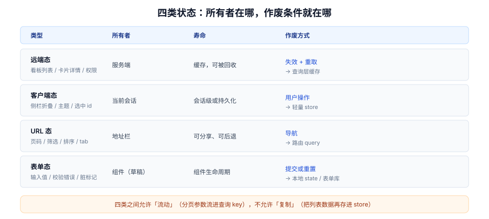

# 总览：四类状态与五个必失点

同一个症状——「列表里显示的还是旧数据」——至少有五种完全不同的原因：`staleTime` 让缓存被认为新鲜、失效没广播到另一个组件、乐观更新失败没回滚、两份副本各自刷新、推送乱序把旧事件盖在新状态上。它们都不抛异常、都不进错误监控，只是**安静地显示错的东西**。

本页先把状态分成四类，说清每类的所有者与作废条件，再给出五个「代码正确、构建通过、看起来也对」的失效模式。后面八页都是在某一类或某一个失效点上展开。

## 判据族声明

本页判据族 `SDO-A` ~ `SDO-H`，共 8 条。定义表在第六节。

## 本页不讲什么

- 不讲具体库怎么初始化、Provider 放哪，归框架专题：[React 状态管理](/docs/Frontend/Frame/React/StateManagement/index.md)、[Pinia 进阶](/docs/Frontend/Frame/Vue/Vue3/PiniaAdvanced/index.md)。
- 不讲 `staleTime` 与 `gcTime` 的逐参数语义，归 [本地态与远端态](../LocalRemote/index.md)。
- 不讲失效策略的实现细节，归 [缓存失效](../CacheInvalidation/index.md)。
- 不讲乐观更新的回滚代码，归 [乐观更新](../OptimisticUpdate/index.md)。



## 一、四类状态：先分类，再谈存哪

所有「状态管理选型」的争论，都是因为把四类状态当成了一类。它们的**所有者不同、寿命不同、失效方式不同**，混在一起必然出问题。

| 类型 | 例子 | 所有者 | 寿命 | 作废方式 | 该放哪 |
| --- | --- | --- | --- | --- | --- |
| **远端态**（server state） | 看板列表、卡片详情、当前用户权限 | 服务端 | 缓存，可被回收 | 失效 + 重新取 | 查询层缓存（TanStack Query / SWR / Pinia Colada） |
| **客户端态**（client state） | 侧边栏折叠、主题、选中的卡片 ID、多选集合 | 当前会话 | 会话级或持久化 | 用户操作 | 轻量 store（Zustand / Pinia / Signal） |
| **URL 态** | 页码、筛选条件、排序、当前 tab | 浏览器地址栏 | 可分享、可后退 | 导航 | 路由 query / params |
| **表单态** | 输入中的值、校验错误、脏标记 | 组件（草稿） | 组件生命周期 | 提交或重置 | 组件本地 state / 表单库 |

四类之间**允许流动，但不允许复制**。分页参数从 URL 流进查询 key 是流动；把列表数据复制进 store 是复制——后者就是绝大多数「两份数据不一致」的来源。

::: tip 一句话判断归属
问三个问题：**刷新页面后它该不该还在？**（该 → 服务端或 URL；不该 → 客户端）**别人打开同一个链接该不该看到一样的内容？**（该 → URL）**它是不是用户正在输入但还没提交的东西？**（是 → 表单态）。
:::

### 为什么 URL 态最容易被塞进 store

因为「筛选条件」看起来很像客户端状态。但一旦放进 store：刷新丢失、分享链接对方看到的是默认筛选、浏览器后退回不到上一个筛选。这三件事在测试环境都很难被发现，因为测试的人**从不刷新**。

判断标准很低：**这个值变了以后，用户按「后退」期不期望回到上一个值？** 期望 → URL；不期望 → 客户端态。

## 二、单向数据流约束的不是「方向」，是「谁能改」

「单向数据流」被讲得太多，反而模糊了它真正的约束。它约束的是**写入权**：

| 层 | 可以读 | 可以写 |
| --- | --- | --- |
| 视图（组件） | 任何状态 | **只能写自己的表单态**，其余通过事件/action 请求修改 |
| 领域逻辑（action / store 方法 / mutation） | 任何状态 | 自己拥有的那份状态 |
| 查询层（cache） | —— | 只由「取数结果」与「失效/乐观补丁」写 |
| 服务端 | —— | 远端态的唯一真相 |

违反写入权的典型写法是「组件里直接 `store.list = data`」——它让「谁能改列表」这件事失去了唯一答案，之后任何一次数据错乱都无法定位是谁写的。

### 三条合法通路

```ts
// 通路 1：视图 → action（改客户端态）
const toggleSidebar = useUIStore((s) => s.toggleSidebar);

// 通路 2：视图 → 查询层（读远端态，从来不写）
const { data } = useQuery({ queryKey: ["board", boardId], queryFn: fetchBoard });

// 通路 3：action → 查询层（写成功后失效，而不是直接改缓存里的字段）
const mutation = useMutation({
  mutationFn: moveCard,
  onSuccess: () => queryClient.invalidateQueries({ queryKey: ["board", boardId] }),
});
```

第三条最容易被写成「直接改缓存」：`onSuccess` 里手动把 `data.columns` 里那张卡片挪过去。这在单端场景是对的优化，但**它绕过了服务端**——服务端如果做了额外处理（重排 `position_key`、写审计、通知他人），本地缓存就与真相分叉了。要直接改缓存，前提是**你必须知道服务端返回了什么**（见 [乐观更新](../OptimisticUpdate/index.md) 的「以响应为准」）。

## 三、五个必失点

以下五条都满足「代码正确、构建通过、控制台干净」，但结果就是错的。

### 必失点 1：`staleTime` 用默认值——切一次页面打一次请求

TanStack Query 的 `staleTime` 默认是 **0**，意思是「数据一到手就过期」。于是每次组件挂载、窗口聚焦、网络重连都会触发后台重取。

本机模拟（Node 22.22.2，固定种子，200 个组件在 3 秒内分批挂载、单请求 80 ms）：

| 策略 | 请求数 |
| --- | --- |
| 无缓存，每个组件自取 | **200** |
| 只做「在途请求合并」 | **32** |
| `staleTime: 0` + 合并（即默认配置） | **32** |
| `staleTime: 30s` + 合并 | **1** |

合并只能把「同一瞬间的重复」压掉，压不掉「分批到达的重复」。200 次挂载变成 32 次，看起来好了 6 倍，但仍然是 32 次——**只有新鲜度窗口能把它们变成 1 次**。

**判据**：每个 `useQuery` 都能回答「这份数据多久变一次」，并据此写了 `staleTime`；没有写的那一批必须显式出现在例外清单里。

### 必失点 2：两份副本——store 里一份、查询缓存里一份

```ts
// 反例：把远端数据复制进 store
const { data } = useQuery({ queryKey: ["board", id], queryFn: fetchBoard });
useEffect(() => { if (data) useBoardStore.setState({ board: data }); }, [data]);
```

这段代码有三处问题：① 多一次渲染（`useEffect` 在提交后运行）；② store 里的 `board` 永远比缓存旧一个渲染周期；③ 任何直接改 store 的代码都会让两份分叉，而「分叉后谁赢」没有定义。

**判据**：远端态在 store 里**不存在同名字段**；如果存在，必须有注释说明它是「派生出来的只读视图」而非副本。

### 必失点 3：失效没广播——保存成功，列表还是旧的

```ts
// 反例：只失效了当前页用的 key
await api.updateCard(payload);
queryClient.invalidateQueries({ queryKey: ["card", payload.id] });
// 列表页用的是 ["board", boardId, "cards"]，没人通知它
```

症状非常典型：详情页显示新值，返回列表还是旧值，用户以为没保存成功，再点一次。

**判据**：每个写操作都列出「谁会读到这份数据」，并逐条失效；跨标签页场景还要走广播（见 [缓存失效](../CacheInvalidation/index.md)）。

### 必失点 4：乐观更新失败后不回滚——UI 停在假的成功上

```ts
// 反例：只做了「先改 UI」
const moveCard = (id: string, to: string) => {
  setCards((prev) => prev.map((c) => (c.id === id ? { ...c, column: to } : c)));
  api.moveCard(id, to); // 失败了没人管
};
```

用户看到卡片已经在新列，实际服务端没改。直到下次刷新——或者别人看到的是旧位置，两人开始争论「我明明拖过去了」。

**判据**：每一次乐观写入都配一个回滚函数，且回滚函数在「失败」「超时」「返回冲突」三条路径上都被调用（见 [乐观更新](../OptimisticUpdate/index.md)）。

### 必失点 5：推送落地不判序——旧事件盖掉新状态

服务端推来两条事件：`card.moved(seq=11)` 与 `card.moved(seq=10)`，网络乱序到达。如果客户端「收到就应用」，最终状态取决于**到达顺序**而不是**发生顺序**。

**判据**：每条可变更数据带一个**单调递增的版本**（`seq` / `version` / `updated_at` + 兜底），落地前比较版本；小于等于当前版本的事件必须丢弃。这条与 [实时协作 · 同步协议](/docs/Backend/RealtimeCollaboration/SyncProtocol/index.md) 的 `seq` 设计同源，但**落地判序是客户端责任**——服务端保证了顺序，网络不保证。

## 四、归属决策树

```text
这份数据从哪来？
├─ 服务端接口 → 远端态 → 查询层缓存（带 staleTime）
│    ├─ 需要被多个页面同时读？→ 共享同一个 query key（不要复制）
│    └─ 需要本地先改再提交？→ 乐观补丁 + 回滚快照
├─ 用户输入但未提交 → 表单态 → 组件本地 / 表单库
├─ 影响「看到哪一份数据」→ URL 态 → 路由 query
└─ 纯界面偏好 → 客户端态 → 轻量 store（可持久化）
```

一个常见的误判：**「当前选中的卡片」**看起来是客户端态，但如果这个选中状态决定了「详情面板展示哪张卡」，且产品要求「发链接给对方能看到同一张卡」，它就是 URL 态。判据是**可分享性**，不是「是否与界面有关」。

## 五、三种不该做的做法

1. **不要用 `useEffect` 同步两个状态**：`useEffect(() => setFullName(first + last), [first, last])` 多一轮渲染，且在并发渲染下可能读到撕裂的中间值。能算就不要存（见 [派生状态](../DerivedState/index.md)）。
2. **不要给「一次性数据」建缓存**：验证码、一次性 token、导出下载链接，缓存它们只会带来「第二次点击拿到已失效链接」。这类请求应当 `staleTime: 0` + `gcTime: 0`，或者干脆不用查询层。
3. **不要用全局 store 传 props**：为了少写两层参数把 `boardId` 塞进 store，会让组件无法同时渲染两个看板（比如对比视图），也让测试必须先构造全局状态。

## 六、判据表

| 编号 | 规则 | 违反时的样子 | 怎么验证 |
| --- | --- | --- | --- |
| `SDO-A` | 四类状态各有明确归属，远端态不在 store 里存副本 | 刷新后筛选丢失 / 两份列表不一致 | `git grep` store 定义，逐个字段标注四类之一；远端字段必须为零 |
| `SDO-B` | 每个查询有基于「变化频率」的 `staleTime` | 切页面就打请求，Network 面板刷屏 | 慢速网络下连续切 5 个页面，同一接口请求数 ≤ 1（30 秒内） |
| `SDO-C` | 写操作有完整的失效清单 | 保存成功但列表仍旧 | 每次保存后返回列表，值必须是新的；跨标签页同样成立 |
| `SDO-D` | 乐观写入必须有回滚函数，三条失败路径都调用 | 失败后 UI 停在假值 | 断网后拖动卡片，松手应在 1 秒内弹回原位并提示 |
| `SDO-E` | 可变更数据带单调版本，落地前判序 | 乱序推送导致状态倒退 | 人为延迟一条事件，最终状态必须与「按序应用」一致 |
| `SDO-F` | 不用 `useEffect` 同步两个状态 | 多一轮渲染、偶发旧值 | React DevTools Profiler 里该组件不在「额外提交」列表 |
| `SDO-G` | 一次性数据不缓存 | 第二次点击拿到失效链接 | 连续点两次「下载」，两次都成功 |
| `SDO-H` | URL 态可分享、可后退 | 刷新丢筛选、链接给同事打开是默认值 | 复制地址栏到无痕窗口，页面状态必须一致 |

## 验证方式

`SDO-B` / `SDO-D` / `SDO-H` 可以在任何浏览器里手工验证，不需要额外工具：

```text
SDO-B：DevTools → Network 勾选 Fetch/XHR，限速 Fast 3G
  依次点「列表 → 详情 → 列表 → 详情 → 列表」，30 秒内同一列表接口请求数应 ≤ 1
  期望：1（staleTime 生效）；若为 5，说明每次挂载都在重取

SDO-D：DevTools → Network → Offline
  拖动一张卡片到另一列，松手
  期望：≤1s 内卡片弹回原列 + 出现「保存失败，可重试」提示
  若卡片停在新列且无提示，说明缺少回滚或回滚未被调用

SDO-H：把带筛选条件的地址复制到无痕窗口打开
  期望：筛选条件、页码、排序完全一致
```

`SDO-A` / `SDO-C` / `SDO-E` / `SDO-F` / `SDO-G` 属于代码与契约类判据，验证方式是可复算的静态检查：

```shell
# SDO-A：store 里是否出现疑似远端数据的字段名（人工复核命中项）
grep -rnE "(list|items|rows|detail|board|user)\s*:\s*(\[\]|\{\}|null)" src/stores/ || true
# 期望：命中项逐个人工确认为「客户端态」；出现 cards/list 等远端集合即为违规

# SDO-C：每个 mutation 是否有失效或补丁动作
grep -rn "useMutation" src/ | wc -l
grep -rn "invalidateQueries\|setQueryData" src/ | wc -l
# 期望：后者 ≥ 前者（一个 mutation 可以失效多个 key，但不应一个都没有）
```

::: warning 关于本页的数字
第一节的请求数是**本机模拟**（Node 22.22.2，固定种子，脚本按「挂载时刻 + 在途窗口 + 新鲜度窗口」三个规则计算），不是某个线上应用的实测；它证明的是**三条策略之间的数量级差异**，不是绝对性能。真实项目请用自己的慢速网络读数替代。
:::

## 参考资料

- [TanStack Query v5 · Important Defaults](https://tanstack.com/query/v5/docs/react/guides/important-defaults)——`staleTime` 默认 0、`gcTime` 默认 5 分钟、`retry` 默认 3
- [React · You Might Not Need an Effect](https://react.dev/learn/you-might-not-need-an-effect)——「能派生就不要用 Effect 同步」
- [React · useSyncExternalStore](https://react.dev/reference/react/useSyncExternalStore)——第三方 store 的接入契约
- [RFC 9111 · HTTP Caching](https://www.rfc-editor.org/rfc/rfc9111.html)——`no-cache` 与 `must-revalidate` 的准确定义
- 相邻：[本地态与远端态](../LocalRemote/index.md) · [缓存失效](../CacheInvalidation/index.md) · [乐观更新](../OptimisticUpdate/index.md)
